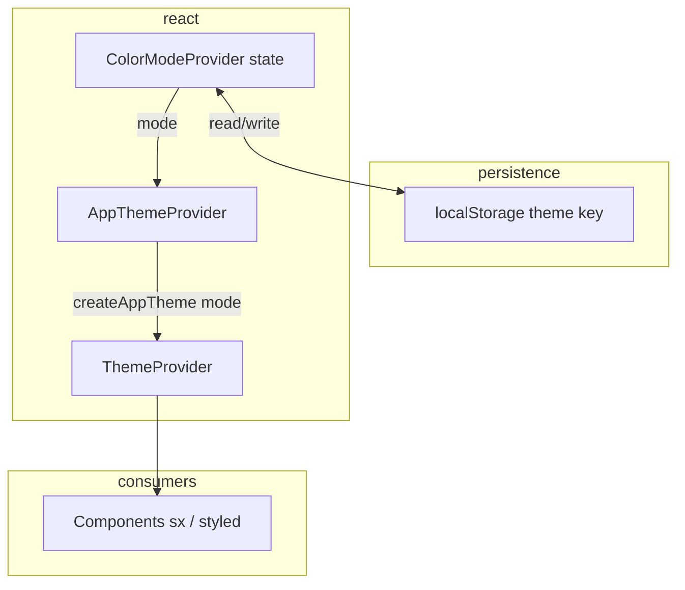

# Plan: Light & dark theme (MUI, centralized tokens)

## 1. Title & summary

Add **user-selectable light and dark appearance** to the React (Vite + MUI) frontend while **preserving the current light theme exactly** as the default. Centralize **all mode-specific colors** in the existing `frontend/src/theme/` module: one **color-mode controller** (context + persistence) drives `createTheme`, and components consume **`theme.palette` / semantic `sx` tokens**—not per-file hex overrides. Success means toggling dark mode updates **shell, buttons, chat, markdown tables, dialogs, and dashboards** without visual regressions in light mode, with **no flash of wrong theme** on reload when a preference is saved, and tests remaining green.

## 2. Type & scope

| | |
|--|--|
| **Type** | Feature (UX) + enhancement (design system hygiene) |
| **Primary surface** | Frontend only |

**In scope**

- Light palette **unchanged** (extract current `palette` from `frontend/src/theme/palette.ts` into a dedicated light module; behavior and values match today).
- Dark palette: `mode: "dark"` with tuned `background`, `text`, `divider`, `primary` / `secondary` (and semantic / action colors) for WCAG-ish contrast on dark surfaces.
- **Single switch point**: React context holding `PaletteMode` (`"light" \| "dark"`), `setMode` / `toggleMode`, and **persistence** (`localStorage`, stable key).
- **Optional default**: respect `prefers-color-scheme` when no stored value (product choice; default can stay **light-only** to match “current app is light”—document the decision in implementation).
- **Semantic surface tokens** (palette extension) for areas that incorrectly use **`grey[50]` / `grey[100]`** (fixed grey ramp does not “invert” in MUI dark mode).
- Theme toggle **UI** in a **shared chrome** location (patient `Header` and doctor layout header/toolbar pattern—same control or shared component).
- `index.html` / global: **`color-scheme`** on `html` or `body` aligned with active mode (native scrollbars, form controls); remove or replace ineffective **`bg-gray-50`** classes (Tailwind is not configured—classes are inert but confuse future work).
- **Test utilities**: `renderWithProviders` / `renderWithTheme` wrap the same providers as production so `useTheme()` sees the active mode.

**Out of scope**

- Backend API or user profile persistence of theme (can be a follow-up).
- Third-party embeds (e.g. PDF viewers) beyond best-effort parent background.
- Full **CssVarsProvider** migration (optional future; not required for shipping dark mode with `ThemeProvider` + `createTheme`).

## 3. Baseline (what exists today)

- **Stack**: MUI 9 + Emotion; styling via `sx`, component overrides under `frontend/src/theme/components/`, central `appTheme` from `frontend/src/theme/index.ts`.
- **Provider**: `AppThemeProvider` (`frontend/src/providers/AppThemeProvider.tsx`) wraps `ThemeProvider` with a **static** `appTheme` and `CssBaseline` + `GlobalStyles` (tablet sidebar rail).
- **Entry**: `frontend/src/main.tsx` — Redux `Provider` → `AppThemeProvider` → `App`.
- **Colors**: `frontend/src/theme/palette.ts` defines `mode: "light"` and the full palette; this is the **authoritative light theme** to preserve.
- **Most UI** already uses semantic tokens (`background.paper`, `text.primary`, `divider`, `alpha(..., )`), which respond well to `createTheme({ palette: { mode: "dark", ... } })`.
- **Problem spots** (do **not** work for dark without changes): explicit **`theme.palette.grey[50]`**, **`"grey.50"` / `"grey.100"`** in `sx` — MUI’s grey scale stays light-centric; see §5–7.

**Key files**

| Area | Path |
|------|------|
| Theme assembly | `frontend/src/theme/index.ts`, `palette.ts`, `typography.ts`, `shape.ts`, `components/` |
| Provider | `frontend/src/providers/AppThemeProvider.tsx` |
| Chat bubbles | `frontend/src/theme/chatMessages.ts` |
| Markdown | `frontend/src/ui/Markdown.tsx` |
| Doctor chat sidebar | `frontend/src/components/doctor/chat/ChatSessionSidebar.tsx` |
| Landing | `frontend/src/pages/LandingPage.tsx` |
| Dashboard | `frontend/src/components/dashboard/LabResultsCard.tsx` |
| Doctor profile | `frontend/src/components/doctor/profile/DoctorEducationEditor.tsx` |
| Tests | `frontend/src/test-utils/renderWithProviders.tsx` |
| HTML shell | `frontend/index.html` |

## 4. Prior art & strategy

### Industry / MUI standard

- **MUI dark mode**: Build **two** theme objects (or one factory `createAppTheme(mode)`) with `palette.mode` set appropriately; pass the result to `ThemeProvider`. Official docs: [Dark mode](https://mui.com/material-ui/customization/dark-mode/) (pattern: store mode in React state + `localStorage`).
- **Avoid scattering**: Do not add `darkMode ? "#fff" : "#000"` in dozens of components; use **palette + optional `palette` augmentation** for semantic names (`surface`, `overlay`).

### This repo vs proposed approach

| Approach | Assessment |
|----------|------------|
| **Keep** single `createTheme` in `theme/index.ts` exporting one static `appTheme` | Fine for light-only; **insufficient** for runtime switching—replace with **`createAppTheme(mode)`** (or equivalent) and memoized theme in provider. |
| **Per-component** theme branches | Rejected: violates “one point of control” and rots quickly. |
| **Extend palette** with `surface` / `overlay` tokens | **Recommended**: mirrors how `background` / `action` work; replaces unsafe `grey[50]` usage (maps to §7). |
| **Tailwind dark:** | **Not used** (no `tailwind.config`); `index.html` `bg-gray-50` is misleading—clean up (§6). |
| **Redux for theme** | Possible but unnecessary; **React context** next to `AppThemeProvider` is simpler and matches MUI examples unless global state must observe theme. |

**Decision:** **Context + `localStorage` + `createAppTheme("light" \| "dark")`**, preserve light palette module as-is, add dark palette module, extend palette for **semantic surfaces**, audit and replace **grey-fixed** usages.

## 5. Target architecture

- **`ColorModeProvider`**: Holds `mode`, exposes `setMode`, `toggleMode`; on change updates `localStorage` and optionally `document.documentElement.style.colorScheme`.
- **`AppThemeProvider`**: `useMemo(() => createAppTheme(mode), [mode])`, passes theme to `ThemeProvider`; keeps `CssBaseline`, `GlobalStyles` (rail styles already use `theme` callback—compatible).
- **Components**: Continue using `sx={{ bgcolor: "background.paper" }}` etc.; **replace** only the known `grey[50]`/fixed-grey call sites with **`surface.*` or `action`/alpha patterns** defined in both palettes.

## 6. Directory & file plan

| Path | Purpose | New / modify |
|------|---------|--------------|
| `frontend/src/theme/paletteLight.ts` | Current light palette (move from `palette.ts` verbatim) | New (or rename `palette.ts` → this) |
| `frontend/src/theme/paletteDark.ts` | Dark `PaletteOptions` (`mode: "dark"`, backgrounds, text, adjusted primary/secondary if needed) | New |
| `frontend/src/theme/createAppTheme.ts` | `createTheme({ palette: mode === "light" ? light : dark, typography, shape, components, breakpoints })` | New |
| `frontend/src/theme/index.ts` | Export `createAppTheme`, types; **deprecate** static `appTheme` export or keep `appTheme` as `createAppTheme("light")` for rare non-React imports | Modify |
| `frontend/src/theme/augmentation.d.ts` | Extend `Palette` / `PaletteOptions` with `surface: { subtle, muted, elevated }` (names TBD during impl.) | Modify |
| `frontend/src/contexts/ColorModeContext.tsx` | Context, provider, `useColorMode`, hydration-safe init | New |
| `frontend/src/providers/AppThemeProvider.tsx` | Consume `useColorMode`, pass dynamic theme | Modify |
| `frontend/src/main.tsx` | Wrap: `ColorModeProvider` **outside** `AppThemeProvider` | Modify |
| `frontend/src/components/ThemeToggleButton.tsx` (or under `ui/`) | Icon toggle (e.g. Sun/Moon from `lucide-react`) | New |
| `frontend/src/components/Header.tsx` | Add toggle (patient portal) | Modify |
| `frontend/src/layouts/DoctorLayout.tsx` or shared doctor header | Same toggle | Modify |
| `frontend/src/theme/chatMessages.ts` | Use `surface` / theme tokens instead of `grey[50]` | Modify |
| `frontend/src/ui/Markdown.tsx` | Replace `grey.50` / `grey.100` table/code surfaces | Modify |
| `frontend/src/components/doctor/chat/ChatSessionSidebar.tsx` | Replace `grey.50` | Modify |
| `frontend/src/pages/LandingPage.tsx`, `LabResultsCard.tsx`, `DoctorEducationEditor.tsx` | Replace `alpha(grey[...])` with semantic overlay tokens where appropriate | Modify |
| `frontend/index.html` | Remove bogus Tailwind classes; optional `meta name="theme-color"` | Modify |
| `frontend/src/test-utils/renderWithProviders.tsx` | Wrap with `ColorModeProvider` + dynamic theme path | Modify |
| `frontend/CLAUDE.md` | Document color mode + theme folder | Modify (short) |

## 7. API / data

- **No REST API** for this feature in v1.
- **Persistence**: `localStorage` key e.g. `prescribe-color-mode` with values `"light"` \| `"dark"` (string must match `PaletteMode`).
- **Casing**: N/A (frontend-only); no snake_case boundary.

## 8. Edge cases & failure handling

| Case | Handling |
|------|----------|
| **Invalid / missing `localStorage` value** | Fall back to `"light"` (preserves today’s default) or documented `prefers-color-scheme` if product enables it. |
| **SSR** | Not applicable (Vite SPA); if SSR added later, persist mode in cookie + server theme. |
| **Flash of light theme before dark loads** | Optional: inline script in `index.html` reads `localStorage` and sets `data-theme` / `class` on `<html>` before React (Phase 4 Notes); or accept minor flash in v1. |
| **`grey[n]` in MUI dark mode** | Numeric grey stays light; **do not** rely on `grey.50` for “subtle background”—use **`surface` tokens** or `background.paper` / `action.selectedOpacity` patterns. |
| **Lucide icons** | Use `color: "text.primary"` / `inherit` on parent; avoid fixed hex on icons. |
| **DevIdentityBanner** | Uses `warning.light`; verify contrast in dark palette (tune `warning` dark variant). |
| **PDF / iframe** | Out of scope; page chrome still themes. |
| **Concurrent tabs** | `storage` event can sync mode across tabs (optional enhancement). |

## 9. Testing strategy

- **Unit / component (Vitest + RTL)**  
  - `ColorModeContext`: toggling updates context; persistence mocked `localStorage`.  
  - Optional: snapshot or smoke test that `createAppTheme("dark").palette.mode === "dark"`.
- **Regression**  
  - Existing tests use `renderWithProviders` — after wrapping **ColorModeProvider**, run `npm run test:run`; fix any tests that assumed single static theme.
- **Manual**  
  - Patient: dashboard, chat, documents, profile, landing (logged out).  
  - Doctor: dashboard, chat (session sidebar + bubbles), patient detail.  
  - Toggle repeatedly; refresh with each mode saved.
- **Flake avoidance**  
  - Do not depend on animation timing; mock `localStorage` deterministically in tests.

## 10. Risks & rollback

| Risk | Mitigation |
|------|------------|
| Missed `grey.*` / hardcoded color | Grep audit (`grey.`, `palette.grey`) before merge; checklist in Phase 5. |
| Poor dark contrast | Tune `paletteDark` + button `contrastText`; spot-check primary/secondary on `background.paper`. |
| Provider order bugs | Document: `ColorModeProvider` → `AppThemeProvider` → app. |
| **Rollback** | Revert provider wiring + toggle UI; keep `paletteLight` as default export if needed. Feature is frontend-only—safe revert. |

---

## 11. Implementation phases (detailed)

### Implementation order overview

1. Phase 1 — Theme factory & palettes (light preserved, dark added, semantic tokens)
2. Phase 2 — Color mode context & provider wiring
3. Phase 3 — Replace non-theme-safe greys & overlays
4. Phase 4 — Toggle UI, HTML shell, polish & a11y
5. Phase 5 — Tests, audit pass, documentation

---

### Phase 1 — Theme factory & palettes

| | |
|--|--|
| **Goal** | Introduce `createAppTheme(mode)` with **byte-identical light output** to current `appTheme`, plus a coherent **dark** palette and **palette augmentation** for semantic surfaces used by chat/markdown. |
| **Prerequisites** | None. |
| **Scope** | Theme files only; do not wire context yet (theme can default to `createAppTheme("light")` from `index.ts` for interim build). **Deferred:** runtime switching (Phase 2). |

**Tasks**

1. Move current `palette` object to `theme/paletteLight.ts` (or rename `palette.ts` → `paletteLight.ts`) with **no value changes** — maps to success criterion “light unchanged.”
2. Add `theme/paletteDark.ts` with `mode: "dark"`, `background.default` / `paper`, `text`, `divider`, `primary`/`secondary` (adjust if contrast fails on dark `paper`), `action`, `error`/`warning`/etc.
3. Extend `augmentation.d.ts` with `surface: { subtle: string; muted: string; elevated?: string }` (or minimal set) on `Palette` + `PaletteOptions`.
4. Populate **`surface`** in both `paletteLight` and `paletteDark` (light: subtle ≈ former grey[50] usage; dark: elevated neutral, e.g. slightly above `background.default`).
5. Implement `createAppTheme.ts` importing typography, shape, components, breakpoints from existing modules; merge `palette: isLight ? paletteLight : paletteDark`.
6. Export from `theme/index.ts`; ensure `AppThemeProvider` still works if temporarily switched to `createAppTheme("light")` only.

**Deliverables** | New/modified files in §6 Phase 1 rows; `npm run build` succeeds.

**Verification** | `npm run build` (frontend); visual spot-check that app still looks identical in light when wired to `createAppTheme("light")`.

**Notes** | Compare generated theme for light vs old `appTheme` via shallow diff or Storybook-less manual check of key `palette` fields.

---

### Phase 2 — Color mode context & provider wiring

| **Goal** | Single source of truth for `"light" \| "dark"` with **persistence** and correct **provider nesting**. |

| **Prerequisites** | Phase 1 complete (`createAppTheme`). |

| **Scope** | Context + `main.tsx` + `AppThemeProvider` + test utils. **Deferred:** toggle button UI (Phase 4). |

**Tasks**

1. Implement `ColorModeContext.tsx`: state `mode`, `setMode`, `toggleMode`; initialize from `localStorage` in `useEffect` or lazy init pattern; write on change.
2. Update `AppThemeProvider` to `useColorMode()` and `useMemo(() => createAppTheme(mode), [mode])`.
3. Wrap tree in `main.tsx`: `ColorModeProvider` **outside** `AppThemeProvider`.
4. Update `renderWithProviders` / `renderWithTheme` to include `ColorModeProvider` (default `light` for test stability).

**Deliverables** | Persisted mode survives refresh; React DevTools shows `mode` updates (temporary `setMode` in console or throwaway button OK for verification).

**Verification** | `npm run test:run`; manual: set `localStorage`, reload, confirm theme class/mode (inspect `theme.palette.mode` via devtools or temporary log).

**Notes** | If flash is unacceptable, stub Phase 4 early with a minimal inline script (optional).

---

### Phase 3 — Replace non-theme-safe greys & overlays

| **Goal** | All known surfaces use **semantic tokens** or theme-aware `alpha` so **dark mode** matches design intent. |

| **Prerequisites** | Phase 2 (dynamic theme available). |

| **Scope** | Files listed in §6; grep-driven cleanup. **Deferred:** optional `storage` sync event. |

**Tasks**

1. `theme/chatMessages.ts`: replace `theme.palette.grey[50]` and `"grey.50"` in `chatAssistantStatusBubbleSx` with `theme.palette.surface.subtle` (or `background.paper` if token merged).
2. `ui/Markdown.tsx`: code blocks / table / thead backgrounds — use `surface.muted` / `surface.subtle` instead of `grey.100` / `grey.50`.
3. `ChatSessionSidebar.tsx`: sidebar strip `grey.50` → `surface.subtle` or `background.default` per design.
4. `LandingPage.tsx`, `LabResultsCard.tsx`, `DoctorEducationEditor.tsx`: replace `alpha(grey[500], …)` / `grey[100]` with **`alpha(theme.palette.text.primary, 0.08)`**-style overlays **or** dedicated `palette.overlay` token if contrast is cleaner—document choice in code comments only if non-obvious.
5. Re-grep `grey.` and `palette.grey` in `src/`; fix stragglers.

**Deliverables** | No remaining `grey.50` / `grey.100` for “background fill” semantics in listed areas; grep clean or explicitly justified.

**Verification** | Toggle dark mode on chat + landing + dashboard; no illegible text or near-white-on-white blobs.

**Notes** | Maps to edge case §8.3.

---

### Phase 4 — Toggle UI, HTML shell, polish

| **Goal** | Users can switch modes from the UI; document and native UI respect `color-scheme`. |

| **Prerequisites** | Phase 3. |

| **Scope** | Header(s), `index.html`, optional `theme-color` meta. |

**Tasks**

1. Add `ThemeToggleButton` using `IconButton` + `lucide-react` (Sun/Moon) with `aria-label` / `aria-pressed`.
2. Place in **patient** `Header.tsx` (toolbar end, before/after account actions per layout).
3. Add equivalent to **doctor** shell (`DoctorLayout.tsx` top bar or shared layout component—follow existing flex patterns).
4. `index.html`: remove `bg-gray-50 min-h-screen` (no Tailwind); set `body` styling defer to MUI `CssBaseline` or minimal `style`/`class` tied to theme if needed.
5. Optional: `meta name="theme-color"` content synced via small effect from `mode` (mobile browser chrome).
6. Optional: `prefers-color-scheme` listener to set default when no `localStorage` (product decision from §2).

**Deliverables** | Visible toggle on patient + doctor authenticated layouts; landing page toggle if desired (or inherit from landing header area—align with design).

**Verification** | Keyboard + screen reader spot check (`aria-label`); mobile viewport optional check.

**Notes** | Landing page may need the toggle in the hero/header row for logged-out users—include in same PR or follow-up if scope tight.

---

### Phase 5 — Tests, audit, docs

| **Goal** | Automated coverage for context + green CI; **plan reconciliation** checklist. |

| **Prerequisites** | Phases 1–4. |

| **Scope** | Tests, `frontend/CLAUDE.md` one section, final grep. |

**Tasks**

1. Add `ColorModeContext` tests (localStorage mock, toggle).
2. Run `npm run lint`, `npm run test:run`, `npm run build`.
3. Final audit: `rg 'grey\\.|palette\\.grey|#[0-9a-fA-F]{6}' frontend/src` (allowlist `theme/palette*.ts`).
4. Update `frontend/CLAUDE.md` “Styling” with color mode + file map entry for `ColorModeContext`.

**Deliverables** | Tests added; docs updated; CI commands pass.

**Verification** | All commands in §9; manual checklist §8.

**Notes** | **Final verification chat** (per `/create-plan`): `git diff` vs this plan, walk Phases 1–5 Deliverables, confirm §6 file table.

---

## Executing with Cursor chats (hint)

| Chat | Phases |
|------|--------|
| A | 1–2 (theme factory + context wiring) |
| B | 3 (grey/surface sweep) |
| C | 4–5 (toggle, HTML, tests, docs) |

Reserve a **final chat** for plan-vs-implementation diff and grep audit only.
