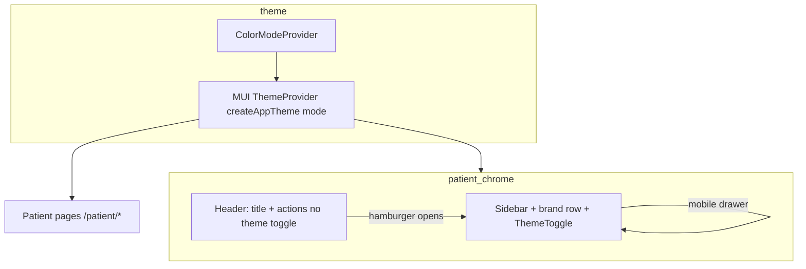

# Plan: Patient portal light/dark polish & navbar parity (doctor-aligned chrome)

## 1. Title & summary

Ensure **all patient portal surfaces** (`/patient/*`) behave correctly in **light and dark mode** using the centralized theme system from [`docs/PLAN_LIGHT_DARK_THEME.md`](./PLAN_LIGHT_DARK_THEME.md), and align **navigation chrome** with the **doctor portal**: same **sidebar brand row** structure (56px row, logo tile, title/subtitle stack, **theme toggle** on the trailing edge), and a **top app bar** whose metrics and borders match that visual system. Success means toggling dark mode across dashboard, profile, documents, doctors, meal plans, and chat shows **no unreadable text, no fixed “light only” panels**, and **one consistent place** for the theme control in the sidebar (matching `DoctorSidebar`), without regressing the existing patient **header** affordances (mobile menu, page title, account actions).

## 2. Type & scope

| | |
|--|--|
| **Type** | Enhancement (UX + design-system consistency) |
| **Primary surface** | Frontend — patient portal only |

**In scope**

- **Prerequisite assumption:** `ColorModeProvider`, `createAppTheme(mode)`, `paletteLight` / `paletteDark`, `surface.*` tokens, and `ThemeToggleButton` are **already** wired as described in `frontend/CLAUDE.md` and `PLAN_LIGHT_DARK_THEME.md`. This plan **does not** re-derive global theme architecture; it **consumes** it.
- **Patient route tree:** Everything under `paths.patient.*` in `frontend/src/router/paths.ts` rendered inside `PatientLayout` (`DashboardPage`, `ProfilePage`, `DocumentsPage`, `PatientDoctorsPage`, `PatientMealPlansPage`, `PatientMealPlanDetailPage`, `ChatPage`) plus shared chrome: `Header`, `Sidebar`, `MainContent`, and patient-specific components under `frontend/src/components/patient/`.
- **Navbar / chrome parity with doctor portal**
  - **Sidebar brand row:** Match `DoctorSidebar`’s brand row layout: `height: 56`, bottom border, flex row with logo tile + brand text + **`ThemeToggleButton`** in `ml: "auto"` (see `frontend/src/components/doctor/DoctorSidebar.tsx`).
  - **Single toggle location:** After sidebar parity, **remove** the duplicate `ThemeToggleButton` from `Header.tsx` so the **same** interaction model as the doctor portal applies (toggle lives in the drawer/sidebar shell, including mobile).
  - **Top bar:** Keep the patient **`Header`** (doctor has no global top bar) but tune **`minHeight` / padding** so it aligns with the **56px** rhythm used in sidebar brand rows and in `PatientContextBar`-style bars; preserve `maxWidth: "72rem"` centering and existing actions (log out, patient selector when not DEV, etc.).
- **Header titles:** Extend `TITLES` in `Header.tsx` so **meal plan** routes show correct page titles (today `paths.patient.mealPlans` / detail are missing).
- **Theming audit:** Grep- and manual pass over patient pages and `components/patient/*` for `grey.*`, hardcoded hex, `paper`-on-`paper` without `divider`, and **`.dark` palette keys** used as *text* on dark backgrounds (e.g. `success.dark` in badges) — tune to theme-safe patterns where contrast fails in dark mode.

**Out of scope**

- Backend persistence of theme preference (same as global plan).
- Changing **doctor** portal behavior except where a **shared** primitive is introduced (optional refactor; doctor files only touched if extracting a shared brand row).
- **Mobile menu affordance:** Doctor portal uses a **fixed FAB** for the drawer; patient keeps the **header hamburger** unless a follow-up explicitly migrates to FAB (different information architecture; call out as optional future).

## 3. Baseline (what exists today)

**Patient shell**

- `frontend/src/layouts/PatientLayout.tsx` — `Sidebar` + column with `Header` + `main` (`Outlet`). Chat route drops `MainContent` wrapper for full-height flex.
- `frontend/src/components/Sidebar.tsx` — Collapsible rail (`md`: icon-only expand on hover; `lg`: full width). Brand row has logo (`primary.main` tile) + “Patient portal” / “Health overview” **but no `ThemeToggleButton`**.
- `frontend/src/components/Header.tsx` — Top bar: mobile menu, patient name + “Patient” chip, centered page title, **`ThemeToggleButton`**, `PatientSelector` (non-DEV), log out, placeholder notifications/avatar. Uses semantic colors; **badge** uses `success.dark` on `alpha(success.main)` — verify dark-mode contrast.

**Doctor shell (reference)**

- `frontend/src/layouts/DoctorLayout.tsx` — No global `Header`; `DoctorSidebar` includes **`ThemeToggleButton`** in the brand row; optional `PatientContextBar` under `/doctor/patients/:id/*` provides secondary tabs.
- `frontend/src/components/doctor/DoctorSidebar.tsx` — Brand row + nav + **log out** in a footer section.

**Theme**

- Global tokens and `ThemeToggleButton` already documented in `frontend/CLAUDE.md` (`ColorModeProvider` → `AppThemeProvider`, `prescribe-color-mode`, `surface.*`).

**Key files**

| Area | Path |
|------|------|
| Patient layout | `frontend/src/layouts/PatientLayout.tsx` |
| Patient sidebar | `frontend/src/components/Sidebar.tsx` |
| Patient header | `frontend/src/components/Header.tsx` |
| Doctor reference | `frontend/src/components/doctor/DoctorSidebar.tsx`, `DoctorLayout.tsx` |
| Chat (patient) | `frontend/src/components/ChatPage.tsx` |
| Patient pages | `frontend/src/pages/DashboardPage.tsx`, `DocumentsPage.tsx`, `ProfilePage.tsx`, `frontend/src/pages/patient/*` |
| Patient UI sections | `frontend/src/components/patient/*` |
| Shared nav button | `frontend/src/ui/SidebarNavItemButton.tsx` |

## 4. Prior art & strategy

### Global theme (existing)

- **Strategy:** Reuse **only** `theme.palette`, `surface.*`, and `alpha(...)` — do not introduce patient-specific theme forks.

### Sidebar chrome: duplicate vs shared primitive

| Approach | Assessment |
|----------|--------------|
| **Copy** doctor brand-row JSX into `Sidebar.tsx` only | Fast, but **two copies** drift (already near-duplicate with `DoctorSidebar`). |
| **Extract** `PortalSidebarBrandRow` (or similar) in `frontend/src/ui/` | **Recommended** for “same design”: one implementation of **height, padding, border, logo tile, trailing slot**; props: `accent: "primary" \| "secondary"`, `title`, `subtitle`, `emoji` / `icon` slot, `trailing?: ReactNode` (wire `ThemeToggleButton`). |
| **Merge** patient + doctor into one `PortalSidebar` with role prop | Likely overkill; higher churn; defer unless we later unify nav item config. |

**Decision:** **Extract a small `ui` primitive** for the brand row **if** both sidebars need edits in the same PR; otherwise implement patient brand row to **match** doctor’s flex structure first, then extract in a follow-up PR to avoid scope creep.

### Header: keep vs collapse into sidebar-only chrome

| Approach | Assessment |
|----------|------------|
| **Remove** header entirely | Rejected: patient UX relies on **page title** and **mobile menu** in the top bar; doctor’s content doesn’t use this pattern. |
| **Keep** header, **remove** duplicate theme toggle | **Recommended:** matches doctor’s “toggle in sidebar” rule; mobile users open the **same drawer** as today and see the toggle in the brand row (mirrors doctor mobile). |

### Log out placement

- **Doctor:** sidebar footer. **Patient:** header button.
- **Optional later:** move patient log out to sidebar footer for full parity — **not required** for theme/navbar visual alignment; note as Phase 6 optional to avoid behavior change without product sign-off.

## 5. Target architecture

- **Single source for theme toggle** in patient portal: **sidebar brand row** (identical slot to `DoctorSidebar`).
- **Header** remains the **contextual** bar (route title, patient identity, logout, selectors).

## 6. Directory & file plan

| Path | Purpose | New / modify |
|------|---------|--------------|
| `frontend/src/ui/PortalSidebarBrandRow.tsx` | Optional shared brand row (logo tile, titles, `trailing` slot for `ThemeToggleButton`) | New (optional) |
| `frontend/src/components/Sidebar.tsx` | Add theme toggle to brand row; optionally use shared primitive | Modify |
| `frontend/src/components/doctor/DoctorSidebar.tsx` | Optionally adopt `PortalSidebarBrandRow` to prevent drift | Modify (optional) |
| `frontend/src/components/Header.tsx` | Remove `ThemeToggleButton`; fix `TITLES` for meal plans; align bar height to 56px rhythm; audit badge colors for dark | Modify |
| `frontend/src/components/ChatPage.tsx` | Align inner toolbars to same **56px** / border tokens where reasonable; ensure no second theme toggle needed | Modify (light touch) |
| `frontend/src/pages/**/*.tsx` (patient) | Only files flagged by audit | Modify as needed |
| `frontend/src/components/patient/**` | Only files flagged by audit | Modify as needed |
| `frontend/CLAUDE.md` | Note patient chrome parity (sidebar toggle, header role) | Modify (short) |

## 7. API / data

- **No REST or DB changes.**
- Theme persistence remains **`localStorage`** key `prescribe-color-mode` via `ColorModeContext` (frontend-only).
- **Casing:** N/A.

## 8. Edge cases & failure handling

| Case | Handling |
|------|----------|
| **Mobile patient** opens only header, never drawer | Theme toggle still reachable via **hamburger → drawer brand row** (same as doctor: FAB → drawer). |
| **`success.dark` / `secondary.dark` as text** on tinted backgrounds | In dark mode, `.dark` keys may be **light** tints; verify badge and sidebar selected states; use `theme.palette.getContrastText` or `text.primary` / `contrastText` where needed. |
| **Chat route** full-height layout | Ensure `Header` + chat subheaders don’t double-apply conflicting `bgcolor`; keep `divider` borders consistent. |
| **DEV double banner** | `PatientLayout` and `ChatPage` both may render `DevIdentityBanner` in dev — out of scope unless it blocks layout metrics verification. |
| **Missing route title** | Meal plan paths fall back to “Portal” today — fix in `Header.tsx` §6. |

## 9. Testing strategy

- **Vitest + RTL:** If `PortalSidebarBrandRow` is added, shallow test that it renders `trailing` and applies `height: 56` (or snapshot flex layout). Existing `renderWithProviders` must already wrap `ColorModeProvider` — confirm sidebar tests if any.
- **Manual matrix (patient):** For **light + dark**: `/patient`, `/patient/profile`, `/patient/documents`, `/patient/doctors`, `/patient/meal-plans`, `/patient/meal-plans/:id`, `/patient/chat`. Actions: open mobile drawer, toggle theme, reload with persisted mode.
- **Regression:** `npm run test:run`, `npm run lint`, `npm run build` in `frontend/`.
- **Flake avoidance:** Theme tests continue to mock `localStorage` deterministically.

## 10. Risks & rollback

| Risk | Mitigation |
|------|------------|
| Users miss theme toggle after header removal | **Verify** toggle visible in **drawer** on first mobile run; consider a one-time tooltip only if product requests (out of scope by default). |
| Shared primitive breaks doctor sidebar | Ship patient-only change first, or migrate both behind one component with visual spot-check on doctor routes. |
| Subtle contrast bugs in badges/cards | Fix forward with palette tokens; **rollback** by reverting patient-specific commits (frontend-only). |

---

## 11. Implementation phases (detailed)

### Implementation order overview

1. Phase 1 — Prerequisites & patient surface inventory  
2. Phase 2 — Sidebar brand row: theme toggle + doctor-aligned layout  
3. Phase 3 — Header: remove duplicate toggle, titles, 56px rhythm, badge contrast  
4. Phase 4 — Page- and feature-level theming audit (`pages/patient`, shared patient components)  
5. Phase 5 — Chat shell alignment & polish  
6. Phase 6 — Tests, docs, optional log-out parity  

---

### Phase 1 — Prerequisites & patient surface inventory

| | |
|--|--|
| **Goal** | Confirm global theme stack is active; list patient files that need visual or token fixes before/after chrome work. |
| **Prerequisites** | None (repo already contains color mode per `frontend/CLAUDE.md`). |
| **Scope** | Read-only inventory + grep; **no** feature code. **Deferred:** optional FAB mobile pattern. |

**Tasks**

1. Verify `frontend/src/main.tsx` nests `ColorModeProvider` outside `AppThemeProvider` and `ThemeToggleButton` works on a doctor route (sanity).
2. `rg` over `frontend/src/pages`, `frontend/src/components/patient`, `frontend/src/components/ChatPage.tsx`, `frontend/src/components/documents` for `grey\.`, `#[0-9a-fA-F]{3,8}`, and `palette\.grey` (allowlist theme files).
3. Document hits in a short checklist (spreadsheet or PR comment) mapped to Phase 4 fixes.

**Deliverables** | Inventory list; confirmation global theme works.

**Verification** | Manual: toggle dark on `/patient` and `/doctor`; `npm run build` optional smoke.

**Notes** | Maps to §8 (edge cases).

---

### Phase 2 — Sidebar brand row: theme toggle + doctor-aligned layout

| | |
|--|--|
| **Goal** | Patient **sidebar** matches **doctor** brand row behavior: **`ThemeToggleButton`** on the right, same row height and border treatment. |
| **Prerequisites** | Phase 1. |
| **Scope** | `Sidebar.tsx` (+ optional `DoctorSidebar.tsx` if extracting shared UI). **Deferred:** logout footer parity. |

**Tasks**

1. In `frontend/src/components/Sidebar.tsx` `SidebarInner` brand row: add a flex container with `ml: "auto"` holding **`ThemeToggleButton`**, mirroring `DoctorSidebar` (`frontend/src/components/doctor/DoctorSidebar.tsx` ~144–186).
2. Ensure **mobile drawer** and **desktop aside** both show the toggle (same inner component — already true for `SidebarInner`).
3. **Optional:** Extract `frontend/src/ui/PortalSidebarBrandRow.tsx` and switch **both** `Sidebar.tsx` and `DoctorSidebar.tsx` to it so future spacing changes stay synchronized (**maps to** §4 strategy).

**Deliverables** | Patient sidebar shows theme toggle in brand row; doctor unchanged or shares primitive.

**Verification** | Manual: `md` and `xs` — open drawer, toggle theme, confirm persistence across refresh.

**Notes** | Parallel-safe **only** if Phase 3 waits for merge — both touch `ThemeToggleButton` placement; sequential PRs reduce conflict.

---

### Phase 3 — Header: duplicate toggle removal, titles, rhythm, contrast

| | |
|--|--|
| **Goal** | **One** theme control in patient portal (sidebar); header aligns to **56px** visual rhythm; meal plan titles correct; badges readable in dark. |
| **Prerequisites** | Phase 2 (toggle must exist in sidebar before header removal). |
| **Scope** | `Header.tsx` only unless badge patterns repeat elsewhere. **Deferred:** avatar/notifications placeholders redesign. |

**Tasks**

1. Remove `ThemeToggleButton` import and usage from `frontend/src/components/Header.tsx`.
2. Add `paths.patient.mealPlans` (and detail route strategy: prefix match for `/patient/meal-plans`) to `TITLES` / `pageTitle` logic.
3. Set header vertical rhythm: e.g. `minHeight: 56`, adjust `py` so content centers like sidebar brand row (match `DoctorSidebar` `height: 56`).
4. Audit **“Patient”** chip: replace `color: success.dark` with a pattern that stays readable on `alpha(success.main, 0.12)` in **dark** mode (e.g. `theme.palette.success.contrastText` on `success.main`, or `text.primary` with background alpha).

**Deliverables** | Updated `Header.tsx`; no duplicate toggle; correct meal plan titles.

**Verification** | Manual: mobile + desktop header; dark mode chip legibility; navigate to meal plan list + detail — titles not “Portal”.

**Notes** | Maps to §8.2.

---

### Phase 4 — Page- and feature-level theming audit

| | |
|--|--|
| **Goal** | Patient screens have **no** light-only surfaces after Phase 1 inventory fixes. |
| **Prerequisites** | Phase 1 inventory; Phase 2–3 merged or in branch with theme toggle reachable. |
| **Scope** | Files from Phase 1 grep + `frontend/src/components/patient/**`. **Deferred:** third-party viewers. |

**Tasks**

1. Fix each inventory item: prefer `surface.*`, `background.*`, `divider`, `alpha(text.primary, …)` per `PLAN_LIGHT_DARK_THEME.md`.
2. Pay attention to **cards**, **upload** zones, and **meal plan** panels (`PatientMealPlansPage`, `PatientMealPlanDetailPage`) for borders and elevated backgrounds.
3. Re-run grep; allowlist only intentional literals in theme files.

**Deliverables** | Clean grep (or documented exceptions); consistent dark appearance on listed routes.

**Verification** | Manual pass §9 matrix; `npm run lint`.

**Notes** | Can run **in parallel** with Phase 5 after Phase 2–3 merge if developers coordinate on conflicting files (unlikely).

---

### Phase 5 — Chat shell alignment & polish

| | |
|--|--|
| **Goal** | `/patient/chat` toolbars feel like the rest of the portal under both modes (borders, heights, backgrounds). |
| **Prerequisites** | Phase 3 (header rhythm). |
| **Scope** | `frontend/src/components/ChatPage.tsx` only. **Deferred:** duplicate `DevIdentityBanner` behavior. |

**Tasks**

1. Align **non-DEV** patient selector strip and **chat header** `py` / `minHeight` with **56px** rhythm where it improves alignment with `Header`.
2. Confirm **no** theme toggle is needed here (sidebar only).
3. Quick dark-mode read on `MessageList` / `ChatInput` borders (fix only if issues found — may already be theme-driven).

**Deliverables** | `ChatPage.tsx` tweaks with no visual regression in light mode.

**Verification** | Manual: `/patient/chat` light/dark; streaming smoke optional.

---

### Phase 6 — Tests, docs, optional logout parity

| | |
|--|--|
| **Goal** | Automated coverage for any new primitive; docs updated; optional UX parity for logout. |
| **Prerequisites** | Phases 2–5. |
| **Scope** | Tests, `frontend/CLAUDE.md`; optional sidebar footer logout. |

**Tasks**

1. If `PortalSidebarBrandRow` exists: add minimal RTL test in `frontend/src/ui/__tests__/` or colocated test.
2. Update `frontend/CLAUDE.md` **Folder map** / **Styling**: patient **theme toggle in sidebar**; header responsibilities.
3. **Optional:** Move **Log out** from `Header` to `Sidebar` footer (mirror `DoctorSidebar`) — requires product/UX approval; if done, replicate footer `borderTop` + `SidebarNavItemButton` pattern.

**Deliverables** | Tests + doc touch-up; optional logout migration.

**Verification** | `npm run test:run`, `npm run lint`, `npm run build`.

**Notes** | **Final verification chat** (per `/create-plan`): `git diff` vs this doc — confirm §6 file table, §11 Deliverables, and manual §9 matrix; document any intentional deviations.

---

## Executing with Cursor chats (hint)

| Chat | Phases |
|------|--------|
| A | 1–2 (inventory + sidebar toggle / optional primitive) |
| B | 3–4 (header + page audit) |
| C | 5–6 (chat polish + tests/docs/optional logout) |

Reserve a **final chat** for plan-vs-implementation diff and the patient route manual matrix only.
