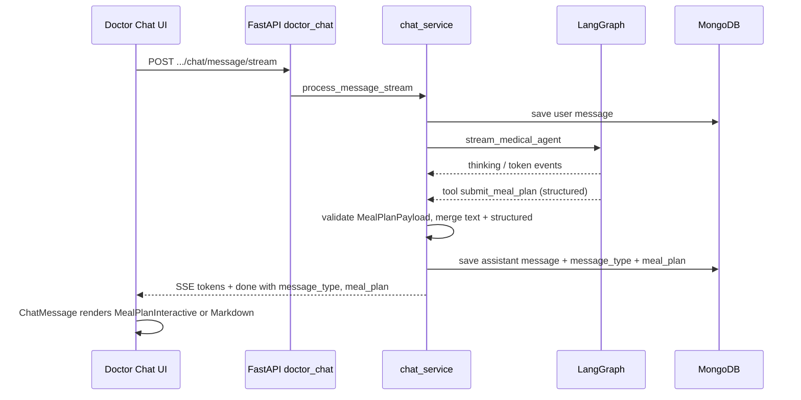

# AI meal plan generation in doctor chat

## 1. Title & summary

Doctors can ask the medical AI to generate a **personalized meal plan** for the selected patient. The agent uses the patient’s profile and health context (via existing record lookup) and returns a **structured meal plan** with a **default horizon of 7 days** unless the doctor specifies another number of days in the prompt. The backend exposes a **`message_type` field** on chat responses and history so the frontend can render this turn as **interactive UI** (not only Markdown). Success means: validated structured payloads round-trip through non-streaming and streaming APIs, persist in MongoDB, reload correctly from history, and the doctor chat shows a **polished, accessible, interactive** meal-plan experience aligned with the app’s MUI theme.

## 2. Type & scope

| | |
|--|--|
| **Type** | Feature (full-stack: AI + API + doctor chat UI) |
| **Primary surface** | Doctor portal — `/doctor/patients/:patientId/chat` (same stack as [`PLAN_DOCTOR_AI_CHAT.md`](./PLAN_DOCTOR_AI_CHAT.md)) |

**In scope**

- Backend: LangGraph tool + prompts to produce a **schema-validated** meal plan; optional extraction of **day count** from user text with **default 7**.
- Persistence: `chat_messages` (and API DTOs) gain **`message_type`** and optional **`meal_plan`** payload; **snake_case** JSON per [`FRONTEND_BACKEND_COLLABORATION.md`](../../FRONTEND_BACKEND_COLLABORATION.md).
- Streaming: extend SSE so the client receives structured data **deterministically** (see §5–7).
- Frontend: extend `Message` / `ChatMessage` to branch on `message_type`; new **interactive** meal-plan component(s) using existing **MUI + theme** patterns (`frontend/src/theme/`, `ChatMessage` bubble layout).

**Out of scope (unless later explicitly added)**

- Patient-facing meal plans (patient chat could reuse the same API fields later; not required for this feature).
- Saving meal plans as standalone prescriptions or PDF export (can be a follow-up).
- Nutrition API integrations (USDA, etc.) — plan may include **estimated** macros as text fields only.
- Regulatory/compliance sign-off; UI will include a standard **educational / not a substitute for professional dietary counseling** disclaimer.

## 3. Baseline (current behavior)

- **Doctor chat** uses `process_doctor_message` → `chat_service.process_message` / `process_message_stream` with `doctor_id` and connection checks (`backend/app/service/doctor_chat.py`, `backend/app/service/chat.py`).
- **AI** runs LangGraph with tools `search_patient_records` and `web_search` (`backend/app/ai/graph.py`, `backend/app/ai/tools.py`). Assistant output is **plain text** streamed as `token` events; final text is saved as `role` + `content` only (`backend/app/repository/chat.py` `save_message`).
- **API**: `ChatResponse` is `{ message, chat_id, message_id, chat_title? }`; `MessageSchema` / history are `{ role, content, timestamp }` (`backend/app/schemas/chat.py`).
- **Frontend**: `Message` in `frontend/src/types/chat.ts` is text-centric; `ChatMessage.tsx` renders assistant content with `Markdown` (`frontend/src/ui/Markdown.tsx`). Doctor streaming uses `sendDoctorChatMessageStream` + `useDoctorChat` (`frontend/src/api/chatStream.ts`, `frontend/src/hooks/useDoctorChat.ts`).

There is **no** `message_type` or structured assistant payload today (`grep` shows no prior `message_type`).

## 4. Prior art & strategy

| Approach | Pros | Cons |
|----------|------|------|
| **A. Only Markdown tables in assistant text** | No API change | Fragile parsing, no real interactivity, poor history fidelity |
| **B. LLM emits JSON in assistant text; client parses** | Simple wire format | brittle, easy to break with model drift |
| **C. LangChain tool with Pydantic schema (`submit_meal_plan`) + persistence from tool output** | Validated structure, one source of truth, fits existing ToolNode graph | Requires graph/stream pipeline to **capture** tool result and merge with final narrative text |

**Recommendation:** **C**, aligned with existing LangGraph + `ToolNode` patterns in `graph.py`. Extend `TOOLS` with a **structured tool** whose arguments (or return value) match a **single Pydantic model** `MealPlanPayload`. After each turn, the service layer **extracts** the meal plan from graph state or tool events (see §5), validates, persists, and returns `message_type` / `meal_plan`.

**Comparison to existing doctor chat plan:** [`PLAN_DOCTOR_AI_CHAT.md`](./PLAN_DOCTOR_AI_CHAT.md) established connection-gated routes and `doctor_id` on sessions. This feature **does not replace** that design; it **adds** structured message types and AI tooling on top of the same `chat_service` path.

**Patient chat:** The same `chat_service` functions power patient chat; implementing tool + persistence once keeps behavior consistent. Product scope here is **doctor-initiated** meal planning; gating **which prompts** trigger the tool is done via **system prompt** (doctor context) rather than a second codebase path.

## 5. Target architecture

**Design choices**

1. **Structured tool** `submit_meal_plan` (name TBD but stable for tests): inputs include `num_days` (default **7**, cap e.g. **14** in schema), and nested **days → meals** (breakfast/lunch/dinner/snacks as needed), optional **notes**, **dietary considerations** referencing profile.
2. **Assistant narrative:** The model still produces user-facing prose after the tool (summary, warnings). **`content`** stored in MongoDB remains human-readable text (Markdown-friendly). **`meal_plan`** holds the machine-readable object for the UI.
3. **Streaming:** Continue streaming **tokens** for the final assistant message. **Additionally**, emit structured data once the tool has completed:
   - **Preferred:** extend the final **`done`** SSE payload with `message_type` and `meal_plan` (and keep `chat_id`, `message_id`), so the client attaches metadata when the stream finishes.
   - **Optional:** add a **`structured`** SSE event (single fire) if you want the UI to show the interactive card **before** `done`; then `done` must still repeat ids for backward compatibility. Pick **one** approach in implementation to avoid duplicate handling.
4. **Non-streaming:** `ChatResponse` includes `message_type` and optional `meal_plan` (same shapes as history).

## 6. Directory & file plan

| Path | Purpose | New / modify |
|------|---------|--------------|
| `backend/app/schemas/meal_plan.py` (or under `schemas/chat.py`) | Pydantic `MealPlanPayload`, enums, validation (day count bounds) | New |
| `backend/app/schemas/chat.py` | Extend `ChatResponse`, `MessageSchema` with `message_type`, `meal_plan` | Modify |
| `backend/app/ai/tools.py` | Add `submit_meal_plan` tool; register in `TOOLS` | Modify |
| `backend/app/ai/prompts.py` | Doctor/patient system prompt additions: when to call tool, default 7 days, safety language | Modify |
| `backend/app/ai/graph.py` | Register tool; optionally `_TOOL_THINKING_UI` entry; **capture** structured output from stream or final state | Modify |
| `backend/app/ai/meal_plan_extract.py` (optional) | Pure functions: extract `MealPlanPayload` from graph result / events | New (if extraction is non-trivial) |
| `backend/app/repository/chat.py` | `save_message(..., message_type=..., meal_plan=...)`; `get_messages` projection | Modify |
| `backend/app/service/chat.py` | `process_message`, `process_message_stream`, `get_chat_history`: wire extraction, persistence, SSE | Modify |
| `backend/tests/test_meal_plan_tool.py` or extend `test_api_chat.py` | Unit/integration tests for schema, API, persistence | New / modify |
| `frontend/src/types/chat.ts` | `message_type`, `meal_plan` on `Message` and `ChatResponse` | Modify |
| `frontend/src/types/mealPlan.ts` | TypeScript types mirroring backend payload (snake_case) | New |
| `frontend/src/api/chatStream.ts` | Parse extended `done` (and optional `structured`) | Modify |
| `frontend/src/hooks/useDoctorChat.ts` | Attach `meal_plan` / `message_type` on last assistant message; history mapping | Modify |
| `frontend/src/components/ChatMessage.tsx` | Branch: meal plan vs Markdown | Modify |
| `frontend/src/components/chat/MealPlanMessage.tsx` (or `meal-plan/`) | Interactive UI: day tabs/accordion, meal rows, expand/collapse, disclaimer | New |
| `frontend/src/theme/chatMessages.ts` | Optional tokens for meal-plan card surfaces | Modify (light touch) |
| `docs/FRONTEND_BACKEND_COLLABORATION.md` | Document new fields and SSE | Modify |

## 7. API / data

**JSON casing:** API remains **snake_case** (`message_type`, `meal_plan`, nested fields snake_case).

**Suggested `message_type` values:** `"text"` (default) | `"meal_plan"` (extensible later, e.g. `"workout_plan"`).

**`meal_plan` shape (illustrative — finalize in Pydantic):**

- `num_days: number`
- `days: array` of `{ day_index: number, label?: string, meals: array of { name: string, description: string, items?: string[] } }`
- `summary: string` (short)
- `disclaimer: string` (or fixed string from backend constant + optional model note)

**Endpoints affected (same URLs, richer bodies):**

- `POST /api/doctors/{doctor_id}/patients/{patient_id}/chat/message`
- `POST /api/doctors/{doctor_id}/patients/{patient_id}/chat/message/stream`
- `GET /api/doctors/{doctor_id}/chat/history/{chat_id}`

**Patient parity (optional same release):** `POST /api/chat/message`, `/stream`, `GET /api/chat/history/{chat_id}` — same response fields if the same service functions are used.

**MongoDB `chat_messages` document (additive fields):**

- `message_type: str` — default `"text"` for legacy rows
- `meal_plan: object | null` — omit or null for text-only messages

No migration strictly required if code treats missing fields as `"text"` / null; optional one-time backfill not needed.

## 8. Edge cases & failure handling

| Scenario | Handling |
|----------|----------|
| Model calls tool with invalid / partial JSON | Pydantic validation fails → log; persist assistant as `message_type: "text"` only; optional user-visible “couldn’t structure meal plan” line |
| Model never calls `submit_meal_plan` but user asked for a plan | Rely on prompt; fallback text-only response; no `meal_plan` |
| User asks for > max days | Schema clamps or rejects tool args; prompt instructs model to clamp to max (e.g. 14) |
| Empty profile / `search_patient_records` miss | Tool + prompt still produce conservative generic plan + explicit caveat in prose |
| Stream ends with tokens but tool output lost | Extraction must run from **checkpointed graph state** after stream if event capture misses (mitigation: single extraction path tested) |
| History load: old messages | `message_type` absent → treat as `text` |
| Concurrent sessions | No shared mutable state; per-turn extraction only |

## 9. Testing strategy

**Backend (pytest in Docker — mandatory per root `CLAUDE.md`):**

- Unit tests for `MealPlanPayload` validation (bounds on `num_days`, required day entries).
- Tool invocation test with mocked LLM or fixed graph fixture if feasible.
- API test: doctor chat non-streaming returns `message_type` + `meal_plan` when tool path is simulated or stubbed.
- Repository test: `save_message` stores and `get_messages` returns nested `meal_plan`.

**Frontend (Vitest):**

- Reducer/hook: parsing `done` with `meal_plan` updates last assistant `Message`.
- Component: `ChatMessage` renders `MealPlanMessage` when `message_type === "meal_plan"` and payload present.

**E2E (Playwright, if present in repo):** optional smoke: open doctor chat, send deterministic stub (may require backend test mode) — only if project already has E2E for chat.

**Flakiness:** Do not assert on real LLM content; use **stubs/mocks** for structure. SSE tests should parse multi-event streams deterministically.

## 10. Risks & rollback

| Risk | Mitigation | Rollback |
|------|------------|----------|
| LLM inconsistently uses tool | Strong prompt + tool description; optional **required** tool pattern only if product allows forced flow | Feature flag `MEAL_PLAN_TOOL_ENABLED` in settings (optional) |
| Larger MongoDB documents | Cap list sizes in schema; reject oversized payloads | Disable tool via flag |
| UI clutter in chat | Collapsible by day; compact density; respects `prefers-reduced-motion` | Render as Markdown fallback if `meal_plan` missing |
| API breaking clients | New fields are **additive**; old clients ignore unknown fields | Remove fields only behind version bump (not planned here) |

## 11. Implementation phases (detailed)

**Implementation order overview**

1. Phase 1 — Schema & persistence foundation  
2. Phase 2 — AI tool, prompts, extraction pipeline  
3. Phase 3 — Service layer: non-streaming + history  
4. Phase 4 — Streaming: SSE `done` (or `structured`) + `useDoctorChat`  
5. Phase 5 — Frontend: types, `ChatMessage` branch, interactive meal-plan UI  
6. Phase 6 — Tests, docs, verification  

---

### Phase 1 — Schema & persistence foundation

| | |
|--|--|
| **Goal** | Persist and return optional structured meal plans without changing AI behavior yet. |
| **Prerequisites** | None |
| **Scope** | Pydantic models, MongoDB write/read shape, default `message_type` for legacy docs. **Deferred:** tool implementation (Phase 2). |
| **Tasks** | 1. Add `MealPlanPayload` (and nested models) with `num_days` default **7** and upper bound. 2. Extend `ChatResponse` / `MessageSchema` with `message_type: str = "text"` and `meal_plan: MealPlanPayload \| None = None`. 3. Update `save_message` / `get_messages` to read/write optional fields. 4. Ensure `get_chat_history` maps Mongo docs to `MessageSchema`. |
| **Deliverables** | New/updated schema files; repository changes; types compile; existing tests pass. |
| **Verification** | `docker compose exec backend python -m pytest tests/ -v` (no new AI tests required yet). |
| **Notes** | Keep DB backward compatible (missing fields OK). |

---

### Phase 2 — AI tool, prompts, extraction pipeline

| | |
|--|--|
| **Goal** | Model can emit a validated structured meal plan via a dedicated tool; extraction logic is testable in isolation. |
| **Prerequisites** | Phase 1 |
| **Scope** | Tool + prompt text + extraction from graph result or stream events. **Deferred:** wiring to HTTP responses (Phase 3–4). |
| **Tasks** | 1. Implement `submit_meal_plan` in `tools.py` with Pydantic args schema; tool body returns a short string for the LLM (e.g. confirmation). 2. Add tool to `TOOLS` in `graph.py`; add thinking labels in `_TOOL_THINKING_UI`. 3. Update `prompts.py` for **doctor** context: instruct use of patient tools first, then meal plan tool; **default 7 days** if user does not specify; medical disclaimer guidance. 4. Implement `extract_meal_plan_from_state` (or equivalent) from completed `invoke_medical_agent` result — scan `messages` for tool result / `submit_meal_plan`. 5. Unit tests for extraction with **fixture** message lists. |
| **Deliverables** | Tool registered; prompts updated; extraction module + tests. |
| **Verification** | Pytest for extraction and schema; optional manual `invoke_medical_agent` in dev with doctor prompt (non-streaming). |
| **Notes** | Maps to edge case §8 (validation failure → text-only). |

---

### Phase 3 — Service layer: non-streaming + history

| | |
|--|--|
| **Goal** | `process_message` returns `message_type` / `meal_plan` when extraction succeeds; history API returns them for reload. |
| **Prerequisites** | Phases 1–2 |
| **Scope** | `chat_service.process_message`, `get_chat_history`; doctor endpoints inherit via same service. **Deferred:** streaming. |
| **Tasks** | 1. After `invoke_medical_agent`, run extraction; set `message_type` to `meal_plan` when payload present. 2. Pass structured fields to `save_message`. 3. Populate `ChatResponse` accordingly. 4. Extend API/OpenAPI implicitly via Pydantic models. 5. Add focused API test (stub graph or fixture if project pattern allows). |
| **Deliverables** | Non-streaming doctor + patient endpoints return new fields; Mongo rows contain `meal_plan` when applicable. |
| **Verification** | Pytest; manual `POST` non-streaming with dev stack. |
| **Notes** | Maps to API §7. |

---

### Phase 4 — Streaming: SSE + doctor hook

| | |
|--|--|
| **Goal** | Streaming clients receive structured metadata on completion without breaking existing parsers. |
| **Prerequisites** | Phase 3 |
| **Scope** | `process_message_stream`, `stream_medical_agent` integration, `chatStream.ts`, `useDoctorChat.ts`. |
| **Tasks** | 1. After full assistant text collected, run same extraction as non-streaming (from final graph state **or** captured `on_tool_end` — choose one consistent method in code). 2. Persist `message_type` / `meal_plan` with final `save_message`. 3. Extend **`done`** event JSON: `chat_id`, `message_id`, `message_type`, `meal_plan` (omit `meal_plan` key if null). 4. Update `consumeSseStream` to parse new fields. 5. In `useDoctorChat`, on `onDone`, merge into last assistant message. 6. Ensure `onChatTitle` / invalidation unchanged. |
| **Deliverables** | Doctor streaming path end-to-end with structured `done`. |
| **Verification** | Manual doctor chat streaming; unit test for SSE parser with sample stream string. |
| **Notes** | **Flaky-prone:** race between last token and `done` — ensure `done` handler applies **after** token buffer flush (maps to §9). Patient `useChat` may be updated in same phase if product wants parity. |

---

### Phase 5 — Frontend: interactive meal-plan UI

| | |
|--|--|
| **Goal** | Doctors see a **smooth, interactive** meal plan inside the chat bubble with clear hierarchy, motion-safe transitions, and theme alignment. |
| **Prerequisites** | Phase 4 (or Phase 3 + non-streaming only for partial demo — prefer Phase 4). |
| **Scope** | New presentational component(s), `ChatMessage` branch, theme tweaks. **Deferred:** export/print. |
| **Tasks** | 1. Add `frontend/src/types/mealPlan.ts` mirroring backend. 2. Extend `Message` with `message_type?`, `meal_plan?`. 3. Build `MealPlanMessage`: e.g. **MUI** `Accordion` or **Tabs** per day, `Card` per meal, subtle elevation, typography from theme; **expand/collapse** for long lists; optional **sticky** day selector on narrow viewports. 4. Respect **`prefers-reduced-motion`** (match `index.css` / theme patterns). 5. Include visible **disclaimer** (educational use). 6. `ChatMessage` memo comparator includes new fields. 7. History load path maps API messages into `Message` with structured payload. |
| **Deliverables** | Polished UI inside assistant bubble; no raw JSON visible to users. |
| **Verification** | Visual review on doctor chat; Vitest for branching; `npm run test:run` as applicable. |
| **Notes** | Prior art: `ChatMessage` bubble + `Markdown` — new branch should reuse `chatMessageBubbleSx` for outer container consistency. |

---

### Phase 6 — Tests, docs, final verification

| | |
|--|--|
| **Goal** | Contract documented; automated tests cover critical paths; ready for review. |
| **Prerequisites** | Phases 1–5 |
| **Scope** | Documentation, any missing tests, `FRONTEND_BACKEND_COLLABORATION.md` SSE examples. |
| **Tasks** | 1. Update `docs/FRONTEND_BACKEND_COLLABORATION.md`: `ChatResponse` / `MessageSchema`, SSE `done` shape. 2. Add/adjust backend tests for doctor history GET with `meal_plan`. 3. Frontend parser tests. 4. Run full backend + frontend test suites in Docker / CI as per `docs/TESTING.md`. |
| **Deliverables** | Docs + green tests. |
| **Verification** | `docker compose exec backend python -m pytest tests/ -v`; `cd frontend && npm run test:run`; optional `npm run lint`. |
| **Notes** | Final chat for human review: walk through §11 deliverables vs `git diff` (per `/create-plan` instructions). |

---

### Execution batches (Cursor chats)

| Batch | Phases | Suggested focus |
|-------|--------|-----------------|
| Chat A | 1–3 | Backend schema, persistence, tool, non-streaming |
| Chat B | 4–5 | SSE + React UI |
| Chat C | 6 | Docs + verification pass |

Adjust if Phase 5 is split between “types/hooks” and “visual polish” for reviewability.
