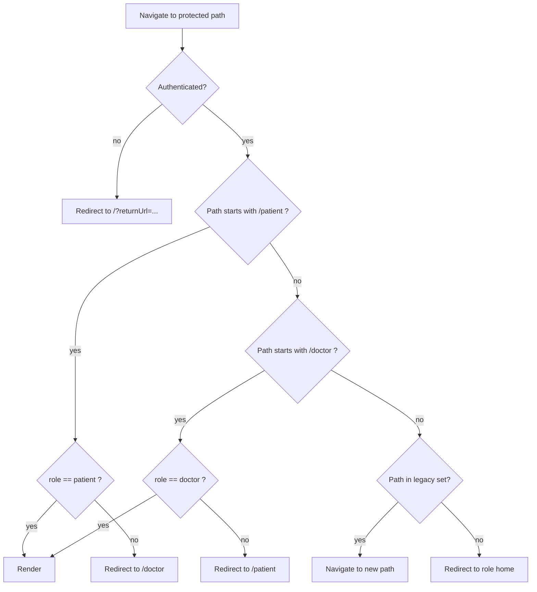

# App Routing & Landing — Public Landing + Role-Scoped Portals

## 1. Title & summary

Make the app behave like a standard multi-role SaaS product:

- **`/`** is a **public landing page** hosting **both login and signup** for **patients _and_ doctors** (role selectable during signup; login is role-agnostic).
- After auth, users land in a **role-scoped, industry-convention URL space**:
  - Patients: **`/patient`**, `/patient/profile`, `/patient/documents`, `/patient/doctors`, `/patient/chat`, …
  - Doctors: **`/doctor`**, `/doctor/profile`, `/doctor/patients`, `/doctor/patients/:patientId`, …
- All **current routes** (`/home`, `/profile`, `/documents`, `/dashboard`, `/public/chat`, `/profile/:userId`) stay reachable via **permanent redirects** so bookmarks keep working.
- Doctor self-signup becomes **first-class** in the UI, gated by the existing `ALLOW_DOCTOR_SELF_SIGNUP` backend flag; when the flag is off, the UI still exposes the tab but submits against the backend which answers **422** with a clear user-facing error. The UI does **not** reintroduce admin signup.

**Success criteria (observable):**

1. Visiting `/` while **unauthenticated** shows the landing page with **Sign in** / **Create account** and a **Patient / Doctor** role toggle on the signup form.
2. After successful login/signup, a patient lands on **`/patient`** and a doctor lands on **`/doctor`** (with `returnUrl` honored if present and safe).
3. Deep links to the old paths (`/home`, `/profile`, `/documents`, `/dashboard`, `/public/chat`, `/profile/:userId`) serve **`<Navigate replace>`** to the new role-scoped equivalents in one hop — never a redirect loop.
4. Role-scoped routes enforce role: a patient who loads `/doctor/...` is redirected to `/patient` (and vice versa) without a flash of the wrong portal.
5. `RequireAuth` redirects unauthenticated users to `/?returnUrl=<original>` (root landing), never to `/login` or `/signup` as dead ends.
6. No new route may be added without explicit handling in both `router.tsx` and (if protected) in the backend route-audit test — existing guarantee preserved.
7. Naming follows the **plural-resource** convention (`/patients`, `/doctors`, `/documents`) — **never** `/*-list`, `/*-page`, or verb-based segments.

## 2. Type & scope

| | |
|--|--|
| **Type** | Enhancement (frontend URL/routing restructure + minor backend `config/features` surface) |
| **In scope** | Frontend route map, layout wiring, legacy redirects, landing page role toggle for signup, doctor signup UI, sidebar/header labels and links, typed route constants, unit + E2E tests, docs updates (`CLAUDE.md`, `FRONTEND_BACKEND_COLLABORATION.md`). |
| **Out of scope** | Backend API URL changes (already resource-noun); new domain features (appointments, messaging, admin portal); cookie-based refresh tokens; email verification UX; marketing content on `/`. Admin routing is noted as a **future seam** only. |

## 3. Baseline (today)

### Frontend route map — current

From [`frontend/src/router.tsx`](../../frontend/src/router.tsx):

| Path | Layout | Page | Notes |
|------|--------|------|-------|
| `/` | `RootLayout` | `LandingPage` | Login/signup (patient-only signup). Redirects authenticated users to `/home` (patient) or `/doctor` (doctor). |
| `/login` | — | `LoginPage` | Redirects to `/?auth=login`. |
| `/signup` | — | `SignupPage` | Redirects to `/?auth=signup`. |
| `/home` | `PatientLayout` | `DashboardPage` | Patient dashboard (recently moved here from `/`). |
| `/profile` | `PatientLayout` | `ProfilePage` | Patient profile. Role-ambiguous path. |
| `/profile/:userId` | `PatientLayout` | `ProfileLegacyRedirect` | Syncs picker then → `/profile`. |
| `/documents` | `PatientLayout` | `DocumentsPage` | Patient documents. Role-ambiguous path. |
| `/dashboard` | — | `Navigate` | Redirects to `/home`. |
| `/public/chat` | — | `Navigate` | Redirects to `/doctor`. |
| `/doctor` | `DoctorLayout` | `DoctorDashboardPage` | Index route. |
| `/doctor/profile` | `DoctorLayout` | `DoctorProfilePage` | |
| `/doctor/patients` | `DoctorLayout` | `DoctorPatientListPage` | |
| `/doctor/patients/:patientId` | `DoctorLayout` | `DoctorPatientDetailPage` | |
| `/doctor/patients/:patientId/documents` | `DoctorLayout` | `DoctorPatientDocumentsPage` | |
| `/doctor/patients/:patientId/chat` | `DoctorLayout` | `DoctorChatPage` | |
| `/doctor/patients/:patientId/prescriptions` | `DoctorLayout` | `DoctorPrescriptionsPage` | |
| `/doctor/connections` | `DoctorLayout` | `DoctorConnectionsPage` | |
| `*` | — | `Navigate` | → `/`. |

### Problems to fix

- **Patient portal sits at root-level segments** (`/home`, `/profile`, `/documents`) with no `/patient` scope. A visitor reading `/profile` cannot tell which portal they are in; a future doctor `/profile` page would collide.
- **Signup is patient-only in the UI**, even though the backend supports doctor signup behind `ALLOW_DOCTOR_SELF_SIGNUP`. Doctors currently have to be seeded.
- **Landing page hard-codes `/home`** and `/doctor` as post-auth destinations — destination logic is scattered.
- Internal redirects (`Header` page titles, `Sidebar` links, `IdentityContext` role switch, `ProtectedAppShell` boundary) reference `/home`, `/profile`, `/documents` as **magic strings** — a rename touches ~10 files.
- There is **no admin seam**, so future expansion needs another round of renames.

### Backend baseline (for context)

Backend URLs already follow plural-resource convention:

- `/api/auth/{signup,login,refresh,logout,me}`
- `/api/patients`, `/api/patients/{id}`, `/api/patients/{id}/documents`, `/api/patients/{id}/medical-history`
- `/api/doctors`, `/api/doctors/{id}`, `/api/doctors/{id}/dashboard`, `/api/doctors/{id}/patients`, `/api/doctors/{id}/patients/{pid}/chat/...`
- `/api/connections`
- `/api/config/features` → exposes `dev_identity_bypass`.

**No backend URL change is proposed.** One new feature flag (`allow_doctor_self_signup`) is surfaced to the frontend so the landing page can hide the Doctor tab when the backend rejects it.

## 4. Prior art & strategy

### Existing vs proposed strategy

| Existing | Proposed | Verdict |
|----------|----------|---------|
| Patient portal routes at root (`/home`, `/profile`, `/documents`) | Scope under **`/patient/*`** with `/patient` as dashboard | **Change**. Root-level patient routes were a remnant from single-persona prototype; they block a clean `/doctor` vs `/patient` symmetry and a future `/admin` namespace. |
| Separate `/login`, `/signup` pages redirect to `/?auth=...` | Keep `/` as the only auth surface; keep `/login` and `/signup` as **permanent redirects** to `/?auth=...` | **Keep**. Already chosen and shipped in a prior change. |
| `DashboardPage` (patient) + `DoctorDashboardPage` (doctor) as distinct route indexes | Keep both; they are genuinely different surfaces | **Keep**. |
| Backend URLs | Already plural-resource convention | **Keep.** |
| User suggested `patients-list`, `doctors-list` suffix | Reject — use plural resource (`/patients`, `/doctors`). `-list` is non-standard and breaks when a detail page (`/patients/:id`) is added. | **Reject `-list`; document rationale.** |
| Admin portal | Not in scope, but reserve `/admin/*` namespace | **Reserve only**. |

### Industry conventions applied

1. **Plural resource nouns** for collections, singular for the user's own scoped root:
   - `/patient` (my portal), `/patient/profile` (my profile), `/patient/documents` (my documents), `/patient/doctors` (the doctors available to me).
   - `/doctor` (my portal), `/doctor/profile`, `/doctor/patients` (patients connected to me).
2. **Detail pages nested under plural resource:** `/doctor/patients/:patientId`, `/doctor/patients/:patientId/documents` — reuse for sibling aspects of the same resource.
3. **No `-list`, `-page`, or verb segments.** `/doctor/patients` already _is_ the list; `/doctor/patients/:id` is the detail. Do not introduce `/doctor/patients-list` or `/doctor/view-patient/...`.
4. **Auth is collapsed at `/`.** Login and signup are modes of the same landing surface, not different pages.
5. **Role-specific home at `/role`, not `/role/dashboard`.** `/doctor` and `/patient` index to the dashboard; no redundant `/dashboard` suffix.
6. **`returnUrl` is preserved through the entire auth dance** and validated (same-origin, no `//`, no external redirects).
7. **Typed route constants** (single source of truth) so renames are one-file changes, not grep-and-hope.

### Rejected alternatives

- **`/app/*` umbrella** (`/app/patient`, `/app/doctor`) — redundant; `/` already implies app.
- **Subdomain split** (`patient.prescribe.local`, `doctor.prescribe.local`) — over-engineered for a single-repo SPA and complicates cookies/CORS.
- **Query-string role** (`/portal?role=patient`) — breaks back-button intuition and deep-linking.

## 5. Target architecture

### Route map — target

Legend: `★` new, `→` redirect, unmarked = unchanged element just re-rooted.

| Path | Layout | Page | Auth | Notes |
|------|--------|------|------|-------|
| `/` | `RootLayout` | `LandingPage` | public | Role-toggle signup (`patient` / `doctor`); login role-agnostic. |
| `/login` | — | `→ /?auth=login&…` | public | Preserves `returnUrl`. |
| `/signup` | — | `→ /?auth=signup&role=patient&…` | public | Defaults to patient; honors `?role=doctor`. |
| `/patient` ★ | `PatientLayout` | `DashboardPage` | patient | Moved from `/home`. |
| `/patient/profile` ★ | `PatientLayout` | `ProfilePage` | patient | Moved from `/profile`. |
| `/patient/documents` ★ | `PatientLayout` | `DocumentsPage` | patient | Moved from `/documents`. |
| `/patient/doctors` ★ | `PatientLayout` | `PatientDoctorsPage` (placeholder, wires existing `doctorsApi`) | patient | New but thin — replaces the concept the user described as `/doctors-list`. Phase 3: list of connected + available doctors, request-connection CTA. If a full implementation does not fit this plan, ship the route with an "Coming soon" empty state and hook up the existing `GET /api/doctors` list behind it. |
| `/patient/chat` ★ | `PatientLayout` | existing patient `ChatPage` | patient | Moved from `/public/chat` (public chat concept is retired anyway). |
| `/doctor` | `DoctorLayout` | `DoctorDashboardPage` | doctor | Unchanged. |
| `/doctor/profile` | `DoctorLayout` | `DoctorProfilePage` | doctor | |
| `/doctor/patients` | `DoctorLayout` | `DoctorPatientListPage` | doctor | The "patients list" the user referenced — stays at plural-resource path, **not** `/doctor/patients-list`. |
| `/doctor/patients/:patientId` | `DoctorLayout` | `DoctorPatientDetailPage` | doctor | |
| `/doctor/patients/:patientId/documents` | `DoctorLayout` | `DoctorPatientDocumentsPage` | doctor | |
| `/doctor/patients/:patientId/chat` | `DoctorLayout` | `DoctorChatPage` | doctor | |
| `/doctor/patients/:patientId/prescriptions` | `DoctorLayout` | `DoctorPrescriptionsPage` | doctor | |
| `/doctor/connections` | `DoctorLayout` | `DoctorConnectionsPage` | doctor | |
| `/home` | — | `→ /patient` | — | Legacy redirect. |
| `/profile` | — | `→ /patient/profile` | — | Legacy redirect (patient-era). |
| `/profile/:userId` | `PatientLayout` | `ProfileLegacyRedirect` → `/patient/profile` | — | Keep the picker-sync logic; only the final target changes. |
| `/documents` | — | `→ /patient/documents` | — | Legacy redirect. |
| `/dashboard` | — | `→ /patient` | — | Legacy redirect (previously `/home`). |
| `/public/chat` | — | `→ /patient/chat` | — | Legacy redirect (previously `/doctor`). |
| `/admin/*` ★ | — | reserved; `→ /` for now | — | Name the namespace; do not implement. |
| `*` | — | `→ /` | — | 404 fallback. |

### Role-scoped redirect policy

Flow (inside `ProtectedAppShell` / `IdentityRedirectBoundary`):



### Typed route constants

Single source of truth in `frontend/src/router/paths.ts` (new). Example shape:

```ts
export const paths = {
  root: "/",
  login: "/login",
  signup: "/signup",
  patient: {
    root: "/patient",
    profile: "/patient/profile",
    documents: "/patient/documents",
    doctors: "/patient/doctors",
    chat: "/patient/chat",
  },
  doctor: {
    root: "/doctor",
    profile: "/doctor/profile",
    patients: "/doctor/patients",
    patientDetail: (id: string) => `/doctor/patients/${id}`,
    patientDocuments: (id: string) => `/doctor/patients/${id}/documents`,
    patientChat: (id: string) => `/doctor/patients/${id}/chat`,
    patientPrescriptions: (id: string) => `/doctor/patients/${id}/prescriptions`,
    connections: "/doctor/connections",
  },
} as const;
```

All `NavLink`, `Navigate`, and programmatic `navigate(...)` calls MUST use `paths.*`; hard-coded strings fail the lint rule added in Phase 6.

## 6. Directory & file plan

| Path | New / Modify | Purpose |
|------|-------------|---------|
| `frontend/src/router/paths.ts` | **New** | Typed route constants (single source of truth). |
| `frontend/src/router/postAuthPath.ts` | **New** | `defaultPostAuthPath(role)` + `safeReturnUrl(raw, role)` — extracted from `LandingPage`. |
| `frontend/src/router.tsx` | Modify | Replace magic strings with `paths.*`; add `/patient/*` subtree; add legacy redirects; reserve `/admin/*`. |
| `frontend/src/pages/LandingPage.tsx` | Modify | Role toggle on signup form; use `useSignupMutation` (or `useAuth().signup`) with optional `role`; feature-flag the doctor tab via `allow_doctor_self_signup`. |
| `frontend/src/pages/LoginPage.tsx` | Modify | Already a redirect; confirm it reads `paths.root`. |
| `frontend/src/pages/SignupPage.tsx` | Modify | Already a redirect; honor `?role=doctor`. |
| `frontend/src/pages/patient/PatientDoctorsPage.tsx` | **New** | Minimal "my doctors" page — lists connections via existing `connectionsApi`/`doctorsApi`; placeholder if full UX not in scope. |
| `frontend/src/layouts/ProtectedAppShell.tsx` | Modify | Use `paths.*`; redirect patient→`/patient`, doctor→`/doctor`. |
| `frontend/src/contexts/AuthContext.tsx` | Modify | Replace `/`/`/login`/`/signup` string checks with `paths.*`; logout → `paths.root`; `navigateToLoginWithReturn` → `paths.root`. |
| `frontend/src/contexts/IdentityContext.tsx` | Modify | Role switch targets use `paths.patient.root` / `paths.doctor.root`. |
| `frontend/src/components/RequireAuth.tsx` | Modify | Redirect to `paths.root` with `returnUrl`. |
| `frontend/src/components/Sidebar.tsx` | Modify | Patient nav items use `/patient/*`. Add `Doctors` entry. |
| `frontend/src/components/doctor/DoctorSidebar.tsx` | Modify | Use `paths.doctor.*`; no label change beyond verification. |
| `frontend/src/components/Header.tsx` | Modify | Title map keyed off `/patient/*`; drop `/home` special case. |
| `frontend/src/components/doctor/DoctorHeader.tsx` | Modify | Keep, but use `paths.doctor.*`. |
| `frontend/src/components/ChatPage.tsx` | Modify | Internal "Back to portal" link → `paths.patient.root`. |
| `frontend/src/components/ProfileLegacyRedirect.tsx` | Modify | Final `Navigate` target → `paths.patient.profile`. |
| `frontend/src/types/auth.ts` | Modify | Extend `MeResponse` consumer types only if role union changes (no change expected). |
| `frontend/src/api/config.ts` / `configApi.ts` | Modify | Add `allow_doctor_self_signup: boolean` to `FeatureFlags`. |
| `frontend/src/contexts/FeatureFlagContext.tsx` | Modify | Expose `allowDoctorSelfSignup`. |
| `backend/app/api/config.py` | Modify | Include `allow_doctor_self_signup` in `GET /api/config/features` response. |
| `frontend/src/__tests__/router.routing.test.tsx` | **New** | Unit tests for redirects and role boundary. |
| `frontend/e2e/routing.spec.ts` (if Playwright exists; otherwise Vitest route tests) | **New** | Cross-path navigation smoke. |
| `docs/FRONTEND_BACKEND_COLLABORATION.md` | Modify | Update the "Frontend routes" table; document new redirects and role-scoped convention. |
| `frontend/CLAUDE.md` | Modify | Update folder map and route commentary. |
| `docs/plans/PLAN_APP_ROUTING_AND_LANDING.md` | **This file** | Plan. |

No file deletions. `pages/DashboardPage.tsx`, `pages/ProfilePage.tsx`, `pages/DocumentsPage.tsx` keep their names — only their route paths change. (Rename optional but **out of scope** to avoid a noisy diff.)

## 7. API / data

- **No URL changes** to backend.
- **Add one field** to `GET /api/config/features`:

  ```json
  {
    "ai_suggestions_enabled": true,
    "dev_identity_bypass": false,
    "allow_doctor_self_signup": false
  }
  ```

  Sourced from `Settings.ALLOW_DOCTOR_SELF_SIGNUP` in [`backend/app/config.py`](../../backend/app/config.py). Snake_case on the wire (matches the other flags); frontend maps to camelCase in `FeatureFlagContext` to match existing `devIdentityBypass` naming.
- **Signup request body** (`POST /api/auth/signup`) already accepts `role` ([`backend/app/schemas/auth.py`](../../backend/app/schemas/auth.py)); the landing page now sends `role: "doctor"` when the Doctor tab is selected. Backend still enforces `ALLOW_DOCTOR_SELF_SIGNUP` and returns **422** with the existing detail when disabled — the UI surfaces that message verbatim.
- **Casing boundary:** snake_case wire, camelCase in frontend contexts (`allowDoctorSelfSignup`, `devIdentityBypass`) — unchanged policy per [`docs/FRONTEND_BACKEND_COLLABORATION.md`](../FRONTEND_BACKEND_COLLABORATION.md).

## 8. Edge cases & failure handling

| # | Case | Handling |
|---|------|----------|
| 8.1 | Unauthenticated visit to `/patient/...` or `/doctor/...` | `RequireAuth` → `Navigate` to `/?returnUrl=<encoded>` (single hop). |
| 8.2 | Dev bypass on (`dev_identity_bypass: true`) + unauth on `/` | Landing redirects to role home (`/patient` by default, `/doctor` when dev role is doctor). |
| 8.3 | Role mismatch (patient hits `/doctor/...`) | `IdentityRedirectBoundary` `Navigate replace` to `/patient`; no render flash because the effect runs before outlet mount is committed (use `useLayoutEffect`). |
| 8.4 | Bookmarked old paths (`/home`, `/profile`, `/documents`, `/dashboard`, `/public/chat`, `/profile/:id`) | Explicit `Navigate replace` entries in the router; each resolves in one hop to the new path. |
| 8.5 | Unsafe `returnUrl` (`//evil.com`, `https://...`, empty) | `safeReturnUrl()` falls back to role home. Tested in Phase 6. |
| 8.6 | `returnUrl` pointing to a role that does not match the authenticated user | After login, destination validated: if path starts with `/doctor` but role is patient, fall back to `/patient`. |
| 8.7 | Doctor signup with `ALLOW_DOCTOR_SELF_SIGNUP=false` | Frontend tab visible only when `allowDoctorSelfSignup === true`; if a user forges the request, backend returns 422 and the landing page shows the detail inline. |
| 8.8 | Logout from `/doctor/...` or `/patient/...` | `AuthContext.logout()` → `navigate(paths.root)`; session cleared before navigation so `RequireAuth` does not re-trigger. |
| 8.9 | Refresh token fails mid-session on a protected route | `ensureFreshAccessToken` → `onRefreshFailed` → `navigateToLoginWithReturn()` using `paths.root`; `returnUrl` carries the current location. |
| 8.10 | Browser back after post-login redirect | `replace: true` everywhere on the auth path so back-button does not land in `/login`/`/signup`/`/?auth=...`. |
| 8.11 | 404 for unknown path | Catch-all `*` → `/`. Authenticated users then bounce to their role home via `IdentityRedirectBoundary`. |
| 8.12 | Stale `patient_id` in URL after role switch (dev) | Existing `IdentityRedirectBoundary` already clears doctor paths on patient; add the symmetric patient-path-on-doctor check (no regression). |
| 8.13 | `/admin/*` access | Reserved; redirect to `/` until admin portal exists — keeps the namespace clean for future work without dead code. |

## 9. Testing strategy

### Unit (Vitest + React Testing Library)

- **`frontend/src/router/__tests__/paths.test.ts`**
  - `paths.doctor.patientDetail("p1")` returns `/doctor/patients/p1`, etc.
- **`frontend/src/router/__tests__/postAuthPath.test.ts`**
  - `defaultPostAuthPath("doctor")` → `/doctor`; `"patient"` → `/patient`.
  - `safeReturnUrl("//evil.com", "patient")` → `/patient`.
  - `safeReturnUrl("/doctor/patients/abc", "patient")` → `/patient` (role mismatch).
  - `safeReturnUrl("/patient/documents", "patient")` → `/patient/documents`.
- **`frontend/src/__tests__/router.routing.test.tsx`**
  - Rendering `<RouterProvider>` with a `MemoryRouter`-style harness and asserting:
    - `/home` → `/patient` (via `Navigate replace`).
    - `/profile` → `/patient/profile`.
    - `/documents` → `/patient/documents`.
    - `/dashboard` → `/patient`.
    - `/public/chat` → `/patient/chat`.
    - `/admin` and `/admin/anything` → `/`.
  - Role boundary: render `ProtectedAppShell` with a mocked `IdentityContext.currentRole = "patient"` on `/doctor/patients` and assert redirect to `/patient`. Symmetric case for doctor on `/patient/documents`.
- **`frontend/src/pages/__tests__/LandingPage.test.tsx`**
  - Renders Sign in / Create account tabs.
  - When `allowDoctorSelfSignup: false`, the Doctor sub-tab inside signup is hidden.
  - When `true`, submitting the signup form with Doctor selected sends `role: "doctor"` (mock the mutation and assert payload).
  - On 422 from backend, the inline error renders the backend `detail`.
- **`frontend/src/contexts/__tests__/AuthContext.redirect.test.tsx`**
  - `navigateToLoginWithReturn` does not navigate when already on `/`.
  - Navigates with `returnUrl` otherwise.

### Integration / E2E

- If Playwright harness exists, add `frontend/e2e/routing.spec.ts` covering the six legacy redirects and the role-boundary redirect. If not, the route tests above are sufficient.

### Backend

- `backend/tests/test_api_config.py` (extend): `GET /api/config/features` returns the `allow_doctor_self_signup` key matching `Settings.ALLOW_DOCTOR_SELF_SIGNUP`.
- Existing `backend/tests/test_route_audit.py` stays green — no backend URL change.

### Non-negotiables

- Tests must be **deterministic** — no real network, no `sleep`-based waits; use fake timers for the landing page redirect effect.
- No test may rely on `window.location` side effects; use `MemoryRouter` + `createMemoryRouter` or React Router's `createMemoryRouter`.

## 10. Risks & rollback

| Risk | Mitigation | Rollback |
|------|-----------|----------|
| Deep links and bookmarks break for existing users | Explicit `Navigate replace` for every legacy path; Phase 6 tests assert each one. | Revert `router.tsx` + `paths.ts`; old paths resurface. |
| Redirect loop between `/patient` ↔ `/doctor` ↔ `/` | `IdentityRedirectBoundary` uses `Navigate replace` with a single destination per role; unit test exercises both role paths. | Disable the boundary and ship with static per-role layouts. |
| Doctor signup accidentally enabled in production | UI tab gated by `allow_doctor_self_signup` flag; backend still enforces `ALLOW_DOCTOR_SELF_SIGNUP` at the service layer. Both must agree. | Flip `ALLOW_DOCTOR_SELF_SIGNUP=false`; UI tab hides on next `features` poll. |
| Unsafe `returnUrl` after auth (open-redirect class) | `safeReturnUrl` enforces same-origin, rejects `//`, and rejects cross-role. | Revert to hard-coded role home. |
| Renaming patient layout paths breaks places that still hard-code `/home`/`/profile` | Phase 2 introduces `paths.*`; Phase 3 greps for remaining string literals and the ESLint rule from Phase 6 fails the build. | `git revert` the phase; legacy redirects alone keep the app functional. |
| CLS / flash of wrong portal during role redirect | `useLayoutEffect` in the boundary + `replace: true` so the user never sees the "wrong" route mount. | Accept a brief flash; minor UX regression. |

## 11. Implementation phases (detailed)

### Implementation order overview

1. **Phase 1** — Backend: surface `allow_doctor_self_signup` feature flag.
2. **Phase 2** — Frontend foundations: typed paths + post-auth helpers + feature flag wiring (**no URL changes yet**).
3. **Phase 3** — Frontend: restructure router — add `/patient/*`, legacy redirects, reserve `/admin/*`.
4. **Phase 4** — Frontend: update every consumer (sidebar, header, contexts, ChatPage, ProfileLegacyRedirect, RequireAuth, ProtectedAppShell) to use `paths.*`.
5. **Phase 5** — Landing: role-toggle signup + doctor signup wiring + error surface.
6. **Phase 6** — Tests, docs, and lint guard against raw route strings.

Each phase is sized for a single reviewable PR. Phases 1 and 2 can run in parallel; phases 3–5 are sequential; phase 6 lands last.

---

### Phase 1 — Backend: `allow_doctor_self_signup` feature flag

**Goal.** Surface the existing backend `ALLOW_DOCTOR_SELF_SIGNUP` setting via `GET /api/config/features` so the frontend can conditionally show the Doctor signup tab without a code deploy.

**Prerequisites.** None.

**Scope.** Just the one flag. No signup behavior change.

**Tasks.**

1. Edit [`backend/app/api/config.py`](../../backend/app/api/config.py) → include `"allow_doctor_self_signup": settings.ALLOW_DOCTOR_SELF_SIGNUP` in the JSON response.
2. Extend `backend/tests/test_api_config.py` (create if missing) with a test that flips `ALLOW_DOCTOR_SELF_SIGNUP` via `get_settings.cache_clear` + env monkeypatch and asserts the field.
3. Update [`docs/FRONTEND_BACKEND_COLLABORATION.md`](../FRONTEND_BACKEND_COLLABORATION.md): add `allow_doctor_self_signup` to the `/api/config/features` example.

**Deliverables.** Config endpoint with new field; test coverage; doc row. No behavior change for callers that ignore the field.

**Verification.**

```bash
docker compose exec backend python -m pytest tests/test_api_config.py -v
curl -s http://localhost:8000/api/config/features | jq .
```

Response contains `allow_doctor_self_signup` boolean.

**Notes.** Safe to ship independently of frontend changes.

---

### Phase 2 — Frontend foundations: typed paths + post-auth helpers

**Goal.** Introduce the single source of truth for route strings and centralize post-auth navigation logic — still pointing at the **current** paths (`/home`, `/profile`, `/documents`) so this phase is behavior-preserving.

**Prerequisites.** None (Phase 1 can run in parallel).

**Scope.**

- New files only: `frontend/src/router/paths.ts`, `frontend/src/router/postAuthPath.ts`.
- **Do not** change `router.tsx` yet; consumers keep hard-coded strings for one more PR.

**Tasks.**

1. Create `frontend/src/router/paths.ts` matching the shape in §5.
   - Include placeholder `admin: { root: "/admin" }` for future use (not wired).
   - During this phase, `patient.*` paths may be **aliased to current values** (`patient: { root: "/home", profile: "/profile", ... }`) **only if** you prefer a two-PR rollout. Otherwise, set them to the final targets (`/patient/*`) and rely on Phase 3 to introduce the routes. **Recommended:** set final targets; Phase 3 lands before merging to main.
2. Create `frontend/src/router/postAuthPath.ts` exporting `defaultPostAuthPath(role)` and `safeReturnUrl(raw, role)`; copy logic from `frontend/src/pages/LandingPage.tsx` and add the **cross-role guard** from §8.6.
3. Extend `FeatureFlags` in [`frontend/src/api/config.ts`](../../frontend/src/api/config.ts) with `allow_doctor_self_signup: boolean`.
4. Extend [`frontend/src/contexts/FeatureFlagContext.tsx`](../../frontend/src/contexts/FeatureFlagContext.tsx) with `allowDoctorSelfSignup` (camelCase).
5. Add `frontend/src/router/__tests__/paths.test.ts` and `frontend/src/router/__tests__/postAuthPath.test.ts` per §9.

**Deliverables.** `paths`, `safeReturnUrl`, extended feature flags. Zero route or URL changes for the user.

**Verification.**

```bash
cd frontend && npm run test -- router
cd frontend && npm run build
```

Tests pass; the app still works end-to-end against existing routes.

**Notes.** This phase pairs with Phase 1: once both land, the next PR wires them.

---

### Phase 3 — Router restructure: `/patient/*`, legacy redirects, admin reserve

**Goal.** Move the patient portal under `/patient/*` and make every legacy path a single-hop redirect.

**Prerequisites.** Phase 2 merged.

**Scope.**

- `frontend/src/router.tsx` only (plus any necessary `paths.ts` tweak if Phase 2 deferred the final values).

**Tasks.**

1. Replace the `PatientLayout` subtree to live under `{ path: "patient", element: <PatientLayout />, children: [ { index: true, element: <DashboardPage /> }, { path: "profile", element: <ProfilePage /> }, { path: "documents", element: <DocumentsPage /> }, { path: "doctors", element: <PatientDoctorsPage /> }, { path: "chat", element: <ChatPage /> }, { path: "profile/:userId", element: <ProfileLegacyRedirect /> } ] }`.
2. Add redirect entries at the same level as `/doctor`:
   - `{ path: "home", element: <Navigate to="/patient" replace /> }`
   - `{ path: "profile", element: <Navigate to="/patient/profile" replace /> }`
   - `{ path: "documents", element: <Navigate to="/patient/documents" replace /> }`
   - `{ path: "dashboard", element: <Navigate to="/patient" replace /> }`
   - `{ path: "public/chat", element: <Navigate to="/patient/chat" replace /> }`
3. Reserve `{ path: "admin/*", element: <Navigate to="/" replace /> }`.
4. Create `frontend/src/pages/patient/PatientDoctorsPage.tsx` as a minimal component (use existing `doctorsApi.useListDoctorsQuery`/connection hooks if available; otherwise render an empty state with a heading and a "Coming soon" paragraph). Map to edge case §8.1 + §8.11 (route must resolve cleanly even if data is empty).
5. Run `npm run build` — confirm no import errors.

**Deliverables.** New route tree; legacy redirects; reserved admin namespace; placeholder patient doctors page.

**Verification.**

```bash
cd frontend && npm run test
cd frontend && npm run build
docker compose up -d frontend backend
# Manual smoke
open http://localhost:5173/home       # → /patient
open http://localhost:5173/profile    # → /patient/profile
open http://localhost:5173/documents  # → /patient/documents
open http://localhost:5173/dashboard  # → /patient
open http://localhost:5173/public/chat # → /patient/chat
open http://localhost:5173/admin      # → /
```

Each path lands on the new target in one hop (check DevTools Network tab — a single 200 for `/`, no chain).

**Notes.** Consumers (sidebar, header, contexts) still reference old paths at this point. The app works because of redirects; Phase 4 cleans up the references.

---

### Phase 4 — Consumer cleanup: use `paths.*` everywhere

**Goal.** Eliminate hard-coded route strings from components and contexts so renames are a one-line change in the future.

**Prerequisites.** Phase 3 merged.

**Scope.**

- Every file listed in §6 under "Modify" except `LandingPage` (Phase 5) and `router.tsx` (Phase 3 already done).

**Tasks.**

1. **Sidebar** (`frontend/src/components/Sidebar.tsx`): replace nav items with `{ path: paths.patient.root, label: "Dashboard", ... }`, `{ path: paths.patient.profile, ... }`, `{ path: paths.patient.documents, ... }`, `{ path: paths.patient.doctors, label: "My Doctors", ... }`. Drop any `/home` references.
2. **DoctorSidebar** (`frontend/src/components/doctor/DoctorSidebar.tsx`): replace with `paths.doctor.*`.
3. **Header** (`frontend/src/components/Header.tsx`): rework `TITLES` and `pageTitle` to key off `/patient/*`; remove the `/home` branch.
4. **DoctorHeader** (`frontend/src/components/doctor/DoctorHeader.tsx`): verify against `paths.doctor.*`; no user-visible label change expected.
5. **ProtectedAppShell** (`frontend/src/layouts/ProtectedAppShell.tsx`):
   - Redirect doctor-on-patient-path: `navigate(paths.doctor.root, { replace: true })`.
   - Redirect patient-on-doctor-path: `navigate(paths.patient.root, { replace: true })`.
   - Use `useLayoutEffect` (not `useEffect`) to avoid flash per §8.3.
6. **AuthContext** (`frontend/src/contexts/AuthContext.tsx`):
   - `navigateToLoginWithReturn` checks `location.pathname === paths.root` (plus `/login` and `/signup` redirect targets).
   - `logout` and `subscribeLogoutFromOtherTabs` navigate to `paths.root`.
7. **IdentityContext** (`frontend/src/contexts/IdentityContext.tsx`): role switch target uses `paths.patient.root` / `paths.doctor.root`.
8. **RequireAuth** (`frontend/src/components/RequireAuth.tsx`): `Navigate to={\`${paths.root}?returnUrl=...\`}`.
9. **ChatPage** (`frontend/src/components/ChatPage.tsx`): back-link → `paths.patient.root`.
10. **ProfileLegacyRedirect** (`frontend/src/components/ProfileLegacyRedirect.tsx`): final `<Navigate to={paths.patient.profile} replace />`.

**Deliverables.** No component or context hard-codes a patient-portal or doctor-portal URL string except inside `paths.ts`.

**Verification.**

```bash
cd frontend
rg -n "['\"]/(home|profile|documents|dashboard|public/chat|doctor|patient)" src \
  --glob '!src/router/paths.ts' \
  --glob '!src/router.tsx'
```

The only remaining matches should be inside `paths.ts` and `router.tsx`. If any surface in a component/context, fix it before closing the phase.

```bash
npm run test
npm run build
```

Green.

**Notes.** Keep this phase purely mechanical (no UX changes) so review is fast.

---

### Phase 5 — Landing page: role-toggle signup + doctor flow

**Goal.** Let patients **and** doctors sign up from `/`, gated by the `allowDoctorSelfSignup` feature flag.

**Prerequisites.** Phases 1, 2 (feature flag plumbing) and 4 (`paths.*` available).

**Scope.**

- `frontend/src/pages/LandingPage.tsx`
- `frontend/src/api/authApi.ts` (confirm the `signup` mutation body accepts `role`; extend type if needed).
- `frontend/src/contexts/AuthContext.tsx` (make `signup(email, password, role?)` accept optional role).

**Tasks.**

1. Update the `signup` mutation input type to include `role?: "patient" | "doctor"`.
2. Update `AuthContext.signup` signature: `(email, password, role?)` → passes through to the mutation.
3. In `LandingPage.tsx`:
   - Add local state `signupRole: "patient" | "doctor"` (default `patient`).
   - Render a second-level segmented control **inside the signup panel** (not on the top Sign in/Create account toggle): **Patient** | **Doctor**. Hide the Doctor option entirely when `allowDoctorSelfSignup === false`.
   - Copy changes:
     - Patient: "Patient signup — at least 12 characters, one letter and one number."
     - Doctor: "Doctor signup — you will complete your clinical profile after sign-up."
   - `onSubmitSignup` calls `signup(email, password, signupRole)`.
   - On success: `navigate(safeReturnUrl(returnUrlParam, me.role))` — the server-returned role is the source of truth (defense-in-depth if the backend rejects a role).
   - On 422 from the backend (doctor self-signup disabled), surface the `detail` string inline.
4. Keep the top-level `?auth=` query behavior. Add `?role=doctor` support: when present and allowed, preselect the Doctor tab in signup mode.
5. `LoginPage` / `SignupPage`: already redirect to `/?auth=...`; ensure they pass through `role` if present.

**Deliverables.** Landing page supports both roles; login is role-agnostic (unchanged); errors surface clearly; dev-only bypass path still works.

**Verification.**

```bash
# With ALLOW_DOCTOR_SELF_SIGNUP=false (default)
open http://localhost:5173/          # Doctor tab not visible inside signup
# With ALLOW_DOCTOR_SELF_SIGNUP=true
docker compose exec backend bash -lc "export ALLOW_DOCTOR_SELF_SIGNUP=true && ..."
# Reload landing; Doctor tab visible; signup as doctor lands on /doctor
cd frontend && npm run test -- LandingPage
```

All Phase 5 tests from §9 pass.

**Notes.** Do not add admin signup to the UI under any condition.

---

### Phase 6 — Tests, docs, lint guard

**Goal.** Lock the structure down so future PRs cannot silently regress it.

**Prerequisites.** Phases 3–5 merged.

**Scope.**

- New tests per §9 that were not written inline.
- Docs updates.
- Lint rule (ESLint) forbidding hard-coded route literals outside `paths.ts` and `router.tsx`.

**Tasks.**

1. Add remaining tests: `router.routing.test.tsx`, `AuthContext.redirect.test.tsx`.
2. Update [`docs/FRONTEND_BACKEND_COLLABORATION.md`](../FRONTEND_BACKEND_COLLABORATION.md):
   - Rewrite the "Frontend routes" table for the new map.
   - Note the six legacy redirects and the `/admin/*` reserve.
3. Update [`frontend/CLAUDE.md`](../../frontend/CLAUDE.md):
   - Folder map mentions `src/router/paths.ts` and `src/router/postAuthPath.ts`.
   - One paragraph explaining the role-scoped portal convention.
4. Add an ESLint rule in `frontend/eslint.config.js` (or `.eslintrc.*` if that is what the repo uses) — `no-restricted-syntax` against string literals matching `^/(home|profile|documents|dashboard|public/chat|doctor|patient)(/|$)` in `src/**` **except** in `src/router/paths.ts`, `src/router.tsx`, and test files. (Implementers: if the repo uses Flat Config, the pattern is `files`-scoped overrides; otherwise `overrides`.)
5. Run `npm run lint` and fix anything that trips the new rule.

**Deliverables.** Tests guarding redirects and role boundary; docs reflecting the new map; lint rule preventing regressions.

**Verification.**

```bash
cd frontend && npm run lint
cd frontend && npm run test
cd frontend && npm run build
docker compose exec backend python -m pytest tests/ -v
```

All green. Grep confirms `paths.ts`/`router.tsx` own every patient/doctor route string.

**Notes.** This phase is also the **final verification chat** trigger per the create-plan command: before closing Phase 6, run `git diff main...HEAD` and walk §§6, 9, 10 to confirm no task was silently skipped.
