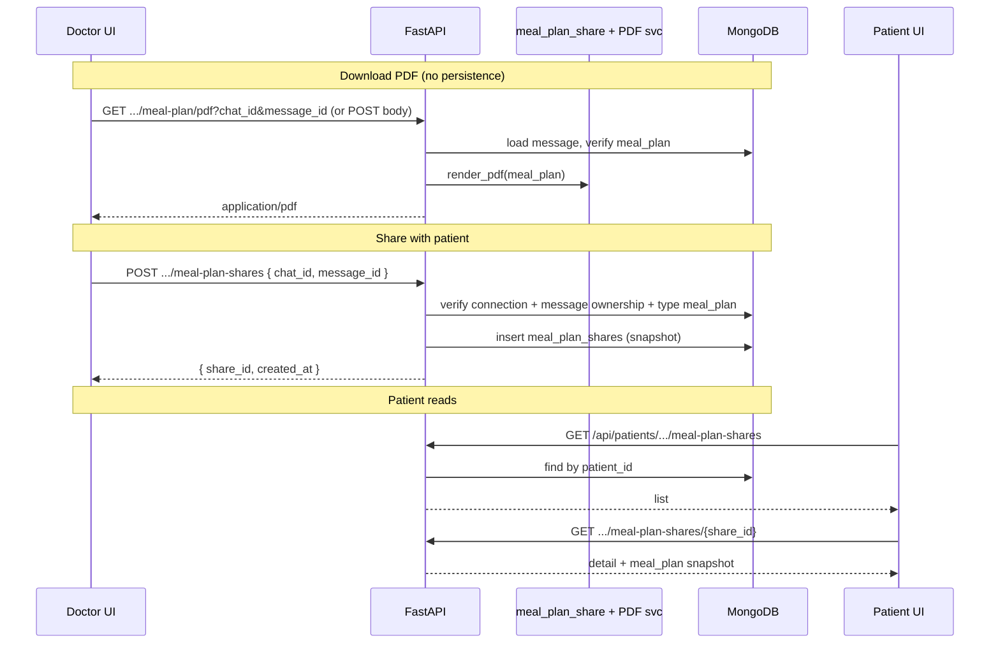

# Meal plan PDF download & patient share

## 1. Title & summary

After the AI generates a **structured meal plan** in doctor chat (`message_type === "meal_plan"`, `meal_plan` on messages and `ChatResponse`), clinicians need to **export a PDF** from the UI and **share the plan with the patient** so the patient can open it in the patient portal. Success means: (1) a clear **Download PDF** action on meal-plan messages in doctor chat that produces a readable, branded PDF; (2) a **Share with patient** action that persists an **auditable, patient-visible record** independent of ephemeral UI state; (3) authenticated patients can **list and view** shared meal plans (and download the same PDF) without relying on doctor chat history alone; (4) APIs, MongoDB shapes, and `docs/FRONTEND_BACKEND_COLLABORATION.md` stay aligned with existing **snake_case JSON**, **JWT / connection rules**, and **RTK Query + service** patterns.

## 2. Type & scope

| | |
|--|--|
| **Type** | Feature (full-stack: persistence + API + doctor + patient UI) |
| **Primary surface** | Doctor: `/doctor/patients/:patientId/chat` meal-plan bubble; Patient: new portal area under `/patient/*` |

**In scope**

- PDF generation and download for a **validated `MealPlanPayload`** (same schema as `backend/app/schemas/meal_plan.py` / `frontend/src/types/mealPlan.ts`).
- **Share** flow: doctor triggers share for a specific chat message; backend stores a **durable record** the patient can query.
- Patient UI: **list + detail** (and PDF download) for shared plans.
- MongoDB indexes, authz (doctor–patient connection for create; patient self for read), and documentation updates.

**Out of scope (unless explicitly added later)**

- Email/SMS notifications when a plan is shared (can reuse `share_id` later).
- Public / unauthenticated magic links (tokenized URLs). The design below can **add** a `public_token` field later without breaking the core model.
- Editing a meal plan after generation (still immutable per current chat message model).
- Storing PDF bytes in GridFS (generate on demand from snapshot JSON unless product requires archival).

## 3. Baseline (current behavior)

- **Generation & persistence:** LangGraph tool `submit_meal_plan` validates `MealPlanPayload`; assistant messages persist `message_type`, `meal_plan` on `chat_messages` via `chat_repo.save_message` (`backend/app/repository/chat.py`). Doctor and patient chat share the same service patterns (`backend/app/service/chat.py`, `doctor_chat` wrappers).
- **Doctor UI:** `frontend/src/components/ChatMessage.tsx` renders `MealPlanMessage` when `message_type === "meal_plan"` and `meal_plan` is present (`frontend/src/components/chat/MealPlanMessage.tsx`). Streaming completes with `done` including `message_id`, `meal_plan`, etc. (`useDoctorChat`).
- **Patient visibility:** [`PLAN_AI_MEAL_PLAN_CHAT.md`](./PLAN_AI_MEAL_PLAN_CHAT.md) scoped **doctor-initiated** structured plans; **patient-facing** delivery was explicitly out of scope. There is **no** share table or patient route for meal plans today.
- **PDF:** The backend uses **PyPDF2** for **ingesting** PDFs (`backend/app/document_text.py`), not for authoring. No PDF **writer** dependency is pinned in `backend/requirements.txt` yet.

**Key files:** `backend/app/schemas/meal_plan.py`, `backend/app/repository/chat.py`, `backend/app/api/doctor_chat.py`, `frontend/src/components/chat/MealPlanMessage.tsx`, `frontend/src/router/paths.ts`, `docs/FRONTEND_BACKEND_COLLABORATION.md`.

## 4. Prior art & strategy

| Topic | Existing / prior art | Decision |
|--------|----------------------|----------|
| Structured payload | Single source of truth: `MealPlanPayload` in DB + API | **Reuse** for PDF input and for **snapshot** on share (validate once, store JSON). |
| Patient read path | Patient chat history API could theoretically expose doctor-generated messages | **Do not** require patients to use doctor chat threads to see shared plans. Explicit **share records** give clearer product semantics, simpler queries, and **snapshot** safety (see below). |
| PDF approach A — **client-only** (e.g. `window.print`, `jspdf` + `html2canvas`, or `@react-pdf/renderer`) | No new Python deps; fast iteration | Layout drift between web and PDF; harder to unit-test “golden” bytes; doctor and patient might differ if not careful. |
| PDF approach B — **server-generated** PDF from `MealPlanPayload` | One implementation shared by doctor download, patient download, and future email; testable | Adds a dependency (e.g. **fpdf2** or **reportlab**); must implement layout once. |

**Recommendation:** **Server-generated PDF (B)** with a small dedicated module (e.g. `backend/app/service/meal_plan_pdf.py`) that takes `MealPlanPayload` (+ optional title / doctor display name) and returns `bytes` with `Content-Type: application/pdf`. **Rationale:** matches medical-adjacent workflows (consistent artifact), single pipeline for both portals, and straightforward pytest (snapshot hash or structure checks). If build time or Docker image size becomes an issue, a **documented fallback** is client-side `@react-pdf/renderer` using the same TypeScript types—only switch if measured need.

**Share storage — reference vs snapshot**

| Approach | Pros | Cons |
|----------|------|------|
| **Reference only** (`chat_id` + `message_id`) | No duplicate data | **Doctor delete chat** wipes messages (`delete_session_and_messages` in `chat_repo`); patient loses shared plan. |
| **Snapshot** `meal_plan` (+ metadata) on share document | Patient view survives chat deletion; clear “what was shared” | Slight redundancy; must copy at share time. |

**Recommendation:** **Snapshot** the validated `meal_plan` dict (and optional short `summary_line` / `chat_title` copy for list UI) into a new collection. Store **provenance** `source_chat_id`, `source_message_id`, `doctor_id`, `patient_id` for audit and idempotency (“already shared” detection).

## 5. Target architecture

**Authz**

- **Create share:** Authenticated **doctor**; `doctor_id` path matches JWT; **active connection** to `patient_id`; message belongs to `chat_id` for this doctor–patient pair and `message_type === "meal_plan"`.
- **List / get / PDF as patient:** Authenticated **patient** whose JWT maps to the same `patient_id` as the share (same rules as other patient profile routes).
- **Optional revoke:** `DELETE` or `PATCH revoked` by **doctor** who created the share (same connection rules); patient then gets 404 or filtered list.

## 6. Directory & file plan

| Path | Purpose | New / modify |
|------|---------|--------------|
| `backend/app/schemas/meal_plan_share.py` | Pydantic: `MealPlanShareCreate`, `MealPlanShareResponse`, list item | New |
| `backend/app/repository/meal_plan_share.py` | CRUD + indexes for `meal_plan_shares` | New |
| `backend/app/service/meal_plan_share.py` | Create (validate message + snapshot), list for patient, get by id, optional revoke | New |
| `backend/app/service/meal_plan_pdf.py` | `render_meal_plan_pdf(payload, metadata) -> bytes` | New |
| `backend/app/api/doctor_chat.py` or `backend/app/api/meal_plans.py` | Routes: doctor PDF, doctor create share | Modify / new router include in `main` |
| `backend/app/api/patients.py` (or dedicated `patient_meal_plans.py`) | Patient list/get/PDF for shares | Modify |
| `backend/requirements.txt` | Add PDF library (fpdf2 or reportlab) | Modify |
| `backend/tests/test_meal_plan_share.py`, `test_meal_plan_pdf.py` | API + service tests | New |
| `backend/tests/test_route_audit.py` | Register new paths if required by suite | Modify |
| `frontend/src/router/paths.ts` | e.g. `paths.patient.mealPlans`, `mealPlanDetail(shareId)` | Modify |
| `frontend/src/router.tsx` | Patient routes + lazy pages | Modify |
| `frontend/src/components/Sidebar.tsx` | `patientNavItems` — link to meal plans | Modify |
| `frontend/src/components/chat/MealPlanMessage.tsx` | Toolbar: Download PDF, Share with patient | Modify |
| `frontend/src/api/` | RTK Query endpoints or fetch helpers for PDF blob + share | New / modify |
| `frontend/src/pages/patient/` | `PatientMealPlansPage.tsx`, `PatientMealPlanDetailPage.tsx` | New |
| `docs/FRONTEND_BACKEND_COLLABORATION.md` | Document new endpoints and shapes | Modify |

## 7. API / data

**Collection: `meal_plan_shares` (MongoDB)**

Suggested fields (all snake_case in DB and JSON):

| Field | Type | Notes |
|-------|------|--------|
| `share_id` | str (UUID) | Primary public id |
| `patient_id` | str | Chat patient id |
| `doctor_id` | str | Sharing doctor |
| `meal_plan` | object | **Snapshot** — same shape as `meal_plan` on messages |
| `source_chat_id` | str | Provenance |
| `source_message_id` | str | Provenance |
| `chat_title` | str | Optional copy for list UI |
| `created_at` | datetime | |
| `revoked_at` | datetime \| null | Optional |

**Indexes:** `{ "share_id": 1 }` unique; `{ "patient_id": 1, "created_at": -1 }` for patient list; `{ "patient_id": 1, "source_message_id": 1 }` optional unique partial index to prevent duplicate shares of the same message (product choice: allow re-share vs idempotent — **recommend idempotent** unique on `(patient_id, source_message_id)` when `revoked_at` is null, or soft-delete pattern).

**Endpoints (proposed — adjust names to match router style)**

| Method | Path | Auth | Description |
|--------|------|------|-------------|
| `GET` | `/api/doctors/{doctor_id}/patients/{patient_id}/chat/meal-plan/pdf` | Doctor | Query: `chat_id`, `message_id`. Returns PDF stream. |
| `POST` | `/api/doctors/{doctor_id}/patients/{patient_id}/meal-plan-shares` | Doctor | Body: `{ chat_id, message_id }`. Creates share snapshot. |
| `GET` | `/api/patients/{patient_id}/meal-plan-shares` | Patient (self) | Paginated list for patient |
| `GET` | `/api/patients/{patient_id}/meal-plan-shares/{share_id}` | Patient (self) | Detail |
| `GET` | `/api/patients/{patient_id}/meal-plan-shares/{share_id}/pdf` | Patient (self) | Same PDF as doctor |
| `DELETE` | `/api/doctors/{doctor_id}/patients/{patient_id}/meal-plan-shares/{share_id}` | Doctor | Revoke (optional phase) |

**Casing:** Request/response bodies **snake_case** per [`docs/FRONTEND_BACKEND_COLLABORATION.md`](../FRONTEND_BACKEND_COLLABORATION.md); TypeScript types mirror with snake_case on the wire.

**PDF response:** `Content-Type: application/pdf`, `Content-Disposition: attachment; filename="meal-plan-{share_id or message_id}.pdf"` (filename ASCII-safe).

## 8. Edge cases & failure handling

- **Message not found / wrong chat / not meal_plan:** Create share and PDF endpoints return **404** with generic detail; no leak of other patients’ data.
- **No connection:** **403** (reuse `connection_service` patterns from doctor chat).
- **Streaming message not yet persisted:** Doctor should only show actions when `message_id` and `meal_plan` exist (after `done`). If user clicks early, disable buttons or show “Saving…” — aligns with `useDoctorChat` state.
- **Duplicate share:** Return **200/201** with existing `share_id` if idempotent policy chosen, or **409** if duplicate not allowed — pick one and document.
- **Large plans:** `MealPlanPayload` already caps days; PDF pagination must handle long lists (page breaks per day).
- **Revoked share:** Patient GET returns **404**; list excludes revoked.
- **Chat deleted after share:** Patient still sees snapshot; doctor PDF from **share** can use `GET .../meal-plan-shares/{id}/pdf` if message row is gone — optional enhancement: PDF endpoint accepts **either** message reference **or** `share_id`.

## 9. Testing strategy

- **Backend (pytest in Docker):**  
  - Repository: insert/list/get `meal_plan_shares`.  
  - Service: create share with mocked DB or test Mongo; assert snapshot matches message; connection forbidden without link.  
  - PDF: assert non-empty bytes, `%PDF` header, and stable sections for a fixture payload (avoid full binary snapshot if flaky).  
  - Route audit: new routes registered for auth test (`backend/tests/test_route_audit.py`).
- **Frontend:** Vitest for hooks/components if share/PDF buttons gate correctly on `message_id`; optional Playwright E2E if suite exists for doctor–patient flows.
- **Flake control:** PDF tests compare structure or hashes of **deterministic** input; no network.

## 10. Risks & rollback

| Risk | Mitigation |
|------|------------|
| New PDF dependency breaks Docker build | Pin version; run `docker compose build backend` in CI or before merge. |
| Duplicate share confusion | Idempotent create or clear UI “Already shared” from GET-by-message if exposed. |
| Large PDFs on low memory | Stream response; fpdf2 typically fine for text tables. |
| **Rollback** | Feature-flag optional; else revert API + collection (drop `meal_plan_shares` only if no prod data) + frontend buttons. |

---

## 11. Implementation phases (detailed)

**Implementation order overview**

1. Phase 1 — Data model & repository (`meal_plan_shares`)
2. Phase 2 — PDF rendering service (backend) + tests
3. Phase 3 — Doctor APIs: PDF download + create share
4. Phase 4 — Patient APIs: list, detail, PDF
5. Phase 5 — Doctor UI: MealPlanMessage actions + wiring
6. Phase 6 — Patient UI: routes, sidebar, list/detail pages
7. Phase 7 — Documentation, route audit, manual E2E verification

---

### Phase 1 — Data model & repository

| Subsection | Content |
|------------|---------|
| **Goal** | Persist share records with indexes and typed repository helpers so services can stay thin. |
| **Prerequisites** | None. |
| **Scope** | New collection + repository only; **no** HTTP routes yet. **Deferred:** revoke logic details. |
| **Tasks** | 1. Define Pydantic models in `backend/app/schemas/meal_plan_share.py` (create + response). 2. Implement `repository/meal_plan_share.py`: `insert_share`, `find_by_patient`, `get_by_share_id`, `find_by_message` (for idempotency). 3. Add `ensure_indexes` in `database/connection.py` (or follow existing index pattern). 4. Unit tests with `AsyncIOMotorDatabase` / test DB pattern used elsewhere. |
| **Deliverables** | New files above; indexes created on app startup; tests green. |
| **Verification** | `docker compose exec backend python -m pytest backend/tests/test_meal_plan_share.py -v` (or path adjusted to repo layout). |
| **Notes** | Parallel-safe with Phase 2 only if collection name is stable. |

---

### Phase 2 — PDF rendering service

| Subsection | Content |
|------------|---------|
| **Goal** | Deterministic PDF bytes from `MealPlanPayload` for reuse by all endpoints. |
| **Prerequisites** | Phase 1 optional for integration tests; can use in-memory payload only for unit tests. |
| **Scope** | `meal_plan_pdf.py` + dependency in `requirements.txt`. **Deferred:** fancy branding assets. |
| **Tasks** | 1. Add `fpdf2` or `reportlab` to `requirements.txt` (justify pick: fpdf2 is lightweight for simple layouts). 2. Implement `render_meal_plan_pdf(payload: MealPlanPayload, *, title: str | None, subtitle: str | None) -> bytes`. 3. Include disclaimer text from payload. 4. Tests: magic bytes, key strings from fixture payload. |
| **Deliverables** | `backend/app/service/meal_plan_pdf.py`, updated `requirements.txt`, tests. |
| **Verification** | `docker compose exec backend python -m pytest …test_meal_plan_pdf… -v`. |
| **Notes** | Keep layout logic pure; no FastAPI imports in pdf module. |

---

### Phase 3 — Doctor APIs (PDF + share)

| Subsection | Content |
|------------|---------|
| **Goal** | Doctors can request PDF for a meal-plan message and create a patient-visible share. |
| **Prerequisites** | Phases 1–2. |
| **Scope** | Doctor-only routes; wire `doctor_chat` or new router included in `app/main.py`. **Deferred:** revoke endpoint. |
| **Tasks** | 1. `meal_plan_share.py` service: load message by `chat_id` + `message_id`; validate `doctor_id` on session (`chat_sessions`) and `message_type`; build snapshot; insert. 2. PDF endpoint: same validation; call `render_meal_plan_pdf`. 3. Register routes under `/api/doctors/...` consistent with `doctor_chat.py`. 4. Tests: 403 without connection, 404 bad ids, 200 PDF and share. Maps to §8 (failure modes). |
| **Deliverables** | Working `curl` / pytest against new endpoints; logs on validation failure. |
| **Verification** | Pytest module for doctor APIs; manual `curl` with dev JWT optional. |
| **Notes** | Reuse `ensure_doctor_route` and connection checks from `doctor_chat_service`. |

---

### Phase 4 — Patient APIs

| Subsection | Content |
|------------|---------|
| **Goal** | Patients list and open shared plans and download PDF. |
| **Prerequisites** | Phase 3 (shares exist). |
| **Scope** | Read-only patient routes + PDF for `share_id`. **Deferred:** notification hooks. |
| **Tasks** | 1. List GET with pagination (match existing patient list patterns). 2. Detail GET. 3. PDF GET reusing `render_meal_plan_pdf` from **snapshot** (not live message). 4. Auth: patient `user_id` ↔ `patient_id` resolution like other `/api/patients/{patient_id}/...` routes. 5. Tests. |
| **Deliverables** | Patient pytest coverage; no data leak across patients. |
| **Verification** | `pytest` + manual patient UI smoke later. |
| **Notes** | PDF from snapshot ensures behavior if chat deleted (§4). |

---

### Phase 5 — Doctor UI

| Subsection | Content |
|------------|---------|
| **Goal** | Meal plan card exposes Download PDF and Share with patient. |
| **Prerequisites** | Phase 3 APIs available (or mock with MSW only if team agrees — prefer real API). |
| **Scope** | `MealPlanMessage.tsx` + `useDoctorChat` / chat API helpers; **no** patient pages yet. **Deferred:** toast copy perfection. |
| **Tasks** | 1. Extend API client: PDF as `blob` download (trigger file save); POST share. 2. Add MUI `Button`s or icon buttons with loading/error states. 3. Share confirmation dialog (“Patient will see this in their portal”). 4. Pass `chat_id`, `message_id`, `doctor_id`, `patient_id` from parent `ChatMessage` / route context — **audit props** to avoid wrong patient. 5. After share success, optional chip “Shared” (local state or refetch). Maps to §8 (premature click). |
| **Deliverables** | Visible buttons on doctor meal-plan messages; network calls succeed against backend. |
| **Verification** | Manual: generate plan → download PDF → share → DB row in `meal_plan_shares`. |
| **Notes** | Match MUI theme from existing chat components. |

---

### Phase 6 — Patient UI

| Subsection | Content |
|------------|---------|
| **Goal** | Patients discover and read shared meal plans under `/patient`. |
| **Prerequisites** | Phase 4. |
| **Scope** | New paths in `paths.ts`, `router.tsx`, `Sidebar.tsx`, list + detail pages; reuse `MealPlanMessage` in read-only mode or extract presentational subcomponent. **Deferred:** dashboard widgets. |
| **Tasks** | 1. Add `paths.patient.mealPlans` and detail route. 2. RTK Query list/detail endpoints. 3. List page: cards with title, date, doctor name if API returns it. 4. Detail page: render snapshot; PDF download button calling patient PDF endpoint. 5. Empty state when no shares. |
| **Deliverables** | Nav item + pages working end-to-end with Phase 4. |
| **Verification** | Logged-in patient sees shared plan after doctor share; PDF downloads. |
| **Notes** | Can parallelize Phase 5 and 6 **only** if API contracts are fixed via OpenAPI or shared types first. |

---

### Phase 7 — Docs, audit, final verification

| Subsection | Content |
|------------|---------|
| **Goal** | Contract documented; security audit test updated; architecture note if needed. |
| **Prerequisites** | Phases 1–6 complete. |
| **Scope** | Documentation and test harness only. |
| **Tasks** | 1. Update `docs/FRONTEND_BACKEND_COLLABORATION.md` with endpoints and schemas. 2. Update `docs/ARCHITECTURE.md` SSE section only if behavior changed (likely not). 3. Extend `test_route_audit.py` for new paths. 4. Final chat: `git diff` vs this plan per command **Executing the plan with Cursor chats**. |
| **Deliverables** | Doc PR-ready; route audit green. |
| **Verification** | Full `pytest`; frontend `npm test` if applicable; `npm run build` for frontend. |
| **Notes** | Optional: add `docs/plans/` cross-link from `PLAN_AI_MEAL_PLAN_CHAT.md` “follow-ups”. |

---

### Execution batches (optional)

| Chat | Phases | Rationale |
|------|--------|-----------|
| A | 1–2 | Backend foundations + PDF |
| B | 3–4 | All HTTP contracts |
| C | 5–6 | Full UI vertical |
| D | 7 | Docs + audit + plan verification |

**Mandatory final verification chat:** compare `git diff` to section 11 deliverables and verification steps; reconcile any intentional deferrals in this file.
