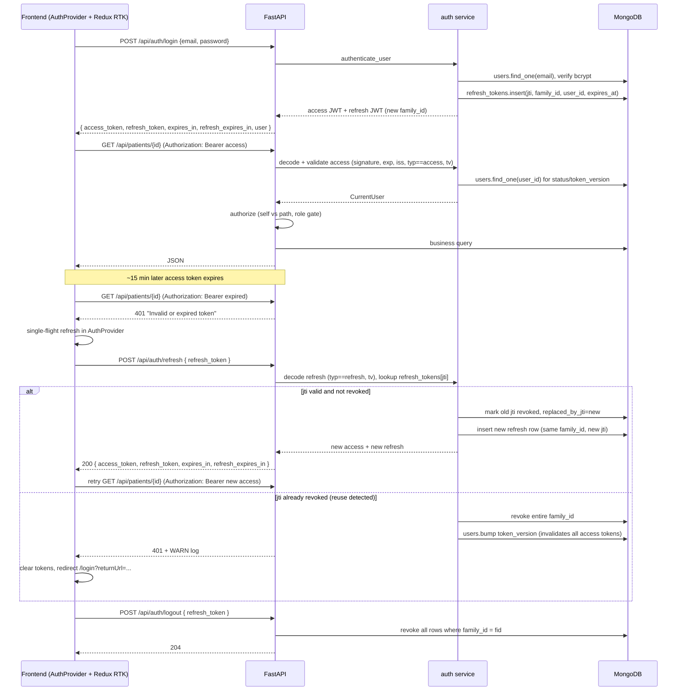

# Phase D — Authentication and API protection

## 1. Title & summary

This plan implements **Phase D** from [PLAN_PRODUCT_BUILD_ORDER.md](./PLAN_PRODUCT_BUILD_ORDER.md): email/password **signup and login**, **JWT issuance** and verification, **`GET /auth/me`**, and **credential requirements** for patient and doctor surfaces. It **replaces dev-only trust** (`X-Patient-Id` / `X-Doctor-Id` as sole identity) with an authenticated **`user_id`** from JWT while preserving a **narrowly scoped dev bypass** for local testing.

**Relationship to Redux / RTK Query (landed before Phase D frontend auth):** [PLAN_redux-rtk-query.md](./PLAN_redux-rtk-query.md) introduced **`@reduxjs/toolkit`**, **`react-redux`**, a single **`baseApi`** (`fetchBaseQuery` wrapper), and **`applyPrescribeHeaders`** in [`frontend/src/api/client.ts`](../../frontend/src/api/client.ts) shared by RTK and SSE. Phase D **does not** revert that stack; it **extends** the same header path with **`Authorization: Bearer`**, token lifecycle, and **401 → refresh → retry** behavior so **RTK Query, `apiFetch`, and streaming `fetch`** stay consistent. Dev identity headers remain subordinate to JWT when authenticated (see §4.5).

**Success criteria (observable):**

1. All patient/doctor portal APIs return **401** without a valid JWT when `AUTH_REQUIRED=true`.
2. Cross-tenant access returns **403** (patient A cannot read patient B; doctor A cannot read doctor B’s dashboard / connections / chat history).
3. `GET /api/chat/history/{chat_id}` no longer returns messages without **proven session ownership**.
4. Frontend logs in, persists tokens across full page reload (session-scoped), attaches **`Authorization: Bearer`** to **every** HTTP call (**RTK Query `baseApi`, `apiFetch`, and SSE `fetch`** via the same header helper), **silently refreshes** via `POST /api/auth/refresh` when the 15-minute access token expires, and **redirects unauthenticated users** to `/login` with a `returnUrl` when the refresh token is also invalid.
5. Reusing an already-rotated refresh token revokes the caller's entire session family and forces re-login (reuse detection verified by automated test).
6. Test suite includes an **automated route audit** that fails if any new route is added without explicit auth annotation.

## 2. Type & scope

| | |
|--|--|
| **Type** | Feature (cross-cutting infrastructure + behavior change) |
| **In scope** | Backend auth router; password hashing; JWT encode/decode with standard claims; **rotating refresh tokens with server-side `refresh_tokens` store, reuse detection, and family revocation**; `get_current_user` / role dependencies; protecting patient portal, doctor portal, chat, documents, connections, and suggestions APIs; frontend login/signup UI; token lifecycle **including single-flight silent renewal**; route guards with `returnUrl`; CORS tightening; automated route-audit test; seed/migration script for dev password hashes; docs updates. |
| **Out of scope** | OAuth / SSO; password reset via email; email verification flows; **refresh token delivery via `httpOnly` cookie (tracked as Phase D+1 follow-up)**; multi-factor auth; full admin UI (Phase E); production HIPAA/compliance hardening; new Phase A collections. |

**Signup policy (locked for Phase D):**

- **Patient self-signup:** **enabled** (`POST /api/auth/signup` with `role=patient`; body-provided role ignored or enforced to patient).
- **Doctor self-signup:** **disabled** by default. Env flag `ALLOW_DOCTOR_SELF_SIGNUP` (default `false`); doctor accounts are created by a Phase E admin or via the dev seed. This prevents random users from claiming `role=doctor` and reaching PHI routes through the **connection** system.
- **Admin self-signup:** **never** exposed through `/auth/signup`. Admins only via seed until Phase E.

## 3. Baseline (today)

**Backend**

- FastAPI app in [`backend/app/main.py`](../../backend/app/main.py); routers aggregated in [`backend/app/api/router.py`](../../backend/app/api/router.py). **No auth router**; no JWT or password libs in [`backend/requirements.txt`](../../backend/requirements.txt).
- CORS: [`main.py`](../../backend/app/main.py) currently sets `allow_origins=["*"]` with `allow_credentials=True` — **invalid combination** per the Fetch spec (browsers drop credentials). Must be tightened in Phase 1.
- Identity for chat: [`backend/app/api/dependencies.py`](../../backend/app/api/dependencies.py) exposes `get_current_patient_id` / `get_current_doctor_id` that **require headers** and return raw strings — no DB verification.
- Patient chat: [`backend/app/api/chat.py`](../../backend/app/api/chat.py) uses `X-Patient-Id` for `/message` and `/message/stream`. **`GET /history/{chat_id}` has no `Depends`** — anyone with a `chat_id` can read history (security gap).
- Doctor echo: [`backend/app/api/doctors.py`](../../backend/app/api/doctors.py) `GET /dev/echo` requires `X-Doctor-Id`; most doctor/patient routes **do not** require headers.
- Users: [`backend/app/schemas/user.py`](../../backend/app/schemas/user.py) defines `UserDocument` with `password_hash`; [`backend/app/repository/users.py`](../../backend/app/repository/users.py) includes `get_user_by_email_with_password_hash` — ready for login once hashes exist.
- Patient profiles link **`user_id`** ↔ clinical data ([`backend/app/schemas/patient.py`](../../backend/app/schemas/patient.py)). Chat sessions store `patient_id` (slug/UUID) and optional `doctor_id` ([`backend/app/repository/chat.py`](../../backend/app/repository/chat.py)).

**Frontend**

- **Redux + RTK Query:** [`frontend/src/store/index.ts`](../../frontend/src/store/index.ts) wires **`baseApi`** middleware; REST JSON flows use injected endpoints under [`frontend/src/api/*Api.ts`](../../frontend/src/api/) (see [`frontend/src/api/index.ts`](../../frontend/src/api/index.ts)). [`frontend/src/main.tsx`](../../frontend/src/main.tsx) wraps the app with `<Provider store={store}>`.
- **Shared headers:** [`frontend/src/api/client.ts`](../../frontend/src/api/client.ts) exposes **`applyPrescribeHeaders`** (dev `X-Patient-Id` / `X-Doctor-Id` via registered getters) and is invoked from [`frontend/src/api/baseApi.ts`](../../frontend/src/api/baseApi.ts)’s `baseQuery` **and** SSE / legacy `apiFetch` paths — **no `Authorization: Bearer` yet**.
- **Contexts:** [`PatientContext`](../../frontend/src/contexts/PatientContext.tsx) and [`IdentityContext`](../../frontend/src/contexts/IdentityContext.tsx) still drive dev identity for header getters; routing uses portal layouts — **no login/session** today (role switching dev-only).
- SSE uses `fetch` (not `EventSource`), so once Bearer attachment lands in `applyPrescribeHeaders`, streaming stays aligned with RTK.

**Docs**

- [`docs/ARCHITECTURE.md`](../../docs/ARCHITECTURE.md) and [`docs/FRONTEND_BACKEND_COLLABORATION.md`](../../docs/FRONTEND_BACKEND_COLLABORATION.md) document dev headers; the latter incorrectly references Phase E for auth and must be updated to Phase D.

## 4. Prior art & strategy

| Approach | Decision |
|----------|----------|
| **Keep header-only identity** | **Rejected** — forgeable, no cryptographic principal. |
| **Bearer JWT (HS256) with dev bypass flag** | **Selected** — standard for SPA + FastAPI, easy test fixtures, works with existing `fetch`-based SSE. |
| **Cookie-based session (httpOnly, SameSite)** | **Deferred** — better XSS posture but requires CORS/cookie plumbing and a CSRF story. Planned as a follow-up; Phase D leaves the door open by isolating token handling inside `AuthProvider` + `api/client.ts`. |
| **`owner_user_id` column on `chat_sessions`** | **Deferred** — existing `patient_id` + `doctor_id` plus profile resolution is sufficient for authorization; adding `owner_user_id` later simplifies audit queries and is a non-breaking additive migration. |
| **PyJWT vs python-jose** | **PyJWT** locked — smaller surface, actively maintained, no deprecated cryptography deps. |
| **bcrypt vs argon2** | **bcrypt via `passlib[bcrypt]`** locked — aligns with `UserDocument.password_hash`, well-known, good defaults. Rounds = **12** (tunable via config). |
| **Refresh model — stateless long-lived JWT** | **Rejected** — cannot revoke individual sessions, cannot detect reuse, cannot "log out everywhere" without a global `token_version` bump that also kills active sessions. |
| **Refresh model — opaque random string + DB lookup** | Considered. Keeps token contents hidden but loses stateless verification and adds a DB round-trip even on issuance. |
| **Refresh model — rotating JWT + server-side `jti` ledger with reuse detection** | **Selected** — short access (15 min) + rotating refresh (7 days) with a `refresh_tokens` collection keyed by `jti` and grouped by `family_id`. Each refresh revokes the old `jti` and issues a new pair in the same family. A second use of an already-revoked `jti` revokes the **entire family** and bumps `users.token_version`, invalidating every live access token for that user. |
| **Refresh token delivery** | **Phase D:** JSON response body + `sessionStorage` mirror, same pattern as the access token. **Phase D+1 follow-up:** move refresh token into `httpOnly; Secure; SameSite=Strict` cookie on `/api/auth/refresh` path only, keeping the access token in memory. Documented as the XSS-hardening migration. |

**Comparison to existing code:** Extend [`app/repository/users.py`](../../backend/app/repository/users.py) and [`app/schemas/user.py`](../../backend/app/schemas/user.py). Implement **`app/service/auth.py`** (hashing, token build/verify, authenticate) and **`app/api/auth.py`** (HTTP boundary) to stay consistent with API → Service → Repository layering ([`backend/CLAUDE.md`](../../backend/CLAUDE.md)). **Frontend:** auth attaches to the **existing** [`applyPrescribeHeaders`](../../frontend/src/api/client.ts) + [`baseApi` `baseQuery`](../../frontend/src/api/baseApi.ts) — do not add a parallel HTTP stack.

## 4.5. Security decisions (locked)

| Decision | Value |
|----------|-------|
| **JWT algorithm** | HS256 (symmetric, single backend). Rotate to RS256 only when adding a second consumer. |
| **Access token lifetime** | **15 minutes** (config `ACCESS_TOKEN_EXPIRE_MINUTES=15`). Shortened from 60 min now that a refresh flow exists. |
| **Refresh token lifetime** | **7 days** rolling (config `REFRESH_TOKEN_EXPIRE_DAYS=7`). Each successful `/auth/refresh` issues a new 7-day refresh token. |
| **Clock skew leeway** | 30 seconds on `exp`/`iat`, applied to both access **and** refresh tokens. |
| **Access JWT claims** | `sub` = `user_id`, `role` ∈ `UserRole`, `exp`, `iat`, `iss` = `"prescribe-v2"`, `typ` = `"access"`, `tv` = `token_version` (integer from `users.token_version`, for revocation). |
| **Refresh JWT claims** | `sub`, `role`, `exp`, `iat`, `iss`, `typ` = `"refresh"`, `tv`, `jti` = UUID4 (row id in `refresh_tokens`), `fid` = family UUID4 (stable across a login session; changed only by re-login). |
| **Refresh rotation & reuse detection** | `/auth/refresh` (a) verifies signature, `iss`, `typ=="refresh"`, `exp`, `tv`; (b) loads `refresh_tokens[jti]`; (c) if row is **missing** → 401; if row is **already revoked** → **security event**: revoke entire `family_id`, bump `users.token_version`, log WARN, return 401; if row is valid → stamp `revoked_at` + `replaced_by_jti`, issue new access + new refresh in the same `fid`, persist new row. |
| **Refresh store** | MongoDB collection `refresh_tokens`: `{ _id: jti, user_id, family_id, issued_at, expires_at, revoked_at, replaced_by_jti, user_agent, ip }`. **TTL index** on `expires_at` so expired rows self-delete. Compound index on `(user_id, family_id)` for logout and admin "sessions" views. |
| **Password policy** | ≥ 12 chars, ≥ 1 letter and 1 digit; reject common passwords list (small embedded list or optional `zxcvbn` — zxcvbn **deferred**). Enforced in schema validator. |
| **bcrypt rounds** | 12 (constant). |
| **Timing-safe login** | If user absent, **still run a dummy bcrypt verify** to equalize response time. |
| **Token storage (frontend)** | **Access token:** memory first, mirrored to `sessionStorage` key `prescribe_access_token`. **Refresh token:** mirrored to `sessionStorage` key `prescribe_refresh_token`. Never `localStorage`. Documented as XSS tradeoff; `httpOnly` cookie for refresh is the Phase D+1 follow-up tracked in § 10. |
| **Silent renewal (frontend)** | `AuthProvider` schedules a proactive refresh at `access.exp − 60s` (clamped, never negative). On any **`401`** from **`apiFetch` or the RTK `baseQuery` wrapper**, a **single-flight** refresh Promise is created; all other in-flight 401s await the same Promise and then retry the original request **once** (RTK: retry the inner `fetchBaseQuery` call with a fresh `Authorization` header). Paths under `/api/auth/refresh` (and the refresh helper itself) **must not** re-enter the 401 handler. If refresh fails, tokens are cleared and the user is redirected to `/login?returnUrl=...`. |
| **Revocation** | Two-layer. (1) Per-session: the `refresh_tokens` ledger allows revoking an individual `jti` (rotation) or an entire `family_id` (logout, reuse detection). (2) Global: `users.token_version` is incremented on password change and on "log out everywhere"; JWT `tv` must equal current `token_version` for **both** access and refresh or the token is rejected. |
| **Logout** | `POST /api/auth/logout` revokes the caller's refresh `family_id` (all rows), clears frontend state, and navigates to `/login`. Calling logout without a refresh token is a no-op 204. |
| **Dev bypass** | Allowed only when `AUTH_REQUIRED=false` **and** `ENVIRONMENT` ∈ `{"local","test"}`. Any other environment forces auth even if the flag is set. |
| **CORS** | Replace `allow_origins=["*"]` with explicit origin list from config (`CORS_ALLOWED_ORIGINS`, default `http://localhost:5173`). Keep `allow_credentials` only if cookies are introduced. |
| **OpenAPI** | Register `HTTPBearer` security scheme so Swagger UI (`/docs`) can test protected endpoints. |
| **Rate limiting** | Deferred; documented as Phase-E follow-up. Phase D adds a **log line per failed login** so ops can observe abuse pre-limiter. |

## 5. Target architecture



**Identity rules (normative):**

1. When `AUTH_REQUIRED=true`, every route except the allow-list (see §7) requires `Authorization: Bearer`. Missing/invalid → **401**.
2. **`role: patient`** — may access **only** their own `patient_profiles` row, own documents, own chat sessions where `doctor_id` is null. `X-Patient-Id` header is **ignored** when JWT is present.
3. **`role: doctor`** — path `doctor_id` must equal `JWT.sub`; access to a specific patient additionally requires an **active connection** (existing Phase C rule preserved).
4. **`role: admin`** — Phase D covers only `GET /auth/me`; broad admin protection is Phase E.
5. **Chat history (`GET /api/chat/history/{chat_id}`)** loads session → asserts ownership (`patient_id` matches resolved patient profile **and** `doctor_id` is null for patient callers; `doctor_id == JWT.sub` for doctor callers). Returns **404** if no session, **403** if mismatch, **200** otherwise.

## 6. Directory & file plan

| Path | Purpose | New / modify |
|------|---------|--------------|
| [`backend/requirements.txt`](../../backend/requirements.txt) | Add pinned `passlib[bcrypt]>=1.7.4`, `PyJWT>=2.9.0`, `bcrypt>=4.2.0` | modify |
| [`backend/app/config.py`](../../backend/app/config.py) | `JWT_SECRET`, `JWT_ALGORITHM="HS256"`, `ACCESS_TOKEN_EXPIRE_MINUTES=15`, `REFRESH_TOKEN_EXPIRE_DAYS=7`, `AUTH_REQUIRED=True`, `ENVIRONMENT`, `ALLOW_DOCTOR_SELF_SIGNUP=False`, `CORS_ALLOWED_ORIGINS`, `BCRYPT_ROUNDS=12` | modify |
| [`backend/app/main.py`](../../backend/app/main.py) | Tighten CORS; register `HTTPBearer` in OpenAPI; startup sanity check (fail if `AUTH_REQUIRED` and no `JWT_SECRET`) | modify |
| [`backend/app/schemas/user.py`](../../backend/app/schemas/user.py) | Add `token_version: int = 0` to `UserDocument` and `UserRead` | modify |
| [`backend/app/repository/users.py`](../../backend/app/repository/users.py) | Helpers: `set_password_hash`, `bump_token_version`, `touch_last_login` | modify |
| `backend/app/repository/refresh_tokens.py` | Motor CRUD for `refresh_tokens` collection: `insert`, `get_by_jti`, `revoke_by_jti`, `revoke_family`, `ensure_indexes` (TTL on `expires_at`, compound on `(user_id, family_id)`) | **new** |
| `backend/app/schemas/auth.py` | `SignupRequest`, `LoginRequest`, `TokenPair`, `RefreshRequest`, `LogoutRequest`, `MeResponse`, password validator | **new** |
| `backend/app/service/auth.py` | `hash_password`, `verify_password`, `create_access_token`, `create_refresh_token`, `decode_access_token`, `decode_refresh_token`, `issue_token_pair`, `rotate_refresh_token`, `revoke_family`, `authenticate_user`, `CurrentUser` dataclass | **new** |
| `backend/app/api/auth.py` | `POST /signup`, `POST /login`, `POST /refresh`, `POST /logout`, `GET /me` | **new** |
| [`backend/app/database/connection.py`](../../backend/app/database/connection.py) | Call `refresh_tokens.ensure_indexes()` on startup lifespan | modify |
| [`backend/app/api/dependencies.py`](../../backend/app/api/dependencies.py) | `get_current_user`, `get_optional_user`, `require_patient`, `require_doctor`, `resolve_patient_context` | modify |
| [`backend/app/api/router.py`](../../backend/app/api/router.py) | Mount `auth` router at `/auth` | modify |
| [`backend/app/api/chat.py`](../../backend/app/api/chat.py), [`patients.py`](../../backend/app/api/patients.py), [`documents.py`](../../backend/app/api/documents.py), [`suggestions.py`](../../backend/app/api/suggestions.py), [`doctors.py`](../../backend/app/api/doctors.py), [`doctor_patients.py`](../../backend/app/api/doctor_patients.py), [`doctor_chat.py`](../../backend/app/api/doctor_chat.py), [`connections.py`](../../backend/app/api/connections.py) | Add `Depends` + ownership checks | modify |
| `backend/app/scripts/set_dev_passwords.py` | One-shot util to set bcrypt hashes on seeded users from `DEV_DEFAULT_PASSWORD` env | **new** |
| `backend/tests/conftest.py` | Shared fixtures: `test_settings`, `patient_token`, `doctor_token`, `auth_headers_*` | **new or modify** |
| `backend/tests/test_auth_service.py`, `test_refresh_repository.py`, `test_api_auth.py`, `test_route_audit.py` | Unit + API + refresh rotation / reuse detection + route-audit tests | **new** |
| Update `test_api_chat.py`, `test_api_patients*.py`, `test_api_doctors*.py` | Swap `X-Patient-Id` for Bearer headers where auth is required | modify |
| [`frontend/src/api/client.ts`](../../frontend/src/api/client.ts) | Extend **`applyPrescribeHeaders`** (or a small companion) to attach **`Authorization: Bearer`** when an access token is available (via a **registered getter**, mirroring patient/doctor id getters); keep dev headers when JWT absent / dev bypass. Export **`registerAccessTokenGetter`** (or equivalent) used by `AuthProvider`. | modify |
| [`frontend/src/api/baseApi.ts`](../../frontend/src/api/baseApi.ts) | Wrap `rawBaseQuery` so **`401`** triggers the same **single-flight refresh + one retry** as `apiFetch` (shared module — e.g. `authRefresh.ts`); ensure `/api/auth/refresh` and auth mutations skip the refresh loop (`meta` / `skipAuthRefresh` flag). | modify |
| `frontend/src/api/authApi.ts` (or `frontend/src/api/auth.ts`) | RTK **`injectEndpoints`**: `login`, `signup`, `getMe`, `refresh`, `logout` — **refresh/logout** use `skipAuthRefresh` / `skip401Handler` so the base query does not recurse. Alternatively thin imperative wrappers that call `fetch` with shared headers; prefer **one** style for maintainability (RTK preferred for parity with the rest of the app). | **new** |
| `frontend/src/contexts/AuthContext.tsx` | state `{ accessToken, refreshToken, user, status }`; `sessionStorage` mirror for both tokens; bootstrap `/me`; single-flight `refreshPromise` ref; proactive refresh timer at `exp − 60s`; `login`, `logout`; register token getter + **unauthorized** handler with **`client.ts` / `baseApi` wrapper** | **new** |
| `frontend/src/pages/LoginPage.tsx`, `SignupPage.tsx` | Forms with validation | **new** |
| `frontend/src/router.tsx` | `/login`, `/signup`, `RequireAuth` loader/guard, `returnUrl` | modify |
| `frontend/src/layouts/RootLayout.tsx` | Wrap `AuthProvider` above `IdentityProvider` | modify |
| [`docs/FRONTEND_BACKEND_COLLABORATION.md`](../../docs/FRONTEND_BACKEND_COLLABORATION.md), [`docs/ARCHITECTURE.md`](../../docs/ARCHITECTURE.md), [`docs/LOCAL_DEVELOPMENT.md`](../../docs/LOCAL_DEVELOPMENT.md), [`docs/TESTING.md`](../../docs/TESTING.md) | Auth endpoints, Bearer, 401/403, fixtures | modify |

## 7. API / data

**New endpoints** (mounted under `/api/auth` via `api_router`):

| Method | Path | Request | Response | Status codes |
|--------|------|---------|----------|--------------|
| `POST` | `/api/auth/signup` | `{ email, password }` (role forced to `patient`; doctor/admin rejected unless `ALLOW_DOCTOR_SELF_SIGNUP=true` and body role=doctor) | `TokenPair` + `user: MeResponse` | 201, 409 duplicate email, 422 policy |
| `POST` | `/api/auth/login` | `{ email, password }` | `TokenPair` + `user: MeResponse` | 200, 401 bad creds, 403 inactive |
| `POST` | `/api/auth/refresh` | `{ refresh_token }` | `TokenPair` (new access + new refresh, same `fid`) | 200, 401 invalid/expired/unknown/reused |
| `POST` | `/api/auth/logout` | `{ refresh_token }` (optional) | — | 204; 204 even when token already invalid (idempotent) |
| `GET` | `/api/auth/me` | — (Bearer access) | `MeResponse` | 200, 401 |

**TokenPair**

```python
class TokenPair(BaseModel):
    access_token: str
    refresh_token: str
    token_type: Literal["bearer"] = "bearer"
    expires_in: int          # access TTL in seconds  (e.g. 900)
    refresh_expires_in: int  # refresh TTL in seconds (e.g. 604800)
```

**MeResponse** — `user_id`, `role`, `email`, `status`, `email_verified`, `profile_completed`, plus role-specific hint (`patient_slug` when profile exists, else `null`).

**JWT claim examples**

Access:

```json
{
  "sub": "uuid-...",
  "role": "patient",
  "exp": 1713550000,
  "iat": 1713549100,
  "iss": "prescribe-v2",
  "typ": "access",
  "tv": 0
}
```

Refresh:

```json
{
  "sub": "uuid-...",
  "role": "patient",
  "exp": 1714155000,
  "iat": 1713550200,
  "iss": "prescribe-v2",
  "typ": "refresh",
  "tv": 0,
  "jti": "c1b2a3d4-...",
  "fid": "f00dcafe-..."
}
```

**Allow-list (no auth required):**

- `GET /health`
- `POST /api/auth/signup`, `POST /api/auth/login`, `POST /api/auth/refresh`, `POST /api/auth/logout`
- `GET /api/config/features` (already public)

`POST /api/auth/refresh` is "public" only in the sense that it takes no Bearer header; its security comes from the refresh JWT in the body plus the server-side `jti` lookup. `POST /api/auth/logout` is idempotent and never raises on unknown input.

Every other route is protected. `GET /api/patients/for-chat` and `GET /api/doctors/for-dev` are **gated** when `AUTH_REQUIRED=true` (they exist for the dev picker; behind auth they remain safe to expose to authenticated principals).

**Casing:** snake_case in JSON, per existing contract.

**Migration:** Existing seeded users have `password_hash=None` ([`backend/seed.py`](../../backend/seed.py)). New util `set_dev_passwords.py` reads `DEV_DEFAULT_PASSWORD` from env and writes bcrypt hashes for all seeded users, or per-user `DEV_PASSWORD_<email>` for variety. **No passwords committed.**

## 8. Edge cases & failure handling

- **Missing token on protected route** → 401 `detail: "Authentication required"`.
- **Invalid signature / expired** → 401 `detail: "Invalid or expired token"`.
- **`tv` mismatch** → 401 (after password change, old tokens rejected).
- **User `status != ACTIVE`** → 403 on `/me` and all protected calls.
- **Patient JWT requests another patient’s path** → 403.
- **Doctor JWT with path `doctor_id != sub`** → 403.
- **Chat session `doctor_id` set but caller is patient** → 403 on history.
- **Legacy sessions without `doctor_id`** → existing Phase C rule (doctor gets 403) preserved.
- **Signup with duplicate email** → 409.
- **Signup with role=doctor when policy disabled** → 422.
- **Timing attack on login** → dummy bcrypt verify when user absent.
- **SSE mid-stream token expiry** → stream was authorized at open; connection continues to `done`. The **next** SSE call triggers silent refresh. A mid-stream hard 401 still surfaces via the existing `error` SSE event.
- **Concurrent tabs after logout** → `storage` event on the `sessionStorage` mirror key clears other tabs.
- **CORS preflight** → explicit origins allow the Docker dev host; failures surface as browser network errors, not 401.
- **Refresh: valid jti not in store** (server restart wiped Mongo, or token forged with known secret but no row) → 401 `detail: "Invalid refresh token"`; frontend clears and redirects to `/login`.
- **Refresh: jti already revoked (reuse detection)** → revoke entire `family_id`, bump `users.token_version`, log WARN `auth.refresh_reuse_detected` with `user_id`, `fid`, `jti`, return 401. All other tabs using the same family will also hit 401 and redirect.
- **Refresh: expired refresh token** → 401 `detail: "Refresh token expired"`; frontend redirects to `/login?returnUrl=...`.
- **Refresh: `tv` mismatch** (password changed elsewhere) → 401; user must log in again.
- **Concurrent 401s in the same tab** → single-flight: `AuthProvider.refreshPromise` is created by the first 401, later 401s `await` the same Promise. After it resolves, each original caller retries once.
- **Refresh during refresh (network race)** → `rotate_refresh_token` is atomic per `jti`: the first call sets `revoked_at` in a Mongo `find_one_and_update({revoked_at: null})`. The second call finds the row already revoked and triggers reuse detection. Frontend single-flight prevents this for a single well-behaved client; the server still enforces it.
- **Clock skew on refresh** → same 30 s leeway as access tokens.
- **Logout with no refresh token on client** → FE still clears local state and calls `POST /logout` with empty body; server returns 204.
- **Logout "everywhere"** (future, but the plumbing exists) → `POST /api/auth/logout?all=true` revokes **every** family for the user and bumps `token_version`. Phase D ships the underlying primitives; the `?all=true` flag is wired but the UI entry point is Phase E.

## 9. Testing strategy

**Backend**

1. **Unit (`test_auth_service.py`)**
   - bcrypt hash + verify round-trip; reject empty and too-short passwords.
   - `create_access_token` / `decode_access_token`: happy path, bad signature, expired (freeze time), wrong `iss`, wrong `typ` (refresh token presented as access), `tv` mismatch.
   - `create_refresh_token` / `decode_refresh_token`: happy path, expired, wrong `typ`, `tv` mismatch, new `jti`/`fid` generated each login.
   - `rotate_refresh_token`: valid rotation returns new pair with same `fid`, persists new row, revokes old row with `replaced_by_jti`; second rotation of the same `jti` → reuse detected → entire family revoked + `users.token_version` bumped.
2. **API (`test_api_auth.py`)**
   - `POST /signup` 201 + `/me` 200 with returned access token; refresh row written; duplicate email 409.
   - `POST /login` 200; wrong password 401; inactive user 403; each login starts a fresh `family_id`.
   - `GET /me` 401 without token; 200 with token.
   - `POST /refresh` happy path returns **new** access and **new** refresh; old refresh no longer works; `family_id` preserved.
   - `POST /refresh` with expired refresh → 401.
   - `POST /refresh` reuse attack: rotate once, then replay the original refresh → 401 **and** any access token in that family is rejected on the next call (verify by calling `/me`).
   - `POST /refresh` after `users.token_version` bump (password change) → 401 even if refresh row is still "valid".
   - `POST /logout` revokes the whole family; subsequent `/refresh` with **any** token from that family → 401.
   - `POST /logout` with malformed body → 204 (idempotent).
3. **Authorization regression**
   - Patient A fetching patient B’s profile/documents/history → 403.
   - Doctor A hitting doctor B’s dashboard/connections/chat history → 403.
   - Patient calling doctor routes → 403.
4. **Automated route audit (`test_route_audit.py`)**
   - Walk `app.routes`; for each `APIRoute` not in an explicit allow-list, send an unauthenticated request; assert status `∈ {401, 403, 405}`. Adding a new public route requires explicit allow-list update — **this is the guardrail** against accidental public endpoints.
5. **Fixtures (`conftest.py`)** — shared across all test modules:

   ```python
   @pytest.fixture
   def patient_token(test_settings, seed_users) -> str:
       return create_access_token(user_id="patient-1", role=UserRole.PATIENT)

   @pytest.fixture
   def auth_headers_patient(patient_token) -> dict:
       return {"Authorization": f"Bearer {patient_token}"}
   ```

**Frontend**

- `npm run build` typecheck gate.
- Extend Vitest coverage: **`baseApi` 401 → refresh → retry** (alongside existing header tests); optional MSW integration test for one authenticated RTK query.
- Manual QA checklist in `docs/TESTING.md`: login, reload survival (`sessionStorage`), logout, 401 auto-redirect with `returnUrl`, role-scoped routes, **RTK-cached view** + **SSE chat** after token rotation.

**Determinism**

- Tests set `JWT_SECRET=test-secret`, `AUTH_REQUIRED=true`, `ENVIRONMENT=test` via env or fixture.
- No live LLM calls; existing mocks in `test_api_chat.py` remain.

## 10. Risks & rollback

| Risk | Mitigation |
|------|------------|
| A protected route is missed and leaks data | `test_route_audit.py` enumerates all routes; CI failure on new unprotected endpoint. |
| Dev experience regression | `ENVIRONMENT=local` + `AUTH_REQUIRED=false` allowed; `set_dev_passwords.py` + documented login in `docs/LOCAL_DEVELOPMENT.md`. |
| XSS exfiltrates refresh token from `sessionStorage` | Biggest residual risk now that refresh lives 7 days. Mitigations: refresh rotation + reuse detection (stolen token becomes a self-nuke the moment the legit client rotates once); `sessionStorage` (not `localStorage`) limits blast radius to the current tab; short 15 min access TTL; follow-up migrates refresh into `httpOnly; Secure; SameSite=Strict` cookie scoped to `/api/auth/refresh`. Phase D adds strict CSP headers only if trivial — otherwise a follow-up. |
| Refresh reuse false positive (legitimate double-submit during a flaky network) | Single-flight `refreshPromise` on the frontend prevents concurrent refreshes from the same tab; server rotation is atomic via `find_one_and_update({revoked_at: null})` so at most one call succeeds and the other gets 401. Users experience "please log in again" in the rare multi-tab race — acceptable tradeoff for reuse detection. |
| RTK `baseQuery` and `apiFetch` implement refresh differently | **Mitigation:** one shared module (`ensureFreshAccessToken` + 401 retry) imported by both; add a Vitest test that mocks `401` → refresh → retry for the wrapper (see [`frontend/src/api/baseApi.test.ts`](../../frontend/src/api/baseApi.test.ts)). |
| `refresh_tokens` collection grows unbounded | TTL index on `expires_at` auto-removes expired rows; compound index `(user_id, family_id)` keeps logout O(family size). Verified in `test_refresh_repository.py`. |
| CORS change breaks dev | `CORS_ALLOWED_ORIGINS` defaults include `http://localhost:5173`; documented. |
| JWT secret committed | `.env.example` ships placeholder only; backend **refuses to start** when `AUTH_REQUIRED=true` and secret is empty or a known default. |
| bcrypt cost too high on slow dev machines | Config-exposed `BCRYPT_ROUNDS`; default 12, override 10 in `ENVIRONMENT=test`. |
| Rolling back | `AUTH_REQUIRED=false` preserves Phase C behavior because dependencies fall back to `get_optional_user` + legacy headers; feature flag is the rollback lever. |

---

## 11. Implementation phases (detailed)

**Implementation order overview**

1. Phase 1 — Foundations: config, crypto, JWT, CORS hardening
2. Phase 2 — Auth HTTP API: signup, login, me, OpenAPI scheme
3. Phase 3 — Protect patient surface (chat, patients, documents, suggestions)
4. Phase 4 — Protect doctor surface + connections + route-audit test
5. Phase 5 — Frontend: AuthProvider, Bearer, RequireAuth with returnUrl (**extends existing Redux + RTK `baseApi`**, shared 401/refresh)
6. Phase 6 — Seeds, docs, regression, plan-vs-diff verification

---

### Phase 1 — Foundations (config, crypto, JWT, CORS)

| | |
|--|--|
| **Goal** | Stand up secure configuration and a **testable auth service** (access + refresh primitives) without touching any existing route. Tighten CORS so browser auth works once tokens land. |
| **Prerequisites** | None. |
| **Scope** | Backend only. No HTTP behavior change except CORS origins. **Deferred:** rate limiting, zxcvbn, refresh-token cookie delivery. |
| **Tasks** | 1. Pin `passlib[bcrypt]`, `PyJWT`, `bcrypt` in [`requirements.txt`](../../backend/requirements.txt). 2. Extend [`config.py`](../../backend/app/config.py) per §4.5 — includes `ACCESS_TOKEN_EXPIRE_MINUTES=15` and `REFRESH_TOKEN_EXPIRE_DAYS=7`. 3. Add startup assertion in [`main.py`](../../backend/app/main.py): when `AUTH_REQUIRED` is true, `JWT_SECRET` must be non-empty and not equal to `"change-me"`. 4. Replace CORS `allow_origins=["*"]` with `settings.CORS_ALLOWED_ORIGINS`. 5. Add `token_version: int = 0` to `UserDocument` (defaults keep backwards compatibility). 6. Create `app/schemas/auth.py` DTOs (`SignupRequest`, `LoginRequest`, `RefreshRequest`, `LogoutRequest`, `TokenPair`, `MeResponse`) with password validator. 7. Create `app/repository/refresh_tokens.py` with `ensure_indexes` (TTL on `expires_at`, compound on `(user_id, family_id)`), `insert`, `get_by_jti`, `rotate(jti, new_jti, new_expires_at)` (atomic `find_one_and_update({_id: jti, revoked_at: null}, {$set: {revoked_at, replaced_by_jti}})`), `revoke_family(user_id, family_id)`. Hook `ensure_indexes` into the FastAPI lifespan. 8. Create `app/service/auth.py`: `hash_password(p, rounds=settings.BCRYPT_ROUNDS)`, `verify_password`, `create_access_token(user)`, `create_refresh_token(user, family_id)`, `decode_access_token`, `decode_refresh_token`, `issue_token_pair(user, family_id=None)` (new family on login), `rotate_refresh_token(db, refresh_jwt)` (handles reuse detection + `token_version` bump), `revoke_family(db, user_id, family_id)`, `authenticate_user(db, email, password)` with **timing-safe dummy hash** when user missing. 9. Write `backend/tests/test_auth_service.py` (access + refresh unit tests per §9.1) and `backend/tests/test_refresh_repository.py` (TTL index assertion, atomic rotation, family revoke). |
| **Deliverables** | New modules; green unit tests; CORS tightened; `refresh_tokens` collection + indexes created on startup. |
| **Verification** | `python -m pytest tests/test_auth_service.py tests/test_refresh_repository.py -v`; `docker compose up --build -d` starts cleanly with new env; `curl -I http://localhost:8000/health` succeeds; `docker compose exec mongo mongosh --quiet --eval 'db.refresh_tokens.getIndexes()'` shows the TTL index. |
| **Notes** | Keep `app/service/auth.py` **pure** (no HTTP / no `Depends`) so it’s unit-testable without `TestClient`. The **only** Mongo dependency is `app/repository/refresh_tokens.py`, injected into service functions. |

---

### Phase 2 — Auth HTTP API + OpenAPI security scheme

| | |
|--|--|
| **Goal** | `/api/auth/signup`, `/api/auth/login`, `/api/auth/refresh`, `/api/auth/logout`, `/api/auth/me` work end-to-end; Swagger UI can exercise protected endpoints once they exist. |
| **Prerequisites** | Phase 1. |
| **Scope** | New router; `HTTPBearer` registration; no existing routes changed. |
| **Tasks** | 1. Implement `POST /signup` — enforce `role=patient` unless `ALLOW_DOCTOR_SELF_SIGNUP`; call `users.create_user` then `set_password_hash`; call `issue_token_pair(user)` (new family) and persist the refresh row. 2. Implement `POST /login` — load via `get_user_by_email_with_password_hash`, timing-safe verify, check `status`, `issue_token_pair(user)` (new family), `touch_last_login`. 3. Implement `POST /refresh` — decode refresh, call `rotate_refresh_token`; on reuse or invalidity return 401 with generic `detail`; on success return new `TokenPair`. Record `user_agent` + client IP on the new row. 4. Implement `POST /logout` — decode refresh (best-effort), revoke the `family_id`; accept `?all=true` to revoke every family for the user **and** bump `token_version`. Always 204, even on malformed input. 5. Implement `GET /me` — `Depends(get_current_user)`; include `patient_slug` lookup when role=patient. 6. Register router in [`router.py`](../../backend/app/api/router.py). 7. Add `HTTPBearer` security to `FastAPI` so `/docs` picks it up; mark `/refresh` and `/logout` as public in OpenAPI (they don't carry a Bearer). 8. `test_api_auth.py` covers 201/200/204/401/403/409/422 including the refresh/reuse/logout matrix from §9.2. |
| **Deliverables** | Auth flows documented in OpenAPI; tests passing. |
| **Verification** | `python -m pytest tests/test_api_auth.py tests/test_auth_service.py tests/test_refresh_repository.py -v`; browse `/docs` and log in with seeded user, exchange a refresh, attempt reuse, logout. |
| **Notes** | **Log** failed logins and `auth.refresh_reuse_detected` events at WARNING level with email prefix + IP so ops can observe abuse even before rate limiting. **Never** return `detail` that distinguishes "unknown jti" from "revoked jti" from "expired" — always `"Invalid refresh token"` — to avoid oracles. |

---

### Phase 3 — Protect patient surface (chat, patients, documents, suggestions)

| | |
|--|--|
| **Goal** | Every patient-facing API requires auth; caller can only touch their own data; `X-Patient-Id` becomes advisory (ignored when JWT present). |
| **Prerequisites** | Phase 2. |
| **Scope** | [`chat.py`](../../backend/app/api/chat.py), [`patients.py`](../../backend/app/api/patients.py), [`documents.py`](../../backend/app/api/documents.py), [`suggestions.py`](../../backend/app/api/suggestions.py). **Deferred:** `owner_user_id` on `chat_sessions`. |
| **Tasks** | 1. Implement `get_current_user` in [`dependencies.py`](../../backend/app/api/dependencies.py): parse `Authorization: Bearer`, decode, check `status` and `token_version`, return `CurrentUser`. 2. Add `get_optional_user` so `AUTH_REQUIRED=false` path keeps Phase C behavior. 3. Add `resolve_patient_context(user)` — returns `(user_id, patient_slug)` by querying `patient_profiles`. 4. **Chat** — replace `get_current_patient_id` on `/message` and `/message/stream` with `resolve_patient_context`; **protect `/history/{chat_id}`** with ownership check (load session, compare). 5. **Patients** — `GET/PUT /{patient_id}` assert resolved profile matches caller; `GET /patients` list becomes **self-only** for `role=patient`. 6. **Documents** — every doc path asserts ownership via `patient_id → user_id`. 7. **Suggestions** — same. 8. Update `test_api_chat.py` and add `test_api_patients_auth.py`, `test_api_documents_auth.py`, `test_api_suggestions_auth.py` with cross-patient 403 cases and SSE auth happy path (`X-Patient-Id` removed, Bearer added). |
| **Deliverables** | Patient APIs locked down; history no longer leaks. |
| **Verification** | `python -m pytest tests/ -v`; manual: log in as seeded patient, send chat, download document; log in as another patient, confirm 403. |
| **Notes** | Maps to §8 (patient mismatch) and the baseline history gap in §3. |

---

### Phase 4 — Protect doctor surface + automated route audit

| | |
|--|--|
| **Goal** | Doctor routes enforce self-match; connections and doctor chat respect JWT; a **CI guardrail** prevents future unprotected routes. |
| **Prerequisites** | Phase 3. |
| **Scope** | [`doctors.py`](../../backend/app/api/doctors.py), [`doctor_patients.py`](../../backend/app/api/doctor_patients.py), [`doctor_chat.py`](../../backend/app/api/doctor_chat.py), [`connections.py`](../../backend/app/api/connections.py), new `tests/test_route_audit.py`. |
| **Tasks** | 1. Add `require_doctor(user)` and `verify_doctor_path(path_doctor_id, user)` helpers. 2. Apply to every `/api/doctors/{doctor_id}/...` endpoint. 3. Gate or remove `/dev/echo`; gate `/for-dev` behind auth when `AUTH_REQUIRED`. 4. Doctor chat history: load session, require `session.doctor_id == user.user_id`; 403 on legacy (no `doctor_id`). 5. Preserve existing Phase C **connection-active** gate — compose with auth. 6. Write `test_api_doctors_auth.py` for cross-doctor 403, and `test_route_audit.py` (see §9.4). 7. Update `docs/FRONTEND_BACKEND_COLLABORATION.md` tables. |
| **Deliverables** | Doctor surface protected; route audit in CI path. |
| **Verification** | `python -m pytest tests/ -v`; inspect `test_route_audit.py` output to confirm the allow-list matches §7. |
| **Notes** | After this phase, adding a new endpoint without `Depends(get_current_user)` (and without allow-listing) **fails tests**. |

---

### Phase 5 — Frontend: AuthProvider, Bearer, RequireAuth (on Redux + RTK Query)

| | |
|--|--|
| **Goal** | A user logs in, reloads, and keeps working across the **whole refresh lifetime** via silent renewal; unauthenticated users are redirected with a `returnUrl`; **RTK Query**, **`apiFetch`**, and **SSE** all send Bearer and share one refresh story. |
| **Prerequisites** | Phase 2 (auth endpoints live, including `/refresh` and `/logout`); Phases 3–4 for meaningful E2E. **Already in repo:** Redux store + `baseApi` (see §3 Frontend baseline and [PLAN_redux-rtk-query.md](./PLAN_redux-rtk-query.md)). |
| **Scope** | [`client.ts`](../../frontend/src/api/client.ts), [`baseApi.ts`](../../frontend/src/api/baseApi.ts), new `authApi` (or equivalent), `AuthContext`, pages, [`router.tsx`](../../frontend/src/router.tsx), [`RootLayout.tsx`](../../frontend/src/layouts/RootLayout.tsx). **Deferred:** password reset, email verify, `httpOnly` cookie delivery for refresh. |
| **Tasks** | 1. **Headers:** extend `applyPrescribeHeaders` (or companion) with **`Authorization: Bearer`** when `AuthProvider` registers a non-empty access token; when JWT is present, **omit or ignore** dev identity headers per backend rules (see §5 identity rules — typically do not send `X-Patient-Id` / `X-Doctor-Id` for real auth). 2. **`api/auth` surface:** add **`authApi`** via `baseApi.injectEndpoints` for `login`, `signup`, `getMe`, `refresh`, `logout` — **or** thin `fetch` helpers that still use `applyPrescribeHeaders`; mark refresh/logout so the **401 wrapper does not recurse** (`meta.skipAuthRefresh` / dedicated `fetch` for refresh). 3. **`AuthContext`:** state `{ accessToken, refreshToken, user, status }`; **memory + `sessionStorage` mirror** for both tokens; on mount, `/me` if access present else one `/refresh` if only refresh present; register **access token getter** + **`ensureFreshAccessToken`** with the shared auth module used by `client` / `baseApi`. 4. **Single-flight refresh:** one module-level `refreshPromise` shared by **`apiFetch` and the RTK `baseQuery` wrapper** — `ensureFreshAccessToken()` dedupes callers. 5. **RTK `baseQuery`:** wrap existing `rawBaseQuery`; on **`401`** (and not `skipAuthRefresh`), await `ensureFreshAccessToken()`, **retry the request once** with updated headers; if refresh fails, clear tokens + navigate `/login?returnUrl=...`. 6. **`apiFetch`:** same 401 behavior as today’s plan (attach Bearer via headers helper; single-flight refresh + one retry). 7. **Proactive refresh timer** at `access.exp − 60s` as in §4.5. 8. Pages: `LoginPage`, `SignupPage`; router `/login`, `/signup`; `<RequireAuth>` on portal subtrees. 9. **`IdentityProvider`:** when authenticated, **drive role from `user.role`**; dev picker only when `ENVIRONMENT=local` + dev bypass. 10. Doctor routes: use **`user.user_id`** for `doctor_id` paths when authenticated. 11. `logout()` → POST `/api/auth/logout`, cancel timer, clear storage, navigate `/login`. 12. **Cross-tab:** `storage` event on `prescribe_refresh_token` cleared → sync logout. 13. **Cache:** on login/logout, `dispatch(baseApi.util.resetApiState())` or targeted invalidation so stale patient/doctor queries do not leak across users (tune in implementation). |
| **Deliverables** | Working auth UX; Bearer on **RTK and non-RTK** requests; SSE still streams; refresh reuse still kicks the user out. |
| **Verification** | `cd frontend && npm run build`; manual matrix includes **an RTK-backed page** (e.g. profile load via `useGetPatientQuery`) and **one SSE chat** after token expiry simulation — both must recover via refresh. Same cases as before: 16m wait, delete access token in storage, `returnUrl`, two-tab logout, tampered refresh. |
| **Notes** | `sessionStorage` tradeoff unchanged (§10). Update [`frontend/CLAUDE.md`](../../frontend/CLAUDE.md): document **JWT + RTK Query** — `applyPrescribeHeaders`, **`baseQuery` 401 handling**, and that silent refresh lives in a **shared** module (not duplicated per endpoint). |

---

### Phase 6 — Seeds, docs, regression, plan-vs-diff verification

| | |
|--|--|
| **Goal** | Make Phase D operable, documented, and auditable. |
| **Prerequisites** | Phases 1–5. |
| **Scope** | `set_dev_passwords.py`, doc updates, final pytest + build, diff review. |
| **Tasks** | 1. Implement `scripts/set_dev_passwords.py` — reads `DEV_DEFAULT_PASSWORD` (required to run) and writes bcrypt hashes to all seeded users; idempotent. 2. Update [`docs/LOCAL_DEVELOPMENT.md`](../../docs/LOCAL_DEVELOPMENT.md) with login steps and env example. 3. Update [`docs/FRONTEND_BACKEND_COLLABORATION.md`](../../docs/FRONTEND_BACKEND_COLLABORATION.md): auth table, Bearer note, correct Phase-D reference, mark dev headers as legacy-only. 4. Update [`docs/ARCHITECTURE.md`](../../docs/ARCHITECTURE.md) request flow with JWT decode step. 5. Update [`docs/TESTING.md`](../../docs/TESTING.md) with fixture list and the route-audit guardrail. 6. Run full suite: `docker compose exec backend python -m pytest tests/ -v` + `npm run build`. 7. **Final verification chat** per `/create-plan`: walk §6–§11, run `git diff` vs plan, document any intentional deviations. |
| **Deliverables** | Green tests; accurate docs; seed accounts usable. |
| **Verification** | `docker compose exec backend python -m pytest tests/ -v`; manual smoke on Docker stack. |

---

## Appendix A — Fixture sketch

```python
@pytest.fixture
def test_settings(monkeypatch):
    monkeypatch.setenv("JWT_SECRET", "test-secret")
    monkeypatch.setenv("AUTH_REQUIRED", "true")
    monkeypatch.setenv("ENVIRONMENT", "test")
    monkeypatch.setenv("BCRYPT_ROUNDS", "4")  # faster hashing in tests
    get_settings.cache_clear()
    return get_settings()

@pytest.fixture
def patient_token(test_settings):
    return create_access_token(
        user_id="patient-1",
        role=UserRole.PATIENT,
        token_version=0,
    )

@pytest.fixture
def auth_headers_patient(patient_token):
    return {"Authorization": f"Bearer {patient_token}"}
```

## Appendix B — Route-audit sketch

```python
PUBLIC_ROUTES = {
    ("GET", "/health"),
    ("POST", "/api/auth/signup"),
    ("POST", "/api/auth/login"),
    ("GET", "/api/config/features"),
}

def test_all_routes_require_auth(client):
    for route in app.routes:
        if not isinstance(route, APIRoute):
            continue
        for method in route.methods - {"HEAD", "OPTIONS"}:
            if (method, route.path) in PUBLIC_ROUTES:
                continue
            resp = client.request(method, _fill_path_params(route.path))
            assert resp.status_code in {401, 403, 405}, (
                f"{method} {route.path} returned {resp.status_code} "
                "without auth — add Depends(get_current_user) or allow-list."
            )
```

---

*Plan created for Phase D of [PLAN_PRODUCT_BUILD_ORDER.md](./PLAN_PRODUCT_BUILD_ORDER.md). Last updated: 2026-04-19.*
