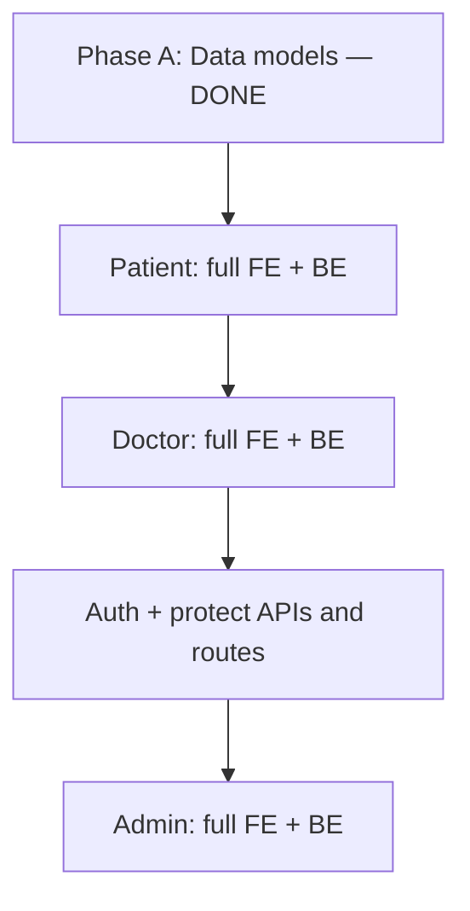

# Product build order — from prototype to multi-role app

## Summary

This document captures **how to sequence work** when evolving Prescribe v2 from the current medical AI chat prototype into a product with patients, doctors, admins, and authentication.

**Current strategy:** Implement **full patient-facing capabilities** (frontend and backend), then **full doctor-facing capabilities**, then **authentication, JWT, and route/API protection**. **Admin** (full FE + BE) comes **after auth**, so admin surfaces and APIs can assume a real principal, roles, and protected routes from day one. Data models from Phase A give each feature a place to attach data; patient and doctor phases still use agreed dev scoping until auth lands.

**Reference baseline:** [PLAN_MEDICAL_AI_CHAT_PROTOTYPE.md](../PLAN_MEDICAL_AI_CHAT_PROTOTYPE.md) (original prototype scope: no auth, file-based patient context). Current code already implements chat, LangGraph, MongoDB sessions/messages, and streaming ([STREAMING_PLAN.md](../STREAMING_PLAN.md)).

---

## Where the codebase is today

- **Backend:** FastAPI in [backend/app/main.py](../../backend/app/main.py), chat API in [backend/app/api/chat.py](../../backend/app/api/chat.py), orchestration in [backend/app/service/chat.py](../../backend/app/service/chat.py), persistence in [backend/app/repository/chat.py](../../backend/app/repository/chat.py) (`chat_sessions`, `chat_messages`), AI in [backend/app/ai/](../../backend/app/ai/).
- **Frontend:** React + Vite chat UI under [frontend/src/](../../frontend/src/).
- **Patient context today:** `patient_id` strings tied to files under [data/patients/](../../data/patients/), not database-backed patient records or user accounts (evolving per phase plans).

---

## Sequencing rationale

| Question | Approach |
|----------|----------|
| When do we add signup, login, JWT, and protected routes? | **After** patient and doctor features are stable end-to-end, **before** admin. Auth locks down patient/doctor APIs and establishes real `user_id` and roles; admin is built on top of that. |
| Why auth before admin? | Admin actions (user/org management, moderation, config) should **not** rely on long-lived dev headers or implicit trust. Implementing admin after auth avoids retrofitting admin-only checks and duplicate “fake principal” paths. Patient/doctor work can still use **dev-only or implicit context** until the auth phase. |
| What was Phase A for? | **MongoDB collections, Pydantic models, and relationships** so later phases do not retrofit `User` and foreign keys from scratch. **Phase A is done** — see [PLAN_PHASE_A_SCHEMA_DESIGN.md](./PLAN_PHASE_A_SCHEMA_DESIGN.md). |

---

## Recommended dependency order (patient → doctor → auth → admin)

1. **Phase A (complete)** — Collections, models, indexes, doctor–patient links, and related design decisions documented.
2. **Patient side** — Everything a patient needs: portal UX, AI chat tied to patient context, **document upload and storage**, **supported document types**, retrieval for the model, and any patient-only settings. Backend APIs and frontend flows **without** requiring login in the final sense (use agreed dev scoping until auth lands).
3. **Doctor side** — Everything a clinician needs: dashboard, patient lists, **prescriptions only for linked/assigned patients**, chat or review flows scoped to those patients, and doctor-specific UI. Enforce **linkage rules in the backend** even before JWT (e.g. doctor id + patient id checks).
4. **Auth and protection** — `POST /auth/signup`, `POST /auth/login`, JWT (or sessions), `Depends(get_current_user)`, **protect patient and doctor APIs**, attach sessions to real `user_id`, frontend token/cookie handling, and **route guards** for those surfaces.
5. **Admin side** — Full admin surface: user/org/patient/doctor management (per product scope), moderation, configuration, or audit views as defined in your admin spec. Backend + frontend, **assuming authenticated admin role** and protected routes.

---

## Phase outline (high level)

### Phase A — Domain schema design — **completed**

- **Goal:** MongoDB collections and Pydantic models for `User` (or `Account`), `Patient` profile, `Doctor` profile, `Admin` or `role: admin`, and relationships (e.g. doctor–patient assignment).
- **Touch:** Modules under [backend/app/schemas/](../../backend/app/schemas/), [backend/app/repository/](../../backend/app/repository/), indexes via [init-mongo.js](../../init-mongo.js) or migration scripts.
- **Detailed plan:** [PLAN_PHASE_A_SCHEMA_DESIGN.md](./PLAN_PHASE_A_SCHEMA_DESIGN.md).

### Phase B — Patient: all features (frontend + backend)

- **Goal:** Complete patient experience — chat/context, **upload and storage of documents**, **supported types** (PDF, images, etc., per product rules), processing pipeline hooks for AI, and patient-facing UI. Persist against Phase A models.
- **Touch:** Patient APIs, storage layer (e.g. object storage or GridFS — as decided), [backend/app/ai/tools.py](../../backend/app/ai/tools.py) if context sources change; patient routes and components in the frontend.
- **Note:** Until auth (Phase D), define how you simulate “current patient” (dev picker, env, or single test account) so features are testable without login.

### Phase C — Doctor: all features (frontend + backend)

- **Goal:** Complete doctor experience — **write prescriptions only for linked/assigned patients**, patient selection, chat or clinical workflows scoped to allowed patients, and doctor UI.
- **Touch:** Authorization logic in services (doctor–patient link checks); doctor dashboards and APIs; tests for forbidden access between doctors’ patients.
- **Detailed plans:** [`docs/plans/doctors/MASTER_PLAN.md`](./doctors/MASTER_PLAN.md) — 8 features covering dev identity extension, doctor profiles, connection system, doctor UI shell, patient list/view, doctor dashboard, AI chat migration (doctor-only), and prescription management.

### Phase D — Authentication and protection (after B–C)

- **Goal:** Signup/login (or invite-only, per policy), JWT issuance, password hashing, `GET /auth/me`, require credentials for protected routes; **wire chat and patient/doctor APIs to authenticated `user_id`**; frontend: storage of tokens, `Authorization` headers, route protection for those apps.
- **Touch:** New [backend/app/api/](../../backend/app/api/) auth router, [backend/app/config.py](../../backend/app/config.py) for secrets; [backend/app/api/chat.py](../../backend/app/api/chat.py), repositories, [frontend/src/api/chat.ts](../../frontend/src/api/chat.ts) and app routing.
- **Deferred until needed:** OAuth, SSO, password reset emails.

### Phase E — Admin: all features (frontend + backend, after D)

- **Goal:** Complete admin experience — management and configuration surfaces defined for your product (users, roles, assignments, system settings, etc.).
- **Touch:** Admin APIs, admin UI, and backend checks for admin-only operations **using the same auth stack as Phase D** (e.g. `role: admin`, 403 for non-admins).

### Parallel / ongoing — Replace file-only patients (optional)

- **Goal:** Move from [data/patients/*.md](../../data/patients/) as the sole source to DB-backed records + attachments where not already covered in Phase B; keep RAG/tooling aligned with the chosen source of truth.
- **Touch:** [backend/app/ai/tools.py](../../backend/app/ai/tools.py), patient APIs.

---

## Design decisions to lock early

- **Single `users` collection with `role`** is usually simpler than three unrelated tables; store role-specific fields in nested objects or linked collections.
- **Identifiers:** Prefer stable `user_id` / `patient_id` UUIDs; keep `patient_id` in chat aligned with whatever the AI tool resolves (file slug vs DB id — pick one naming scheme).
- **Security:** JWT in memory or `httpOnly` cookies beats `localStorage` for XSS resilience; align frontend storage with your threat model **when implementing Phase D**.
- **Pre-auth development:** Treat unauthenticated stacks as **development-only** for sensitive data; do not deploy wide exposure without Phase D (auth). Admin (Phase E) should not ship without auth.
- **Compliance:** Real PHI, HIPAA, and audit trails are out of scope for the original prototype; if you approach production, treat security and legal review as a separate program of work.

---

## Testing expectations

- **Phases B–C:** API and integration tests for business rules (document types, prescription linkage) using test fixtures for doctor/patient identities **without** requiring full JWT if you use test doubles for “current principal.”
- **Phase D:** Unit tests for password verify, JWT encode/decode, role checks; API tests for 401 without token, 403 when role wrong, 200 when allowed; regression suites so patient and doctor flows still work with auth enabled.
- **Phase E:** Admin API and UI tests with authenticated admin principal; 403 for non-admin users on admin-only routes.

---

## What not to do first

- **Do not** block patient document pipelines on full auth while B–C are in flight — but **do** design storage and APIs so Phase D can attach `user_id` and tighten access without a rewrite.
- **Do not** duplicate “patient” as only markdown files and again in Mongo without a migration story — pick the source of truth for `patient_id` early (Phase A + patient phase work).

---

## Related documents

- [PLAN_MEDICAL_AI_CHAT_PROTOTYPE.md](../PLAN_MEDICAL_AI_CHAT_PROTOTYPE.md) — Original prototype phases (Docker, backend, AI, frontend, polish).
- [STREAMING_PLAN.md](../STREAMING_PLAN.md) — SSE streaming (already aligned with additive `/message/stream` pattern).

---

*Last updated: 2026-04-19 — build order patient → doctor → auth → admin; Phase A marked complete; Phase C detailed plans in doctors/MASTER_PLAN.md.*
