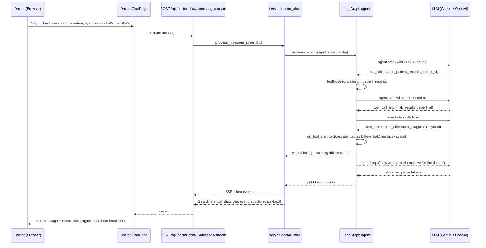

# Differential Diagnosis Assistant

## 1. Title & Summary

When a doctor describes a patient's symptoms in the chat (e.g. "47-year-old patient reports
chest pressure on exertion, occasional dyspnea, mild diaphoresis"), the AI returns a **ranked
differential diagnosis** — each candidate condition with a calibrated probability, an
explicit per-diagnosis rationale that cites the patient's **specific** conditions,
medications, allergies, family history, lifestyle, and recent labs, plus **red-flag /
can't-miss** diagnoses regardless of probability and a **recommended workup**.

The product differentiator: Isabel Healthcare and Ada produce population-level differentials.
This one is grounded in **this patient's chart** — diabetes + metformin + family history of
hypertension materially shifts both the ranking and the rationale ("ischemic cardiac causes
are weighted higher because of the diabetic vasculopathy risk and family-history HTN"
rather than "chest pain — typical age-stratified differential").

Success: a doctor pastes symptoms into a connected patient's chat and within one turn sees
(a) a ranked list with probabilities, (b) per-diagnosis rationale referencing **named**
patient factors, (c) a red-flag section, (d) a suggested first-line workup, and
(e) a clinical disclaimer. The result also renders as a structured side-card (probability
bars + expandable rationale per diagnosis), not just inline markdown.

---

## 2. Type & Scope

**Type:** Feature (full-stack: new LangGraph tool + structured payload + doctor chat UI card)

**In scope:**
- New `submit_differential_diagnosis` LangGraph tool with structured payload (mirrors the
  `submit_meal_plan` / `submit_fitness_plan` pattern in [backend/app/ai/tools.py](../../backend/app/ai/tools.py)).
- New `DifferentialDiagnosisPayload` Pydantic schema with `diagnoses`, `red_flags`,
  `recommended_workup`, `reasoning_notes`, `summary`, `disclaimer`.
- Payload extraction helper (`differential_diagnosis_extract.py`) following the existing
  `meal_plan_extract.py` / `fitness_plan_extract.py` pattern.
- Graph wiring: register tool in `TOOLS`, capture payload in `stream_medical_agent` (mirrors
  meal-plan/fitness-plan capture), emit `_differential_diagnosis_payload` internal event,
  forward as SSE `differential_diagnosis` event to the client.
- Prompt rule in `DOCTOR_ASSISTANT_PROMPT_TEMPLATE` ([backend/app/ai/prompts.py](../../backend/app/ai/prompts.py))
  instructing **when** to call the tool (only when the doctor describes symptoms / asks for a
  differential) and **how** to ground each diagnosis in the patient's actual chart.
- Doctor-portal frontend: `DifferentialDiagnosisCard` component rendered inline in the
  doctor chat thread, with probability bars and per-diagnosis expandable details.
- Backend pytest coverage for the tool, payload validation, and extraction.
- Frontend Vitest coverage for the card component and the SSE event handler.
- Doc updates: [docs/ARCHITECTURE.md](../ARCHITECTURE.md), [docs/FRONTEND_BACKEND_COLLABORATION.md](../FRONTEND_BACKEND_COLLABORATION.md).

**Out of scope (v1):**
- **Patient-portal differential** (`MEDICAL_SYSTEM_PROMPT_TEMPLATE`). Patient self-triage is
  materially different from doctor-facing decision support and carries a higher risk profile;
  defer to a separate scoped feature.
- Persisting the differential in MongoDB as its own collection (the chat checkpoint already
  retains the tool call and payload; no separate "saved differentials" UI yet).
- External knowledge-base integration (UMLS, Isabel API, SnomedCT). The v1 differential is
  LLM-reasoned with patient context — same grounding strategy as the drug-interaction checker
  in its v1 pre-RxNorm form.
- Hard quantitative calibration of probabilities (probabilities are model-estimated; the UI
  presents them as relative rankings, not Bayesian posteriors). A future phase can add
  literature-grounded priors.
- ICD-10 coding of each diagnosis. Future phase.
- "Accept differential into chart" / write-back. Future phase.

---

## 3. Baseline

What exists today (relevant building blocks already in place):

| Area | File | State |
|------|------|-------|
| Doctor-portal chat agent | [backend/app/ai/graph.py](../../backend/app/ai/graph.py) | LangGraph agent ↔ tools loop with `astream_events` streaming and `_TOOL_THINKING_UI` mapping. Already captures `submit_meal_plan` and `submit_fitness_plan` tool input as structured payloads from the stream. |
| Doctor system prompt | [backend/app/ai/prompts.py:27-103](../../backend/app/ai/prompts.py) | `DOCTOR_ASSISTANT_PROMPT_TEMPLATE` already has numbered rules for `search_patient_records`, `web_search`, `fetch_lab_results`, `submit_meal_plan`, `submit_fitness_plan`. **No rule for differential diagnosis.** |
| Tool registry | [backend/app/ai/graph.py:47](../../backend/app/ai/graph.py) | `TOOLS = [search_patient_records, fetch_lab_results, web_search, submit_meal_plan, submit_fitness_plan]` |
| Patient context | [backend/app/ai/tools.py:146-197](../../backend/app/ai/tools.py) | `_format_patient_summary` already returns demographics, conditions, medications, allergies, family history, lifestyle, and recent documents. Re-used by the differential tool via `search_patient_records`. |
| Lab grounding | [backend/app/ai/tools.py:272-309](../../backend/app/ai/tools.py) | `fetch_lab_results` already returns structured lab values for chart-grounded reasoning. Differential can leverage these alongside `search_patient_records`. |
| Structured-payload tools | [backend/app/ai/tools.py:396-510](../../backend/app/ai/tools.py), [backend/app/ai/meal_plan_extract.py](../../backend/app/ai/meal_plan_extract.py), [backend/app/ai/fitness_plan_extract.py](../../backend/app/ai/fitness_plan_extract.py) | Proven pattern: tool accepts the structured object as args; `extract_*_from_messages` finds the most-recent tool call in the message history; `stream_medical_agent` captures it from `on_tool_start` and emits an internal `_*_payload` event. |
| Doctor chat UI | `frontend/src/components/ChatPage.tsx` (doctor variant), `frontend/src/components/ChatMessage.tsx`, the meal-plan and fitness-plan cards | Already renders structured payload cards inline in the chat thread when SSE emits the corresponding event. Pattern to mirror for the differential card. |
| Doctor portal connection | `frontend/src/pages/doctor/...` | Doctor selects a connected patient; chat is scoped by `patient_id`. No new auth, no new connection check. |

**Gap:** the LLM has no structured way to emit a ranked differential. Today, asking
"what's the differential?" returns free-prose markdown — usable, but not renderable as a card,
not capturable as a payload, and not standardized in shape across responses.

---

## 4. Prior Art & Strategy

### Existing precedents to mirror

Two structured-output tools already live in the same code paths:

1. **`submit_meal_plan`** — LLM gathers patient context → builds a structured day-by-day plan
   → calls the tool with the full structured payload → `stream_medical_agent` captures the
   tool input and emits `_meal_plan_payload` → SSE forwarding code turns it into a
   `meal_plan` event → frontend renders a `MealPlanCard`.
2. **`submit_fitness_plan`** — same flow.

Both succeed because:
- The structured object is part of the tool **input** (not the return value), so LangGraph
  captures it deterministically in `on_tool_start`.
- The tool's `@tool` docstring carries all "when to call / how to call" instructions, and the
  system prompt has a parallel numbered rule binding the tool to a user-intent trigger.
- A Pydantic schema is the contract: `MealPlanPayload` / `FitnessPlanPayload`.

### Option A — Free-prose markdown only

Add a prompt rule instructing the LLM to produce a markdown-formatted ranked differential when
the doctor describes symptoms. No new tool, no new payload.

- **Pro:** zero new code paths; ships in an hour.
- **Con:** unstructured. Probability bars, expandable per-diagnosis cards, and red-flag
  callouts require parsing free prose. Formatting drifts across model versions. The
  product differentiator (visible "grounded in this patient's chart" rationale) is harder to
  surface visually.
- **Con:** future features (save differential, "accept into chart", export to PDF) require
  re-extracting structure from prose every time.

### Option B — Structured `submit_differential_diagnosis` tool (proposed)

Mirror the meal-plan / fitness-plan pattern exactly. Define `DifferentialDiagnosisPayload`,
add a `submit_differential_diagnosis` tool whose input is the structured payload, wire it
through `stream_medical_agent`, render a card on the frontend.

- **Pro:** consistent with two already-shipped features in the same file; reviewers and
  future contributors recognize the pattern immediately.
- **Pro:** structured data unlocks the visual rendering (probability bars, per-diagnosis
  drill-down, red-flag chips) that makes the patient-grounded rationale obvious.
- **Pro:** payload is captured deterministically from `on_tool_start`; no fragile
  post-hoc prose parsing.
- **Pro:** the structured fields themselves (`supporting_evidence: list[str]`,
  `contradicting_evidence: list[str]`) **force** the LLM to enumerate patient-specific
  reasoning, which is exactly the product differentiator. Free prose lets the LLM hand-wave;
  required structured fields don't.
- **Con:** slightly more upfront code (schema + tool + extract + card). Worth it.

**Verdict: Option B.** It is the established repo pattern, and the structured fields are not
incidental — they are the mechanism by which "grounded in patient profile" becomes visible
rather than implicit.

### Option C — Hybrid (LLM + external KB lookup)

A future phase analogous to the drug-interaction checker's RxNorm/OpenFDA enrichment (see
[PLAN_drug-interaction-checker.md §7](./PLAN_drug-interaction-checker.md)): before calling the
LLM, enrich each candidate condition with literature priors or guideline references. **Out of
scope for v1** to keep the surface tractable; called out in §10 as the natural next phase.

---

## 5. Target Architecture

### Data flow



### Component relationships (backend)

```
ai/graph.py
├── TOOLS = [..., submit_differential_diagnosis]
├── _TOOL_THINKING_UI["submit_differential_diagnosis"] = ("Building differential...", "differential")
├── stream_medical_agent
│   └── on_tool_start (name == "submit_differential_diagnosis")
│       └── DifferentialDiagnosisPayload.model_validate(tool_input)
│       └── yield _differential_diagnosis_payload event
└── invoke_medical_agent  (non-streaming path)
    └── extract_differential_diagnosis_from_messages(...)

ai/tools.py
└── @tool submit_differential_diagnosis(diagnoses, red_flags, recommended_workup, ...)
        # docstring contains WHEN-TO-CALL / HOW-TO-CALL

ai/differential_diagnosis_extract.py            ← NEW
└── extract_differential_diagnosis_from_messages(messages)
        # walks messages back-to-front looking for the latest
        # submit_differential_diagnosis tool call, validates with Pydantic

schemas/differential_diagnosis.py               ← NEW
├── Diagnosis
├── DifferentialDiagnosisPayload
└── DEFAULT_DDX_DISCLAIMER
```

### Component relationships (frontend)

```
ChatPage (doctor variant)
└── useChat / SSE handler
    └── on "differential_diagnosis" event → setDifferentialPayload(message_id, payload)
└── ChatMessage
    └── (existing) MealPlanCard if meal_plan attached
    └── (existing) FitnessPlanCard if fitness_plan attached
    └── DifferentialDiagnosisCard if differential_diagnosis attached   ← NEW
        ├── Summary line
        ├── For each diagnosis:
        │   ├── Probability bar (color-scaled by tier)
        │   ├── Condition name + probability %
        │   └── Expandable: rationale, supporting evidence, contradicting evidence, key workup
        ├── Red-flag chips ("can't-miss" panel)
        ├── Recommended initial workup (checklist)
        └── Disclaimer footer
```

---

## 6. Directory & File Plan

| Path | Purpose | New / Modify |
|------|---------|--------------|
| `backend/app/schemas/differential_diagnosis.py` | `Diagnosis`, `DifferentialDiagnosisPayload`, `DEFAULT_DDX_DISCLAIMER` | **New** |
| `backend/app/ai/tools.py` | Add `submit_differential_diagnosis` tool (docstring with WHEN/HOW) | Modify |
| `backend/app/ai/differential_diagnosis_extract.py` | `extract_differential_diagnosis_from_messages` (mirrors `meal_plan_extract.py`) | **New** |
| `backend/app/ai/graph.py` | Import tool + extractor; add to `TOOLS`; `_TOOL_THINKING_UI` entry; capture in `on_tool_start`; emit `_differential_diagnosis_payload`; include in `invoke_medical_agent` return tuple | Modify |
| `backend/app/ai/prompts.py` | Add numbered rule **9** to `DOCTOR_ASSISTANT_PROMPT_TEMPLATE` ("DIFFERENTIAL DIAGNOSIS — when the doctor describes symptoms or explicitly asks for a differential…"). **Do not** modify `MEDICAL_SYSTEM_PROMPT_TEMPLATE` (patient portal out of scope v1). | Modify |
| `backend/app/service/doctor_chat.py` (or wherever doctor stream forwarding lives) | Forward internal `_differential_diagnosis_payload` event as SSE `differential_diagnosis` event | Modify |
| `backend/tests/test_differential_diagnosis_tool.py` | Tool docstring contract, schema validation edge cases, extractor round-trip | **New** |
| `backend/tests/test_doctor_chat_stream.py` (or extend existing) | Stream emits `differential_diagnosis` event when LLM calls the tool (mock the LLM to return the tool call) | New / extend |
| `frontend/src/types/chat.ts` (or `doctor.ts`) | `Diagnosis`, `DifferentialDiagnosisPayload` types | Modify |
| `frontend/src/components/DifferentialDiagnosisCard.tsx` | Card rendering ranked list, probability bars, expandable per-diagnosis details, red flags, workup, disclaimer | **New** |
| `frontend/src/components/ChatMessage.tsx` (doctor variant) | Render `<DifferentialDiagnosisCard>` when payload attached | Modify |
| `frontend/src/hooks/useChat.ts` (doctor variant) | Handle `differential_diagnosis` SSE event; attach payload to the assistant message | Modify |
| `frontend/src/components/DifferentialDiagnosisCard.test.tsx` | Render tests for the card | **New** |
| `docs/ARCHITECTURE.md` | Add `submit_differential_diagnosis` to the tools section | Modify |
| `docs/FRONTEND_BACKEND_COLLABORATION.md` | Document the new `differential_diagnosis` SSE event and payload shape | Modify |

No new HTTP endpoints. No new MongoDB collections. No migrations.

---

## 7. API / Data

### No new HTTP endpoints

The feature flows entirely through the existing doctor chat streaming endpoint
(`POST /api/doctor-chat/.../message/stream`). The new contract is a **new SSE event type**:
`differential_diagnosis`, parallel to the existing `meal_plan` / `fitness_plan` events.

### SSE event added

```
event: differential_diagnosis
data: {"differential_diagnosis": { ...DifferentialDiagnosisPayload... }}
```

Emitted **after** the assistant prose tokens are streamed (same ordering as the meal-plan and
fitness-plan events today). Frontend attaches the payload to the most-recent assistant message
on receipt.

### Pydantic schemas (`schemas/differential_diagnosis.py`)

```python
from typing import Literal
from pydantic import BaseModel, Field, field_validator

DEFAULT_DDX_DISCLAIMER = (
    "This differential is an AI-generated decision-support aid for an educational prototype. "
    "It is not a substitute for clinical judgment. Verify every candidate diagnosis against "
    "the patient's full chart, examination findings, and current guidelines before acting."
)


class Diagnosis(BaseModel):
    rank: int = Field(..., ge=1, le=20)
    condition: str
    probability: int = Field(..., ge=0, le=100, description="0-100 relative likelihood")
    tier: Literal["high", "moderate", "low"]
    rationale: str = Field(..., description="One- or two-sentence clinical reasoning")
    supporting_evidence: list[str] = Field(
        default_factory=list,
        description="Patient-chart factors that raise the probability (named conditions, meds, labs, family history, lifestyle)",
    )
    contradicting_evidence: list[str] = Field(
        default_factory=list,
        description="Patient-chart factors that lower the probability or argue against",
    )
    key_workup: list[str] = Field(
        default_factory=list,
        description="First-line tests or exam steps that would meaningfully shift this diagnosis up or down",
    )

    @field_validator("condition")
    @classmethod
    def _strip_condition(cls, v: str) -> str:
        v = (v or "").strip()
        if not v:
            raise ValueError("condition must not be empty")
        return v


class DifferentialDiagnosisPayload(BaseModel):
    summary: str = Field(..., description="2-3 sentence overview of the clinical picture")
    diagnoses: list[Diagnosis] = Field(..., min_length=1, max_length=20)
    red_flags: list[str] = Field(
        default_factory=list,
        description="Can't-miss diagnoses or warning features the doctor should rule out regardless of probability",
    )
    recommended_workup: list[str] = Field(
        default_factory=list,
        description="Suggested first-line tests, exams, or referrals to narrow the differential",
    )
    reasoning_notes: str = Field(
        "",
        description="Brief overall reasoning, including which patient factors most shaped the ranking",
    )
    disclaimer: str = DEFAULT_DDX_DISCLAIMER

    @field_validator("diagnoses")
    @classmethod
    def _ranks_are_sequential(cls, v: list[Diagnosis]) -> list[Diagnosis]:
        # The model occasionally returns out-of-order ranks; normalize.
        sorted_v = sorted(v, key=lambda d: (-d.probability, d.rank))
        for i, d in enumerate(sorted_v, start=1):
            d.rank = i
        return sorted_v
```

### TypeScript types (frontend, mirroring snake_case wire format)

```typescript
export type DiagnosisTier = "high" | "moderate" | "low";

export interface Diagnosis {
  rank: number;
  condition: string;
  probability: number;
  tier: DiagnosisTier;
  rationale: string;
  supporting_evidence: string[];
  contradicting_evidence: string[];
  key_workup: string[];
}

export interface DifferentialDiagnosisPayload {
  summary: string;
  diagnoses: Diagnosis[];
  red_flags: string[];
  recommended_workup: string[];
  reasoning_notes: string;
  disclaimer: string;
}
```

### snake_case / camelCase boundary

- Wire (SSE event payload): **snake_case** throughout (`supporting_evidence`,
  `recommended_workup`, `red_flags`). Matches the meal-plan and fitness-plan precedent.
- React internal state can use camelCase if a component needs derived view-model fields, but
  the SSE-shaped object stays snake_case to match the existing `MealPlanPayload` /
  `FitnessPlanPayload` types and avoid an inconsistent boundary inside `useChat`.

### MongoDB access

None new. `search_patient_records` and `fetch_lab_results` already cover chart context. The
differential is **not** persisted to a dedicated collection in v1 — the LangGraph
checkpoint already retains the tool call (which contains the full payload) under the chat's
`thread_id`. A future "saved differentials" feature can index into the checkpoint or migrate
to a dedicated collection.

---

## 8. Edge Cases & Failure Handling

| Scenario | Handling |
|----------|---------|
| Doctor's message is a greeting, not symptoms | Rule 9 narrowly scopes the tool to symptom descriptions / explicit differential requests; the LLM does not call it for "hi". Reinforced by tool docstring "WHEN TO CALL". |
| Doctor asks for a differential but the chart is empty / sparse | LLM still produces a differential but `supporting_evidence` and `contradicting_evidence` arrays are short; `reasoning_notes` must explicitly state that the ranking is based primarily on symptom semantics due to limited patient-chart signal. Tested via prompt-level integration test. |
| LLM omits `red_flags` for a high-acuity symptom set (e.g. "crushing chest pain, diaphoresis") | Prompt rule **requires** populating `red_flags` whenever any symptom feature is in a published red-flag set (chest pain, focal neuro deficit, severe headache, severe dyspnea, syncope, hemoptysis, GI bleeding, fever + altered mental status). Tested in §9 with a chest-pain fixture. |
| LLM returns >20 diagnoses or empty list | Pydantic `min_length=1, max_length=20` rejects at validation; capture step logs `differential_validation_failed`; frontend renders only the inline prose response (graceful degradation, no card). |
| LLM returns probabilities that do not sum to 100 | **Intentional.** Differential probabilities are not a normalized distribution (overlapping causes can co-occur). The schema does not enforce a sum constraint. The prompt rule clarifies this for the LLM. |
| Probability values outside 0–100 | Pydantic `ge=0, le=100` rejects; whole payload fails validation; chat falls back to prose only. |
| Ranks out of order or duplicated | Schema validator re-sorts by probability and renumbers ranks (1..N). Documented as deterministic behavior so the frontend can trust `rank` ordering. |
| Patient profile lookup fails mid-turn | `search_patient_records` already returns a graceful error string; LLM may still produce a differential but should mark it "not chart-grounded" in `reasoning_notes`. Prompt rule covers this. |
| Doctor describes the patient's full prior history inline instead of relying on chart | LLM should still call `search_patient_records` to confirm meds and allergies (covered by existing Rule 2). |
| `_differential_diagnosis_payload` event arrives before token stream completes | Frontend treats it as "attached to most-recent assistant message" (same handling as meal-plan / fitness-plan today). |
| LLM never calls the tool (returns only prose) | Card is not rendered; prose response stands alone. No error state. The prompt rule incentivizes the tool but does not require it. |
| Doctor explicitly asks "without using the differential tool" | LLM has discretion; falls back to prose. Acceptable. |
| Token cost / latency from a large structured payload | Cap `max_length=20` diagnoses; cap each text field via prompt guidance ("rationale ≤ 30 words, summary ≤ 60 words"). |
| Doctor not connected to the patient | Existing connection guard in doctor chat endpoint applies; no new path. |

---

## 9. Testing Strategy

All backend tests **run in the backend container** per [backend/CLAUDE.md](../../backend/CLAUDE.md):
`docker compose exec backend python -m pytest tests/<file> -v`.

### Backend (pytest)

**`backend/tests/test_differential_diagnosis_tool.py` (new)**

1. `test_payload_schema_validates_minimal` — a 1-diagnosis payload validates and round-trips.
2. `test_payload_rejects_empty_diagnoses` — `diagnoses=[]` raises `ValidationError`.
3. `test_payload_rejects_too_many_diagnoses` — 21 entries raise `ValidationError`.
4. `test_payload_rejects_invalid_probability` — `probability=150` raises.
5. `test_payload_renumbers_ranks_by_probability_desc` — input ranks scrambled; validator
   re-sorts and renumbers `1..N`.
6. `test_tool_docstring_mentions_when_to_call` — guard the docstring contract (key phrases:
   "differential", "WHEN TO CALL", "search_patient_records").
7. `test_extract_differential_from_messages_finds_latest_tool_call` — given a synthetic
   message list with two `submit_differential_diagnosis` tool calls, the extractor returns
   the most recent (parallels `meal_plan_extract`'s behavior).
8. `test_extract_returns_none_when_no_tool_call` — empty / unrelated messages → `None`.

**`backend/tests/test_doctor_chat_stream.py` (new or extend existing)**

Mock the LLM in the graph (`@patch("app.ai.graph.get_llm")`) so the agent step deterministically
returns:
- step 1: `tool_call: submit_differential_diagnosis(<sample payload>)`
- step 2: a streaming assistant message with prose tokens

Assertions:
1. The SSE stream contains a `thinking` event with status "Building differential...".
2. The SSE stream contains a `differential_diagnosis` event whose payload validates against
   `DifferentialDiagnosisPayload`.
3. Token events for the trailing narrative are emitted **before** the
   `differential_diagnosis` event (same ordering invariant as meal-plan today).
4. When the tool input is malformed (e.g. negative probability), validation fails silently and
   **no** `differential_diagnosis` event is emitted; the prose tokens still stream.

### Prompt-level integration (lightweight, optional)

A `pytest.mark.live` test (skipped by default) that hits the real LLM with a chest-pain
fixture for a synthetic patient with `conditions=[diabetes]` and asserts:
- `red_flags` is non-empty.
- At least one `supporting_evidence` entry references "diabetes" or an equivalent term.
- At least 3 diagnoses returned.

Skipped by default to avoid flakiness and API cost; run manually before each release.

### Frontend (Vitest + React Testing Library)

**`frontend/src/components/DifferentialDiagnosisCard.test.tsx` (new)**

1. Renders summary, all diagnoses, red flags, workup, disclaimer.
2. Renders a probability bar whose width corresponds to `probability` (snapshot test on the
   inline style).
3. `tier="high"` renders with the high-tier color token; `"moderate"` and `"low"` with their
   respective tokens (no string-color checks; reach for the MUI theme palette names).
4. Per-diagnosis accordion expands on click (asserts `supporting_evidence` is hidden until
   expanded).
5. Empty `red_flags` array hides the red-flags section entirely (no empty heading).

**`frontend/src/hooks/useChat.test.ts` (extend)** or equivalent integration test:

6. SSE handler attaches `differential_diagnosis` payload to the most-recent assistant message
   on event receipt — same shape as the existing meal-plan / fitness-plan attachment test.

### No flaky patterns

- Backend LLM is mocked; no live API calls in CI.
- Frontend SSE handler is tested with `EventSource` mock (or RTK / MSW pattern already used
  for meal-plan tests).
- Extraction tests assert structurally (`isinstance`, field equality), not on serialized JSON
  ordering.

---

## 10. Risks & Rollback

| Risk | Mitigation |
|------|-----------|
| LLM produces a clinically incorrect or anchored differential, doctor over-trusts it | Mandatory disclaimer in payload + UI footer. Prompt rule explicitly tells the LLM the differential is decision-**support**, not a diagnosis. `red_flags` array is forced for high-acuity symptom sets. UI does not present probabilities as if calibrated; the card heading reads "AI differential — verify clinically". |
| LLM omits patient-grounded reasoning (defeats the differentiator) | The schema **requires** `rationale` per diagnosis and the prompt rule specifies that `supporting_evidence` and `contradicting_evidence` must reference the patient's actual chart, citing named conditions / meds / family history / labs by name. Tested at prompt-integration level. |
| Probability bars give a false sense of statistical calibration | UI labels probabilities as "relative likelihood" not "probability"; tooltip explains they are model-estimated rankings, not normalized posteriors. |
| Token / latency cost | Caps: ≤ 20 diagnoses, ≤ 30-word rationales (prompt), ≤ 60-word summary. Tool input is structured (efficient) rather than a long prose dump. |
| Card rendering errors break the chat thread | The card is rendered inside a React `ErrorBoundary` (already wrapping `MealPlanCard` / `FitnessPlanCard`); on error, prose response still renders. |
| Extraction picks the wrong tool call when multiple turns happen | Extractor walks back-to-front and returns the latest valid `submit_differential_diagnosis` call (mirrors meal/fitness extractors; covered by §9 test 7). |
| Backwards compatibility of stored chat checkpoints after schema change | Schema is additive (new event type, new tool, new payload). Existing checkpoints contain no `submit_differential_diagnosis` calls and behave unchanged. |
| Rollback | All changes are additive. To revert: drop `submit_differential_diagnosis` from `TOOLS` and `_TOOL_THINKING_UI`, remove the SSE forwarding branch, remove the card render call. No DB migration. |

**Future enhancement (deferred):** External knowledge-base grounding (literature priors,
guideline references) — same staged approach as the drug-interaction checker's later
RxNorm/OpenFDA phase.

---

## 11. Implementation Phases (Detailed)

### Implementation order overview

1. Phase 1 — Backend schema & tool (`differential_diagnosis.py` + `submit_differential_diagnosis`)
2. Phase 2 — Extractor (`differential_diagnosis_extract.py`)
3. Phase 3 — Graph integration (TOOLS list, `_TOOL_THINKING_UI`, payload capture, SSE forwarding)
4. Phase 4 — Doctor prompt rule
5. Phase 5 — Frontend types, SSE handler, `DifferentialDiagnosisCard` component
6. Phase 6 — Tests & documentation

Phases 1–4 can be implemented in one Cursor chat (backend vertical slice). Phase 5 is a
clean handoff point for a second chat (frontend). Phase 6 is the final verification chat.

---

### Phase 1 — Backend Schema & Tool

**Goal:** Define the structured contract (`DifferentialDiagnosisPayload`) and the LangGraph
tool that accepts it as input. After this phase, the schema and tool are independently
importable and the tool can be unit-tested without the graph.

**Prerequisites:** None.

**Scope:**
- Create `backend/app/schemas/differential_diagnosis.py` with `Diagnosis`,
  `DifferentialDiagnosisPayload`, `DEFAULT_DDX_DISCLAIMER`.
- Add `submit_differential_diagnosis` to `backend/app/ai/tools.py` with the WHEN-TO-CALL /
  HOW-TO-CALL docstring (parallels `submit_meal_plan`).
- *Deferred to Phase 3:* graph wiring, stream capture.

**Tasks:**

1. Create `backend/app/schemas/differential_diagnosis.py`:
   - `Diagnosis` with fields per §7 (`rank`, `condition`, `probability`, `tier`, `rationale`,
     `supporting_evidence`, `contradicting_evidence`, `key_workup`).
   - `field_validator` on `condition` rejecting blank strings.
   - `DifferentialDiagnosisPayload` with fields per §7 and the `_ranks_are_sequential`
     validator that sorts by `(-probability, rank)` and renumbers `rank` to `1..N`.
   - `DEFAULT_DDX_DISCLAIMER` constant.

2. Add to `backend/app/ai/tools.py`:

   ```python
   from app.schemas.differential_diagnosis import (
       DEFAULT_DDX_DISCLAIMER,
       Diagnosis,
       DifferentialDiagnosisPayload,
   )

   @tool
   def submit_differential_diagnosis(
       summary: str,
       diagnoses: list[Diagnosis],
       red_flags: list[str] = [],
       recommended_workup: list[str] = [],
       reasoning_notes: str = "",
       disclaimer: str = DEFAULT_DDX_DISCLAIMER,
   ) -> str:
       """Submit a ranked, patient-grounded differential diagnosis.

       WHEN TO CALL: Call this tool ONLY when the doctor describes a patient's symptoms
       or explicitly asks for a differential diagnosis, possible causes, or "what could
       this be". Do NOT call it for general medical questions, drug lookups, lab
       interpretation, or chart summaries.

       HOW TO CALL:
       - First call `search_patient_records` with patient_id=... to retrieve the patient's
         demographics, conditions, medications, allergies, family history, and lifestyle.
       - If the symptoms or chief complaint plausibly relate to labs (chest pain → cardiac
         enzymes/lipids; fatigue → CBC/TSH; etc.), also call `fetch_lab_results`.
       - For each candidate diagnosis, write a short `rationale` (≤ 30 words) and populate
         `supporting_evidence` with **named** patient factors that raise the probability
         (e.g. "Type 2 diabetes", "metformin therapy", "father had HTN") and
         `contradicting_evidence` with factors that argue against. These arrays are the
         entire point of the differential — they make the patient grounding visible.
       - Populate `key_workup` per diagnosis with the first-line test(s) that would most
         meaningfully shift the probability.
       - Set `tier` to "high", "moderate", or "low" matching the probability bucket
         (high ≥ 30, moderate 10–29, low < 10) — these are relative likelihoods, not
         normalized posteriors, and do not need to sum to 100.
       - Populate top-level `red_flags` whenever the chief complaint includes any
         can't-miss feature (chest pain, focal neurologic deficit, severe headache,
         severe dyspnea, syncope, hemoptysis, GI bleeding, fever with altered mental
         status, etc.) — list the specific diagnoses to rule out.
       - Populate `recommended_workup` with the highest-yield initial tests / exam
         steps across the differential.
       - `summary` is a 2–3 sentence overview of the clinical picture grounded in
         the patient's chart.
       - Keep the default `disclaimer`.

       After calling this tool, write a brief prose summary for the doctor highlighting
       the top 1–2 candidates, the red flags, and the recommended next step. Do not
       restate the structured payload verbatim.

       Args:
           summary: 2–3 sentence overview of the clinical picture.
           diagnoses: Ranked list of candidate diagnoses (1–20).
           red_flags: Can't-miss diagnoses to rule out regardless of probability.
           recommended_workup: First-line tests / exam steps.
           reasoning_notes: Brief overall reasoning, including which patient factors most
               shaped the ranking.
           disclaimer: Educational disclaimer (use the default).

       Returns:
           Confirmation string for the LLM to continue with a narrative summary.
       """
       n = len(diagnoses) if diagnoses else 0
       logger.info("submit_differential_diagnosis called n_diagnoses=%d", n)
       return (
           f"Differential with {n} ranked diagnoses has been structured. "
           "Now write a brief narrative summary for the doctor — highlight the top "
           "1–2 candidates, any red flags, and the recommended initial workup."
       )
   ```

**Deliverables:**
- `backend/app/schemas/differential_diagnosis.py` (new).
- `backend/app/ai/tools.py` updated with the new tool import + function.

**Verification:**
```bash
docker compose exec backend python -c "
from app.schemas.differential_diagnosis import DifferentialDiagnosisPayload, Diagnosis
from app.ai.tools import submit_differential_diagnosis
p = DifferentialDiagnosisPayload(
    summary='test',
    diagnoses=[Diagnosis(rank=2, condition='X', probability=40, tier='high',
                         rationale='r', supporting_evidence=[], contradicting_evidence=[], key_workup=[]),
               Diagnosis(rank=1, condition='Y', probability=20, tier='moderate',
                         rationale='r', supporting_evidence=[], contradicting_evidence=[], key_workup=[])],
)
assert p.diagnoses[0].rank == 1 and p.diagnoses[0].condition == 'X'
print('schema OK')
"
```
- No import errors; ranks renumbered; tool docstring reachable as `submit_differential_diagnosis.description`.

---

### Phase 2 — Extractor

**Goal:** A helper that walks chat-history messages back-to-front and returns the most-recent
valid `DifferentialDiagnosisPayload`, mirroring `extract_meal_plan_from_messages`.

**Prerequisites:** Phase 1 (schema exists).

**Scope:**
- Create `backend/app/ai/differential_diagnosis_extract.py`.
- *Deferred:* graph integration (Phase 3) and tests (Phase 6).

**Tasks:**

1. Open `backend/app/ai/meal_plan_extract.py` and `backend/app/ai/fitness_plan_extract.py` —
   copy the structure exactly. Key behaviors to mirror:
   - Walk `messages` in reverse.
   - For each AI message with `tool_calls`, look for a call whose `name ==
     "submit_differential_diagnosis"`.
   - `model_validate` the call's `args` against `DifferentialDiagnosisPayload`.
   - Return the first valid match; return `None` if none found.
   - On `ValidationError`, log at WARNING and continue (do not crash the agent).

2. Export `extract_differential_diagnosis_from_messages(messages) -> DifferentialDiagnosisPayload | None`.

**Deliverables:**
- `backend/app/ai/differential_diagnosis_extract.py` (new).

**Verification:**
```bash
docker compose exec backend python -c "
from app.ai.differential_diagnosis_extract import extract_differential_diagnosis_from_messages
assert extract_differential_diagnosis_from_messages([]) is None
print('extractor OK')
"
```

---

### Phase 3 — Graph Integration (TOOLS, Thinking UI, Stream Capture, SSE)

**Goal:** Wire `submit_differential_diagnosis` into the LangGraph agent loop so the LLM can
call it, capture the payload during streaming, and forward it as an SSE
`differential_diagnosis` event to the doctor portal.

**Prerequisites:** Phases 1 and 2 (schema, tool, extractor all importable).

**Scope:**
- Modify `backend/app/ai/graph.py`:
  - Import the new tool and extractor.
  - Append `submit_differential_diagnosis` to `TOOLS`.
  - Add `"submit_differential_diagnosis": ("Building differential...", "differential")` to
    `_TOOL_THINKING_UI`.
  - In `stream_medical_agent.on_tool_start`, add a branch that captures the tool input as
    `DifferentialDiagnosisPayload` (mirrors the meal-plan branch at
    [backend/app/ai/graph.py:234-249](../../backend/app/ai/graph.py)).
  - After the stream loop completes, yield
    `{"event": "_differential_diagnosis_payload", "data": {"differential_diagnosis": payload.model_dump()}}`
    (mirrors meal-plan / fitness-plan emission at the bottom of `stream_medical_agent`).
  - In `invoke_medical_agent`, call `extract_differential_diagnosis_from_messages` on
    `all_messages` and include the result in the return tuple.
  - **Update** the return signature of `invoke_medical_agent` from
    `(str, MealPlanPayload | None, FitnessPlanPayload | None)` to also include the
    differential payload. **All callers** of `invoke_medical_agent` must be updated
    accordingly.
- Modify the doctor chat service / streaming forwarder (likely
  `backend/app/service/doctor_chat.py` or wherever the internal `_meal_plan_payload` event is
  translated into the public `meal_plan` SSE event) to add a parallel branch for
  `_differential_diagnosis_payload` → `differential_diagnosis`.

**Tasks:**

1. In `backend/app/ai/graph.py`:
   - Add import: `from app.ai.tools import submit_differential_diagnosis`.
   - Add import: `from app.ai.differential_diagnosis_extract import extract_differential_diagnosis_from_messages`.
   - Add import: `from app.schemas.differential_diagnosis import DifferentialDiagnosisPayload`.
   - Append `submit_differential_diagnosis` to `TOOLS`.
   - Add the entry to `_TOOL_THINKING_UI`.
   - Add a `captured_differential: DifferentialDiagnosisPayload | None = None` local in
     `stream_medical_agent` next to the existing meal-plan / fitness-plan captures.
   - Inside the `on_tool_start` branch:
     ```python
     elif name == "submit_differential_diagnosis":
         tool_input = event["data"].get("input", {})
         if isinstance(tool_input, dict):
             try:
                 captured_differential = DifferentialDiagnosisPayload.model_validate(tool_input)
                 logger.info(
                     "differential_captured_from_stream chat_id=%s n_diagnoses=%d",
                     chat_id,
                     len(captured_differential.diagnoses),
                 )
             except Exception:
                 logger.warning(
                     "differential_stream_validation_failed chat_id=%s",
                     chat_id,
                     exc_info=True,
                 )
     ```
   - At the bottom of `stream_medical_agent` (after the existing `captured_meal_plan` and
     `captured_fitness_plan` emit blocks):
     ```python
     if captured_differential is not None:
         yield {
             "event": "_differential_diagnosis_payload",
             "data": {"differential_diagnosis": captured_differential.model_dump()},
         }
     ```
   - In `invoke_medical_agent`, after the meal-plan / fitness-plan extraction:
     ```python
     differential = extract_differential_diagnosis_from_messages(all_messages)
     ```
     Update the return signature to `(str, MealPlanPayload | None, FitnessPlanPayload | None, DifferentialDiagnosisPayload | None)`.

2. Find and update **every caller** of `invoke_medical_agent` to consume the new tuple
   position (use ripgrep: `rg "invoke_medical_agent\(" backend/`). If callers exist that
   should not break, alternative: convert the return to a `NamedTuple` or a dedicated result
   dataclass — but the precedent already returns a flat tuple, so prefer to update callers
   for consistency. Document the decision in the PR.

3. In the doctor chat service / streaming forwarder, add a branch that translates the
   internal `_differential_diagnosis_payload` event to a public SSE
   `differential_diagnosis` event with the payload as JSON data. Place it next to the
   existing meal-plan / fitness-plan translation.

**Deliverables:**
- `backend/app/ai/graph.py` updated with tool registration, capture, emission, and
  invoke return tuple extension.
- All `invoke_medical_agent` callers updated.
- Doctor chat stream forwarder updated to emit the public `differential_diagnosis` event.

**Verification:**
```bash
docker compose exec backend python -c "
from app.ai.graph import TOOLS, _TOOL_THINKING_UI
names = [t.name for t in TOOLS]
assert 'submit_differential_diagnosis' in names, names
assert 'submit_differential_diagnosis' in _TOOL_THINKING_UI
print('graph wired:', names)
"

# Manual smoke (with the stack running and a connected patient):
# In the doctor chat, send: "Patient presents with sudden severe chest pressure radiating to
# the left arm, mild diaphoresis. What's your differential?"
# Expected: "Building differential..." thinking event appears, then a `differential_diagnosis`
# SSE event with a valid payload (inspect via DevTools Network → EventStream).
```

---

### Phase 4 — Doctor Prompt Rule

**Goal:** Instruct the doctor-portal LLM **when** to call `submit_differential_diagnosis` and
**how** to ground each diagnosis in the patient's actual chart.

**Prerequisites:** Phase 3 (tool must be in TOOLS before adding the prompt rule that
references it). The rule references `search_patient_records` and `fetch_lab_results`, both of
which already exist.

**Scope:**
- Modify `DOCTOR_ASSISTANT_PROMPT_TEMPLATE` in `backend/app/ai/prompts.py` — append a new
  numbered rule (Rule 9, after the meal-plan / fitness-plan rule 8).
- **Do not** modify `MEDICAL_SYSTEM_PROMPT_TEMPLATE` (patient portal out of scope v1).

**Tasks:**

1. In `backend/app/ai/prompts.py`, after rule 8 in `DOCTOR_ASSISTANT_PROMPT_TEMPLATE`, add:

   ```
   9. DIFFERENTIAL DIAGNOSIS — when the doctor describes a patient's symptoms,
   chief complaint, or examination findings and asks (explicitly or implicitly) for a
   differential, possible causes, or "what could this be":
   (a) First call search_patient_records with patient_id="{patient_id}" to retrieve
       conditions, medications, allergies, family history, and lifestyle (if not already
       retrieved in this conversation).
   (b) If the symptom set plausibly relates to lab data (e.g. chest pain → cardiac
       enzymes/lipids; fatigue → CBC/TSH; unexplained weight loss → glucose/TSH), also
       call fetch_lab_results with patient_id="{patient_id}".
   (c) Call submit_differential_diagnosis with a ranked list (1–20 candidates). For
       each diagnosis you MUST populate supporting_evidence and contradicting_evidence
       with named patient factors taken from the chart (e.g. "Type 2 diabetes",
       "metformin therapy", "father had HTN", "HbA1c 8.2%"). Generic population-level
       reasoning without naming the patient's actual factors is unacceptable — the
       entire purpose of this tool is patient-grounded differential reasoning.
   (d) Always populate red_flags whenever the chief complaint includes a can't-miss
       feature (chest pain, focal neurologic deficit, severe headache, severe dyspnea,
       syncope, hemoptysis, GI bleeding, fever with altered mental status, pregnancy
       with abdominal pain, immunocompromised host with fever, suspected sepsis, etc.).
       List the specific diagnoses to rule out.
   (e) After the tool call, write a brief prose summary (3–5 sentences) for the doctor
       highlighting the top 1–2 candidates, any red flags, and the recommended next
       step. Do not restate the structured payload verbatim.
   (f) End with a one-sentence reminder that the differential is decision-support, not
       a diagnosis, and that the doctor's clinical judgment governs.
   Do NOT call this tool for greetings, chart summaries, drug lookups, lab interpretation
   alone, meal/fitness plan requests, or non-symptom questions.
   ```

2. Sanity check: the prompt still fits within model context limits (the doctor template
   plus tool docstrings remains well under the model's input cap for typical patient
   profiles).

**Deliverables:**
- `backend/app/ai/prompts.py` updated with rule 9.

**Verification:**
```bash
docker compose exec backend python -c "
from app.ai.prompts import DOCTOR_ASSISTANT_PROMPT_TEMPLATE
assert 'DIFFERENTIAL DIAGNOSIS' in DOCTOR_ASSISTANT_PROMPT_TEMPLATE
assert 'supporting_evidence' in DOCTOR_ASSISTANT_PROMPT_TEMPLATE
assert 'red_flags' in DOCTOR_ASSISTANT_PROMPT_TEMPLATE
print('prompt updated')
"

# Manual: in the doctor chat for a connected patient, send a symptom-based prompt
# ("Patient with new-onset polyuria, polydipsia, blurred vision — DDx?"). Confirm the
# `submit_differential_diagnosis` tool is invoked and that supporting_evidence references
# the patient's actual chart factors (e.g. diabetes risk factors from the profile).
```

---

### Phase 5 — Frontend: Types, SSE Handler, `DifferentialDiagnosisCard`

**Goal:** Render a structured `DifferentialDiagnosisCard` inline in the doctor chat thread
when the assistant emits a `differential_diagnosis` SSE event — with probability bars,
expandable per-diagnosis details, red flags, recommended workup, and the disclaimer.

**Prerequisites:** Phase 3 (SSE event is emitted by the backend) and Phase 4 (prompt rule
ensures the tool is actually called for real symptom prompts during manual QA).

**Scope:**
- Add TypeScript types matching the payload shape.
- Extend the doctor chat SSE handler to attach the payload to the most-recent assistant
  message (mirrors the meal-plan / fitness-plan handler).
- Build `DifferentialDiagnosisCard.tsx` with the visual layout from §5.
- Render the card inside the doctor `ChatMessage` when the message has a `differential_diagnosis`
  attachment.

**Tasks:**

1. In `frontend/src/types/chat.ts` (or wherever `MealPlanPayload` lives — match that file
   for the new types):
   ```typescript
   export type DiagnosisTier = "high" | "moderate" | "low";

   export interface Diagnosis {
     rank: number;
     condition: string;
     probability: number;
     tier: DiagnosisTier;
     rationale: string;
     supporting_evidence: string[];
     contradicting_evidence: string[];
     key_workup: string[];
   }

   export interface DifferentialDiagnosisPayload {
     summary: string;
     diagnoses: Diagnosis[];
     red_flags: string[];
     recommended_workup: string[];
     reasoning_notes: string;
     disclaimer: string;
   }
   ```
   Extend the `ChatMessage` type to include an optional
   `differential_diagnosis?: DifferentialDiagnosisPayload` field (parallel to the existing
   `meal_plan?` and `fitness_plan?` fields).

2. In `frontend/src/hooks/useChat.ts` (doctor variant) or the SSE-handling hook, add a case
   for the `differential_diagnosis` event:
   - On receipt, parse the JSON payload.
   - Attach it to the most-recent assistant message in the conversation state (same logic
     as the meal-plan / fitness-plan attachment).

3. Create `frontend/src/components/DifferentialDiagnosisCard.tsx`:
   - Props: `payload: DifferentialDiagnosisPayload`.
   - Layout:
     - Header: "AI Differential Diagnosis — verify clinically".
     - `Summary` paragraph.
     - For each diagnosis (already sorted by rank from backend validator):
       - Row with rank number, condition name, probability `Chip` (color by tier:
         `error` for high, `warning` for moderate, `default` for low).
       - Probability bar (`LinearProgress` variant `determinate` with `value={probability}`).
       - Rationale text.
       - `Accordion` "Patient context" with two columns:
         - "Supports this diagnosis" — bulleted `supporting_evidence`.
         - "Argues against" — bulleted `contradicting_evidence`.
       - "Key workup" bulleted list.
     - "Red flags — rule out regardless of probability" section: only rendered when
       `red_flags.length > 0`; renders each as an `error`-severity `Chip` with the diagnosis
       to rule out.
     - "Recommended initial workup" — bulleted checklist.
     - "Reasoning" — `reasoning_notes` paragraph (only rendered when non-empty).
     - Disclaimer footer: small text, low contrast.

4. In `frontend/src/components/ChatMessage.tsx` (or the doctor-specific variant), render
   `<DifferentialDiagnosisCard payload={message.differential_diagnosis} />` when the field is
   present (parallel placement to the existing `MealPlanCard` / `FitnessPlanCard`).

**Deliverables:**
- `frontend/src/types/chat.ts` (or wherever) extended.
- `frontend/src/hooks/useChat.ts` extended.
- `frontend/src/components/DifferentialDiagnosisCard.tsx` (new).
- `frontend/src/components/ChatMessage.tsx` (or doctor variant) extended.

**Verification:**
```bash
# Build / type check
docker compose exec frontend npm run build

# Manual end-to-end (stack running, doctor logged in, connected to a patient with chart data):
# 1. Open the doctor chat for that patient.
# 2. Send: "Patient with intermittent palpitations, fatigue, and weight gain over 3 months. DDx?"
# 3. Confirm: "Building differential..." thinking bubble appears.
# 4. Confirm: streamed prose narrative appears.
# 5. Confirm: DifferentialDiagnosisCard renders below the prose with ranked diagnoses,
#    probability bars, expandable per-diagnosis context, red flags (if any), workup, disclaimer.
# 6. Confirm: per-diagnosis "supporting evidence" cites the patient's actual chart factors
#    (named conditions/meds/family history). This is the product differentiator — if it
#    surfaces generic reasoning, return to Phase 4 and strengthen the prompt rule.
```

---

### Phase 6 — Tests & Documentation

**Goal:** Lock in behavior with automated tests; reflect the new tool, event, and payload in
the docs so future contributors find it.

**Prerequisites:** Phases 1–5 complete.

**Scope:**
- Backend pytest: schema, extractor, stream-event emission with mocked LLM.
- Frontend Vitest: card rendering, SSE handler attachment.
- Doc updates: `docs/ARCHITECTURE.md`, `docs/FRONTEND_BACKEND_COLLABORATION.md`.

**Tasks:**

1. Create `backend/tests/test_differential_diagnosis_tool.py` with the 8 cases in §9 (Backend).

2. Create or extend `backend/tests/test_doctor_chat_stream.py` with the 4 cases in §9
   (Backend integration). Mock `app.ai.graph.get_llm` to return a deterministic agent that
   emits the tool call.

3. Create `frontend/src/components/DifferentialDiagnosisCard.test.tsx` with the 5 cases in
   §9 (Frontend).

4. Extend `frontend/src/hooks/useChat.test.ts` with the SSE attachment test (case 6 in §9
   Frontend) — copy the meal-plan handler test as the template.

5. Update `docs/ARCHITECTURE.md`:
   - Add `submit_differential_diagnosis` to the tools section/table alongside the other
     submit-style tools.
   - Briefly describe the new SSE event in the streaming-flow section.

6. Update `docs/FRONTEND_BACKEND_COLLABORATION.md`:
   - Add a row for the `differential_diagnosis` SSE event in the streaming events section.
   - Document the payload shape (link to the Pydantic schema and TypeScript type file paths).

**Deliverables:**
- `backend/tests/test_differential_diagnosis_tool.py` (new).
- `backend/tests/test_doctor_chat_stream.py` (new or extended).
- `frontend/src/components/DifferentialDiagnosisCard.test.tsx` (new).
- `frontend/src/hooks/useChat.test.ts` (extended).
- `docs/ARCHITECTURE.md` updated.
- `docs/FRONTEND_BACKEND_COLLABORATION.md` updated.

**Verification:**
```bash
# Backend
docker compose exec backend python -m pytest \
  tests/test_differential_diagnosis_tool.py \
  tests/test_doctor_chat_stream.py -v
# All green.

# Frontend
docker compose exec frontend npm run test:run -- DifferentialDiagnosisCard
# All green.

# Type check
docker compose exec frontend npm run build
# No TypeScript errors.

# Lint backend (if a lint job exists in CI for backend)
docker compose exec backend ruff check app/ tests/
```

**Notes:** Phases 1–4 (backend) can ship behind a feature checkpoint independent of the
frontend — the SSE event is additive and ignored by an unaware client. The frontend (Phase 5)
can then be merged separately. The final verification chat (per the `/create-plan` execution
guide) should `git diff main...HEAD` against this plan section by section before declaring
done.

---

*Plan authored 2026-05-16. Next recommended phase after v1: knowledge-base grounding
(literature priors, guideline references) — the same staged enrichment pattern used by the
drug-interaction checker's RxNorm/OpenFDA phase.*
