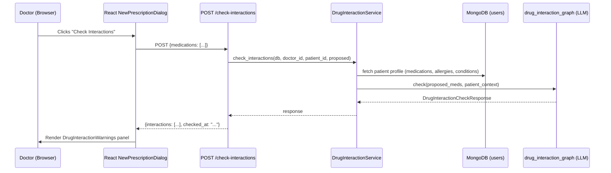

# Drug Interaction Checker — Prescription Safety Gate

## 1. Title & Summary

When a doctor is composing a new prescription, the AI scans the proposed medications against the patient's **existing medications**, **documented allergies**, and **active conditions** to surface potential drug-drug, drug-allergy, and drug-condition interactions before the prescription is saved. A new `POST /prescriptions/check-interactions` endpoint drives the check; the LangGraph copilot system prompt is also hardened to proactively surface interactions in its suggestions. Success means a doctor writing a new prescription for a patient on Warfarin who adds Aspirin sees a **critical** interaction warning inline, before saving, with a plain-English description of the risk.

---

## 2. Type & Scope

**Type:** Feature (new endpoint + UI component + copilot prompt enhancement)

**In scope:**
- New `POST .../prescriptions/check-interactions` backend endpoint.
- New `DrugInteractionWarnings` React component rendered inside `NewPrescriptionDialog`.
- "Check Interactions" button wired to the RTK Query mutation; auto-fires when the dialog opens with a copilot prefill.
- Structured AI response: severity (`critical | moderate | minor`), title, plain-English description, implicated drug names.
- Checks: drug-drug, drug-allergy, drug-condition interactions across proposed + existing patient medications.
- Enhancement of the prescription copilot system prompt to proactively flag interactions in its suggestion.
- Backend unit tests; frontend component tests.
- Doc updates to `FRONTEND_BACKEND_COLLABORATION.md` and `ARCHITECTURE.md`.

**Out of scope:**
- Integration with external drug databases (DrugBank, RxNorm, OpenFDA). Future phase.
- Blocking hard-stops that prevent submission — the warning is advisory; the doctor decides.
- Automatic prescription rejection or EHR write-back.
- Interaction checking on the prescriptions list view (only during creation/edit).
- Drug-drug interactions between two existing (non-proposed) patient medications (the patient profile already shows this context; it is out of scope for this gate).

---

## 3. Baseline

What exists today:

| Area | File | State |
|------|------|-------|
| Prescription creation form | `frontend/src/pages/doctor/DoctorPrescriptionsPage.tsx:186–395` | Dialog with dynamic medication fields; no interaction checking |
| Prescription copilot | `backend/app/ai/prescription_copilot_graph.py` | System prompt already flags *allergy* conflicts; does NOT check drug-drug interactions |
| Patient medication data | `backend/app/schemas/patient.py:144–148` | `Medication(name, dosage, frequency, since)` stored in `users.patient_profile.medications` |
| Prescription endpoints | `backend/app/api/prescriptions.py` | CRUD + `/suggest`; no `/check-interactions` endpoint |
| AI LLM integration | `backend/app/ai/llm.py` | `get_llm()` factory; `.with_structured_output()` for copilot |
| RTK Query layer | `frontend/src/api/prescriptionsApi.ts` | 4 mutations; no interaction-check mutation |

---

## 4. Prior Art & Strategy

### Existing pattern: copilot system prompt allergy flagging

`prescription_copilot_graph.py:15–34` already instructs the LLM:

> "If the doctor's description mentions a drug the patient is allergic to, include a clear warning in notes and either omit that drug or suggest a safe alternative."

This works for allergy inference during suggestion generation but **does not run after the doctor edits the form**, and it does not cover drug-drug interactions.

### Option A — Enhance copilot prompt only

Extend the existing copilot system prompt to also check drug-drug interactions. Simple, zero new endpoints. But it fires only during copilot suggestion, not when the doctor types medications manually into the dialog.

### Option B — Separate dedicated endpoint (proposed)

A standalone `POST /check-interactions` endpoint that accepts the current form's proposed medications, fetches the patient's existing medications and allergies, and calls a new `drug_interaction_graph` function. The copilot system prompt is **also** hardened as a cheap parallel improvement.

**Why Option B wins:**

- Works regardless of whether the doctor used the copilot or typed manually.
- Isolated: the interaction-check LLM call can use `temperature=0.0` without affecting copilot creativity.
- Testable independently from suggestion generation.
- The pattern mirrors `prescription_copilot.py → prescription_copilot_graph.py`; it is idiomatic to this repo.

Option A is not discarded — Phase 3 hardens the copilot prompt regardless because it is low-effort and high-value.

---

## 5. Target Architecture

### Data flow



### Component relationships

```
NewPrescriptionDialog
├── MedicationsList (existing)
│   └── [name, dosage, frequency, duration, instructions fields]
├── [Check Interactions] button  ← NEW
├── DrugInteractionWarnings      ← NEW component
│   ├── CriticalWarning chip (red)
│   ├── ModerateWarning chip (orange)
│   └── MinorWarning chip (yellow)
└── [Save Prescription] button (unchanged)
```

---

## 6. Directory & File Plan

| Path | Purpose | Status |
|------|---------|--------|
| `backend/app/schemas/drug_interaction.py` | Pydantic models: `MedicationCheckItem`, `DrugInteraction`, `DrugInteractionCheckRequest`, `DrugInteractionCheckResponse` | **New** |
| `backend/app/ai/drug_interaction_graph.py` | LangGraph function: system prompt + `.with_structured_output()` returning `DrugInteractionCheckResponse` | **New** |
| `backend/app/service/drug_interaction_service.py` | Business logic: fetch patient profile, format context, call AI graph | **New** |
| `backend/app/api/prescriptions.py` | Add `POST /{patient_id}/prescriptions/check-interactions` route | **Modify** |
| `backend/app/ai/prescription_copilot_graph.py` | Extend system prompt to include drug-drug interaction rules | **Modify** |
| `backend/tests/test_drug_interaction_service.py` | Unit tests: mocked LLM + patient profile | **New** |
| `frontend/src/types/doctor.ts` | Add `DrugInteraction`, `DrugInteractionCheckResponse` types | **Modify** |
| `frontend/src/api/prescriptionsApi.ts` | Add `useCheckDrugInteractionsMutation` | **Modify** |
| `frontend/src/components/DrugInteractionWarnings.tsx` | Renders severity-coded interaction cards | **New** |
| `frontend/src/pages/doctor/DoctorPrescriptionsPage.tsx` | Wire button + state + component into `NewPrescriptionDialog` | **Modify** |
| `docs/FRONTEND_BACKEND_COLLABORATION.md` | Document new endpoint contract | **Modify** |
| `docs/ARCHITECTURE.md` | Note the new AI graph and service | **Modify** |

---

## 7. API / Data

### New endpoint

```
POST /api/doctors/{doctor_id}/patients/{patient_id}/prescriptions/check-interactions
```

**Auth:** Bearer JWT; `ensure_doctor_route` + `verify_connection`.

**Request (JSON, snake_case):**
```json
{
  "medications": [
    { "name": "Aspirin", "dosage": "81mg", "frequency": "once daily" },
    { "name": "Lisinopril", "dosage": "10mg", "frequency": "once daily" }
  ]
}
```

**Response (JSON, snake_case):**
```json
{
  "interactions": [
    {
      "severity": "moderate",
      "title": "Aspirin + Lisinopril — reduced antihypertensive effect",
      "description": "NSAIDs including aspirin can blunt the blood-pressure-lowering effect of ACE inhibitors. Monitor blood pressure closely; consider GI protection.",
      "implicated_drugs": ["Aspirin", "Lisinopril"]
    }
  ],
  "checked_at": "2026-05-10T14:22:03Z"
}
```

**Empty interactions (no issues found):**
```json
{ "interactions": [], "checked_at": "2026-05-10T14:22:03Z" }
```

**Error responses:**
- `403` — doctor not connected to patient.
- `422` — request body validation failure (no medications, or empty name).
- `500` — LLM failure (returns generic error; do not bubble AI errors to the browser as interaction warnings).

### Pydantic schemas (`drug_interaction.py`)

```python
from pydantic import BaseModel
from typing import Literal

class MedicationCheckItem(BaseModel):
    name: str
    dosage: str = ""
    frequency: str = ""

class DrugInteraction(BaseModel):
    severity: Literal["critical", "moderate", "minor"]
    title: str
    description: str
    implicated_drugs: list[str]

class DrugInteractionCheckRequest(BaseModel):
    medications: list[MedicationCheckItem]

class DrugInteractionCheckResponse(BaseModel):
    interactions: list[DrugInteraction]
    checked_at: str  # ISO 8601
```

### TypeScript types (`doctor.ts` additions)

```typescript
export type InteractionSeverity = "critical" | "moderate" | "minor";

export interface DrugInteraction {
  severity: InteractionSeverity;
  title: string;
  description: string;
  implicated_drugs: string[];
}

export interface DrugInteractionCheckResponse {
  interactions: DrugInteraction[];
  checked_at: string;
}
```

### MongoDB access

No new collections. The service reads `users.patient_profile` (medications, allergies, conditions) from the existing `users` collection using the same pattern as `prescription_copilot.py:get_patient_profile(db, patient_id)`.

### snake_case / camelCase boundary

- Wire protocol (HTTP request/response): **snake_case** throughout (`implicated_drugs`, `checked_at`).
- React internal state: camelCase (`implicatedDrugs`). TypeScript type field names should match the wire format for consistency with existing types in `doctor.ts` (which already use snake_case for API-mirrored fields).

---

## 8. Edge Cases & Failure Handling

| Scenario | Handling |
|----------|---------|
| Doctor adds zero medication rows | Button disabled; frontend validates `medications.length > 0 && medications.every(m => m.name.trim())` before calling. |
| Patient has no existing medications | AI receives empty `current_medications` context; can still detect drug-drug interactions within the proposed list. |
| LLM returns unexpected structure | `.with_structured_output()` raises; service catches and returns `{"interactions": [], "checked_at": ...}` with a log warning — silent no-warn is safer than a UI crash. |
| LLM hallucination (invents a false interaction) | System prompt instructs: "Only flag interactions that are well-documented in clinical literature. If uncertain, omit." Disclaimer shown in UI. This is a known limitation; external database integration is the long-term mitigation. |
| Network timeout on check call | RTK Query request times out; component shows an inline error "Interaction check failed — verify manually." Submit button remains enabled. |
| Doctor ignores warnings and saves | Permitted. Warnings are advisory only. `checked_at` timestamp is not persisted (out of scope this phase). |
| Duplicate medication name in proposed list | AI handles naturally; frontend does not deduplicate (existing form behaviour unchanged). |
| Copilot prefills medications then doctor edits | Interaction check result is stale after edits; a "Re-check" state cue is shown if medications change after a check runs. |
| Patient allergies not yet documented | AI works with available data; system prompt notes "only check against documented allergies." |
| Empty or whitespace medication name submitted | `MedicationCheckItem.name: str` with Pydantic `@field_validator` that strips and rejects blank strings. |

---

## 9. Testing Strategy

### Backend (pytest, run in Docker)

**`backend/tests/test_drug_interaction_service.py`**

```python
# Test cases:
# - proposed meds interact with each other (e.g., Warfarin + Aspirin → critical)
# - proposed med conflicts with patient's existing med
# - proposed med matches patient allergy → critical
# - no interactions → empty list
# - LLM raises exception → service returns empty interactions (not 500)
# - patient not found → 404 propagated from service
```

- Mock: LLM via `unittest.mock.patch("backend.app.ai.drug_interaction_graph.get_llm")`.
- Mock: DB via `AsyncMock` returning pre-built patient profile fixtures.
- Do NOT use real LLM calls in unit tests.

**`backend/tests/test_prescriptions_api.py`** (extend or create)

- HTTP-level test: `POST .../check-interactions` with valid/invalid body.
- Auth: verify `403` when connection is absent.
- Validate response shape against `DrugInteractionCheckResponse`.

### Frontend (vitest + React Testing Library)

**`frontend/src/components/DrugInteractionWarnings.test.tsx`**

```typescript
// - Renders nothing when interactions=[]
// - Renders correct number of warning cards
// - Critical interactions render red chip
// - Moderate interactions render orange chip
// - Minor interactions render yellow chip
// - implicated_drugs listed per card
```

**`DoctorPrescriptionsPage` integration test (extend existing or add)**

- "Check Interactions" button is disabled with empty medications.
- Clicking fires the RTK mutation.
- Mutation loading state shows spinner on button.
- Mutation success renders `DrugInteractionWarnings`.
- Mutation error renders inline error text.

### No flaky patterns

- All LLM calls in backend tests are mocked synchronously; no real network requests.
- Frontend tests use `msw` (or RTK mock) to intercept the endpoint; no real API calls.
- Tests do not rely on insertion order of interactions array (assertions use `arrayContaining`).

---

## 10. Risks & Rollback

| Risk | Mitigation |
|------|-----------|
| LLM hallucinates clinically incorrect interaction | Add disclaimer in UI ("AI screening only — verify with clinical reference"). Lower temperature to 0.0. Do not block submit. Long-term: external drug database. |
| Latency of AI call disrupts UX | Check is on-demand (button click), not blocking form render. Target < 4 s; show spinner. Timeout after 10 s. |
| Copilot prompt changes degrade suggestion quality | Change is additive only (extra rules appended). Run manual regression: test 3 sample prompts before and after. |
| `with_structured_output()` schema mismatch breaks endpoint | Pydantic model validates at the boundary; service catches `ValidationError` and returns empty interactions. Log at ERROR level. |
| Rollback | All new code is additive. Rolling back = remove the new route from `prescriptions.py` router and revert the frontend PR. No DB migrations. |

---

## 11. Implementation Phases (Detailed)

### Implementation order overview

1. Phase 1 — Backend schemas & AI graph (foundation)
2. Phase 2 — Backend service & API endpoint
3. Phase 3 — Copilot system prompt enhancement *(can run parallel with Phase 2)*
4. Phase 4 — Frontend types & RTK Query mutation
5. Phase 5 — DrugInteractionWarnings component & dialog integration
6. Phase 6 — Tests & documentation

---

### Phase 1 — Backend Schemas & AI Graph

**Goal:** Define the data contract and the AI function that does the interaction analysis. Nothing is callable yet, but the types and LLM logic are complete and independently testable.

**Prerequisites:** None.

**Scope:**
- Create `backend/app/schemas/drug_interaction.py` with all Pydantic models.
- Create `backend/app/ai/drug_interaction_graph.py` with the LLM function.
- *Deferred to Phase 2:* service, endpoint, router registration.

**Tasks:**

1. Create `backend/app/schemas/drug_interaction.py`:
   - `MedicationCheckItem(name, dosage, frequency)` with `@field_validator` rejecting blank `name`.
   - `DrugInteraction(severity: Literal[...], title, description, implicated_drugs)`.
   - `DrugInteractionCheckRequest(medications: list[MedicationCheckItem])`.
   - `DrugInteractionCheckResponseAI(interactions: list[DrugInteraction])` — used only as the structured output target for the LLM.
   - `DrugInteractionCheckResponse(interactions: list[DrugInteraction], checked_at: str)` — returned to the API caller.

2. Create `backend/app/ai/drug_interaction_graph.py`:
   ```python
   async def check_drug_interactions(
       proposed_medications: list[dict],
       patient_context: str,  # formatted: current meds, allergies, conditions
   ) -> DrugInteractionCheckResponse
   ```
   - Use `get_llm().with_structured_output(DrugInteractionCheckResponseAI)`.
   - Temperature `0.0` (override at call site if needed, or use a separate `get_llm_strict()` helper).
   - System prompt must instruct:
     - Check **proposed medications** against each other (drug-drug).
     - Check **proposed medications** against **existing patient medications** (drug-drug).
     - Check **proposed medications** against **documented allergies** (drug-allergy).
     - Check **proposed medications** against **active conditions** (drug-condition, e.g. metformin + renal impairment).
     - Only flag interactions documented in recognised clinical literature.
     - Severity: `critical` = contraindicated or life-threatening; `moderate` = close monitoring required; `minor` = awareness advised.
     - If no interactions: return `{"interactions": []}`.
     - Do **not** invent patient data. Use only what the context provides.
     - Add a `title` ≤ 10 words and `description` ≤ 40 words.
   - Wrap invocation in `asyncio.to_thread(...)` if LLM SDK is sync (mirrors copilot graph pattern).
   - Catch `Exception`; on failure, log and return `DrugInteractionCheckResponse(interactions=[], checked_at=...)`.

**Deliverables:**
- `backend/app/schemas/drug_interaction.py` (new file).
- `backend/app/ai/drug_interaction_graph.py` (new file).

**Verification:**
```bash
# From repo root (stack running)
docker compose exec backend python -c "
from app.schemas.drug_interaction import DrugInteractionCheckRequest
from app.ai.drug_interaction_graph import check_drug_interactions
print('imports OK')
"
```
- No import errors. Schema validation rejects blank `name`. Module importable.

---

### Phase 2 — Backend Service & API Endpoint

**Goal:** Expose the interaction checker via HTTP. A working `POST /check-interactions` that fetches patient context and returns structured warnings.

**Prerequisites:** Phase 1 complete (schemas and AI graph exist).

**Scope:**
- Create `backend/app/service/drug_interaction_service.py`.
- Add route in `backend/app/api/prescriptions.py`.
- *Deferred to Phase 6:* backend tests for this service.

**Tasks:**

1. Create `backend/app/service/drug_interaction_service.py`:
   ```python
   async def check_interactions(
       db: AsyncIOMotorDatabase,
       doctor_id: str,
       patient_id: str,
       request: DrugInteractionCheckRequest,
   ) -> DrugInteractionCheckResponse
   ```
   - Call `connection_service.verify_connection(db, doctor_id, patient_id)` — raise `HTTPException(403)` on failure (mirrors `prescription_copilot.py` pattern exactly).
   - Fetch patient profile via the same helper used in `prescription_copilot.py` (reuse or extract to a shared util if not already factored).
   - Format patient context using the same `_format_patient_context` function (from tools or copilot service — import directly; do not duplicate).
   - Call `check_drug_interactions(proposed, formatted_context)` from Phase 1 graph.
   - Attach `checked_at = datetime.utcnow().isoformat() + "Z"`.
   - Return `DrugInteractionCheckResponse`.

2. Add route to `backend/app/api/prescriptions.py`:
   ```python
   @router.post(
       "/{patient_id}/prescriptions/check-interactions",
       response_model=DrugInteractionCheckResponse,
   )
   async def check_drug_interactions_route(
       doctor_id: str,
       patient_id: str,
       body: DrugInteractionCheckRequest,
       db: AsyncIOMotorDatabase = Depends(get_db),
       actor: CurrentUser = Depends(resolve_actor_user),
   ) -> DrugInteractionCheckResponse:
       ensure_doctor_route(actor, doctor_id)
       return await drug_interaction_service.check_interactions(db, doctor_id, patient_id, body)
   ```
   - Import `DrugInteractionCheckRequest`, `DrugInteractionCheckResponse`, `drug_interaction_service`.
   - Route ordering: place before the `/{patient_id}/prescriptions/{prescription_id}` parameterised routes to avoid shadowing (FastAPI matches in order).

**Deliverables:**
- `backend/app/service/drug_interaction_service.py` (new file).
- `backend/app/api/prescriptions.py` updated with new route.

**Verification:**
```bash
docker compose up --build -d  # rebuild to pick up new files
# Smoke test with curl (AUTH_REQUIRED=false for local dev or use valid token)
curl -s -X POST \
  http://localhost:8000/api/doctors/<doctor_id>/patients/<patient_id>/prescriptions/check-interactions \
  -H "Content-Type: application/json" \
  -d '{"medications": [{"name": "Warfarin"}, {"name": "Aspirin"}]}' | jq .
# Expected: interactions array with ≥1 critical entry
```
- No 422 or 500. Route appears in `/docs` (FastAPI auto-docs).

---

### Phase 3 — Copilot System Prompt Enhancement

**Goal:** Harden the existing prescription copilot to proactively surface drug-drug interactions in its AI suggestions, independent of the new standalone check.

**Prerequisites:** None (entirely independent of Phases 1–2 and 4–5).

**Notes:** *Can run in parallel with Phase 2.*

**Scope:**
- Modify `backend/app/ai/prescription_copilot_graph.py` system prompt only.
- No schema or service changes.
- *Deferred:* updating the copilot to call the new AI graph function (complex; use prompt-only approach here).

**Tasks:**

1. Open `backend/app/ai/prescription_copilot_graph.py`.

2. Extend `_SYSTEM_PROMPT` rules section (append after the existing allergy rule):

   ```
   - Check the proposed medications against the patient's current medications for drug-drug interactions.
     For each interaction found: add a warning to `notes` identifying the two drugs, the interaction risk (e.g., bleeding, serotonin syndrome), and a brief action (e.g., "monitor INR closely").
   - Check each proposed medication against the patient's active conditions for contraindications
     (e.g., metformin in severe renal impairment, beta-blockers in asthma). Flag these in `notes`.
   - If a proposed drug interacts critically with another, prefer a safer alternative in the
     `medications` list and explain the substitution in `notes`.
   - Preserve existing allergy-check rules above; allergy conflicts take priority over drug-drug interactions.
   ```

3. Verify the prompt still fits within token limits (count characters; the full context including patient data stays well under 4 K tokens for typical profiles).

**Deliverables:**
- `backend/app/ai/prescription_copilot_graph.py` updated system prompt.

**Verification:**
```bash
docker compose exec backend python -c "
from app.ai.prescription_copilot_graph import _SYSTEM_PROMPT
assert 'drug-drug' in _SYSTEM_PROMPT
print('prompt updated')
"
# Manual: open the copilot modal in the browser, type a prompt that should trigger an interaction,
# confirm the suggestion notes field includes an interaction warning.
```

---

### Phase 4 — Frontend Types & RTK Query Mutation

**Goal:** Add the TypeScript types and RTK Query mutation so the React layer can call the backend.

**Prerequisites:** Phase 2 endpoint is stable (API contract agreed, even if backend not yet deployed).

**Scope:**
- Add types to `frontend/src/types/doctor.ts`.
- Add mutation to `frontend/src/api/prescriptionsApi.ts`.
- *Deferred to Phase 5:* component and dialog integration.

**Tasks:**

1. In `frontend/src/types/doctor.ts`, add after existing prescription types:
   ```typescript
   export type InteractionSeverity = "critical" | "moderate" | "minor";

   export interface DrugInteraction {
     severity: InteractionSeverity;
     title: string;
     description: string;
     implicated_drugs: string[];
   }

   export interface DrugInteractionCheckResponse {
     interactions: DrugInteraction[];
     checked_at: string;
   }

   export interface DrugInteractionCheckRequest {
     medications: Array<{ name: string; dosage: string; frequency: string }>;
   }
   ```

2. In `frontend/src/api/prescriptionsApi.ts`, add mutation alongside existing ones:
   ```typescript
   checkDrugInteractions: builder.mutation<
     DrugInteractionCheckResponse,
     { doctorId: string; patientId: string; body: DrugInteractionCheckRequest }
   >({
     query: ({ doctorId, patientId, body }) => ({
       url: `${prescriptionsBase(doctorId, patientId)}/check-interactions`,
       method: "POST",
       body: JSON.stringify(body),
     }),
   }),
   ```
   - Export the auto-generated hook: `useCheckDrugInteractionsMutation`.
   - No cache tag invalidation needed (this is a read-only check, not a mutation that changes persistent state).

**Deliverables:**
- `frontend/src/types/doctor.ts` extended.
- `frontend/src/api/prescriptionsApi.ts` extended.

**Verification:**
```bash
cd frontend && npm run build  # TypeScript compile must pass with 0 errors
```

---

### Phase 5 — DrugInteractionWarnings Component & Dialog Integration

**Goal:** Surface interaction warnings inline inside `NewPrescriptionDialog` — visible before the doctor clicks Save.

**Prerequisites:** Phase 4 complete (types and mutation available).

**Scope:**
- New `DrugInteractionWarnings` component.
- Wire into `NewPrescriptionDialog` in `DoctorPrescriptionsPage.tsx`.
- *Deferred:* persisting `checked_at` alongside the saved prescription (future audit feature).

**Tasks:**

1. Create `frontend/src/components/DrugInteractionWarnings.tsx`:
   - Props: `interactions: DrugInteraction[]`.
   - If `interactions.length === 0`: render nothing (null).
   - Otherwise: render an MUI `Stack` (or `Box`) with:
     - Header: `Alert severity="warning"` — "Interaction screening results — AI-generated, verify clinically."
     - For each interaction: an `Accordion` with:
       - Summary: severity `Chip` (color: `error` for critical, `warning` for moderate, `default` for minor) + `title` text.
       - Details: `description` text + small "Implicated: " + `implicated_drugs.join(", ")`.
   - No internal state; purely presentational.

2. In `DoctorPrescriptionsPage.tsx`, inside `NewPrescriptionDialog`:

   a. Add state near existing form state:
      ```typescript
      const [interactionResult, setInteractionResult] = useState<DrugInteractionCheckResponse | null>(null);
      const [checkInteractions, { isLoading: isCheckingInteractions }] = useCheckDrugInteractionsMutation();
      ```

   b. Reset `interactionResult` to `null` whenever the medications array changes (use `useEffect` or inline in the medication change handler) — this prevents stale results from being displayed after edits.

   c. Add a "Check Interactions" `Button` variant `outlined` between the medications list and the Save button:
      - Disabled when: `isCheckingInteractions`, or no medication has a non-empty `name`, or `isLoading` (form submitting).
      - Loading: show `CircularProgress` size 16 inside the button while `isCheckingInteractions`.
      - On click:
        ```typescript
        const result = await checkInteractions({
          doctorId,
          patientId,
          body: { medications: medications.filter(m => m.name.trim()).map(m => ({
            name: m.name, dosage: m.dosage, frequency: m.frequency
          })) },
        }).unwrap();
        setInteractionResult(result);
        ```
      - On error: show `Snackbar` "Interaction check failed — verify manually."

   d. Render `<DrugInteractionWarnings interactions={interactionResult?.interactions ?? []} />` below the Check button.

   e. Auto-trigger check when dialog opens with a copilot prefill (i.e., `prefill !== null`): call the check in a `useEffect` that watches `open && prefill`.

   f. Clear `interactionResult` on dialog close (in the existing `handleClose` function).

**Deliverables:**
- `frontend/src/components/DrugInteractionWarnings.tsx` (new file).
- `DoctorPrescriptionsPage.tsx` updated dialog state, button, and component rendering.

**Verification:**
```bash
# Start the stack
docker compose up -d
# Navigate to a patient's prescriptions page in the browser
# Open New Prescription dialog, add "Warfarin" + "Aspirin", click Check Interactions
# Expect: at least one interaction warning card rendered with severity chip
# Add no medications → Check Interactions button is disabled
# Edit medications after check → warning panel clears (stale result gone)
# Close and reopen dialog → no stale warnings shown
```

---

### Phase 6 — Tests & Documentation

**Goal:** Ensure the feature has sufficient test coverage and that the documentation reflects the new endpoint and architecture.

**Prerequisites:** Phases 1–5 complete.

**Scope:**
- Backend unit tests for service + API.
- Frontend component tests.
- Docs updates.

**Tasks:**

1. Create `backend/tests/test_drug_interaction_service.py`:
   - Fixtures: `fake_db`, `patient_profile_with_warfarin`, `patient_profile_no_meds`.
   - Mock `get_llm` to return a `MagicMock` with `.with_structured_output().invoke()` returning pre-built `DrugInteractionCheckResponseAI`.
   - Test cases:
     - `test_critical_drug_drug_interaction` — Warfarin + Aspirin → critical returned.
     - `test_drug_allergy_interaction` — Penicillin proposed; patient allergic to Penicillin → critical.
     - `test_no_interactions` — Saline + Glucose → empty list.
     - `test_llm_failure_returns_empty` — LLM raises `Exception`; service returns `interactions=[]`.
     - `test_no_connection_raises_403` — `verify_connection` returns False; expect `HTTPException(403)`.

2. Create/extend `backend/tests/test_prescriptions_api.py`:
   - HTTP-level test for `POST .../check-interactions`:
     - `test_check_interactions_returns_200` with mocked service.
     - `test_check_interactions_invalid_body_422` — empty medications list.
     - `test_check_interactions_blank_name_422` — medication with `name=""`.
     - `test_check_interactions_no_connection_403`.

3. Create `frontend/src/components/DrugInteractionWarnings.test.tsx`:
   - `renders nothing with empty interactions`.
   - `renders critical chip in error color`.
   - `renders moderate chip in warning color`.
   - `renders implicated drugs`.
   - `renders disclaimer text`.

4. Update `docs/FRONTEND_BACKEND_COLLABORATION.md`:
   - Add `POST .../prescriptions/check-interactions` to the prescriptions endpoint table.
   - Document request/response shapes and snake_case/camelCase note.

5. Update `docs/ARCHITECTURE.md`:
   - Note `drug_interaction_graph.py` in the AI graph section alongside `prescription_copilot_graph.py`.

**Deliverables:**
- `backend/tests/test_drug_interaction_service.py` (new file).
- `backend/tests/test_prescriptions_api.py` extended.
- `frontend/src/components/DrugInteractionWarnings.test.tsx` (new file).
- `docs/FRONTEND_BACKEND_COLLABORATION.md` updated.
- `docs/ARCHITECTURE.md` updated.

**Verification:**
```bash
# Backend tests (in container)
docker compose exec backend python -m pytest tests/test_drug_interaction_service.py tests/test_prescriptions_api.py -v

# Frontend tests
docker compose exec frontend npm run test -- --reporter=verbose DrugInteractionWarnings

# All green = Phase 6 done
```

---

---

### Phase 7 — Pharmacological Enrichment (RxNorm + OpenFDA) ✅ Implemented 2026-05-10

**Goal:** Ground the interaction check in authoritative pharmaceutical data instead of relying solely on LLM training knowledge.

**Why it matters:**
- LLM-only approach fails when a doctor enters a regional brand name (e.g., "Panadol") — the model may or may not know it contains paracetamol, and definitely cannot verify the dosage against FDA limits.
- A prescribed "1000mg 4x daily" of paracetamol (4 g/day = hepatotoxicity threshold) would go unchecked without label data.
- Hallucinated or missed interactions are a real risk with pure LLM checks.

**What was added:**

| File | Change |
|------|--------|
| `backend/app/ai/drug_lookup.py` | **New** — `enrich_medications()` calls RxNorm REST + OpenFDA concurrently for each proposed drug |
| `backend/app/ai/drug_interaction_graph.py` | **Modified** — calls enrichment before LLM call; injects pharmacological data into prompt; strengthened system prompt |

**How it works:**

1. **RxNorm brand→ingredient resolution**: `GET /rxcui.json?name={drug_name}` → RxCUI → `GET /rxcui/{rxcui}/allrelated.json` extracts Ingredient (IN) concept terms. "Tylenol" → "acetaminophen"; "Augmentin" → "amoxicillin", "clavulanate".
2. **OpenFDA label lookup**: `GET /drug/label.json?search=openfda.brand_name:"{name}"` (with generic fallback). Extracts:
   - `boxed_warning` / `warnings` — FDA black box and standard warnings
   - `drug_interactions` — FDA-listed interaction text
   - `dosage_and_administration` — dosage limits and guidance
3. **Enriched prompt section** (`## Pharmacological Data`) is appended to the LLM human message. The updated system prompt instructs the LLM to:
   - Use resolved active ingredients for interaction analysis (not just brand names)
   - Treat FDA-listed interactions as authoritative
   - Classify FDA boxed warnings as `critical`
   - Flag dosage excess against FDA limits

**Graceful degradation**: If RxNorm or OpenFDA are unreachable, enrichment is skipped and the check falls back to the original LLM-only approach. No 500 error is propagated.

**APIs used (no key required):**
- RxNorm REST API: `https://rxnav.nlm.nih.gov/REST` — NLM, free, no key
- OpenFDA API: `https://api.fda.gov/drug` — FDA, free, 240 req/min

**Added latency**: ~0.5–1.5 s for concurrent lookups (run in parallel per drug). Total check time remains under 6 s for typical 3–5 drug prescriptions.

---

*Plan authored 2026-05-10. Phase 7 implemented 2026-05-10. Next recommended phase: persist interaction check results alongside saved prescriptions for audit trail.*
