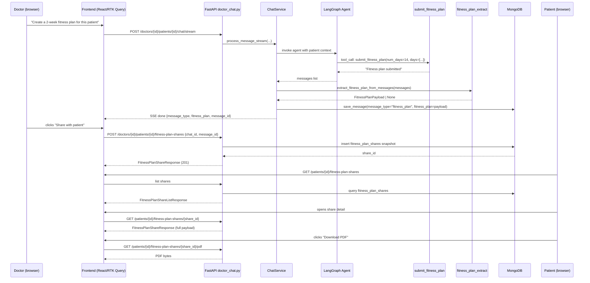

# Personalized Fitness / Gym Plan

## 1. Title & Summary

Add a **doctor-prescribed, AI-generated fitness plan** feature that mirrors the existing meal plan feature end-to-end. The AI generates a structured weekly workout program grounded in each patient's conditions, medications, and lifestyle — e.g., no high-impact cardio for cardiac conditions, resistance-training modifications for osteoporosis, heart-rate targets adjusted for beta-blocker use. Doctors generate a plan in the chat UI, optionally download a PDF, and share it with the patient. Patients view their shared plans and download PDFs from the patient portal.

**Success criteria:**
- Doctor can trigger fitness plan generation via chat prompt; plan renders in chat as a structured card.
- Doctor can download a PDF of the plan and share it with a connected patient.
- Patient can list all shared fitness plans, view details, and download a PDF.
- The AI respects patient medical context (conditions, medications, activity level) when generating exercises.
- Feature is consistent in UX and code structure with the meal plan feature.

---

## 2. Type & Scope

**Type:** Full-stack feature

**In scope:**
- `FitnessPlanPayload` schema (days → sessions → exercises) with medical context fields
- `submit_fitness_plan` LangGraph tool registered alongside `submit_meal_plan`
- Extraction, share service, share repository, PDF renderer (parallel to meal plan modules)
- New `fitness_plan_shares` MongoDB collection with indexes
- `fitness_plan` optional field on `chat_messages` documents and `ChatResponse` / `MessageSchema`
- Doctor endpoints: download PDF, create share
- Patient endpoints: list shares, get share detail, download share PDF
- Frontend: `FitnessPlanMessage` doctor chat component, `PatientFitnessPlanPage` list, `PatientFitnessPlanDetailPage` detail, RTK Query hooks, router paths, sidebar nav
- Updated system prompt guidance for fitness plan generation
- Documentation updates (`FRONTEND_BACKEND_COLLABORATION.md`, `ARCHITECTURE.md`)

**Out of scope:**
- Progress tracking, exercise completion logging
- Video or image content in plans
- Patient-initiated plan requests (doctor-only, same as meal plans)
- Revoke/delete share endpoint (present structurally as `revoked_at` field but no dedicated UI)
- Integration with wearables or external fitness APIs
- Patient-editable plan

---

## 3. Baseline

The meal plan feature is the direct precedent and structural twin. Key files today:

| Layer | Path |
|-------|------|
| Pydantic schema | `backend/app/schemas/meal_plan.py` |
| LangGraph tool | `backend/app/ai/tools.py` (`submit_meal_plan`) |
| Graph registration | `backend/app/ai/graph.py` (`TOOLS` list) |
| Extraction | `backend/app/ai/meal_plan_extract.py` |
| Share repository | `backend/app/repository/meal_plan_share.py` |
| Share service | `backend/app/service/meal_plan_share.py` |
| PDF renderer | `backend/app/service/meal_plan_pdf.py` |
| Chat service wiring | `backend/app/service/chat.py` |
| Doctor endpoints | `backend/app/api/doctor_chat.py` |
| Patient endpoints | `backend/app/api/patients.py` |
| TS types | `frontend/src/types/mealPlan.ts`, `mealPlanShare.ts` |
| RTK Query | `frontend/src/api/chatApi.ts`, `patientsApi.ts` |
| Doctor component | `frontend/src/components/chat/MealPlanMessage.tsx` |
| Patient pages | `frontend/src/pages/patient/PatientMealPlansPage.tsx`, `PatientMealPlanDetailPage.tsx` |
| Router | `frontend/src/router/paths.ts`, `frontend/src/router.tsx` |
| Nav | `frontend/src/components/Sidebar.tsx` |

The `chat_messages` document already has `message_type` and `meal_plan` optional fields. The SSE `done` event already carries `message_type` and `meal_plan`. Both need a parallel `fitness_plan` extension.

---

## 4. Prior Art & Strategy

**Existing pattern (meal plan):** Tool-based structured output via LangGraph. The LLM calls `submit_meal_plan` as a tool within the agent loop; `extract_meal_plan_from_messages()` scans the resulting `ToolMessage` and validates through Pydantic; the payload is stored as a snapshot in `chat_messages` and copied into `meal_plan_shares` when shared. Streaming SSE delivers the structured payload in the `done` event.

**Alternative (prescription copilot):** `llm.with_structured_output(...)` — synchronous, no streaming, no multi-turn tool loop. Not suitable here because fitness plans benefit from multi-step reasoning about patient conditions and streaming feedback while the AI thinks.

**Decision: mirror meal plan exactly.** The tool pattern is proven, streaming is better UX for plan generation (users see "thinking"), and keeping the two features structurally identical reduces cognitive overhead for future maintainers. No deviation warranted.

The only deliberate design extensions vs. meal plan:
1. `FitnessPlanPayload` has richer medical context fields (`medical_notes`, `contraindications`) and an exercise intensity model (`low / moderate / high`).
2. `num_days` bound extends to 28 (4-week programs are common; 7 is still the default).
3. Each `ExerciseItem` carries an optional `modifications` list for patient-specific adaptations.

---

## 5. Target Architecture



---

## 6. Directory & File Plan

### Backend

| Path | Purpose | New / Modify |
|------|---------|-------------|
| `backend/app/schemas/fitness_plan.py` | `ExerciseItem`, `WorkoutSession`, `DayWorkout`, `FitnessPlanPayload` | **New** |
| `backend/app/schemas/fitness_plan_share.py` | `FitnessPlanShareCreate`, `FitnessPlanShareResponse`, `FitnessPlanShareListItem`, `FitnessPlanShareListResponse` | **New** |
| `backend/app/schemas/chat.py` | Add `fitness_plan: FitnessPlanPayload \| None` to `MessageSchema` and `ChatResponse`; extend `message_type` literal to include `"fitness_plan"` | **Modify** |
| `backend/app/ai/tools.py` | Add `@tool submit_fitness_plan(...)` alongside `submit_meal_plan` | **Modify** |
| `backend/app/ai/graph.py` | Register `submit_fitness_plan` in `TOOLS` list | **Modify** |
| `backend/app/ai/fitness_plan_extract.py` | `extract_fitness_plan_from_messages(messages) -> FitnessPlanPayload \| None` | **New** |
| `backend/app/ai/prompts.py` | Add doctor system-prompt guidance on when/how to generate fitness plans | **Modify** |
| `backend/app/repository/fitness_plan_share.py` | `insert_share`, `find_by_patient`, `get_by_share_id`, `find_by_message`, `ensure_indexes` | **New** |
| `backend/app/service/fitness_plan_share.py` | `doctor_create_share`, `patient_list_shares`, `patient_get_share`, `patient_share_pdf_bytes`, `doctor_fitness_plan_pdf_bytes` | **New** |
| `backend/app/service/fitness_plan_pdf.py` | `render_fitness_plan_pdf(payload, title, subtitle) -> bytes` via fpdf2 | **New** |
| `backend/app/service/chat.py` | Call `extract_fitness_plan_from_messages`; set `message_type="fitness_plan"` if returned; persist `fitness_plan` field | **Modify** |
| `backend/app/repository/chat.py` | Accept + store `fitness_plan` optional field on `chat_messages` | **Modify** |
| `backend/app/api/doctor_chat.py` | Add `GET .../fitness-plan/pdf` and `POST .../fitness-plan-shares` endpoints | **Modify** |
| `backend/app/api/patients.py` | Add `GET .../fitness-plan-shares`, `.../fitness-plan-shares/{id}`, `.../fitness-plan-shares/{id}/pdf` endpoints | **Modify** |
| `backend/tests/test_fitness_plan.py` | Unit tests: schema validation, extraction, PDF render | **New** |
| `backend/tests/test_fitness_plan_share.py` | Integration tests: doctor create/share, patient list/detail/pdf | **New** |
| `backend/tests/test_route_audit.py` | Register new routes in route permission audit | **Modify** |

### Frontend

| Path | Purpose | New / Modify |
|------|---------|-------------|
| `frontend/src/types/fitnessPlan.ts` | `ExerciseItem`, `WorkoutSession`, `DayWorkout`, `FitnessPlanPayload` (snake_case wire types) | **New** |
| `frontend/src/types/fitnessPlanShare.ts` | `FitnessPlanShareResponse`, `FitnessPlanShareListItem`, `FitnessPlanShareListResponse` | **New** |
| `frontend/src/types/chat.ts` | Add `fitness_plan?: FitnessPlanPayload` to `Message` / `ChatResponse`; extend `message_type` union | **Modify** |
| `frontend/src/api/chatApi.ts` | Add `useLazyGetDoctorFitnessPlanPdfQuery`, `useCreateDoctorFitnessPlanShareMutation` | **Modify** |
| `frontend/src/api/patientsApi.ts` | Add `useListPatientFitnessPlanSharesQuery`, `useGetPatientFitnessPlanShareQuery`, `useLazyGetPatientFitnessPlanSharePdfQuery` | **Modify** |
| `frontend/src/components/chat/FitnessPlanMessage.tsx` | Doctor chat card: Accordion by day, sessions, exercises, Download PDF + Share buttons | **New** |
| `frontend/src/pages/patient/PatientFitnessPlanPage.tsx` | Card grid of shared fitness plans (list) | **New** |
| `frontend/src/pages/patient/PatientFitnessPlanDetailPage.tsx` | Full plan detail + Download PDF button | **New** |
| `frontend/src/router/paths.ts` | Add `paths.patient.fitnessPlans`, `fitnessPlanDetail(shareId)` | **Modify** |
| `frontend/src/router.tsx` | Add patient routes for list + detail pages | **Modify** |
| `frontend/src/components/Sidebar.tsx` | Add "Fitness Plans" nav link under Meal Plans | **Modify** |

### MongoDB

| Collection | Action | Notes |
|-----------|--------|-------|
| `chat_messages` | Schema extension | Add optional `fitness_plan` field; `message_type` already exists |
| `fitness_plan_shares` | **New collection** | `share_id` (unique), `patient_id`, `doctor_id`, `fitness_plan` (snapshot), `source_chat_id`, `source_message_id`, `chat_title`, `doctor_display_name`, `created_at`, `revoked_at` |

---

## 7. API / Data

### FitnessPlanPayload (Pydantic — backend and TypeScript mirror — snake_case throughout)

```python
class ExerciseItem(BaseModel):
    name: str                           # e.g. "Low-impact walking"
    sets: int | None = None             # None for pure cardio/time-based
    reps: str | None = None             # e.g. "10–12" or "30 seconds"
    duration_minutes: int | None = None
    rest_seconds: int | None = None
    notes: str = ""                     # e.g. "Keep HR below 130 bpm"
    modifications: list[str] = []       # Patient-specific adaptations

class WorkoutSession(BaseModel):
    session_type: Literal["cardio", "strength", "flexibility", "balance", "rest"]
    name: str                           # e.g. "Upper Body Strength"
    duration_minutes: int
    intensity: Literal["low", "moderate", "high"]
    exercises: list[ExerciseItem]
    warmup_notes: str = ""
    cooldown_notes: str = ""

class DayWorkout(BaseModel):
    day_index: int                      # 1-indexed, 1–28 max
    label: str | None = None            # e.g. "Day 1 – Monday"
    sessions: list[WorkoutSession]
    is_rest_day: bool = False

class FitnessPlanPayload(BaseModel):
    num_days: int = 7                   # validator: 1–28
    days: list[DayWorkout]
    goal: str                           # e.g. "Improve cardiovascular endurance"
    fitness_level: Literal["beginner", "intermediate", "advanced"] = "beginner"
    medical_notes: str = ""             # AI-authored contraindication notes
    summary: str
    disclaimer: str = DEFAULT_FITNESS_DISCLAIMER
```

### New Doctor Endpoints

All under `/api/doctors/{doctor_id}/patients/{patient_id}/...`

| Method | Path | Body | Response | Status |
|--------|------|------|----------|--------|
| `GET` | `chat/fitness-plan/pdf` | Query: `chat_id`, `message_id` | `application/pdf` bytes | 200 |
| `POST` | `fitness-plan-shares` | `{ chat_id: str, message_id: str }` | `FitnessPlanShareResponse` | 201 (or 200 idempotent) |

### New Patient Endpoints

All under `/api/patients/{patient_id}/...`

| Method | Path | Query | Response | Status |
|--------|------|-------|----------|--------|
| `GET` | `fitness-plan-shares` | `skip=0&limit=50` | `FitnessPlanShareListResponse` | 200 |
| `GET` | `fitness-plan-shares/{share_id}` | — | `FitnessPlanShareResponse` | 200 |
| `GET` | `fitness-plan-shares/{share_id}/pdf` | — | `application/pdf` bytes | 200 |

### SSE `done` Event Extension

```json
{
  "type": "done",
  "chat_id": "...",
  "message_id": "...",
  "message_type": "fitness_plan",
  "fitness_plan": { "num_days": 7, "days": [...], "goal": "...", ... }
}
```

`message_type` remains `"text"` if neither plan is generated. `meal_plan` and `fitness_plan` are independent optional fields — in theory both could appear if the AI generates both (out of scope for now; system prompt should prevent this, but backend tolerates it gracefully).

**Casing:** All snake_case on the wire. TypeScript types mirror backend exactly (no camelCase transformation layer needed, consistent with existing meal plan types).

---

## 8. Edge Cases & Failure Handling

- **AI omits fitness plan entirely:** `extract_fitness_plan_from_messages` returns `None`; `message_type` stays `"text"`; no plan card renders. Doctor can prompt again.
- **Partial/malformed tool call args:** Pydantic `ValidationError` caught in extraction; logs error + returns `None`; graceful text fallback. No crash.
- **`num_days` out of bounds (>28 or <1):** Validator clamps silently (same as `meal_plan` pattern). LLM occasionally exceeds bounds.
- **No doctor–patient connection:** Share creation returns `403`. Doctor UI shows error toast.
- **Message not of type `fitness_plan`:** Share creation returns `404` (or `422`). Prevents sharing non-plan messages.
- **Duplicate share (same `message_id`):** Unique partial index on `(patient_id, source_message_id)` (where `revoked_at IS NULL`). Service returns 200 with existing share rather than 409. Idempotent.
- **Chat or message deleted after share created:** Share holds a full snapshot; patient access unaffected. PDF renders from snapshot.
- **`fpdf2` PDF render failure:** Exception caught in service layer; returns `500` with JSON error body (same pattern as meal plan PDF).
- **SSE stream ends before `done` event:** Frontend already handles this via existing error boundary in `consumeSseStream`; last message stays partial text.
- **Concurrent share creation requests:** Mongo unique index is the authoritative guard; service wraps `DuplicateKeyError` and returns existing share.
- **Patient accesses revoked share:** Service filters `revoked_at IS NULL`; returns `404`.
- **Empty `exercises` list in a session:** Allowed structurally; PDF renders session header with no exercise rows. System prompt should prevent this in practice.

---

## 9. Testing Strategy

### Backend (Docker container — `docker compose exec backend python -m pytest ...`)

| Test file | Coverage |
|----------|---------|
| `backend/tests/test_fitness_plan.py` | Schema validation: `num_days` clamping, `FitnessPlanPayload` round-trip, `ExerciseItem` optional fields; extraction logic: parses valid tool call, returns None on missing/malformed args |
| `backend/tests/test_fitness_plan_share.py` | Integration: doctor create share (201 + idempotent 200), patient list, patient get detail, PDF download, 403 no-connection, 404 wrong message type |
| `backend/tests/test_fitness_plan_pdf.py` | Pure-function: `render_fitness_plan_pdf` returns non-empty bytes for valid payload; handles rest days |
| `backend/tests/test_route_audit.py` | New routes appear in audit with correct auth requirements |

**Not flaky:** All share tests use isolated test DB; no reliance on LangGraph invocation (extraction is unit-tested with synthetic `ToolMessage`). PDF render is pure-function, no async.

### Frontend (vitest + React Testing Library)

| Test | Location |
|------|---------|
| `FitnessPlanMessage` renders accordion with sessions | `frontend/src/__tests__/FitnessPlanMessage.test.tsx` |
| Share button → mutation called with correct args | Same file |
| `PatientFitnessPlanPage` renders share cards, empty state | `frontend/src/__tests__/PatientFitnessPlanPage.test.tsx` |
| RTK Query hooks return correct types | Covered by type-checking |

### Manual / E2E

1. Start full stack: `docker compose up --build -d`
2. Open doctor chat, send: "Create a 1-week fitness plan for this patient considering their conditions."
3. Verify plan card renders with sessions and exercises.
4. Download PDF — verify opens in browser.
5. Click "Share with patient" — verify confirmation, then success state.
6. Switch to patient portal → Fitness Plans — verify card appears.
7. Open detail — verify full plan displayed.
8. Download PDF from patient side — verify PDF matches.

---

## 10. Risks & Rollback

| Risk | Mitigation |
|------|-----------|
| AI generates plan ignoring patient conditions | System prompt must explicitly instruct model to reason about conditions/medications before choosing exercises; tested with known high-risk conditions in manual QA |
| `message_type` collision (AI triggers both meal + fitness in one message) | Backend tolerates both fields; system prompt prohibits it; add extraction precedence rule (first tool call of each type wins) |
| `chat_messages` field addition breaks existing reads | `fitness_plan` field is optional; MongoDB is schema-less; existing messages without the field return `None` gracefully via Pydantic `Optional` |
| fpdf2 fitness plan PDF layout issues | Use same layout as meal plan PDF; test with long exercise names and many days |
| LangGraph tool list grows too large (context window) | Current list is small (3 tools + 1 new); not a risk today; document tool count as a watch item |
| Frontend chat stream parsing misses `fitness_plan` | SSE `done` parser already handles optional keys; add `fitness_plan` alongside `meal_plan` in the same conditional block |

**Rollback:** Feature is additive. Removing the tool from `TOOLS`, removing the `fitness_plan` field from `ChatResponse`, and hiding the UI components in the router returns the app to its prior state. No migration needed; `fitness_plan_shares` collection and optional `fitness_plan` fields in `chat_messages` are harmless if never populated.

---

## 11. Implementation Phases (Detailed)

### Implementation order overview

1. Phase 1 — Data Schemas & Types
2. Phase 2 — LangGraph Tool & Extraction
3. Phase 3 — Share Repository & Service
4. Phase 4 — PDF Renderer
5. Phase 5 — Backend API Endpoints
6. Phase 6 — Chat Service Wiring & SSE
7. Phase 7 — Frontend Types & RTK Query
8. Phase 8 — Doctor Chat UI Component
9. Phase 9 — Patient Portal Pages & Navigation
10. Phase 10 — Tests & Documentation

---

### Phase 1 — Data Schemas & Types

**Goal:** Establish the canonical data shapes for `FitnessPlanPayload` and share DTOs on both backend (Pydantic) and frontend (TypeScript), so all downstream phases compile against concrete types.

**Prerequisites:** None.

**Scope:**
- Backend Pydantic schemas only.
- Frontend TypeScript types only.
- No API, no service, no UI yet.

**Tasks:**

1. Create `backend/app/schemas/fitness_plan.py`:
   - `ExerciseItem`, `WorkoutSession`, `DayWorkout`, `FitnessPlanPayload`
   - Validator: clamp `num_days` 1–28 (mirror `meal_plan.py` validator pattern)
   - `DEFAULT_FITNESS_DISCLAIMER` constant
   - `FITNESS_PLAN_MEDICAL_NOTES_PLACEHOLDER` constant

2. Create `backend/app/schemas/fitness_plan_share.py`:
   - `FitnessPlanShareCreate` (fields: `chat_id`, `message_id`)
   - `FitnessPlanShareListItem` (fields: `share_id`, `created_at`, `chat_title`, `doctor_display_name`, `goal_snippet`)
   - `FitnessPlanShareListResponse` (fields: `shares: list[FitnessPlanShareListItem]`)
   - `FitnessPlanShareResponse` (full: adds `fitness_plan: FitnessPlanPayload`, `patient_id`, `doctor_id`)

3. Extend `backend/app/schemas/chat.py`:
   - Add `fitness_plan: FitnessPlanPayload | None = None` to `MessageSchema` and `ChatResponse`
   - Extend `message_type` literal: `Literal["text", "meal_plan", "fitness_plan"]`

4. Create `frontend/src/types/fitnessPlan.ts`:
   - Mirror backend Pydantic types exactly in snake_case (same as `mealPlan.ts` pattern)
   - Export `ExerciseItem`, `WorkoutSession`, `DayWorkout`, `FitnessPlanPayload`

5. Create `frontend/src/types/fitnessPlanShare.ts`:
   - `FitnessPlanShareListItem`, `FitnessPlanShareListResponse`, `FitnessPlanShareResponse`

6. Extend `frontend/src/types/chat.ts`:
   - Add `fitness_plan?: FitnessPlanPayload` to `Message` and `ChatResponse`
   - Extend `message_type` union

**Deliverables:** 2 new backend schema files, 1 modified; 2 new frontend type files, 1 modified.

**Verification:**
```bash
# Backend: schema imports and validation
docker compose exec backend python -c "from app.schemas.fitness_plan import FitnessPlanPayload; print('OK')"

# Frontend: TypeScript compile
docker compose exec frontend npx tsc --noEmit
```

---

### Phase 2 — LangGraph Tool & Extraction

**Goal:** The AI can call `submit_fitness_plan` during a conversation, and the system can reliably extract a validated `FitnessPlanPayload` from the agent's output messages.

**Prerequisites:** Phase 1 (Pydantic schema must exist for validation).

**Scope:**
- Tool definition in `tools.py`
- Graph registration in `graph.py`
- Extraction function in `fitness_plan_extract.py`
- System prompt update in `prompts.py`
- **Deferred:** Chat service wiring (Phase 6), actual invocation testing via chat endpoint (Phase 5+).

**Tasks:**

1. In `backend/app/ai/tools.py`, add `submit_fitness_plan` tool:
   ```python
   @tool
   def submit_fitness_plan(num_days: int, days: list[dict], goal: str,
                            fitness_level: str, medical_notes: str, summary: str) -> str:
       """Submit a personalized fitness plan tailored to the patient's medical conditions."""
       return "Fitness plan submitted"
   ```
   Tool docstring is the prompt the LLM sees — make it instructive about when to call it.

2. In `backend/app/ai/graph.py`, add `submit_fitness_plan` to `TOOLS`:
   ```python
   from app.ai.tools import ..., submit_fitness_plan
   TOOLS = [search_patient_records, web_search, submit_meal_plan, submit_fitness_plan]
   ```

3. Create `backend/app/ai/fitness_plan_extract.py`:
   - `extract_fitness_plan_from_messages(messages: list) -> FitnessPlanPayload | None`
   - Scans messages for `ToolMessage` with `name == "submit_fitness_plan"`
   - Parses `tool_call` args → validates via `FitnessPlanPayload(**args)`
   - Catches `ValidationError`, logs, returns `None`
   - *(Mirror `meal_plan_extract.py` exactly, substitute names)*

4. In `backend/app/ai/prompts.py`, add doctor system-prompt section:
   - When to generate a fitness plan (explicit patient request or doctor prompt)
   - How to reason about conditions (cardiac → avoid HIIT; osteoporosis → low-impact; diabetes → monitor intensity; beta-blockers → lower max HR)
   - Default `num_days = 7` unless specified
   - Must include `medical_notes` field with contraindication rationale
   - Do not generate both a meal plan and fitness plan in the same response

**Deliverables:** `fitness_plan_extract.py` new; `tools.py`, `graph.py`, `prompts.py` modified.

**Verification:**
```bash
# Extraction unit test (synthetic ToolMessage)
docker compose exec backend python -m pytest tests/test_fitness_plan.py::test_extract_fitness_plan -v

# Confirm tool registered
docker compose exec backend python -c "
from app.ai.graph import TOOLS
print([t.name for t in TOOLS])
"
```

---

### Phase 3 — Share Repository & Service

**Goal:** Backend can persist, retrieve, and manage `fitness_plan_shares` documents with the same access-control and idempotency guarantees as meal plan shares.

**Prerequisites:** Phase 1 (share schemas).

**Scope:**
- Repository: MongoDB CRUD for `fitness_plan_shares`
- Service: business logic (connection check, idempotency, snapshot copy)
- **Deferred:** API endpoints (Phase 5), PDF (Phase 4).

**Tasks:**

1. Create `backend/app/repository/fitness_plan_share.py`:
   - `async def insert_share(db, doc: dict) -> None`
   - `async def find_by_patient(db, patient_id, skip, limit) -> list[dict]`
   - `async def get_by_share_id(db, share_id) -> dict | None`
   - `async def find_by_message(db, patient_id, source_message_id) -> dict | None`
   - `async def ensure_indexes(db) -> None` — create `share_id` unique index, `(patient_id, created_at)` index, `(patient_id, source_message_id)` unique partial index (where `revoked_at IS NULL`)
   - *(Exact structural copy of `meal_plan_share.py` with `fitness_plan_shares` collection name)*

2. Create `backend/app/service/fitness_plan_share.py`:
   - `async def doctor_create_share(db, doctor_id, patient_id, chat_id, message_id) -> FitnessPlanShareResponse`
     - Verify connection (raises 403 if none)
     - Load chat session; verify doctor ownership (raises 404)
     - Load message; verify `message_type == "fitness_plan"` and `fitness_plan` present (raises 422)
     - Check idempotency: if active share exists for `(patient_id, message_id)` → return 200 existing
     - Insert snapshot (copy `fitness_plan` payload, `doctor_display_name`, `chat_title`)
     - Return 201 `FitnessPlanShareResponse`
   - `async def patient_list_shares(db, patient_id, skip, limit) -> FitnessPlanShareListResponse`
   - `async def patient_get_share(db, patient_id, share_id) -> FitnessPlanShareResponse`
   - `async def patient_share_pdf_bytes(db, patient_id, share_id) -> bytes`
   - `async def doctor_fitness_plan_pdf_bytes(db, doctor_id, patient_id, chat_id, message_id) -> bytes`

3. Call `fitness_plan_share_repository.ensure_indexes(db)` from the app startup / `ensure_all_indexes()` function (wherever `meal_plan_share` indexes are registered today).

**Deliverables:** 2 new backend files; 1 modified (index registration).

**Verification:**
```bash
docker compose exec backend python -m pytest tests/test_fitness_plan_share.py -v -k "not pdf"
```
*(PDF tests require Phase 4 to pass; skip for now.)*

---

### Phase 4 — PDF Renderer

**Goal:** `render_fitness_plan_pdf(payload, title, subtitle) -> bytes` produces a valid, readable PDF for any valid `FitnessPlanPayload`.

**Prerequisites:** Phase 1 (schema). Phase 3 can run in parallel.

**Scope:**
- Pure function, no FastAPI, no async, no DB.
- `fpdf2` already in `requirements.txt`.

**Tasks:**

1. Create `backend/app/service/fitness_plan_pdf.py`:
   - `def render_fitness_plan_pdf(payload: FitnessPlanPayload, title: str, subtitle: str = "") -> bytes`
   - Header: title, subtitle, goal, fitness level, date
   - Per day: day label; per session: session name, type, intensity, duration; per exercise: name, sets/reps/duration, notes, modifications (bulleted)
   - Rest day: single row "Rest Day"
   - Footer: medical notes section, disclaimer
   - Return `pdf.output()` as bytes
   - *(Mirror `meal_plan_pdf.py` layout; substitute meal → session/exercise hierarchy)*

2. Write `backend/tests/test_fitness_plan_pdf.py`:
   - `test_render_returns_bytes`: non-empty bytes for valid payload
   - `test_render_rest_day`: rest day renders without exception
   - `test_render_no_sets`: exercise with `sets=None` renders without exception
   - `test_render_long_exercise_name`: truncation or wrapping, no crash

**Deliverables:** `fitness_plan_pdf.py` new; `test_fitness_plan_pdf.py` new.

**Verification:**
```bash
docker compose exec backend python -m pytest tests/test_fitness_plan_pdf.py -v
```

---

### Phase 5 — Backend API Endpoints

**Goal:** All HTTP endpoints for doctor and patient fitness plan share operations are live, authorized, and return correct response shapes.

**Prerequisites:** Phases 1, 3, 4.

**Scope:**
- Doctor: PDF download, share creation.
- Patient: list shares, get detail, PDF download.
- Auth checks, connection checks, route registration.

**Tasks:**

1. In `backend/app/api/doctor_chat.py`, add endpoints (follow existing meal-plan endpoint layout):

   ```python
   @router.get("/{patient_id}/chat/fitness-plan/pdf")
   async def get_doctor_fitness_plan_pdf(
       patient_id: str, chat_id: str, message_id: str,
       doctor_id: str = Depends(get_current_doctor_id), db = Depends(get_db)
   ) -> Response:
       pdf_bytes = await fitness_plan_share_service.doctor_fitness_plan_pdf_bytes(
           db, doctor_id, patient_id, chat_id, message_id
       )
       return Response(content=pdf_bytes, media_type="application/pdf",
                       headers={"Content-Disposition": "attachment; filename=fitness-plan.pdf"})

   @router.post("/{patient_id}/fitness-plan-shares", status_code=201)
   async def create_fitness_plan_share(...) -> FitnessPlanShareResponse: ...
   ```

2. In `backend/app/api/patients.py`, add patient endpoints (follow meal-plan route layout):
   - `GET /patients/{patient_id}/fitness-plan-shares`
   - `GET /patients/{patient_id}/fitness-plan-shares/{share_id}`
   - `GET /patients/{patient_id}/fitness-plan-shares/{share_id}/pdf`

3. In `backend/tests/test_route_audit.py`, register the 5 new routes with their expected auth roles.

**Deliverables:** `doctor_chat.py` and `patients.py` modified; route audit updated.

**Verification:**
```bash
docker compose exec backend python -m pytest tests/test_route_audit.py -v
docker compose exec backend python -m pytest tests/test_fitness_plan_share.py -v
```
Manual:
```bash
curl -X POST http://localhost:8000/api/doctors/{doctor_id}/patients/{patient_id}/fitness-plan-shares \
  -H "Authorization: Bearer $TOKEN" \
  -H "Content-Type: application/json" \
  -d '{"chat_id":"...", "message_id":"..."}'
```

---

### Phase 6 — Chat Service Wiring & SSE

**Goal:** When the LangGraph agent calls `submit_fitness_plan`, the response is extracted, persisted, and delivered to the frontend via the `done` SSE event — identical to how meal plans flow today.

**Prerequisites:** Phases 2, 3 (extraction + service must exist).

**Scope:**
- `chat.py` service modifications only.
- `repository/chat.py` field addition.
- SSE `done` payload extension.
- **Deferred:** Frontend parsing of the new field (Phase 7).

**Tasks:**

1. In `backend/app/repository/chat.py`, extend `save_message(...)`:
   - Accept `fitness_plan: FitnessPlanPayload | None = None`
   - Serialize and store under `"fitness_plan"` key alongside `"meal_plan"`

2. In `backend/app/service/chat.py`, extend `process_message(...)` and `process_message_stream(...)`:
   ```python
   from app.ai.fitness_plan_extract import extract_fitness_plan_from_messages

   fitness_plan = extract_fitness_plan_from_messages(messages)
   meal_plan = extract_meal_plan_from_messages(messages)

   if fitness_plan:
       message_type = "fitness_plan"
   elif meal_plan:
       message_type = "meal_plan"
   else:
       message_type = "text"

   await save_message(..., message_type=message_type, meal_plan=meal_plan, fitness_plan=fitness_plan)
   ```
   - In SSE `done` event builder, include `"fitness_plan": fitness_plan.dict() if fitness_plan else None`

3. Verify `ChatResponse` already has `fitness_plan` field (added in Phase 1); confirm serialization.

**Deliverables:** `chat.py` (service) and `repository/chat.py` modified.

**Verification:**
```bash
# Full integration: send a prompt that triggers fitness plan generation
# (requires running stack)
docker compose up -d
# Prompt doctor chat to generate a fitness plan; inspect SSE done event
# Verify message_type="fitness_plan" and fitness_plan field in DB
docker compose exec backend python -m pytest tests/ -v -k "fitness"
```

---

### Phase 7 — Frontend Types & RTK Query

**Goal:** All TypeScript types and RTK Query hooks for fitness plans are in place; frontend compiles with correct types before any UI is built.

**Prerequisites:** Phase 1 (TS types). Phase 6 should be deployed or at least schema-stable.

**Scope:**
- Types: done in Phase 1 — verify they compile.
- RTK Query hooks in `chatApi.ts` and `patientsApi.ts`.
- SSE stream parser extension.
- **Deferred:** Rendering components (Phase 8, 9).

**Tasks:**

1. In `frontend/src/api/chatApi.ts`, add:
   - `useLazyGetDoctorFitnessPlanPdfQuery` — `GET .../chat/fitness-plan/pdf?chat_id=&message_id=` → blob/PDF response
   - `useCreateDoctorFitnessPlanShareMutation` — `POST .../fitness-plan-shares`
   *(Follow exact pattern of meal plan hooks above them)*

2. In `frontend/src/api/patientsApi.ts`, add:
   - `useListPatientFitnessPlanSharesQuery`
   - `useGetPatientFitnessPlanShareQuery`
   - `useLazyGetPatientFitnessPlanSharePdfQuery`

3. In the SSE stream consumer (wherever `consumeSseStream` processes the `done` event), add parsing of `fitness_plan` alongside `meal_plan`:
   ```typescript
   if (done.fitness_plan) {
     dispatch(updateLastMessage({ fitness_plan: done.fitness_plan, message_type: done.message_type }));
   }
   ```

**Deliverables:** `chatApi.ts`, `patientsApi.ts`, SSE parser modified.

**Verification:**
```bash
docker compose exec frontend npx tsc --noEmit
```

---

### Phase 8 — Doctor Chat UI Component

**Goal:** When a fitness plan message arrives in the doctor's chat, it renders as a structured accordion card with session breakdown, exercise list, and action buttons (Download PDF, Share with patient).

**Prerequisites:** Phase 7 (hooks must exist); Phase 6 (backend must return `fitness_plan` in SSE).

**Scope:**
- `FitnessPlanMessage.tsx` component.
- Integration into the chat message rendering switch/dispatcher.
- **Deferred:** Patient-side pages (Phase 9).

**Tasks:**

1. Create `frontend/src/components/chat/FitnessPlanMessage.tsx`:
   - Props: `{ message: Message, patientId: string, chatId: string }`
   - Top section: goal, fitness level chip, summary text, medical notes (collapsible)
   - Accordion per day (MUI `Accordion`): day label, session cards inside
   - Session card: session name, type icon (cardio/strength/flexibility/balance), intensity chip, duration
   - Exercise rows: name, sets × reps or duration, notes, modifications (expandable)
   - Rest day: single "Rest Day" chip row
   - Action toolbar (bottom): "Download PDF" button (`useLazyGetDoctorFitnessPlanPdfQuery`), "Share with Patient" button (`useCreateDoctorFitnessPlanShareMutation`)
   - Loading + success + error states on both buttons (same UX as `MealPlanMessage`)
   - Disclaimer text (footer, small, muted)
   *(Use MUI components matching `MealPlanMessage.tsx` patterns throughout)*

2. In the chat message renderer (wherever `message_type === "meal_plan"` dispatches to `MealPlanMessage`), add:
   ```tsx
   if (message.message_type === "fitness_plan" && message.fitness_plan) {
     return <FitnessPlanMessage message={message} patientId={patientId} chatId={chatId} />;
   }
   ```

**Deliverables:** `FitnessPlanMessage.tsx` new; message renderer modified.

**Verification (manual):**
1. `docker compose up -d`
2. Open doctor chat, prompt: "Create a 1-week fitness plan for this patient."
3. Verify plan card renders with accordions.
4. Click "Download PDF" → PDF opens.
5. Click "Share with patient" → success state.

---

### Phase 9 — Patient Portal Pages & Navigation

**Goal:** Patients can access their shared fitness plans from the sidebar, browse a list of plans, view a full plan detail, and download a PDF.

**Prerequisites:** Phases 7, 8 (RTK Query hooks must exist; backend endpoints must be live).

**Scope:**
- Two new patient pages.
- Router paths and routes.
- Sidebar nav link.

**Tasks:**

1. Create `frontend/src/pages/patient/PatientFitnessPlanPage.tsx`:
   - Calls `useListPatientFitnessPlanSharesQuery`
   - Card grid: each card shows doctor name, goal snippet, date, click → navigate to detail
   - Empty state: "No fitness plans shared yet" (same pattern as `PatientMealPlansPage`)
   - Loading skeleton, error state

2. Create `frontend/src/pages/patient/PatientFitnessPlanDetailPage.tsx`:
   - Calls `useGetPatientFitnessPlanShareQuery` with `share_id` from route params
   - Full plan display (re-use day/session/exercise rendering logic from `FitnessPlanMessage`, extracted into a shared component or duplicated with a TODO to extract)
   - "Download PDF" button (`useLazyGetPatientFitnessPlanSharePdfQuery`)
   - Back link to list page

3. In `frontend/src/router/paths.ts`, add:
   ```typescript
   patient: {
     ...existingPaths,
     fitnessPlans: "/patient/fitness-plans",
     fitnessPlanDetail: (shareId: string) => `/patient/fitness-plans/${shareId}`,
   }
   ```

4. In `frontend/src/router.tsx`, add routes:
   ```tsx
   <Route path="/patient/fitness-plans" element={<PatientFitnessPlanPage />} />
   <Route path="/patient/fitness-plans/:shareId" element={<PatientFitnessPlanDetailPage />} />
   ```

5. In `frontend/src/components/Sidebar.tsx`, add "Fitness Plans" nav item (below Meal Plans, same icon style, uses `paths.patient.fitnessPlans`).

**Deliverables:** 2 new patient pages, `paths.ts` and `router.tsx` modified, `Sidebar.tsx` modified.

**Verification (manual):**
1. Navigate to patient portal sidebar — verify "Fitness Plans" link.
2. Click → list page renders (with or without data).
3. Share a plan from doctor side (Phase 8 verified) → reload patient list → card appears.
4. Click card → detail page renders full plan.
5. Download PDF → PDF opens.

---

### Phase 10 — Tests & Documentation

**Goal:** Feature is covered by automated tests and all documentation is accurate. The plan can be considered complete after this phase.

**Prerequisites:** All prior phases.

**Scope:**
- Backend unit + integration tests.
- Frontend component tests.
- `docs/FRONTEND_BACKEND_COLLABORATION.md` update.
- `docs/ARCHITECTURE.md` update if data flow section exists.

**Tasks:**

1. Finalize `backend/tests/test_fitness_plan.py`:
   - Schema validators (num_days clamping, required fields)
   - `extract_fitness_plan_from_messages` happy path + malformed args + missing tool call

2. Finalize `backend/tests/test_fitness_plan_share.py`:
   - Doctor create share: 201 success, 200 idempotent, 403 no connection, 422 wrong message type
   - Patient list: returns items for correct patient only
   - Patient get detail: 200 success, 404 wrong patient
   - Patient PDF: returns bytes > 0

3. Add frontend component test `frontend/src/__tests__/FitnessPlanMessage.test.tsx`:
   - Renders accordion with correct day labels
   - "Share" button triggers mutation

4. Update `docs/FRONTEND_BACKEND_COLLABORATION.md`:
   - Add fitness plan share endpoints table
   - Document `fitness_plan` field in SSE `done` event
   - Add `fitness_plan_shares` collection entry

5. Update `docs/ARCHITECTURE.md` if there's a section on chat message types or share flows.

**Deliverables:** Test files finalized, docs updated.

**Verification:**
```bash
# Full backend test suite
docker compose exec backend python -m pytest tests/ -v

# Frontend type check
docker compose exec frontend npx tsc --noEmit
```
