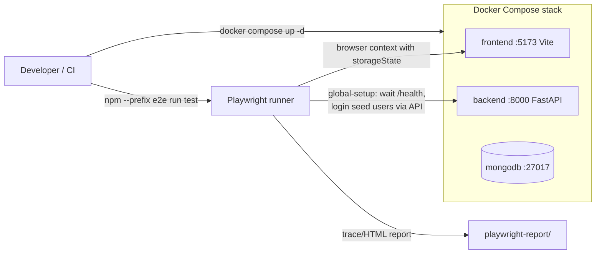

# PLAN — Playwright end-to-end testing strategy

## 1. Title & summary

Introduce a **first-class end-to-end (E2E) test suite** for `prescribe-v2` using **Playwright**, organized as a **top-level `e2e/` workspace** alongside `backend/` and `frontend/`. The suite drives the **real Docker-Compose stack** (React frontend on `:5173`, FastAPI on `:8000`, MongoDB on `:27017`) and exercises critical user journeys end-to-end.

The plan is deliberately **not maximal**: Phase 1 ships a **small, fast, deterministic smoke + auth baseline** (~8 specs, < 60s wall-clock locally) that prevents regressions on login, role routing, protected-route redirects, and patient-portal navigation. LLM-dependent flows (chat streaming, plan generation, differential diagnosis) are **explicitly deferred** to a later, tagged suite so the baseline stays cheap and green.

**Success criteria for this plan:**

1. Running `npm --prefix e2e run test` after `docker compose up -d` produces a green report covering all Phase 1 specs, with HTML traces on failure.
2. Adding a new spec is a single-file change inside `e2e/tests/...` that consumes shared fixtures — no boilerplate per test.
3. The pattern is documented in `docs/TESTING.md` and linked from `CLAUDE.md`, `backend/CLAUDE.md`, `frontend/CLAUDE.md`, and `docs/DOCUMENTATION_MAP.md`.
4. The structure scales to (a) doctor-portal flows, (b) mocked-LLM chat flows, and (c) CI execution **without restructuring** — only adding more specs / projects / a GitHub Actions workflow.

---

## 2. Type & scope

**Type:** Enhancement (adds a new testing capability; does not change product behavior).

**In scope (this plan):**

- A new top-level `e2e/` workspace (own `package.json`, `tsconfig.json`, `playwright.config.ts`).
- `@playwright/test` (TypeScript), Chromium baseline browser, traces/screenshots/video on first retry.
- **`storageState`-per-role** auth pattern using seeded users via the real `/api/auth/login` endpoint.
- A thin **Page Object Model (POM)** layer for the surfaces touched by Phase 1 specs (Landing, Patient shell, Doctor shell).
- Phase 1 spec set: health, landing, patient login, doctor login, invalid login, logout, protected-route redirect, patient sidebar navigation.
- Documentation updates: a new `## E2E tests (Playwright)` section in `docs/TESTING.md`, navigation pointers in root + area `CLAUDE.md` files, and an entry in `docs/DOCUMENTATION_MAP.md`.

**Explicitly out of scope (deferred to follow-up phases / plans):**

- Chat streaming / LLM-dependent specs (real or mocked SSE). Captured as a future phase below.
- Visual regression / screenshot diffing (Playwright has it, but it costs maintenance — not first-day value).
- Cross-browser matrix (Firefox/WebKit) — Chromium only in Phase 1; add browsers as a config-only change later.
- Mobile viewport emulation suite.
- Component-level Playwright tests (`@playwright/experimental-ct-react`) — Vitest already covers component-level concerns.
- A GitHub Actions CI workflow. The plan **prepares** for CI (separate scripts, deterministic startup) but does not introduce `.github/workflows/e2e.yml` in Phase 1 because the repo has **no CI configured today**; adding one is a follow-up phase to avoid landing two unrelated changes in one PR.
- Performance / load testing (Playwright is not the right tool — use a dedicated load runner later).
- Mutating tests against shared dev data (no destructive operations against the running `medical_chat` DB beyond signup of timestamped throwaway users).

---

## 3. Baseline (today)

- **No Playwright in the repo.** `docs/TESTING.md` § *Known gaps* states: *"No full Playwright E2E suite in-repo yet."*
- **No CI workflows.** `.github/` does not exist.
- **Existing test surfaces:**
  - **Backend:** `backend/tests/test_*.py` run via `docker compose exec backend python -m pytest`. Covers API, services, repositories, route audit.
  - **Frontend:** Vitest co-located (`*.test.ts(x)` next to source). Covers RTK Query wrapper, SSE parser, color-mode context, etc.
- **Stack lifecycle:** `docker compose up -d` brings up 3 services with healthchecks (Mongo) and live-reload mounts (backend, frontend). The frontend dev server (Vite) is what's tested; we do **not** run `vite preview` for E2E in Phase 1.
- **Auth state:** `AUTH_REQUIRED=true` by default (per `.env.example`). Seeded users exist via `backend/seed.py` (e.g. `john@example.com`, `jane@example.com`, `alex@example.com` as patients; `sarah@example.com`, `omar@example.com` as doctors; `admin@example.com`). Passwords are set via `DEV_DEFAULT_PASSWORD` (already `Unity123.` in local `.env`).
- **Frontend routing:** Source of truth is [`frontend/src/router/paths.ts`](../../frontend/src/router/paths.ts) — `/patient/*`, `/doctor/*`, `/login`, `/signup`, landing `/`. `RequireAuth` redirects unauthenticated traffic to `/?returnUrl=…` when `auth_relaxed` is false.
- **Selector hygiene:** Almost no `data-testid` attributes today (only inside Vitest fixtures). The plan will add a small, deliberate set tied to high-value selectors and document the convention.

---

## 4. Prior art & strategy

**Prior art in this repo:** none for E2E. There is no existing pattern to align with; the closest precedents are:

- **Layered separation** between backend (`backend/`) and frontend (`frontend/`) workspaces — strong signal that E2E should be its **own peer workspace**, not embedded in either.
- **Co-located unit tests** for both backend (`backend/tests/`) and frontend (`*.test.tsx` next to source). E2E does not co-locate well: it has its own runner, deps, and target (the full stack, not a single workspace), so it deserves its own root.
- **Docker-first dev story** (`docs/LOCAL_DEVELOPMENT.md`, root `CLAUDE.md`): E2E should drive the same stack developers actually run, not a synthetic mock.

**Industry comparison (the "big-tech" reference points):**

| Pattern | Examples | Fit here |
|---|---|---|
| Top-level `e2e/` (own package) | Vercel `vercel/next.js`, Slack `slack-edge/letsencrypt`, Datadog `dd-trace-js`, Figma examples | **✅ Adopt.** Matches our backend/frontend split; lets E2E target deployed URLs trivially. |
| `frontend/e2e/` co-located | Some smaller SPAs, create-react-app templates | ❌ Couples a full-stack contract suite to the frontend image and conflates Vitest deps with Playwright deps. |
| Nx / Turborepo monorepo wrapping | Microsoft, Nrwl-style monorepos | ❌ Overkill. We have 2 workspaces and no Nx today — introducing it for Playwright alone is unjustified churn. |
| BDD layer (Cucumber/Gherkin) | Some enterprise QA orgs | ❌ Overkill. Engineering writes and reads these tests; plain Playwright `test()` is clearer than feature files. |
| Page Object Model | Standard in mature E2E suites | **✅ Adopt, sparingly.** A thin POM per surface; not a class hierarchy. |
| `storageState`-per-role auth | Playwright official guidance, Vercel, Linear | **✅ Adopt.** API-driven login once per role; reuse JWT across tests. |
| Real-LLM tests in main suite | Anti-pattern at scale | ❌ Defer. LLM specs go in a separate tagged suite (`@llm`) gated by env flag, runnable in a nightly job. |

**Chosen strategy:** Top-level `e2e/`, Playwright + TypeScript, POM-lite, `storageState` auth fixtures, deterministic seed-user data, Phase 1 = smoke + auth only, LLM specs deferred.

**Why this is the right level of investment:**

- **Not overkill:** No new monorepo tool, no BDD layer, no visual regression, no cross-browser matrix on day one, no CI on day one. The suite is roughly 8 specs and ~6 files of fixtures/utilities at Phase 1.
- **Not under-built:** Page Object Model, fixtures, `storageState`, and folder-by-domain structure are in place from day one — so adding the 9th and 50th spec is the same shape as the 8th.
- **Scales by config, not refactor:** Adding doctor-portal projects, mocked-LLM specs, CI, more browsers, or a staging baseURL are all **one-file changes** to `playwright.config.ts` or new specs — no structural rewrite.

---

## 5. Target architecture

### High-level



### Components

| Component | Responsibility |
|---|---|
| `e2e/playwright.config.ts` | Runner config: `baseURL`, projects (`setup`, `patient`, `doctor`, `anonymous`), reporters, retries, traces, parallelism. |
| `e2e/global-setup.ts` | Pre-flight: wait for backend `/health`, verify seed users can authenticate, write `.auth/*.json` storage states. Imported once per test run. |
| `e2e/fixtures/test.ts` | Custom Playwright `test` extending the base with `api` (typed HTTP helper), `seedUsers` (constants), and per-role page fixtures. All specs `import { test, expect } from "../fixtures/test"`. |
| `e2e/pages/*.ts` | Thin Page Objects (one per surface) holding selectors + a few actions. **No** business logic — that lives in specs. |
| `e2e/tests/<domain>/*.spec.ts` | Specs grouped by domain (`smoke/`, `auth/`, `patient/`, later `doctor/`, `chat/`). One concern per file. |
| `e2e/utils/*.ts` | Pure helpers: `apiClient.ts` (typed `fetch` against backend), `waitForHealth.ts`, `testUsers.ts`. |
| `e2e/.auth/` | **Gitignored.** Per-role `storageState` JSON files materialized by `global-setup`. |
| `e2e/playwright-report/`, `e2e/test-results/` | **Gitignored.** Reports and trace zips. |

### Auth project pattern (the load-bearing trick)

Playwright **projects** let us run an unauthenticated "setup" phase once that produces JSON `storageState` files, then run actual test projects that load those files into every new browser context. This means **one HTTP login per role per run**, not one per test.

```ts
// playwright.config.ts (sketch — see Phase 1 for full file)
projects: [
  { name: "setup", testMatch: /global\.setup\.ts$/ },
  { name: "anonymous", testMatch: /.*\.anonymous\.spec\.ts$/ },
  {
    name: "patient",
    testMatch: /tests\/(auth|patient)\/.*\.spec\.ts$/,
    use: { storageState: ".auth/patient.json" },
    dependencies: ["setup"],
  },
  {
    name: "doctor",
    testMatch: /tests\/doctor\/.*\.spec\.ts$/,
    use: { storageState: ".auth/doctor.json" },
    dependencies: ["setup"],
  },
],
```

### Request flow during a test

```
spec
  → test fixture (already has page authenticated as patient via storageState)
    → page.goto("/patient")
      → Vite dev server (5173) — React app boots
        → AuthContext reads sessionStorage (hydrated from storageState)
          → applyPrescribeHeaders adds Bearer <jwt>
            → fetch /api/config/features, /api/patients/*, etc.
              → FastAPI verifies JWT → returns JSON
  → assertions: expect(page.getByRole(...)).toBeVisible()
```

---

## 6. Directory & file plan

```
prescribe-v2/
├── e2e/                              # NEW — top-level Playwright workspace
│   ├── package.json                  # NEW — Playwright deps, scripts
│   ├── tsconfig.json                 # NEW — strict TS, ES2022, node moduleResolution
│   ├── playwright.config.ts          # NEW — runner config
│   ├── global.setup.ts               # NEW — health wait + storageState hydration
│   ├── README.md                     # NEW — quick start (5 lines) + link to docs/TESTING.md
│   ├── .gitignore                    # NEW — `.auth/`, `playwright-report/`, `test-results/`, `node_modules/`
│   ├── fixtures/
│   │   ├── test.ts                   # NEW — extended `test`/`expect` exports (+ api fixture)
│   │   └── seedUsers.ts              # NEW — seed user constants (email + role)
│   ├── pages/
│   │   ├── BasePage.ts               # NEW — `goto`, `expectVisible` helpers
│   │   ├── LandingPage.ts            # NEW — landing + auth tabs selectors
│   │   ├── LoginPage.ts              # NEW — login form selectors / actions
│   │   ├── PatientShellPage.ts       # NEW — sidebar nav, header, logout
│   │   └── DoctorShellPage.ts        # NEW — minimal; doctor specs land in Phase 4
│   ├── utils/
│   │   ├── apiClient.ts              # NEW — typed wrapper around request.* for /api/auth/*
│   │   ├── waitForHealth.ts          # NEW — poll /health until 200 or timeout
│   │   └── env.ts                    # NEW — read PW_BASE_URL, PW_API_URL, dev password
│   └── tests/
│       ├── smoke/
│       │   ├── health.anonymous.spec.ts        # NEW — GET /health, GET /
│       │   └── landing.anonymous.spec.ts       # NEW — landing renders, login tab visible
│       ├── auth/
│       │   ├── patient-login.spec.ts            # NEW — login → /patient
│       │   ├── doctor-login.spec.ts             # NEW — login → /doctor
│       │   ├── invalid-login.anonymous.spec.ts  # NEW — wrong password shows error
│       │   ├── logout.spec.ts                   # NEW — logout clears tokens, redirects
│       │   └── protected-redirect.anonymous.spec.ts # NEW — /patient → /?returnUrl=
│       └── patient/
│           └── sidebar-nav.spec.ts              # NEW — sidebar links navigate correctly
│
├── frontend/
│   └── src/
│       └── (small additive changes — see "Selector hygiene" below)
│           # e.g. add data-testid="login-email" to LoginPage form fields
│           # Only added where role/label selectors are ambiguous or fragile.
│
├── docs/
│   ├── TESTING.md                    # MODIFY — new "## E2E tests (Playwright)" section
│   ├── DOCUMENTATION_MAP.md          # MODIFY — add E2E row to topic index
│   ├── ARCHITECTURE.md               # (no change in Phase 1; future: link e2e from testing section)
│   └── plans/
│       └── PLAN_playwright-e2e-tests.md  # THIS FILE
│
├── CLAUDE.md                         # MODIFY — domain routing row for E2E; common commands
├── backend/CLAUDE.md                 # MODIFY — testing section: pointer to e2e/
├── frontend/CLAUDE.md                # MODIFY — testing section: pointer to e2e/ + selector convention
└── .gitignore                        # MODIFY — add `e2e/.auth/`, `e2e/playwright-report/`, `e2e/test-results/`, `e2e/node_modules/`
```

**Rationale for sibling-workspace placement** (vs `frontend/e2e/`):

- E2E is a **full-stack contract** (frontend + backend + Mongo). Putting it inside `frontend/` mis-signals ownership.
- Playwright deps (~250 MB browser binaries) don't belong in the frontend Docker image.
- A future "run e2e against staging URL" job just sets `PW_BASE_URL=https://staging…` — no relocation needed.
- Mirrors big-tech repos (Vercel, Slack, Linear) and matches our existing root-level workspace split.

---

## 7. API / data

### No new backend endpoints

Phase 1 uses **existing public-allow-listed routes**: `GET /health`, `POST /api/auth/login`, `POST /api/auth/logout`, `GET /api/config/features`. No backend changes required.

### Data inputs

- **Seed users** (from [`backend/seed.py`](../../backend/seed.py)) — used as-is, no modifications:
  - Patient: `john@example.com` (primary) and `jane@example.com` (secondary, for multi-user assertions later).
  - Doctor: `sarah@example.com` (primary) and `omar@example.com`.
  - Admin: `admin@example.com` — not used in Phase 1.
- **Password:** `DEV_DEFAULT_PASSWORD` (already `Unity123.` in local `.env`). The E2E runner reads it from the same env. Tests **never hardcode** the password — only the env name.

### Env vars consumed by Playwright

| Env var | Default | Purpose |
|---|---|---|
| `PW_BASE_URL` | `http://localhost:5173` | Frontend URL — Playwright's `baseURL`. |
| `PW_API_URL` | `http://localhost:8000` | Backend URL for `apiClient`. |
| `PW_PATIENT_EMAIL` | `john@example.com` | Patient seed email. |
| `PW_DOCTOR_EMAIL` | `sarah@example.com` | Doctor seed email. |
| `PW_PASSWORD` | reads `DEV_DEFAULT_PASSWORD` from `.env` | Seed password. |
| `PW_RETRIES` | `0` local, `2` CI | Retry count. |

`e2e/utils/env.ts` centralizes reads and throws a **clear error** at startup if a required var is missing (e.g. `PW_PASSWORD`). Failing fast in `global-setup` is much friendlier than a mid-spec auth failure.

### Data isolation strategy (Phase 1)

- **Read-only on seeded data:** Phase 1 specs do not mutate seed user state.
- **Throwaway accounts:** Specs that need a fresh user (signup flows in later phases) use a deterministic email pattern: `e2e-${Date.now()}-${randomSuffix}@example.test`. The `.test` TLD is reserved by RFC 2606 so accidental real-world sends are impossible.
- **No Mongo wipe:** We deliberately do not drop collections between tests. Big-tech default is **isolate by data namespace, not by wiping** — wiping breaks parallelism and surprises devs running the stack locally.
- **Future option:** A dedicated `medical_chat_e2e` DB (separate compose service) is a clean upgrade path if Phase 1 sees data collisions in practice. Captured as a deferred decision, not a blocker.

### Casing boundary

E2E specs only call FastAPI routes from TypeScript, so they will see the **same snake_case ↔ camelCase contract** described in `docs/FRONTEND_BACKEND_COLLABORATION.md`. The `apiClient` helper is **dumb passthrough** — it does not transform casing — so we never accidentally hide a contract bug.

---

## 8. Edge cases & failure handling

| # | Edge case | Handling |
|---|---|---|
| 8.1 | Stack not running when E2E starts | `global.setup.ts` calls `waitForHealth(PW_API_URL, { timeoutMs: 30_000 })`. Fails with a single clear error: *"Backend not reachable at $PW_API_URL — run `docker compose up -d` first"*. |
| 8.2 | Seed users missing or wrong password | `global.setup.ts` calls `POST /api/auth/login`. On 401, fails with: *"Login failed for $PW_PATIENT_EMAIL — check DEV_DEFAULT_PASSWORD and run `docker compose exec backend python -m seed`"*. |
| 8.3 | Stale `.auth/*.json` after JWT secret rotation | `global.setup.ts` always **overwrites** `.auth/*.json` from a fresh login per run; old files are never trusted. |
| 8.4 | Two test runs racing the same DB | Phase 1 specs are read-only on seed data; safe to run in parallel. Mutating specs added later **must** namespace their emails (see §7). |
| 8.5 | Vite slow first compile after a long idle | `BasePage.goto()` uses Playwright's default `domcontentloaded` wait + explicit `expect(page).toHaveURL(...)` — no arbitrary `waitForTimeout`. CI retry count covers genuine cold starts. |
| 8.6 | `auth_relaxed` flag accidentally enabled | Specs assert post-login URL and presence of an authenticated marker (header avatar / sidebar). A relaxed-auth false-positive would not satisfy both. |
| 8.7 | `returnUrl` open-redirect handling | `protected-redirect.anonymous.spec.ts` asserts the redirect target is **same-origin** and decoded matches the original path. |
| 8.8 | Token refresh during a long spec | Phase 1 specs are short enough that the 15-min access JWT never expires mid-spec. Refresh is exercised by Vitest already (`api/baseApi.test.ts`); E2E doesn't duplicate it. A future "long session" spec can simulate expiry by overriding JWT TTL in a test-only backend env. |
| 8.9 | Markdown/streaming content (deferred LLM phase) | Will use **SSE mocking via `page.route(...)`** for determinism. Phase 1 does not touch this. |
| 8.10 | Test artifacts leaking secrets | `.gitignore` excludes `.auth/`, `playwright-report/`, `test-results/`. CI step will upload reports as artifacts — never commit them. |

---

## 9. Testing strategy

E2E is **one layer of a pyramid**, not a replacement for the layers below.

| Layer | Tool | Where | What it owns |
|---|---|---|---|
| Backend unit / API integration | pytest in Docker | `backend/tests/test_*.py` | Endpoint contracts, services, repositories, auth, route audit. |
| Frontend unit | Vitest + jsdom | `frontend/src/**/*.test.ts(x)` | Hooks, RTK Query wrapper, SSE parser, context behavior. |
| **E2E** | **Playwright + Chromium** | **`e2e/tests/**`** | **User journeys across the real stack: login, role routing, navigation, eventually chat.** |

**E2E rules of engagement** (documented in `docs/TESTING.md`):

1. **One concern per spec.** A spec validates one user-visible behavior; do not bundle unrelated assertions.
2. **Selectors:** prefer `getByRole`, `getByLabel`, `getByText` in that order. Use `getByTestId` only when semantic selectors are ambiguous or fragile, and add the `data-testid` in the **same PR** as the spec.
3. **No CSS class selectors. No XPath.** Both are reviewed out.
4. **No `waitForTimeout` in spec code.** Use `expect(locator).toBeVisible()` / `toHaveURL` / `toHaveText` — Playwright auto-retries within timeouts.
5. **Auth is a fixture, not a UI step.** Tests that aren't about auth itself start authenticated via `storageState`; they never go through the login UI.
6. **Network mocks are explicit and scoped.** `page.route(...)` calls are documented at the top of the spec. No global mocks.
7. **Deterministic data.** No `Date.now()` assertions, no random LLM output. Where randomness is unavoidable (timestamp emails), the spec asserts on **shape**, not value.
8. **Parallel-safe by file.** Specs in the same file run serially; files run in parallel. Mutating specs namespace their data per §7.
9. **One screenshot/trace policy.** Traces, screenshots, and video on **first retry only** (cheap on green, useful on red).
10. **No real LLM calls in the default suite.** Tag LLM specs `@llm`; gate them behind `PW_INCLUDE_LLM=true`.

**Phase 1 specs (full list — 8 specs, ~30–60s total local):**

| Spec | Project | Assertion summary |
|---|---|---|
| `smoke/health.anonymous.spec.ts` | anonymous | `GET /health` → 200 + `{ status: "ok" }`. Sanity that the backend is reachable. |
| `smoke/landing.anonymous.spec.ts` | anonymous | `/` renders, app title visible, login form/tab is reachable. |
| `auth/patient-login.spec.ts` | anonymous | Fill email/password → `expect(page).toHaveURL(/\/patient/)` + authenticated marker visible. |
| `auth/doctor-login.spec.ts` | anonymous | Same with doctor seed → lands at `/doctor`. |
| `auth/invalid-login.anonymous.spec.ts` | anonymous | Wrong password → error message visible, URL still on landing. |
| `auth/logout.spec.ts` | patient | Click logout → tokens cleared from `sessionStorage`, redirected to landing. |
| `auth/protected-redirect.anonymous.spec.ts` | anonymous | Visit `/patient/profile` unauthenticated → redirected to `/?returnUrl=%2Fpatient%2Fprofile`. |
| `patient/sidebar-nav.spec.ts` | patient | From `/patient`, click each sidebar link (Profile, Documents, Doctors, Chat) → URL matches `paths.*`, page heading visible. |

**Specs that must not be flaky (explicitly):**

- All Phase 1 specs. The baseline must be **trustworthy** — a flaky baseline poisons the team's relationship with E2E forever. If a spec flakes twice, the policy is: fix or remove. No `test.skip` with a TODO.

---

## 10. Risks & rollback

| # | Risk | Mitigation | Rollback |
|---|---|---|---|
| R1 | **Selector fragility** in a fast-moving UI. | Selector hygiene rules in §9; add `data-testid` deliberately, not as a sprinkle. Codify in `frontend/CLAUDE.md`. | Update selectors; not a structural issue. |
| R2 | **Flaky tests poison trust**. | Phase 1 is small and deterministic by construction (no LLM, no real time, no animations relied upon). Retry=0 locally enforces "no retries to mask flakes." | Any consistently flaky spec is removed in the same PR, not skipped. |
| R3 | **Stack startup drift** (env vars not set, seed not run) wastes onboarding time. | `global.setup.ts` produces actionable error messages (§8.1, §8.2). README in `e2e/` has the 3-line quick start. | Documented fallback: `docker compose down -v && docker compose up -d && docker compose exec backend python -m seed`. |
| R4 | **CI cost balloons** when added. | Phase 1 is Chromium-only, ~8 specs, < 2 min on CI. Cross-browser/visual is a deliberate later decision, not a default. | Drop projects from the CI matrix; specs unchanged. |
| R5 | **Real-LLM specs leaking into the baseline.** | The default `playwright.config.ts` `grepInvert: /@llm/` excludes them; `@llm` runs only when `PW_INCLUDE_LLM=true`. | Tag policy enforced in code review checklist (added to `docs/TESTING.md`). |
| R6 | **`.auth/*.json` accidentally committed.** | `e2e/.gitignore` + root `.gitignore` both exclude it. CI uploads but does not commit reports. | If leaked, rotate `JWT_SECRET`. |
| R7 | **Heavy adoption cost** if the API is awkward. | Custom `test` fixture means a new spec is 5–10 lines. POM is opt-in, not mandatory. | Easy to revert: `e2e/` is self-contained — `rm -rf e2e/` plus the doc-link reverts in `CLAUDE.md` files cleanly back out the entire suite. |
| R8 | **Plan grows beyond Phase 1 without review.** | This plan defers LLM, doctor-portal, CI, cross-browser to **separately named follow-up phases** with explicit gates (§11). Adding a 9th spec is fine; adding a new layer (CI, visual regression) requires its own plan section. | Follow-up plans get their own `docs/plans/PLAN_*.md`. |

**Full rollback** of Phase 1 is `git revert` of (a) the `e2e/` add, (b) the `data-testid` adds in `frontend/src/`, (c) the doc edits in `docs/` and CLAUDE files, plus (d) the `.gitignore` lines. No backend, schema, or runtime change is involved — the rollback surface is documentation + a self-contained workspace.

---

## 11. Implementation phases (detailed)

### Implementation order overview

1. **Phase 1 — Workspace foundation** *(this PR)*
2. **Phase 2 — Auth fixtures & storageState** *(this PR; same chat batch)*
3. **Phase 3 — First specs (smoke + auth)** *(this PR)*
4. **Phase 4 — Patient navigation specs + selector hygiene** *(this PR)*
5. **Phase 5 — Documentation updates** *(this PR)*
6. **Phase 6 — Doctor portal specs** *(follow-up PR)*
7. **Phase 7 — Mocked-LLM chat specs (`@llm` tag, no real LLM)** *(follow-up PR)*
8. **Phase 8 — CI workflow (`.github/workflows/e2e.yml`)** *(separate PR)*

Phases 1–5 are the **baseline this plan delivers**. Phases 6–8 are explicitly listed so the structure stays coherent, but they are out of scope for the first PR and should each be planned as their own slice.

A reasonable Cursor-chat batching is **Phases 1–3 in one chat**, **Phase 4–5 in a second chat**, then a final **verification chat** that diffs the work against §6 and §9.

---

### Phase 1 — Workspace foundation

**Goal:** Stand up `e2e/` as a self-contained TypeScript workspace with Playwright installed, configured, and able to run an empty test successfully.

**Prerequisites:** None.

**Scope:**

- Create `e2e/` directory and `package.json`.
- Install Playwright and Chromium.
- Configure TypeScript (`tsconfig.json`) and Playwright (`playwright.config.ts`).
- Create the `e2e/.gitignore` and update root `.gitignore`.
- Write a placeholder smoke test that just asserts `1 + 1 === 2` to validate the runner before any stack integration.

**Tasks:**

1. `mkdir e2e && cd e2e && npm init -y`. Set `"private": true` in the resulting `package.json`. Add scripts: `"test"`, `"test:headed"`, `"test:debug"`, `"test:report"` (see Phase 5 for the exact JSON to keep here).
2. `npm i -D @playwright/test typescript @types/node`. Run `npx playwright install --with-deps chromium`.
3. Create `e2e/tsconfig.json` (strict, `target: ES2022`, `module: ESNext`, `moduleResolution: bundler`, `types: ["node"]`).
4. Create `e2e/playwright.config.ts` with:
   - `testDir: "./tests"`
   - `fullyParallel: true`
   - `forbidOnly: !!process.env.CI`
   - `retries: process.env.CI ? 2 : 0`
   - `reporter: [["list"], ["html", { open: "never" }]]`
   - `use: { baseURL: PW_BASE_URL, trace: "on-first-retry", screenshot: "only-on-failure", video: "retain-on-failure" }`
   - `projects: [...]` skeleton (filled out in Phase 2).
5. Create `e2e/.gitignore`: `node_modules/`, `.auth/`, `playwright-report/`, `test-results/`, `*.tsbuildinfo`.
6. Append the same paths (prefixed with `e2e/`) to root `.gitignore`.
7. Create a temporary `e2e/tests/smoke/sanity.spec.ts` with a single `test("runner works", () => { expect(1+1).toBe(2); })`. This proves the runner is alive **before** we add stack dependencies.

**Deliverables:**

- `e2e/` directory exists with `package.json`, `tsconfig.json`, `playwright.config.ts`, `.gitignore`.
- `npx playwright --version` resolves inside the workspace.
- The sanity test passes locally.

**Verification:**

```bash
cd e2e
npm test
# → 1 passed (sanity.spec.ts)
```

**Notes:** Do **not** add Playwright as a workspace of `frontend/package.json` or install it at the repo root. Keep the dep boundary clean. Pin Playwright via `package-lock.json`; commit the lockfile.

---

### Phase 2 — Auth fixtures & storageState

**Goal:** Implement the API-driven auth pattern so that subsequent specs receive an already-authenticated `page` for free.

**Prerequisites:** Phase 1. The local Docker stack running (`docker compose up -d`) is required to validate this phase end-to-end but is not a *code* prerequisite.

**Scope:**

- `e2e/utils/env.ts`, `e2e/utils/waitForHealth.ts`, `e2e/utils/apiClient.ts`.
- `e2e/fixtures/seedUsers.ts`, `e2e/fixtures/test.ts`.
- `e2e/global.setup.ts` (health wait + login per role + storageState write).
- Wire `playwright.config.ts` projects: `setup`, `anonymous`, `patient`, `doctor`.

**Tasks:**

1. **`e2e/utils/env.ts`** — read `PW_BASE_URL`, `PW_API_URL`, `PW_PATIENT_EMAIL`, `PW_DOCTOR_EMAIL`, `PW_PASSWORD`. Fall back to `DEV_DEFAULT_PASSWORD` and seeded emails (§7). Throw at module load if `PW_PASSWORD` is unresolved.
2. **`e2e/utils/waitForHealth.ts`** — poll `GET ${PW_API_URL}/health` every 500 ms up to 30 s; throw with the actionable message in §8.1 on timeout.
   - Maps to edge case §8.1.
3. **`e2e/utils/apiClient.ts`** — small typed wrapper over Playwright's `request` API exposing `login(email, password)` and `logout(token)`. No casing transforms.
4. **`e2e/fixtures/seedUsers.ts`** — export `PATIENT_USER` and `DOCTOR_USER` constants pulling from `env.ts`.
5. **`e2e/global.setup.ts`**:
   - Call `waitForHealth()`.
   - For each role: `apiClient.login(...)`, capture the response `{ access_token, refresh_token, user }`.
   - Use Playwright's `request.newContext()` then write `storageState` to `.auth/patient.json` / `.auth/doctor.json`. The `storageState` must include both `sessionStorage` (which is how the frontend hydrates `AuthContext`) and any `localStorage` keys the frontend reads (`prescribe-color-mode`, `prescribe-patient-id` if applicable). Use `page.evaluate` against the dev server origin to seed the in-browser storage before saving.
   - On login failure, throw the message in §8.2.
   - Maps to edge cases §8.1, §8.2, §8.3.
6. **`e2e/fixtures/test.ts`** — extend `@playwright/test`'s `test`/`expect` with an `api` fixture (apiClient instance). Re-export from this file; **all specs import from here**, never from `@playwright/test` directly.
7. Update `playwright.config.ts` `projects` array per the snippet in §5. Files matching `*.anonymous.spec.ts` go to the `anonymous` project (no storageState); other files under `tests/auth/` and `tests/patient/` go to the `patient` project; `tests/doctor/` (future) goes to `doctor`.

**Deliverables:**

- `.auth/patient.json` and `.auth/doctor.json` materialize on first run.
- A spec that imports `test` from `fixtures/test.ts` and does `await page.goto("/patient")` lands on the patient dashboard without a UI login.
- `npm test -- --project=anonymous` and `npm test -- --project=patient` each run independently.

**Verification:**

```bash
docker compose up -d
docker compose exec backend python -m seed   # if not already seeded
cd e2e && npm test
# global-setup completes, .auth/*.json files exist
ls -la e2e/.auth
```

Manually confirm `.auth/*.json` is gitignored (`git status` shows clean).

**Notes:** The frontend stores tokens in **`sessionStorage`** (see `frontend/CLAUDE.md` → AuthProvider). `storageState` covers both local and session storage, but **the keys must match exactly** — read them once from a real browser login (DevTools → Application → Storage) and encode them in `global.setup.ts` rather than guessing.

---

### Phase 3 — First specs (smoke + auth)

**Goal:** Ship the 5 unauthenticated/auth-flow specs that constitute the smoke baseline.

**Prerequisites:** Phase 2.

**Scope:**

- `tests/smoke/health.anonymous.spec.ts`
- `tests/smoke/landing.anonymous.spec.ts`
- `tests/auth/patient-login.spec.ts`
- `tests/auth/doctor-login.spec.ts`
- `tests/auth/invalid-login.anonymous.spec.ts`
- `tests/auth/logout.spec.ts`
- `tests/auth/protected-redirect.anonymous.spec.ts`
- POM stubs: `pages/BasePage.ts`, `pages/LandingPage.ts`, `pages/LoginPage.ts`, `pages/PatientShellPage.ts`.
- Delete the temporary `sanity.spec.ts` from Phase 1.

**Tasks:**

1. **`pages/BasePage.ts`** — minimal: `constructor(page: Page)`, `goto(path: string)`, `expectAt(urlRegex: RegExp)`.
2. **`pages/LandingPage.ts`** — selectors for email field, password field, submit button, error banner. Methods: `loginAs(email, password)`, `expectLoginError()`.
3. **`pages/PatientShellPage.ts`** — selectors for sidebar links (Profile, Documents, Doctors, Chat) and the logout control. Methods: `clickNav(area)`, `logout()`.
4. Write each spec, one concern per spec. Use `expect.poll` only when asserting on async-updated DOM that doesn't auto-retry (rare; default `toBeVisible` is enough).
   - `protected-redirect.anonymous.spec.ts` maps to edge case §8.7.
   - `invalid-login.anonymous.spec.ts` should assert both **error text presence** *and* **URL did not change to `/patient`** (negative + positive).
5. Run the full suite. If any spec flakes, **fix it now** — do not commit a flaky baseline.

**Deliverables:**

- 7 passing specs (plus the health check) — Phase 1's full set minus `patient/sidebar-nav.spec.ts` which lands in Phase 4.
- HTML report under `e2e/playwright-report/` (gitignored) — confirm by running `npm run test:report`.

**Verification:**

```bash
cd e2e
npm test
# All specs pass. Total wall-clock: < 45s locally.
npx playwright show-report
# HTML report opens.
```

Run the suite 3 times in a row; **zero** flakes is the bar.

**Notes:** Specs that change app state (logout) live in the `patient` project so they get the auth context for free. Specs that test login itself stay in `anonymous`.

---

### Phase 4 — Patient navigation spec + selector hygiene

**Goal:** Add the single patient-portal navigation spec **and** add the deliberate set of `data-testid` attributes to the frontend needed to make the suite stable.

**Prerequisites:** Phase 3.

**Scope:**

- `tests/patient/sidebar-nav.spec.ts`.
- Minimal additive `data-testid` attributes in the frontend, **only** where a `getByRole`/`getByLabel` selector would be ambiguous or fragile. Expected total: ≤ 10 attributes across the LoginPage form and the patient Sidebar.
- A short selector-hygiene note in `frontend/CLAUDE.md` (Phase 5 handles the actual doc writes; just confirm the convention here).

**Tasks:**

1. Audit each spec written in Phase 3 for selectors that look fragile (e.g. relied on hyper-specific text that the design team can change). Where so, add a `data-testid` in the **smallest possible** scope:
   - Login form: `data-testid="login-email"`, `login-password`, `login-submit`, `login-error`.
   - Patient sidebar nav links: `data-testid="nav-profile"`, `nav-documents`, `nav-doctors`, `nav-chat`.
   - Patient header logout button: `data-testid="logout"` (only if no accessible name exists).
2. Update POMs to use `data-testid` where applicable; keep `getByRole`/`getByLabel` everywhere a semantic selector is robust.
3. Write `tests/patient/sidebar-nav.spec.ts`:
   - Start at `/patient`.
   - For each (`area` → `expectedPath` from `paths.ts`): click the nav link, assert URL matches, assert a heading or unique text is visible.
   - Maps to `frontend/src/router/paths.ts` (single source of truth).
4. Run the full suite 3× to validate no flake.

**Deliverables:**

- 1 new spec, ≤ 10 new `data-testid` attributes, POM updates.
- All 8 Phase 1 specs green.

**Verification:**

```bash
cd e2e && npm test
# 8 passed.
cd ../frontend && npm run lint && npm run test:run && npm run build
# Frontend unaffected by the testid additions.
```

**Notes:** `data-testid` is **not** a license to skip semantic selectors. Code review on this PR rejects any `getByTestId` that could have been `getByRole` or `getByLabel` instead. Document the rule in `frontend/CLAUDE.md` in Phase 5.

---

### Phase 5 — Documentation updates

**Goal:** Make the E2E story discoverable and self-serve for any future contributor or agent.

**Prerequisites:** Phases 1–4.

**Scope:**

- `docs/TESTING.md` — new top-level section after backend/frontend.
- `docs/DOCUMENTATION_MAP.md` — index entry for E2E.
- Root [`CLAUDE.md`](../../CLAUDE.md) — add E2E row to "Domain routing" and "Common commands."
- [`backend/CLAUDE.md`](../../backend/CLAUDE.md) — extend "Testing" with a pointer to `e2e/`.
- [`frontend/CLAUDE.md`](../../frontend/CLAUDE.md) — extend "Testing" with E2E pointer **and** the selector-hygiene rule (`getByRole` > `getByLabel` > `getByTestId`; no class names; `data-testid` requires same-PR justification).
- `e2e/README.md` — 5-line quick-start that links back to `docs/TESTING.md` as the canonical source. Per the repo single-source rule, the deep docs live in `docs/`, not in the workspace.

**Tasks:**

1. **`docs/TESTING.md`** — add `## E2E tests (Playwright)` covering:
   - When to run E2E (after a UI change that crosses pages, before merging anything that touches auth/routing).
   - Quick start (`docker compose up -d` → `npm --prefix e2e run test`).
   - Folder map (one paragraph + tree).
   - Selector hygiene rules (link to `frontend/CLAUDE.md`).
   - Data strategy (read-only on seed users; namespaced throwaway accounts for mutating specs).
   - Auth fixtures (one paragraph: storageState per role).
   - "What is and isn't covered" (link to known gaps).
   - Common commands table (run, headed, debug, report).
   - **Update §"Known gaps"** to remove the "No full Playwright E2E suite in-repo yet" line and replace with a forward-looking gap list (doctor portal, mocked-LLM specs, CI workflow).
2. **`docs/DOCUMENTATION_MAP.md`** — add a row to the topic index: `E2E tests (Playwright) | docs/TESTING.md | e2e/README.md`. Update §"Known gaps."
3. **`CLAUDE.md`** (root) — domain routing table gets a new row: `E2E test work | docs/TESTING.md (E2E section) → e2e/`. Common commands gets a one-liner: `npm --prefix e2e run test`. Add E2E to the "Critical rules" section: *"E2E tests run against the live Docker stack — start it before running."*
4. **`backend/CLAUDE.md`** — add a sentence under "Testing" pointing to `e2e/` for cross-stack scenarios.
5. **`frontend/CLAUDE.md`** — add a "Testing" sub-section "E2E (Playwright)" covering: (a) the pointer to `docs/TESTING.md`, (b) the selector hierarchy (`getByRole` > `getByLabel` > `getByText` > `getByTestId`), (c) the `data-testid` review rule.
6. **`e2e/README.md`** — `## Quick start` (3 commands), `## Where things live` (1 paragraph), `## Deep docs` (link to `docs/TESTING.md`).

**Deliverables:**

- Doc updates merged in the same PR as the test code so they cannot drift.
- A contributor unfamiliar with the suite can find their way from `CLAUDE.md` → `docs/TESTING.md` → `e2e/README.md` → a spec in under a minute.

**Verification:**

- Manual: walk the link chain from each entry point.
- `grep -r "Playwright" CLAUDE.md backend/CLAUDE.md frontend/CLAUDE.md docs/TESTING.md docs/DOCUMENTATION_MAP.md` — every file has a reference.

**Notes:** Keep CLAUDE.md files **navigational** per the root `CLAUDE.md` rule ("Keep area CLAUDE.md files navigational"). The deep content lives in `docs/TESTING.md`; CLAUDE files only point.

---

### Phase 6 — Doctor portal specs *(follow-up PR)*

**Goal:** Extend the suite into doctor-portal user journeys.

**Prerequisites:** Phases 1–5 merged and stable for at least one week (giving time for flake to surface).

**Scope (illustrative — finalize when the phase opens):**

- `tests/doctor/dashboard.spec.ts` — doctor dashboard loads, lists connected patients.
- `tests/doctor/connections.spec.ts` — accept/reject pending connection (mutating; uses a fresh-signup patient or a dedicated seed pending link).
- `tests/doctor/patient-profile-readonly.spec.ts` — open a connected patient profile, assert profile fields visible.

**Tasks:** (sketch only — flesh out in the follow-up plan)

1. New `pages/DoctorShellPage.ts`, `pages/DoctorPatientProfilePage.ts`.
2. Decide on mutating-test isolation (namespaced patient signup vs. dedicated seed pending link).
3. Add a `data-testid` cluster only where needed.

**Deliverables:** Doctor portal in the suite, still < 2 min wall-clock.

**Verification:** Full suite green; specifically, no shared-state collisions when running Phase 1 and Phase 6 in parallel.

**Notes:** This phase is the natural time to revisit the **dedicated `medical_chat_e2e` database** decision from §7. If Phase 6 introduces meaningful mutation, isolating the DB becomes attractive.

---

### Phase 7 — Mocked-LLM chat specs *(follow-up PR)*

**Goal:** Cover chat streaming UX without depending on a real LLM call.

**Prerequisites:** Phase 6.

**Scope:**

- `tests/chat/patient-chat-stream.spec.ts` — send a message; intercept `POST /api/chat/message/stream` via `page.route(...)`; return a canned SSE body covering `thinking`, `token` (multiple), `done`. Assert tokens stream into the message bubble, the thinking indicator appears and disappears, and the final message is rendered.
- `tests/chat/structured-payloads.spec.ts` — same pattern with a canned `meal_plan` / `differential_diagnosis` payload to validate the structured renderer.
- All specs tagged `@llm-mocked`.

**Tasks:** (sketch)

1. Introduce `fixtures/sseMocks.ts` with reusable SSE bodies.
2. Add a tag-filter `grep` configuration so the default suite excludes anything tagged `@requires-llm` (real) but includes `@llm-mocked` by default.
3. Documentation: extend `docs/TESTING.md` with the SSE-mocking convention.

**Deliverables:** Chat coverage with zero LLM cost and zero non-determinism.

**Verification:** Run the chat specs 10× in a row; zero flake.

**Notes:** A separate `@requires-llm` tag exists for real-LLM specs but those run only in a manually-invoked nightly job, never in the default suite.

---

### Phase 8 — CI workflow *(separate PR)*

**Goal:** Wire the E2E suite into GitHub Actions.

**Prerequisites:** Phase 5 (so the docs and runner are stable).

**Scope:**

- `.github/workflows/e2e.yml` — checkout, set up Node 20, set up Python 3.11, run `docker compose up -d --wait`, run `docker compose exec backend python -m seed`, run `npm --prefix e2e ci`, run `npx playwright install --with-deps chromium`, run `npm --prefix e2e run test`, upload `e2e/playwright-report` as an artifact on failure.
- Update `playwright.config.ts` to honor `CI=true` (retries=2, `forbidOnly`).
- Update `docs/TESTING.md` "E2E tests (Playwright)" with the CI behavior.

**Tasks:** (sketch)

1. Define the workflow trigger: `pull_request` paths-filter on `frontend/**`, `backend/**`, `e2e/**`, `docker-compose.yml`.
2. Cache Playwright browsers across runs.
3. Decide concurrency policy (cancel-in-progress on new push for the same branch).

**Deliverables:** A green E2E check on every PR that touches the in-scope paths.

**Verification:** Open a PR with a deliberate failure; observe the E2E check fail with HTML report artifact attached.

**Notes:** This is its own PR because (a) it adds a new top-level concern (CI) to a repo that has no CI today, and (b) bundling it with the Phase 1 work would force two unrelated reviews into one diff.

---

## Appendix A — Quick start (planned post-Phase 5 contents of `e2e/README.md`)

```bash
# 1. Bring the stack up
docker compose up -d
docker compose exec backend python -m seed   # idempotent

# 2. Install and run
cd e2e
npm install                  # first time only
npx playwright install --with-deps chromium  # first time only
npm test
```

## Appendix B — Why we are not setting up CI in Phase 1

Two reasons:

1. **The repo has no CI today.** Adding GitHub Actions for the first time alongside Playwright bundles two independent decisions (test framework choice + CI provider choice) into one diff. Reviewers cannot evaluate them independently.
2. **CI design depends on the suite's local shape.** Knowing the wall-clock, flake profile, and required services after a week of Phase 1 use makes Phase 8 a much smaller, lower-risk PR.

This is captured in Phase 8 with explicit gates. The local runner is **CI-ready** (env-driven config, deterministic startup, exit-code-clean reporters), so when CI lands it is a workflow file, not a refactor.

## Appendix C — Why Page Object Model "lite"

POM is a tool, not a religion. The rules we will follow:

- **One file per surface, not per page state.** `LandingPage.ts`, not `LandingPageLoggedOut.ts` + `LandingPageWithError.ts`.
- **Methods are imperative actions** (`loginAs(email, pw)`), not assertion bundles. Assertions belong in the spec.
- **No inheritance hierarchy.** `BasePage` is a 10-line helper, not an abstract class.
- **POM is optional for one-off selectors.** A spec that asserts `getByRole("heading", { name: /your profile/i })` does not need a POM method for it.
