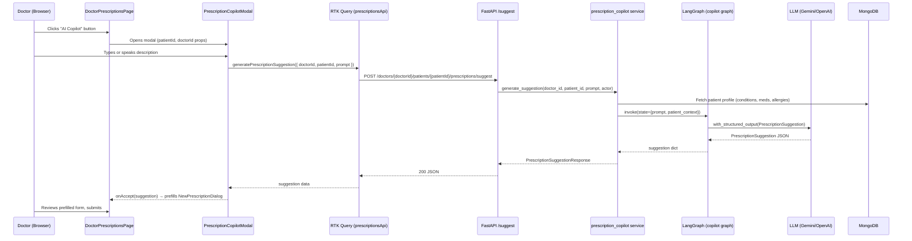

# AI Copilot for Prescription Writing

## 1. Title & Summary

Add an **AI Copilot button** to the Doctor Prescriptions page that opens a conversational panel where the doctor can dictate a prescription in natural language (with or without the mic) and receive a **deterministic, structured JSON response** matching the `Prescription` schema. The copilot reads the patient's medical history (conditions, current medications, allergies, family history) before suggesting medications to surface drug-interaction and allergy flags automatically.

**Success criteria:**
- Doctor clicks "AI Copilot" on the prescriptions page
- A modal opens with a chat input (keyboard + mic/speech-to-text)
- Doctor describes the prescription in natural language
- AI responds with a filled prescription form (JSON: `diagnosis_summary`, `notes`, `medications[]`)
- Doctor can accept the suggestion directly into the `NewPrescriptionDialog` or dismiss
- A single backend endpoint drives the feature; no new streaming infrastructure needed (synchronous JSON response)

---

## 2. Type & Scope

**Type:** Feature (full-stack)

**In scope:**
- New frontend modal component: `PrescriptionCopilotModal`
- Reuse of `useWebSpeechRecognition` hook for voice input
- New backend endpoint: `POST /doctors/{doctor_id}/patients/{patient_id}/prescriptions/suggest`
- New backend service: `prescription_copilot.py` (LangGraph-backed)
- New LangGraph graph for prescription suggestion with structured output
- Pydantic schema for copilot request/response
- RTK Query mutation: `useGeneratePrescriptionSuggestionMutation`
- Wire suggested values into existing `NewPrescriptionDialog` prefill state

**Out of scope:**
- Auto-saving drafts generated by the copilot (doctor must explicitly submit)
- Drug interaction database lookup (AI uses patient medical history context only; no external drug DB call)
- Streaming the AI response token-by-token (synchronous JSON is sufficient for prescription suggestion)
- Multi-turn conversation within the copilot session (single shot: describe → suggest)
- PDF generation of the AI-suggested prescription

---

## 3. Baseline

**What exists today:**

- `frontend/src/pages/doctor/DoctorPrescriptionsPage.tsx` — Page with `NewPrescriptionDialog` (MUI Dialog). Manages its own `newPrescription` form state with `diagnosis_summary`, `notes`, `medications[]`. Fields are typed manually.
- `frontend/src/api/prescriptionsApi.ts` — RTK Query slice with `listPrescriptions`, `createPrescription`, `cancelPrescription` mutations.
- `backend/app/api/prescriptions.py` — FastAPI router mounted under `/doctors/{doctor_id}/patients/{patient_id}/prescriptions`.
- `backend/app/service/prescriptions.py` — Service layer: `create_prescription`, `list_prescriptions`, `cancel_prescription`.
- `backend/app/schemas/prescription.py` — `Medication`, `PrescriptionCreate`, `PrescriptionBody`, `PrescriptionRead` Pydantic models.
- `frontend/src/hooks/useWebSpeechRecognition.ts` — Web Speech API hook: `{ isListening, start, stop, supported, error }`. Already used in `ChatInput.tsx`.
- `backend/app/ai/graph.py` — LangGraph `MedicalChatState` graph with `search_patient_records` tool and MongoDB checkpointing. This is the pattern to replicate.
- `backend/app/ai/llm.py` — LLM factory (Gemini default / OpenAI fallback).
- `backend/app/service/chat.py` — Streaming chat service pattern (reference only; copilot uses sync response).

---

## 4. Prior Art & Strategy

### Existing AI features considered

| Feature | Approach | Fit for copilot? |
|---|---|---|
| Doctor chat (`/chat`) | LangGraph, SSE streaming, multi-turn, unstructured text | Overkill — copilot needs one-shot structured JSON |
| Meal plan generation | LangGraph tool `submit_meal_plan`, streaming | Close — uses structured output tool, worth adapting |
| Document upload AI suggestions | Polling after async job | Wrong pattern — copilot needs immediate sync response |

### Chosen strategy: Sync LangGraph with `structured_output`

The **meal plan `submit_meal_plan` tool** is the closest prior art: the LangGraph agent calls a tool that signals structured output. For the prescription copilot:

- Use LangChain's `.with_structured_output()` on the LLM directly (simpler than a tool call when the entire response must be structured).
- **No streaming**, no SSE. Frontend awaits a single `POST` and receives the filled prescription JSON.
- Re-use `search_patient_records` logic (or a simplified inline query) to supply patient context to the prompt before the LLM call.
- New graph is short: `fetch_patient_context` → `generate_prescription` (LLM with structured output) → return.

**Why this beats multi-turn streaming here:**
- The output must be deterministic JSON — structured output mode is purpose-built for this.
- A doctor's single description is sufficient input; there is no need for back-and-forth.
- Simpler to test, easier to validate with Pydantic on the way out.

---

## 5. Target Architecture



**Component map:**

| Layer | Component | Role |
|---|---|---|
| Frontend UI | `PrescriptionCopilotModal` | Chat input + mic + result display |
| Frontend hook | `useWebSpeechRecognition` | Voice input (reused) |
| Frontend state | `DoctorPrescriptionsPage` | Holds `copilotOpen` flag, prefills `newPrescription` state |
| Frontend API | `prescriptionsApi` (extended) | `generatePrescriptionSuggestion` RTK mutation |
| Backend route | `backend/app/api/prescriptions.py` | New `POST /suggest` endpoint |
| Backend service | `backend/app/service/prescription_copilot.py` | Orchestration + LangGraph invoke |
| Backend AI | `backend/app/ai/prescription_copilot_graph.py` | Short LangGraph graph w/ structured output |
| Backend schema | `backend/app/schemas/prescription.py` | `PrescriptionSuggestionRequest`, `PrescriptionSuggestionResponse` |

---

## 6. Directory & File Plan

| Path | Status | Purpose |
|---|---|---|
| `frontend/src/pages/doctor/DoctorPrescriptionsPage.tsx` | **Modify** | Add AI Copilot button; wire `copilotOpen` state; accept `onAccept` from modal to prefill form |
| `frontend/src/components/PrescriptionCopilotModal.tsx` | **New** | Chat input (text + mic), loading state, suggestion preview, accept/dismiss |
| `frontend/src/api/prescriptionsApi.ts` | **Modify** | Add `generatePrescriptionSuggestion` mutation endpoint |
| `frontend/src/types/doctor.ts` | **Modify** | Add `PrescriptionSuggestionRequest` and `PrescriptionSuggestionResponse` TS interfaces |
| `backend/app/api/prescriptions.py` | **Modify** | Add `POST /{doctor_id}/patients/{patient_id}/prescriptions/suggest` route |
| `backend/app/service/prescription_copilot.py` | **New** | `generate_suggestion()` — fetch patient context, invoke graph |
| `backend/app/ai/prescription_copilot_graph.py` | **New** | LangGraph graph with `search_patient_records` + structured LLM output |
| `backend/app/schemas/prescription.py` | **Modify** | Add `PrescriptionSuggestionRequest`, `PrescriptionSuggestionResponse`, `MedicationSuggestion` |
| `backend/tests/test_prescription_copilot.py` | **New** | Unit + integration tests for suggestion service and endpoint |

---

## 7. API / Data

### New endpoint

```
POST /api/doctors/{doctor_id}/patients/{patient_id}/prescriptions/suggest
Authorization: Bearer <jwt>
Content-Type: application/json
```

**Request body (snake_case):**
```json
{
  "prompt": "Patient has a sinus infection, prescribe a 10-day course of Amoxicillin and add a nasal spray"
}
```

**Response (snake_case):**
```json
{
  "diagnosis_summary": "Acute sinusitis",
  "notes": "Follow up in 2 weeks if symptoms persist.",
  "medications": [
    {
      "name": "Amoxicillin",
      "dosage": "500mg",
      "frequency": "Three times daily",
      "duration": "10 days",
      "instructions": "Take with food. Complete the full course."
    },
    {
      "name": "Fluticasone Nasal Spray",
      "dosage": "50mcg per spray, 2 sprays per nostril",
      "frequency": "Once daily",
      "duration": "10 days",
      "instructions": "Shake well before use."
    }
  ]
}
```

**Error responses:**
- `403` — Doctor-patient connection not verified
- `422` — Missing or invalid prompt
- `500` — LLM or graph failure (with sanitized error message)

### Pydantic schemas (backend)

```python
class PrescriptionSuggestionRequest(BaseModel):
    prompt: str = Field(..., min_length=5, max_length=2000)

class MedicationSuggestion(BaseModel):
    name: str
    dosage: str = ""
    frequency: str = ""
    duration: str = ""
    instructions: str = ""

class PrescriptionSuggestionResponse(BaseModel):
    diagnosis_summary: str = ""
    notes: str = ""
    medications: list[MedicationSuggestion]
```

### TypeScript interfaces (frontend)

```typescript
interface PrescriptionSuggestionRequest {
  prompt: string;
}

interface MedicationSuggestion {
  name: string;
  dosage: string;
  frequency: string;
  duration: string;
  instructions: string;
}

interface PrescriptionSuggestionResponse {
  diagnosis_summary: string;
  notes: string;
  medications: MedicationSuggestion[];
}
```

### casing note

Backend exposes and accepts `snake_case` JSON (consistent with existing prescriptions endpoints). Frontend RTK Query passes the body as-is (`snake_case`). No transformation layer needed.

### MongoDB

No new collection. Patient context is read from the existing `users` collection (`patient_profile` field) — same as `search_patient_records` tool in the main chat graph.

---

## 8. Edge Cases & Failure Handling

| Scenario | Handling |
|---|---|
| Empty or whitespace prompt | Pydantic `min_length=5` validation → 422; frontend disables submit button when input is empty |
| Prompt mentions a drug the patient is allergic to | LLM system prompt instructs to flag allergies explicitly in `notes`; AI may omit flagged drug or warn in `notes` |
| Patient has no medical profile in MongoDB | Service returns empty patient context string; LLM works with prompt only; no crash |
| LLM returns malformed JSON / fails structured output | Pydantic parse error caught in service → 500 with `{"detail": "AI suggestion failed. Please try again."}` |
| Doctor-patient connection not active | `verify_connection` raises `403` (same as all other prescription endpoints) |
| Browser doesn't support Web Speech API | `useWebSpeechRecognition` returns `supported: false`; modal hides mic button gracefully |
| Mic permission denied | Hook sets `error: "not-allowed"`; modal shows "Microphone access denied" inline message |
| Network timeout on suggestion call | RTK Query default timeout; modal shows error state with retry button |
| Doctor accepts suggestion then modifies fields | Suggestion only prefills `NewPrescriptionDialog`; doctor owns the final form state |
| Concurrent suggestion requests | Each request is independent (no session state); idempotent |
| JWT expires mid-request | `baseApi` refreshes token (existing behavior); suggestion request retried transparently |

---

## 9. Testing Strategy

### Backend (pytest in Docker)

Run all tests via:
```bash
docker compose exec backend python -m pytest tests/test_prescription_copilot.py -v
```

**Unit tests** (`backend/tests/test_prescription_copilot.py`):
- `test_generate_suggestion_returns_valid_schema` — mock LLM, assert response is valid `PrescriptionSuggestionResponse`
- `test_generate_suggestion_with_patient_context` — verify patient allergies are injected into the prompt
- `test_generate_suggestion_connection_not_found` — assert `403` when `verify_connection` raises
- `test_generate_suggestion_llm_failure` — mock LLM to raise; assert `500` with sanitized message
- `test_suggestion_endpoint_requires_auth` — assert `401` without token
- `test_suggestion_prompt_too_short` — assert `422` on `prompt: "ab"`

### Frontend (vitest)

- `PrescriptionCopilotModal.test.tsx` — renders, mic button toggles, submit calls mutation, accept fires `onAccept`, error state displayed
- `prescriptionsApi.test.ts` — `generatePrescriptionSuggestion` builds correct URL and body

### Manual / E2E

1. Start stack: `docker compose up --build -d`
2. Navigate to `/doctor/patients/{id}/prescriptions`
3. Click "AI Copilot" — modal opens
4. Type: *"Patient has a UTI, prescribe Trimethoprim 200mg twice daily for 7 days"*
5. Verify suggestion prefills `NewPrescriptionDialog` correctly
6. Submit the prescription; verify it appears in the list
7. Test mic: click mic button, speak, verify transcript appears in input
8. Test error: disconnect network, submit — verify error message shown

---

## 10. Risks & Rollback

| Risk | Likelihood | Mitigation |
|---|---|---|
| LLM hallucination — incorrect dosage | Medium | System prompt warns doctor to verify; `notes` field surfaces any flags; doctor reviews before submitting |
| Structured output parse failure | Low | Pydantic catch-all → 500; retry UI; no data loss since nothing is auto-saved |
| LLM latency > 5s | Medium | Show loading spinner with "Generating suggestion…" message; no timeout cutoff (doctor can wait) |
| Web Speech API unsupported in doctor's browser | Medium | Graceful fallback: hide mic button; text-only input always available |
| Patient profile missing in MongoDB | Low | Service sends empty context; LLM uses prompt-only; result is still valid |
| Connection verification bypass | Very Low | Reuses proven `verify_connection()` guard; same as existing prescriptions endpoints |

**Rollback:** The feature is entirely additive. The copilot button and new endpoint can be removed in one PR without touching the existing prescription creation or display logic.

---

## 11. Implementation Phases

### Implementation order overview

1. Phase 1 — Backend Schemas & Pydantic Models
2. Phase 2 — Backend AI Graph (LangGraph + Structured Output)
3. Phase 3 — Backend Service & FastAPI Endpoint
4. Phase 4 — Frontend Types & RTK Query Mutation
5. Phase 5 — Copilot Modal Component (UI + Voice)
6. Phase 6 — Wire Modal into Prescriptions Page
7. Phase 7 — Testing & Documentation

---

### Phase 1 — Backend Schemas & Pydantic Models

**Goal:** Define the data contracts that all other backend and frontend layers will depend on.

**Prerequisites:** None.

**Scope:**
- Add new Pydantic models to `backend/app/schemas/prescription.py`
- TypeScript interfaces added in Phase 4 (not here)

**Tasks:**
1. Open `backend/app/schemas/prescription.py`
2. Add `PrescriptionSuggestionRequest(BaseModel)` with `prompt: str = Field(..., min_length=5, max_length=2000)`
3. Add `MedicationSuggestion(BaseModel)` with all five string fields (mirrors existing `Medication`)
4. Add `PrescriptionSuggestionResponse(BaseModel)` with `diagnosis_summary`, `notes`, `medications: list[MedicationSuggestion]`
5. Export all new models from `backend/app/schemas/__init__.py` if an init exists

**Deliverables:** Three new Pydantic models in `backend/app/schemas/prescription.py`.

**Verification:**
```bash
docker compose exec backend python -c "from app.schemas.prescription import PrescriptionSuggestionRequest, PrescriptionSuggestionResponse; print('OK')"
```

---

### Phase 2 — Backend AI Graph (LangGraph + Structured Output)

**Goal:** Create a minimal LangGraph graph that accepts a doctor's prompt + patient context and returns a validated `PrescriptionSuggestionResponse`.

**Prerequisites:** Phase 1 (schemas must exist for structured output binding).

**Scope:**
- New file `backend/app/ai/prescription_copilot_graph.py`
- No SSE/streaming; synchronous `.invoke()` only
- Re-use patient context query logic from `search_patient_records` (inline, not importing the tool)
- Deferred: multi-turn conversation, streaming, drug DB lookup

**Tasks:**
1. Create `backend/app/ai/prescription_copilot_graph.py`
2. Import `llm_factory` from `backend/app/ai/llm.py`
3. Build a structured output LLM:
   ```python
   structured_llm = llm.with_structured_output(PrescriptionSuggestionResponse)
   ```
4. Write system prompt: doctor role, patient context (allergies, conditions, current medications), instruct to flag allergies in `notes`, always fill all medication fields, produce valid JSON only
5. Expose a single async function `generate_prescription_suggestion(prompt: str, patient_context: str) -> PrescriptionSuggestionResponse`
6. The function constructs a `HumanMessage` combining system context + doctor prompt, invokes the structured LLM, and returns the Pydantic object

**Deliverables:** `backend/app/ai/prescription_copilot_graph.py` with `generate_prescription_suggestion` function.

**Verification:**
```bash
docker compose exec backend python -c "
import asyncio
from app.ai.prescription_copilot_graph import generate_prescription_suggestion
result = asyncio.run(generate_prescription_suggestion('Prescribe amoxicillin for a throat infection', 'No known allergies.'))
print(result.model_dump())
"
```
Expected: dict with `medications` list containing at least one entry.

---

### Phase 3 — Backend Service & FastAPI Endpoint

**Goal:** Expose the AI graph as a secured REST endpoint, wiring patient context retrieval and connection verification.

**Prerequisites:** Phase 1 (schemas), Phase 2 (AI graph).

**Scope:**
- New service file `backend/app/service/prescription_copilot.py`
- New route in `backend/app/api/prescriptions.py`
- Mount point in `backend/app/api/router.py` (no change needed if prescriptions router is already mounted)

**Tasks:**
1. Create `backend/app/service/prescription_copilot.py`:
   - `async def generate_suggestion(doctor_id, patient_id, prompt, actor, db) -> PrescriptionSuggestionResponse`
   - Call `connection_service.verify_connection(doctor_id, patient_id, db)` → raise `403` if not connected
   - Query `db.users.find_one({"user_id": patient_id})` and extract `patient_profile` dict
   - Format patient context string: conditions, current medications, allergies, family history (same format as `search_patient_records` tool)
   - Call `generate_prescription_suggestion(prompt, patient_context)` from Phase 2
   - Return the `PrescriptionSuggestionResponse` object

2. In `backend/app/api/prescriptions.py`, add:
   ```python
   @router.post("/{doctor_id}/patients/{patient_id}/prescriptions/suggest")
   async def suggest_prescription(
       doctor_id: str,
       patient_id: str,
       body: PrescriptionSuggestionRequest,
       actor: CurrentUser = Depends(get_current_user),
       db: AsyncIOMotorDatabase = Depends(get_db),
   ) -> PrescriptionSuggestionResponse:
   ```
   - Delegate to `prescription_copilot_service.generate_suggestion(...)`
   - Wrap in try/except: LLM/graph errors → `HTTPException(status_code=500, detail="AI suggestion failed. Please try again.")`

3. Verify the router is already mounted for prescriptions (it is — confirm with `backend/app/api/router.py`)

**Deliverables:**
- `backend/app/service/prescription_copilot.py`
- New route in `backend/app/api/prescriptions.py`

**Verification:**
```bash
# With stack running:
curl -X POST \
  http://localhost:8000/api/doctors/<doctor_id>/patients/<patient_id>/prescriptions/suggest \
  -H "Authorization: Bearer <token>" \
  -H "Content-Type: application/json" \
  -d '{"prompt": "Prescribe ibuprofen 400mg for mild pain"}'
# Expect 200 with JSON suggestion
```

Also run backend tests:
```bash
docker compose exec backend python -m pytest tests/test_prescription_copilot.py -v
```

---

### Phase 4 — Frontend Types & RTK Query Mutation

**Goal:** Add the TypeScript interfaces and RTK Query mutation so the frontend can call the new endpoint.

**Prerequisites:** Phase 3 (endpoint must exist for integration testing).

**Scope:**
- Types added to `frontend/src/types/doctor.ts`
- Mutation added to `frontend/src/api/prescriptionsApi.ts`
- No UI changes yet

**Tasks:**
1. In `frontend/src/types/doctor.ts`, add:
   ```typescript
   export interface PrescriptionSuggestionRequest {
     prompt: string;
   }
   export interface MedicationSuggestion {
     name: string;
     dosage: string;
     frequency: string;
     duration: string;
     instructions: string;
   }
   export interface PrescriptionSuggestionResponse {
     diagnosis_summary: string;
     notes: string;
     medications: MedicationSuggestion[];
   }
   ```

2. In `frontend/src/api/prescriptionsApi.ts`, add mutation to the existing `prescriptionsApi.injectEndpoints` call:
   ```typescript
   generatePrescriptionSuggestion: builder.mutation<
     PrescriptionSuggestionResponse,
     { doctorId: string; patientId: string; body: PrescriptionSuggestionRequest }
   >({
     query: ({ doctorId, patientId, body }) => ({
       url: `/doctors/${doctorId}/patients/${patientId}/prescriptions/suggest`,
       method: "POST",
       body,
     }),
   }),
   ```
3. Export `useGeneratePrescriptionSuggestionMutation` from `frontend/src/api/index.ts` (via barrel export — already exports from `prescriptionsApi`)

**Deliverables:** New types in `doctor.ts`; new mutation in `prescriptionsApi.ts`.

**Verification:**
```bash
cd frontend && npm run build 2>&1 | grep -E "error|Error" | head -20
```
TypeScript compilation must be error-free.

---

### Phase 5 — Copilot Modal Component (UI + Voice)

**Goal:** Build the `PrescriptionCopilotModal` component with text input, mic button, loading state, suggestion display, and accept/dismiss actions.

**Prerequisites:** Phase 4 (RTK mutation + types available).

**Scope:**
- New file `frontend/src/components/PrescriptionCopilotModal.tsx`
- Uses `useWebSpeechRecognition` (existing hook — no changes)
- Uses `useGeneratePrescriptionSuggestionMutation` (Phase 4)
- Deferred: multi-turn chat history display, streaming

**Tasks:**
1. Create `frontend/src/components/PrescriptionCopilotModal.tsx`

2. **Props interface:**
   ```typescript
   interface Props {
     open: boolean;
     onClose: () => void;
     doctorId: string;
     patientId: string;
     onAccept: (suggestion: PrescriptionSuggestionResponse) => void;
   }
   ```

3. **Component state:**
   - `prompt: string` — current text input
   - Use `useGeneratePrescriptionSuggestionMutation` for loading/data/error
   - Use `useWebSpeechRecognition` — append transcript tokens to `prompt`

4. **Layout (MUI Dialog):**
   - Title: "AI Prescription Copilot"
   - Content: description text → textarea for prompt → mic button row → (after response) suggestion preview card
   - Actions: "Generate" button (disabled when empty or loading) → after suggestion: "Accept" + "Dismiss" buttons

5. **Suggestion preview card:** Display `diagnosis_summary`, `notes`, and a list of medications with name/dosage/frequency/duration highlighted in MUI `Chip` or `Typography` elements — read-only preview, not an editable form

6. **Mic integration:**
   - Mic icon button (lucide-react `Mic` / `CircleStop`) mirrors `ChatInput.tsx` pattern
   - When `isListening`, append partial recognition result to `prompt` state on each `onResult` event
   - Show `error` from hook as inline `Alert` when mic permission denied

7. **Error state:** MUI `Alert` with error message + retry button (calls mutation again)

8. **Loading state:** Skeleton or `CircularProgress` with label "Generating suggestion…"

**Deliverables:** `frontend/src/components/PrescriptionCopilotModal.tsx`

**Verification:**
- Run `npm run build` — no TypeScript errors
- Manual: Import and render in isolation (storybook not required; a quick test render suffices)

---

### Phase 6 — Wire Modal into Prescriptions Page

**Goal:** Add the AI Copilot button to the prescriptions page and wire the modal so an accepted suggestion prefills the `NewPrescriptionDialog`.

**Prerequisites:** Phase 5 (modal component complete).

**Scope:**
- Modify `frontend/src/pages/doctor/DoctorPrescriptionsPage.tsx` only
- No changes to `NewPrescriptionDialog` structure — prefill via existing `newPrescription` state setter

**Tasks:**
1. Add `copilotOpen: boolean` to page state (alongside existing `newPrescriptionOpen` or however the dialog is controlled)

2. Add "AI Copilot" button near the "New Prescription" button:
   ```tsx
   <Button
     variant="outlined"
     startIcon={<AutoAwesome />}  // MUI icon or equivalent
     onClick={() => setCopilotOpen(true)}
   >
     AI Copilot
   </Button>
   ```

3. Render `<PrescriptionCopilotModal>` alongside `<NewPrescriptionDialog>`:
   ```tsx
   <PrescriptionCopilotModal
     open={copilotOpen}
     onClose={() => setCopilotOpen(false)}
     doctorId={doctorId}
     patientId={patientId}
     onAccept={(suggestion) => {
       setCopilotOpen(false);
       setNewPrescription({
         diagnosis_summary: suggestion.diagnosis_summary,
         notes: suggestion.notes,
         medications: suggestion.medications,
       });
       setNewPrescriptionOpen(true);
     }}
   />
   ```

4. Ensure `doctorId` and `patientId` are accessible from route params at the page level (already available via `useParams`)

**Deliverables:** Modified `DoctorPrescriptionsPage.tsx` with copilot button and modal wired.

**Verification:**
1. `docker compose up -d` (stack running)
2. Navigate to `/doctor/patients/{id}/prescriptions`
3. "AI Copilot" button visible in header area
4. Click → modal opens
5. Type a prescription description → "Generate" → loading spinner visible
6. Suggestion displayed in modal
7. "Accept" → modal closes, `NewPrescriptionDialog` opens pre-populated
8. "Dismiss" → modal closes, page unchanged
9. Mic button → browser permission prompt → voice input appended to textarea
10. `npm run build` passes

---

### Phase 7 — Testing & Documentation

**Goal:** Ensure the feature is covered by tests and documentation is updated per project standards.

**Prerequisites:** Phases 1–6 complete.

**Scope:**
- Backend unit tests
- Frontend component tests (optional, low priority)
- Update `docs/FRONTEND_BACKEND_COLLABORATION.md` with new endpoint
- Update `docs/ARCHITECTURE.md` if the new graph warrants a note

**Tasks:**
1. Write `backend/tests/test_prescription_copilot.py`:
   - `test_suggest_returns_valid_schema` — mock LLM structured output, assert response fields present
   - `test_suggest_requires_valid_connection` — mock `verify_connection` to raise `403`
   - `test_suggest_prompt_too_short` — send `{"prompt": "ab"}`, expect 422
   - `test_suggest_llm_failure` — mock graph to raise, expect 500 with sanitized message
   - `test_suggest_unauthenticated` — no Bearer token, expect 401

2. Update `docs/FRONTEND_BACKEND_COLLABORATION.md`:
   - Add row for `POST /doctors/{doctor_id}/patients/{patient_id}/prescriptions/suggest` in the endpoint table
   - Note request/response shape and auth requirement

3. Update `docs/ARCHITECTURE.md`:
   - Add brief note under AI/LangGraph section: "Prescription Copilot uses synchronous structured output (no streaming) via `prescription_copilot_graph.py`"

**Deliverables:**
- `backend/tests/test_prescription_copilot.py` (≥5 tests)
- Updated `docs/FRONTEND_BACKEND_COLLABORATION.md`
- Updated `docs/ARCHITECTURE.md`

**Verification:**
```bash
docker compose exec backend python -m pytest tests/test_prescription_copilot.py -v
# All tests green
```

```bash
cd frontend && npm run build
# No errors
```

---

*Plan authored: 2026-05-10*
