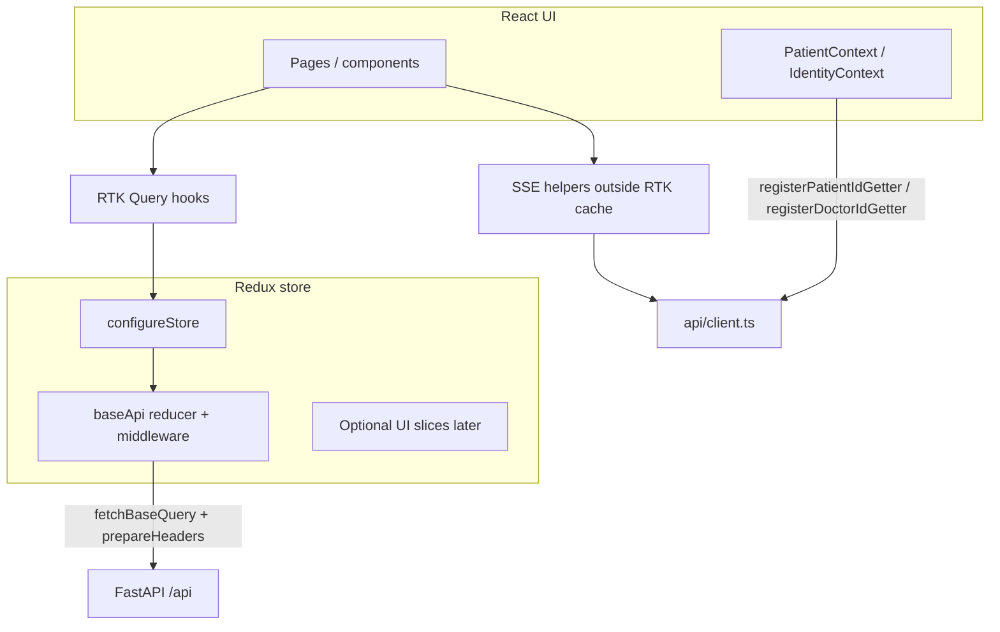

# Redux Toolkit + RTK Query adoption (prescribe-v2 frontend)

## 1. Title & summary

This plan defines how to introduce **Redux Toolkit (RTK)** and **RTK Query** into `prescribe-v2/frontend`, mirroring the proven patterns from **Voya** (`Voya/voya/frontend-v2`): a single `createApi` **base API** with domain modules using `injectEndpoints`, a **configured store** with RTK Query middleware, typed hooks, and **tag-based cache invalidation**. The goal is to **replace imperative `api/*.ts` wrappers** (functions calling `apiRequest` / `apiFetch`) with generated hooks for standard REST JSON endpoints, while **keeping streaming chat, multipart upload, and blob download** on explicit, well-isolated code paths where RTK Query’s default model is a poor fit. Success means: one coherent data layer, less duplicated loading/error state in hooks, cache consistency across patient/doctor routes, `npm run build` green, and a documented migration order for existing call sites.

## 2. Type & scope

| | |
|--|--|
| **Type** | Enhancement (architecture + incremental migration) |
| **Primary surface** | Frontend (`prescribe-v2/frontend`) |

**In scope**

- Add `@reduxjs/toolkit`, `react-redux` (and `redux` as transitive dependency via RTK); wire `<Provider store={store}>` in the React tree.
- Implement `baseApi` with `fetchBaseQuery` and **dev identity headers** (`X-Patient-Id`, `X-Doctor-Id`, `skipPatientHeader` semantics) aligned with `frontend/src/api/client.ts`.
- Split REST endpoints into **injected API slices** (patients, doctors, chat history, documents metadata, connections, config, suggestions), following Voya’s `injectEndpoints` + barrel exports pattern.
- Replace usages in hooks/pages/components with RTK Query hooks **where appropriate**; define **tag types** and `providesTags` / `invalidatesTags` for lists and detail views.
- Testing strategy: Vitest + RTL for store/API utilities (new); align with `docs/TESTING.md` “future” stack.

**Out of scope (unless explicitly pulled in later)**

- Backend changes, OpenAPI code generation, or Phase E auth (JWT) — plan only notes **extension points** (e.g. `prepareHeaders` for `Authorization` later, comparable to Voya `baseApi.ts`).
- Full removal of React Context (`PatientContext`, `IdentityContext`) in the first pass — **optional** later consolidation if product wants a single source of truth in Redux.
- E2E Playwright until the repo adopts it.

## 3. Baseline (current behavior)

**Stack:** React 18 + Vite + React Router v7; **no** Redux today (`frontend/package.json` has no `@reduxjs/toolkit` / `react-redux`).

**HTTP layer:** `frontend/src/api/client.ts` defines `apiFetch` / `apiRequest`, `getApiBase()`, and **module-level** `registerPatientIdGetter` / `registerDoctorIdGetter` so `PatientContext` and `IdentityContext` inject the active dev identity without passing props through every call.

**API modules (imperative):**

| Module | Role |
|--------|------|
| `api/client.ts` | Base URL, headers, JSON parse errors |
| `api/patients.ts` | CRUD, list, medical history |
| `api/chat.ts` | Non-streaming message, **SSE stream**, history, `getPatients` (for-chat) |
| `api/doctors.ts` | Doctor profile, dashboard, connected patients, doctor–patient documents, **doctor chat** (REST + SSE), sessions, history |
| `api/documents.ts` | List/update/delete, **XHR multipart upload**, blob fetch, public URLs |
| `api/connections.ts` | Accept/reject |
| `api/config.ts` | Feature flags |
| `api/suggestions.ts` | List + accept/reject/dismiss |

**Consumers:** Custom hooks (`useChat`, `useDocuments`, `useMedicalHistory`, `useDoctorDashboard`, `useConnectedPatients`, etc.) and contexts use `useState`/`useEffect` + these API functions. See `frontend/CLAUDE.md` and `docs/FRONTEND_BACKEND_COLLABORATION.md` for contract and header rules.

**Key files (pointers):** `frontend/src/main.tsx` (mount only), `frontend/src/App.tsx` (`FeatureFlagProvider` + router), `frontend/src/contexts/PatientContext.tsx`, `frontend/src/contexts/IdentityContext.tsx`.

## 4. Prior art & strategy

### 4.1 Voya (`Voya/voya/frontend-v2`) — what to mirror

| Area | Voya pattern | Location (examples) |
|------|----------------|----------------------|
| Store | `configureStore` with `[baseApi.reducerPath]: baseApi.reducer`, extra slices, `concat(baseApi.middleware, …)` | `src/store/index.ts` |
| Listeners | `setupListeners(store.dispatch)` for refetchOnFocus/reconnect | `src/store/index.ts` |
| Base query | `createApi` with **empty** `endpoints: () => ({})`, shared `tagTypes`, `fetchBaseQuery` + **custom** wrapper (401 refresh in Voya) | `src/api/baseApi.ts` |
| Domain APIs | `baseApi.injectEndpoints({ endpoints: (builder) => ({ ... }) })` per file; **named exports of hooks** | `src/api/authApi.ts`, `chatApi.ts`, … |
| Barrel | `src/api/index.ts` re-exports APIs and hooks | `src/api/index.ts` |
| Typing | `useAppDispatch`, `useAppSelector` typed to `RootState` / `AppDispatch` | `src/store/hooks.ts` |
| Wire-up | `<Provider store={store}>` in `main.tsx` | `src/main.tsx` |
| Casing | `transformResponse` where API is snake_case and UI wants camelCase; otherwise wire types match backend | Comments in `baseApi.ts`, `chatApi.ts` |

### 4.2 Prescribe-v2 — proposed alignment

| Topic | Existing strategy | Recommendation |
|-------|-------------------|----------------|
| REST JSON | `apiRequest` per module | **Replace with RTK Query** endpoints + hooks — same URLs and types as today (`snake_case` DTOs per `FRONTEND_BACKEND_COLLABORATION.md`). |
| Dev headers | Module getters + `register*` from contexts | **Keep getters in `client.ts`** and call them from `prepareHeaders` in `baseApi` (minimal churn, no duplicate identity state). Optional later: sync identity into a Redux slice if you want DevTools visibility or middleware. |
| SSE streaming | `sendMessageStream`, `sendDoctorChatMessageStream` | **Do not** force into standard `mutation` — keep **dedicated modules** (`api/chatStream.ts` or `lib/sse/`) that reuse the **same header preparation** as `fetchBaseQuery` (extract small `applyPrescribeHeaders(init)` helper shared by base query and streams). |
| Multipart upload | XHR + progress | **Option A:** Keep XHR helper until RTK mutation with `fetchBaseQuery` + `FormData` is verified with progress via `onUploadProgress` if you add a custom base query; **Option B:** RTK `mutation` with `fetch` and no progress first — **prefer incremental**: keep XHR initially, then migrate. |
| Feature flags | Context fetch on mount | `useGetFeatureFlagsQuery` + `providesTags: ['Config']` — simplifies `FeatureFlagContext` (or make context a thin wrapper over query). |

**Judgment:** Voya’s **single injected `baseApi` + per-domain files** is the right default for prescribe-v2: it matches team direction (stated in `/create-plan`), scales with more endpoints, and avoids multiple unrelated `createApi` instances unless a second origin (e.g. CMS) appears — then a **second `createApi`** (like Voya’s `strapiApi`) is justified.

## 5. Target architecture

- **RTK Query** owns: normalized **server state** (lists, detail entities, GET-after-mutation consistency).
- **Local UI state** can remain in hooks/components or move to slices later (not required for MVP).
- **Streaming / XHR** stay **outside** the RTK cache; they may **invalidate** RTK tags when a message or upload completes (e.g. `dispatch(baseApi.util.invalidateTags([{ type: 'Chat', id: ... }]))`).

## 6. Directory & file plan

All paths under `prescribe-v2/frontend/src/`.

| Path | Purpose | New / modify |
|------|---------|--------------|
| `store/index.ts` | `configureStore`, middleware, `setupListeners`, exports `store`, types | **New** |
| `store/hooks.ts` | `useAppDispatch`, `useAppSelector` | **New** |
| `api/baseApi.ts` | `createApi`, `fetchBaseQuery`, `prepareHeaders` (patient/doctor headers, `skipPatientHeader` equivalent via custom arg — see §7), `tagTypes` | **New** |
| `api/patientsApi.ts` | `injectEndpoints` — patients CRUD, list, medical history | **New** |
| `api/doctorsApi.ts` | Doctor profile, dashboard, connected patients, connected profile/history/documents list | **New** |
| `api/chatApi.ts` | `getChatHistory`, `getPatients` (for-chat), non-streaming `sendMessage` if still needed; tags for chat | **New** |
| `api/doctorChatApi.ts` *(optional split)* | Doctor REST chat, sessions, history — or merge into `doctorsApi.ts` if preferred | **New** |
| `api/documentsApi.ts` | JSON list/update/delete metadata; **not** blob body in cache | **New** |
| `api/connectionsApi.ts` | accept/reject mutations | **New** |
| `api/configApi.ts` | feature flags query | **New** |
| `api/suggestionsApi.ts` | list + mutations | **New** |
| `api/index.ts` | Barrel: export `baseApi`, slices, hooks (mirror Voya `api/index.ts`) | **New** |
| `api/client.ts` | Keep getters, `getApiBase`; **shared** header builder for streams | **Modify** |
| `api/chat.ts` | **Thin:** re-export stream functions only, or move streams to `api/chatStream.ts` | **Modify** |
| `api/patients.ts`, `doctors.ts`, … | Deprecate or delete after migration; or thin wrappers delegating to RTK for transition | **Modify / delete** |
| `main.tsx` | Wrap with `<Provider store={store}>` (inside/outside router per preference; Voya wraps store outside router) | **Modify** |
| `contexts/FeatureFlagContext.tsx` | Prefer data from `useGetFeatureFlagsQuery` | **Modify** |
| `hooks/*.ts`, `pages/**`, `components/**` | Switch to RTK hooks | **Modify** (incremental) |

**Tag types (initial):** `Patient`, `PatientList`, `Doctor`, `DoctorDashboard`, `ConnectedPatients`, `Documents`, `Chat`, `ChatSessions`, `Config`, `Suggestions`, `Connections` — refine to avoid over-invalidation (e.g. granular `Patient` id tags).

## 7. API / data

**Base URL:** `import.meta.env.VITE_API_URL || "/api"` — unchanged.

**Boundary:** Request/response bodies remain **`snake_case`** per backend (`docs/FRONTEND_BACKEND_COLLABORATION.md`); TypeScript types in `types/` already reflect that. No automatic camelCase transform unless a future UI layer requires it (Voya applies transforms per-endpoint when needed).

**Header semantics (must match `client.ts`):**

- Default: set `X-Patient-Id` when the getter returns non-empty.
- When the backend route uses **path** `patient_id` and the app passes `skipPatientHeader: true` (doctor chat paths), the base query must **omit** `X-Patient-Id`. RTK Query supports **per-endpoint** `query` as a function returning `FetchArgs`; include a flag such as `meta` or an extra property in a wrapped arg type processed in a **custom baseQuery** wrapper, **or** encode `skipPatientHeader` in the endpoint `query` using `headers` override — simplest: **custom `baseQuery`** that inspects `FetchArgs` for a custom field, e.g. `{ url, method, body, skipPatientHeader: true }` stripped before `fetch`.

**Endpoints to map (representative):**

- Patients: `POST/GET/PUT /patients`, `GET /patients?skip&limit`, `GET .../medical-history`, `GET /patients/for-chat`
- Doctors: `GET/PUT /doctors/{id}`, `GET .../dashboard`, `GET .../patients`, `GET .../patients/{pid}/profile`, `GET .../medical-history`, `GET .../documents`, `POST .../chat/message`, `GET .../chat/sessions`, `GET .../chat/history/{chat_id}`
- Chat (patient): `POST /chat/message`, `GET /chat/history/{chat_id}`
- Documents (patient): list/update/delete/metadata; download URL remains string helper using `getApiBase()`
- Connections: `PUT /connections/{id}/accept|reject`
- Config: `GET /config/features`
- Suggestions: under `/patients/{id}/suggestions` — mutations invalidate suggestion list tags

**SSE / binary:** Not stored in RTK Query cache; use `baseApi.util.invalidateTags` after successful stream completion or upload when lists must refresh.

## 8. Edge cases & failure handling

| Scenario | Handling |
|----------|----------|
| Missing `X-Patient-Id` on routes that require it | Same as today: backend 400; surface error via RTK `isError` / `error` on query or mutation |
| Doctor routes with `skipPatientHeader` | Explicit per-endpoint opt-out (see §7) so a stale patient header never conflicts with URL |
| Paginated lists | Use `merge` / `serializeQueryArgs` if infinite scroll is added; for current skip/limit pages, refetch on param change |
| Optimistic updates | Optional Phase 2+ for connection accept/reject; start with `invalidatesTags` only |
| Upload progress | If keeping XHR, no RTK loading state — UI keeps local progress state |
| Stream disconnect | Existing callback `onError`; optionally invalidate chat history tag for recovery |
| Concurrent patient switch | `registerPatientIdGetter` updates immediately; active queries should **reset** or use `refetch` on patient id change — use **query args** that include `patientId` in the cache key where relevant |

## 9. Testing strategy

- **Unit tests (Vitest):** Configure `vitest.config.ts` + `jsdom`; test **baseQuery** / header stripping / `prepareHeaders` with mocked `fetch` (follow Voya patterns where `*.test.ts` exists beside API modules).
- **Integration:** Test hooks with a small **test store** wrapper or MSW to assert cache tags and invalidation for one vertical slice (e.g. documents list after mutation).
- **Regression:** `npm run build` (`tsc -b && vite build`); manual checks from `docs/TESTING.md` for chat streaming after touching headers.

**Flaky-prone areas:** refetch on window focus — `setupListeners` matches Voya; document whether doctor portal should disable `refetchOnFocus` for heavy dashboards if needed (`keepUnusedDataFor`, `refetchOnMountOrArgChange`).

## 10. Risks & rollback

| Risk | Mitigation |
|------|------------|
| Large blast radius | Phase migrations per domain; keep old `api/*.ts` wrappers as one-line delegators during transition |
| Duplicate identity state if later moving to Redux | Start with getters in `prepareHeaders`; document extension point |
| Streaming regression | Extract shared header logic; add one E2E or manual checklist per release |
| Bundle size | RTK is acceptable for medium apps; tree-shake unused endpoints |

**Rollback:** Remove `Provider`, delete `store/` and new API injectors, restore hooks to previous imports; git revert per phase.

---

## 11. Implementation phases (detailed)

### Implementation order overview

1. Phase 1 — Dependencies and store shell  
2. Phase 2 — `baseApi` + header contract + `tagTypes`  
3. Phase 3 — Patients + config API slices and first consumer migrations  
4. Phase 4 — Doctors + connections + dashboard / patient lists  
5. Phase 5 — Documents + suggestions + invalidation polish  
6. Phase 6 — Chat REST + cache invalidation; streaming extraction  
7. Phase 7 — Tests, docs, cleanup deprecations  

---

### Phase 1 — Dependencies and store shell

**Goal:** Add RTK packages and a working Redux store so the app runs with an empty `baseApi` (no consumers yet).

**Prerequisites:** None.

**Scope:** `package.json`, `main.tsx`, new `store/index.ts` and `store/hooks.ts`. **Deferred:** All domain endpoints.

**Tasks**

1. Add `@reduxjs/toolkit` and `react-redux` to `frontend/package.json`; run `npm install` and commit lockfile per `frontend/CLAUDE.md`.
2. Create `store/index.ts`: `configureStore` with placeholder `reducer: { [baseApi.reducerPath]: baseApi.reducer }` and `middleware` chaining `baseApi.middleware` once `baseApi` exists in Phase 2 — for Phase 1 you can temporarily import a minimal `baseApi` stub or add `baseApi` in Phase 1 as empty `createApi` only.
3. Create `store/hooks.ts` with typed `useAppDispatch` / `useAppSelector`.
4. Wrap the app in `<Provider store={store}>` in `main.tsx` (above `RouterProvider` from `App.tsx` — adjust so a single tree: `Provider` → existing `App` content).

**Deliverables:** Store compiles; app boots; no behavior change to data fetching yet.

**Verification:** `cd frontend && npm run build`; smoke-run `npm run dev`.

**Notes:** Phase 1 can merge Phase 2’s empty `baseApi` file to avoid a stub.

---

### Phase 2 — `baseApi` + header contract

**Goal:** Implement `fetchBaseQuery` with **equivalent** behavior to `api/client.ts` headers, plus extensibility for future auth.

**Prerequisites:** Phase 1.

**Scope:** `api/baseApi.ts`; small refactor of `api/client.ts` to export a **pure function** `applyPrescribeHeaders(init, options)` used by both legacy `apiFetch` and the base query. **Deferred:** Domain endpoints.

**Tasks**

1. Implement `rawBaseQuery = fetchBaseQuery({ baseUrl: getApiBase(), prepareHeaders })` where `prepareHeaders` sets `Content-Type: application/json` for JSON bodies, `X-Patient-Id`, `X-Doctor-Id` via existing getters from `client.ts`.
2. Implement optional **wrapper** `baseQuery` that reads `FetchArgs` extended with `skipPatientHeader?: boolean` (strip before calling `rawBaseQuery`) — maps to doctor chat routes.
3. `export const baseApi = createApi({ reducerPath: 'api', baseQuery, tagTypes: [...], endpoints: () => ({}) })`.
4. Register `baseApi` in `store/index.ts`; call `setupListeners(store.dispatch)`.

**Deliverables:** Store includes RTK Query reducer and middleware; headers verified in Network tab for a smoke `query` test endpoint (add temporary `getHealth` query only if backend has `/health` outside `/api` — optional; otherwise skip smoke endpoint).

**Verification:** DevTools show RTK Query slice; no duplicate middleware errors.

**Maps to:** §7 header rules, §8 concurrent identity.

---

### Phase 3 — Patients API slice + config + first migrations

**Goal:** Replace patient REST and feature-flag loading with RTK Query; validate tags.

**Prerequisites:** Phase 2.

**Scope:** `api/patientsApi.ts`, `api/configApi.ts`; migrate `PatientContext` patient list loading, `ProfilePage`, `useMedicalHistory`, `FeatureFlagContext`.

**Tasks**

1. `injectEndpoints` for `listPatients`, `getPatient`, `updatePatient`, `getMedicalHistory`, `getPatientsForChat` (name aligned with wire `/patients/for-chat`); use `providesTags` / `invalidatesTags` for `Patient` + `PatientList`.
2. `injectEndpoints` for `getFeatureFlags` → `providesTags: ['Config']`.
3. Update `PatientContext` to use `useListPatientsQuery` or lazy equivalent + fallback to `getPatientsForChat` — preserve existing fallback behavior (paginated list vs for-chat).
4. Update `ProfilePage` to `useGetPatientQuery` + `useUpdatePatientMutation`.
5. Update `useMedicalHistory` to `useGetMedicalHistoryQuery` with `patientId` in query args.

**Deliverables:** No remaining direct `apiRequest` calls for these flows in migrated files.

**Verification:** Manual: patient profile load/save, dashboard medical history, feature flags banner; `npm run build`.

**Maps to:** §6 file plan, §9 Vitest later.

---

### Phase 4 — Doctors + connections

**Goal:** Doctor portal REST surfaces use RTK Query; connection mutations invalidate dashboard/list tags.

**Prerequisites:** Phase 3.

**Scope:** `api/doctorsApi.ts` (and optionally `doctorChatApi.ts`), `api/connectionsApi.ts`; migrate `useDoctorDashboard`, `useConnectedPatients`, `usePatientDetail`, `DoctorProfilePage`, connection cards, `PendingRequestsCard`.

**Tasks**

1. Endpoints: `getDoctor`, `updateDoctor`, `getDoctorDashboard`, `getConnectedPatients`, `getConnectedPatientProfile`, `getConnectedPatientHistory`, `acceptConnection`, `rejectConnection` — with correct `skipPatientHeader` on routes that require it per `FRONTEND_BACKEND_COLLABORATION.md`.
2. Tags: `DoctorDashboard`, `ConnectedPatients`, `Connections`; invalidate on accept/reject.
3. Replace `useDoctorDashboard`, `useConnectedPatients`, `usePatientDetail` internals with RTK hooks (or delete hooks and use generated hooks in pages directly — prefer thin hooks if they add arg plumbing).

**Deliverables:** Doctor flows use RTK Query for listed operations.

**Verification:** Manual doctor portal checks per `docs/TESTING.md` doctor sections if present; `npm run build`.

---

### Phase 5 — Documents + suggestions

**Goal:** Document list/metadata and suggestions use RTK Query; uploads remain XHR until explicitly migrated.

**Prerequisites:** Phase 4.

**Scope:** `api/documentsApi.ts`, `api/suggestionsApi.ts`; migrate `useDocuments`, `DocumentsPage`, `UploadModal` (keep XHR upload function in `documents.ts` or `documents/upload.ts`), suggestion components.

**Tasks**

1. Queries/mutations for list, update, delete, metadata; `invalidatesTags` on upload completion **dispatched** from XHR success callback via `useAppDispatch` + `prescribeApi.util.invalidateTags` (import `baseApi` as `prescribeApi` or named `baseApi`).
2. Suggestions: list query + accept/reject/dismiss mutations with tag `Suggestions`.

**Deliverables:** Lists refresh after upload without manual `refresh()` only where invalidation is wired.

**Verification:** Upload a file; list updates; suggestion actions refresh list.

**Maps to:** §4.2 multipart strategy.

---

### Phase 6 — Chat REST + streaming module

**Goal:** Chat history and non-streaming POSTs use RTK Query; streaming lives in a dedicated module with shared headers.

**Prerequisites:** Phase 5.

**Scope:** `api/chatApi.ts` (REST only); refactor `useChat` / `useDoctorChat` to keep streaming logic but call `invalidateTags` on `onDone` for history/session queries.

**Tasks**

1. Add `getChatHistory`, `sendMessage` (patient), `getDoctorChatSessions`, `getDoctorChatHistory`, `sendDoctorChatMessage` (REST) as mutations/queries with appropriate tags.
2. Move `sendMessageStream` / `sendDoctorChatMessageStream` to `api/chatStream.ts` (or keep in `chat.ts`) and **import** `applyPrescribeHeaders` from `client.ts` for `fetch` SSE calls.
3. On stream `done`, `dispatch(baseApi.util.invalidateTags([...]))` for `Chat` / session lists.

**Deliverables:** Parity with current streaming UX; cache coherent after message send.

**Verification:** Stream chat in patient and doctor views; history loads; no header leaks on doctor routes.

**Maps to:** §8 stream disconnect.

---

### Phase 7 — Tests, barrel exports, deprecation cleanup

**Goal:** Production-ready polish: Vitest for critical API utilities, barrel `api/index.ts`, remove dead code.

**Prerequisites:** Phase 6.

**Scope:** `vitest.config.ts`, `api/*.test.ts`, `api/index.ts`, remove or deprecate old `api/patients.ts` exports; update `frontend/CLAUDE.md` state/data-flow section to describe RTK Query.

**Tasks**

1. Add Vitest + minimal tests for `baseQuery` header behavior and one invalidation scenario (mock `fetch`).
2. Export all hooks from `api/index.ts` (Voya-style).
3. Delete unused imperative functions or mark `@deprecated` re-exports for one release.
4. Update `frontend/CLAUDE.md` folder map (store, `baseApi`, hooks).

**Deliverables:** Test script in `package.json` (`"test": "vitest"`); documentation matches architecture.

**Verification:** `npm test`; `npm run build`; quick manual regression on patient + doctor paths.

**Notes:** **Final verification chat** (per team process): `git diff` vs this plan — confirm each phase’s deliverables and §6 file table.

---

### Execution batches (optional)

| Batch | Phases | Suggested Cursor chat focus |
|-------|--------|-----------------------------|
| A | 1–2 | Store + base API only |
| B | 3–4 | Patient + doctor vertical slices |
| C | 5–6 | Documents, suggestions, chat |
| D | 7 | Tests + cleanup + doc |

Parallelism: Phases 3–4 are sequential for doctor/patient overlap; **do not** parallelize Phase 2 across branches without locking `baseApi.ts`.
