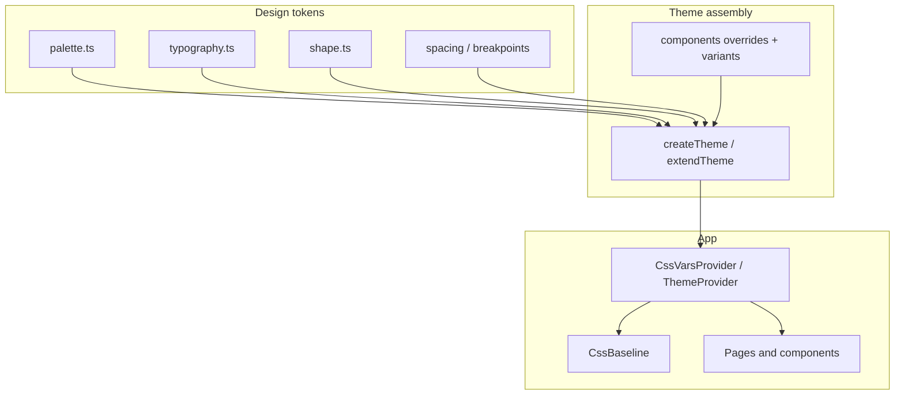

# Plan: Migrate frontend from Tailwind CSS to MUI (Material UI)

## 1. Title & summary

The frontend today is built with **React 18, Vite, and Tailwind CSS 3** (`tailwind.config.js`, `@tailwindcss/typography`, utility classes across **60+** `tsx` files). This plan replaces that stack with **MUI (`@mui/material`)** and **Emotion** (MUI’s default styling engine), introducing a **single structured theme**: typed palette scales, typography ramp, shape, spacing, component **variants** via `theme.components`, and optional **light/dark** (or light-only initially) via the CssVars APIs. Success means **no Tailwind** in dependencies or source, **visual parity or intentional improvement** on patient and doctor portals, **accessible** defaults preserved or improved, **tests** passing with a shared **ThemeProvider** test wrapper, and **docs** (`frontend/CLAUDE.md`, `docs/ARCHITECTURE.md`) updated to describe the new styling approach.

## 2. Type & scope

| | |
|--|--|
| **Type** | Enhancement (platform / UI architecture) |
| **Primary surface** | Frontend |

**In scope**

- Add MUI + Emotion; remove Tailwind, PostCSS Tailwind pipeline, and `@tailwindcss/typography`.
- Central **design tokens** (color ramps, semantic colors, typography) and **`createTheme` / `extendTheme`** composition.
- **Component defaults and variants** using MUI’s `theme.components` (`styleOverrides`, `defaultProps` / `defaultProps` via theme where supported, `variants` arrays for complex components).
- Refactor **all** `className`-heavy UI to MUI primitives (`Box`, `Stack`, `Typography`, `Button`, `Paper`, `TextField`, `Dialog`, etc.) and **`sx`** / **`styled`** where appropriate.
- **Markdown** in chat (`ChatMessage.tsx`): map `react-markdown` element renderers to MUI-styled elements or `sx` tied to `theme.palette` / `theme.typography` (replacing Tailwind prose-like styling).
- **Icons**: keep **`lucide-react`** unless a future phase standardizes on `@mui/icons-material`; MUI does not require MUI icons.
- **Docker / CI**: `package-lock.json` and frontend image build remain valid (`npm ci`).

**Out of scope (unless explicitly added later)**

- Backend or API changes.
- Full **Figma-level redesign** (this is a **technology and structure** migration; colors should start from the existing Tailwind **primary** scale and neutrals, then be refined).
- **SSR** (app is Vite SPA).
- **MUI X** Data Grid / Date Pickers (add only when a screen needs them).

## 3. Baseline (current behavior)

- **Styling:** Tailwind utilities globally via `frontend/src/index.css` (`@tailwind base/components/utilities`). **`tailwind.config.js`** extends a **primary** blue palette (`primary.50`–`900`) and uses **`@tailwindcss/typography`** (main practical consumer is markdown-adjacent styling; much prose is hand-rolled in `ChatMessage.tsx` with utilities).
- **Entry:** `frontend/src/main.tsx` imports `./index.css`; **no** global theme provider.
- **App shell:** `App.tsx` wraps `FeatureFlagProvider` + `RouterProvider` only.
- **Scale:** Broad use of `className` across layouts (`PatientLayout.tsx`, `DoctorLayout.tsx`), sidebars, chat, documents (e.g. `UploadModal.tsx`), dashboards, and forms — see grep counts under `frontend/src/**/*.tsx`.
- **Docs:** `frontend/CLAUDE.md` and `docs/ARCHITECTURE.md` still describe “Tailwind CSS 3”.

Key reference files:

- `frontend/tailwind.config.js` — today’s color source of truth.
- `frontend/postcss.config.js`, `frontend/src/index.css` — Tailwind pipeline.
- `frontend/src/components/ChatMessage.tsx` — markdown element mapping with Tailwind classes.
- `frontend/package.json` — `tailwindcss`, `@tailwindcss/typography`, `autoprefixer`, `postcss`.

## 4. Prior art & strategy

| Approach | Assessment |
|----------|------------|
| **Keep Tailwind and “add MUI for some screens”** | **Rejected.** Two competing systems, duplicated tokens, harder reviews, larger CSS surface. |
| **Tailwind + headless only (no MUI)** | **Rejected.** User requirement is MUI with structured themes/variants. |
| **CSS Modules / vanilla extract only** | **Rejected.** Does not meet MUI requirement; loses accessible component library. |
| **Full migration to MUI + Emotion, token-driven theme** | **Selected.** One mental model, MUI’s `theme.components` for variants, Emotion for `sx`/`styled`, aligns with “best practices” for Material Design–based apps. |

**Comparison note:** The repo has **no prior MUI usage**. Existing plans (e.g. doctor/patient UI shells) assumed Tailwind utilities; this plan **supersedes that styling approach** for implementation detail only — layout and routing decisions remain valid.

## 5. Target architecture

**Runtime provider stack** (order matters):

```text
Redux Provider (existing)
  → CssVarsProvider or ThemeProvider + CssBaseline
      → FeatureFlagProvider
          → RouterProvider
```

- **`CssBaseline`:** Normalize margins, box-sizing, and baseline background using theme (replaces much of Tailwind preflight usage).
- **Theme:** Built from **tokens** → `createTheme` or `extendTheme` (MUI v6+ recommends **CssVarsProvider** + `extendTheme` when using CSS variables for color schemes). Start with **light** mode only if dark is not required; structure tokens so **dark** can be added without renaming keys.
- **Styling patterns:**
  - **Layout:** `Stack`, `Grid`, `Box` with `spacing` from theme — avoid magic pixel strings where `theme.spacing(n)` applies.
  - **One-offs:** `sx` prop reading `theme.palette.*`, `theme.typography.*`, `alpha()`, `breakpoints.up/down`.
  - **Repeated patterns:** `styled(Component)(({ theme }) => ({ ... }))` or **`theme.components.MuiButton.variants`** for true variant names (e.g. `variant="cta"` if added via theme).
  - **Markdown:** Either wrap content in `<Box sx={{ '& h1': { ... } }}>` or keep per-tag renderers using **`useTheme()`** / **`sx`** for consistency.



## 6. Directory & file plan

### 6.1 Tree (target state)

The migration introduces three new top-level folders under `frontend/src/`: **`theme/`** (tokens + assembly), **`providers/`** (app-level context wrappers), and **`ui/`** (reusable MUI primitives / styled wrappers). Existing folders (`components/`, `layouts/`, `pages/`, `hooks/`, `api/`, `contexts/`, `store/`, `router/`) are unchanged in **shape** but migrate **contents** from Tailwind to MUI in place.

```text
frontend/src/
├── theme/                       # MUI design system — one source of truth
│   ├── index.ts                 # Assembles + exports `appTheme` (createTheme / extendTheme)
│   ├── palette.ts               # Color ramps: primary, grey, semantic, text, background, divider
│   ├── typography.ts            # Font families, h1–body2, button, caption
│   ├── shape.ts                 # borderRadius + shared radii constants
│   ├── spacing.ts               # (Optional) spacing unit / custom spacing fn; skip if default 8px is fine
│   ├── breakpoints.ts           # (Optional) only if overriding MUI defaults
│   ├── shadows.ts               # (Optional) elevation ramp overrides
│   ├── zIndex.ts                # (Optional) layering constants (modal/appbar/snackbar)
│   ├── components/              # Per-component overrides (one file per MUI component family)
│   │   ├── index.ts             # Barrel: merges all component overrides into `Components<Theme>`
│   │   ├── MuiCssBaseline.ts    # Global resets (replaces Tailwind preflight residue)
│   │   ├── MuiButton.ts         # styleOverrides + defaultProps + variants
│   │   ├── MuiTextField.ts
│   │   ├── MuiPaper.ts
│   │   ├── MuiDialog.ts
│   │   ├── MuiAppBar.ts
│   │   ├── MuiListItemButton.ts # Sidebar nav active/default variants
│   │   ├── MuiLinearProgress.ts # Upload progress
│   │   └── …                    # Add one file per component as it gets themed
│   ├── tokens.ts                # (Optional) raw brand tokens re-exported for non-MUI consumers (email templates, etc.)
│   └── augmentation.d.ts        # Module augmentation for custom palette keys, Button variants, etc.
├── providers/                   # App-level React context wrappers (composition root helpers)
│   └── AppThemeProvider.tsx     # CssVarsProvider / ThemeProvider + CssBaseline + GlobalStyles
├── ui/                          # Reusable, app-agnostic MUI wrappers / styled primitives
│   ├── index.ts                 # Barrel
│   ├── Section.tsx              # Common page section (Container + vertical rhythm)
│   ├── PageHeader.tsx           # Title + subtitle + actions slot
│   ├── EmptyState.tsx           # Themed empty/placeholder state
│   ├── LoadingState.tsx         # Skeleton / CircularProgress wrapper
│   ├── ErrorState.tsx           # Alert-based error panel
│   └── Markdown.tsx             # react-markdown + remark-gfm wired to theme (replaces prose classes)
├── test-utils/
│   └── renderWithProviders.tsx  # render() with Redux + AppThemeProvider (+ Router when needed)
├── main.tsx                     # Redux Provider → AppThemeProvider → FeatureFlagProvider → RouterProvider
├── App.tsx                      # (unchanged responsibility; may delegate provider stacking to main.tsx)
├── index.css                    # Minimal: @font-face, print, reduced-motion fallbacks only
├── components/                  # Unchanged folder; contents migrated Tailwind → MUI in place
├── layouts/                     # Unchanged; PatientLayout/DoctorLayout rebuilt with MUI primitives
├── pages/                       # Unchanged
├── hooks/ api/ contexts/ store/ router/ types/  # Unchanged
```

### 6.2 File-level responsibilities

| Path | Purpose | New / modify |
|------|---------|--------------|
| `frontend/package.json` | Add `@mui/material`, `@emotion/react`, `@emotion/styled`; remove `tailwindcss`, `@tailwindcss/typography`; drop `postcss` + `autoprefixer` unless another PostCSS plugin is kept (Vite ships its own autoprefixing). | Modify |
| `frontend/package-lock.json` | Lockfile update | Modify |
| `frontend/src/theme/palette.ts` | Exports a typed `palette` (`PaletteOptions`) built from the existing Tailwind `primary.50`–`900` ramp plus greys + semantic colors (`success`/`error`/`warning`/`info`), `text`, `background`, `divider`. **Only source of color values.** | New |
| `frontend/src/theme/typography.ts` | Exports `typography: TypographyOptions` — font family, h1–body2, button, caption tuned for medical UI readability. | New |
| `frontend/src/theme/shape.ts` | Exports `shape: { borderRadius }` plus any shared radius constants (e.g. `radiusSm`, `radiusLg`). | New |
| `frontend/src/theme/spacing.ts` | *(Optional)* Custom spacing scale; omit if default 8px unit is sufficient. | New (optional) |
| `frontend/src/theme/breakpoints.ts` | *(Optional)* Only if we deviate from MUI defaults; otherwise delete. | New (optional) |
| `frontend/src/theme/shadows.ts` | *(Optional)* Softer/branded elevation ramp. | New (optional) |
| `frontend/src/theme/zIndex.ts` | *(Optional)* Explicit layering if dev banner / drawer / dialog stacking needs tuning. | New (optional) |
| `frontend/src/theme/components/<MuiXxx>.ts` | **One file per MUI component family.** Each exports a single `Components<Theme>[MuiXxx]` object (`styleOverrides`, `defaultProps`, `variants`). Keeps `theme/components.ts` from becoming a 1000-line god file. | New |
| `frontend/src/theme/components/index.ts` | Barrel that merges the per-component objects into a single `components: Components<Theme>` map passed to `createTheme`. | New |
| `frontend/src/theme/augmentation.d.ts` | Module augmentation: `declare module '@mui/material/styles'` for custom `Palette` keys (e.g. brand accents), custom `ButtonPropsVariantOverrides`, custom `TypographyVariants`. Imported once from `theme/index.ts` so types are globally available. | New |
| `frontend/src/theme/index.ts` | Composes `palette` + `typography` + `shape` + `components` via `createTheme` (or `extendTheme` if CssVars). Exports **only** `appTheme` (and re-exports augmentation types). No component code here. | New |
| `frontend/src/theme/tokens.ts` | *(Optional)* Raw branding constants (logo color, brand name) consumed outside MUI, e.g. email templates or `<meta theme-color>`. Keeps non-MUI surfaces from duplicating hex values. | New (optional) |
| `frontend/src/providers/AppThemeProvider.tsx` | Thin wrapper: `ThemeProvider` (or `CssVarsProvider`) + `CssBaseline` + any `GlobalStyles` (e.g. scrollbar tweaks, patient-shell tablet-rail rules previously in `index.css`). Exports `<AppThemeProvider>{children}</AppThemeProvider>`. | New |
| `frontend/src/ui/*.tsx` | **Reusable, feature-agnostic MUI wrappers** (`Section`, `PageHeader`, `EmptyState`, `LoadingState`, `ErrorState`, `Markdown`). These are the only place `styled()` wrappers live if they're generic; feature-specific styled wrappers stay co-located with the feature. | New |
| `frontend/src/ui/Markdown.tsx` | Wraps `react-markdown` + `remark-gfm`; maps element renderers (`h1`–`h6`, `p`, `ul`, `ol`, `li`, `code`, `pre`, `table`, `blockquote`, `a`) to MUI `Typography` / `Box` / `Link` with `sx` reading `theme.typography.*`. **Replaces** `@tailwindcss/typography` usage in `ChatMessage`. | New |
| `frontend/src/main.tsx` | Mount order: `Redux Provider` → `AppThemeProvider` → `FeatureFlagProvider` → `RouterProvider`. `AppThemeProvider` sits **above** the router so every route (including error boundary) gets the theme. | Modify |
| `frontend/src/App.tsx` | Keep as a minimal shell; move provider stacking to `main.tsx` so tests can reuse `AppThemeProvider` without `App`. | Modify |
| `frontend/src/index.css` | Strip `@tailwind` directives. Keep only `@font-face`, `:root` font smoothing, `@media (prefers-reduced-motion)` fallbacks, and print rules. Anything dynamic moves to `GlobalStyles` inside `AppThemeProvider`. | Modify |
| `frontend/tailwind.config.js` | Delete after migration. | Delete |
| `frontend/postcss.config.js` | Delete unless another PostCSS plugin remains. | Delete (likely) |
| `frontend/src/test-utils/renderWithProviders.tsx` | `render()` wrapped with Redux `Provider` + `AppThemeProvider` (+ optional `MemoryRouter`). Exports `renderWithProviders`, `renderWithTheme` (theme-only), and re-exports `screen`, `within` from Testing Library for ergonomics. | New |
| `frontend/src/**/*.tsx` | Replace Tailwind utilities with MUI primitives + `sx` / `styled`. Component **files stay where they are** — no directory reshuffle during migration. | Modify (broad) |
| `frontend/eslint.config.js` | Drop `tailwind.config.js` from ignores; no Tailwind-specific plugins expected. Optionally add a rule / pattern to flag `className=.*\b(flex|grid|p-|m-|text-|bg-)\b` during migration. | Modify |
| `frontend/CLAUDE.md` | Rewrite **Styling** section and **Folder map** to reflect `theme/`, `providers/`, `ui/`. | Modify |
| `docs/ARCHITECTURE.md` | Update Frontend UI row from “Tailwind CSS 3” to “MUI + Emotion (see `frontend/src/theme/`)”. | Modify |

### 6.3 Conventions (where does code go?)

These rules keep the migration from silently recreating the problem Tailwind caused — ad-hoc styling with no central source of truth.

1. **Colors, radii, spacing, typography → only in `theme/`.** No hex/rgb literals, no magic `px`, no hand-rolled type scales in components. If a new shade is needed, add it to `palette.ts` (possibly behind `augmentation.d.ts`) first, then reference via `theme.palette.*`.
2. **Per-component overrides live one-file-per-component under `theme/components/`.** A large `MuiButton.ts` is fine; a 1000-line `components.ts` is not. The barrel (`theme/components/index.ts`) is the **only** file that imports all of them.
3. **`sx` for one-offs; `styled()` for repeated patterns; theme `variants` for named reusable looks.** If the same `sx` block appears 3+ times, promote it — either to `theme.components.MuiXxx.variants` (preferred, gives `variant="..."` ergonomics) or to a `styled` wrapper in `ui/` (if it composes multiple components).
4. **Feature-specific styled components stay co-located with the feature** (e.g. `components/documents/UploadDropzoneRoot.tsx` next to `UploadDropzone.tsx`). Only **generic** wrappers (reused across ≥2 features) get promoted to `ui/`.
5. **`ui/` is not a design system.** It's a small set of app-agnostic MUI compositions (`Section`, `PageHeader`, `EmptyState`, `Markdown`, …). Anything domain-specific (patient, doctor, documents) stays in `components/<domain>/`.
6. **Providers stack in `main.tsx`.** `AppThemeProvider` is mounted once, above the router. Tests reuse `AppThemeProvider` through `renderWithProviders` — never re-mount `ThemeProvider` inside a component.
7. **Module augmentation in exactly one place** (`theme/augmentation.d.ts`). Custom palette keys, Button `variant` additions, or extra `Typography` variants are declared there and type-checked everywhere.
8. **`index.css` is for things the theme cannot do**: `@font-face`, print styles, reduced-motion fallbacks. Dynamic global rules (scrollbar, selection color, focus ring) live in `GlobalStyles` inside `AppThemeProvider` so they read from `theme`.
9. **No barrel from `theme/index.ts` to individual tokens.** Consumers import `appTheme` and use `useTheme()` / `sx` — they do **not** import `palette.ts` directly. This prevents the "two sources of truth" trap where some components read tokens and others read `theme`.
10. **Icons stay in `lucide-react`** and are imported at the call site; they are **not** re-exported through `ui/`. If the team later adopts `@mui/icons-material`, migrate per-feature and keep named imports only (never barrel imports).

## 7. API / data

- **No REST or Mongo changes.**
- **Naming:** Frontend remains **camelCase** in TS; MUI theme keys are **camelCase** (`primary.main`, etc.) — unrelated to backend snake_case.
- **Feature flags:** Unchanged; no new env vars required for theming unless you add runtime theme toggle later.

## 8. Edge cases & failure handling

- **Markdown + user content:** Preserve **safe** rendering (`react-markdown` + `remark-gfm`); style code blocks and tables so long content **scrolls** (`overflowX: 'auto'`) and does not break layout — mirror current `ChatMessage` behavior.
- **Responsive layouts:** Map Tailwind breakpoints (`sm`, `md`, …) to **`theme.breakpoints`** once; use **`useMediaQuery`** or `sx={{ [theme.breakpoints.down('md')]: { ... } }}` consistently.
- **Focus and a11y:** Prefer MUI components over raw divs for interactive controls; keep **visible focus** (MUI defaults); do not strip `outline` without replacement.
- **Dialogs / modals:** Use MUI `Dialog`/`Modal` so focus trap and scroll locking are correct (replace hand-rolled overlays).
- **Loading / error UI:** Use `Skeleton`, `Alert`, `CircularProgress` from theme-aligned variants where appropriate.
- **Bundle size:** MUI increases JS/CSS; **accept** for this migration; mitigate with **tree-shaking** (named imports only), avoid importing entire `@mui/icons-material` barrels if adopting MUI icons later.
- **Flaky tests:** Any test that asserts on class names will break; migrate assertions to **roles**, **labels**, or **data-testid** where necessary.

## 9. Testing strategy

- **Unit / component (Vitest + Testing Library):** Add a **`renderWithTheme`** (and reuse existing Redux wrapper if tests use store) so hooks like `useTheme` work. Re-run `npm run test:run` after each batch.
- **Visual regression:** Not mandated in-repo; optional follow-up (Chromatic / Playwright screenshots). Manual **patient** and **doctor** smoke paths: landing, chat stream, document upload, dashboard.
- **Lint:** `npm run lint` must stay green; fix `react-refresh` / exhaustive-deps only when touched.
- **Build:** `npm run build` in CI/local before merge.

## 10. Risks & rollback

| Risk | Mitigation |
|------|------------|
| Large diff causes regressions | Phase by **shell → chat → documents → rest**; keep a short-lived **feature branch**; smoke test both portals each phase. |
| Theme drift (magic colors in `sx`) | Code review checklist: new colors go through **`palette`** or **`alpha(palette.*)`**; exceptions documented. |
| Long-running branch conflicts | Prefer **merge to main** after shell + theme land, then vertical slices. |
| Docker `node_modules` volume stale | After lockfile change: `docker compose exec frontend npm ci` per root `CLAUDE.md`. |

**Rollback:** Revert the merge commit that removed Tailwind; restore `package-lock.json` and Tailwind config from git history. Intermediate rollback: restore Tailwind configs **only** if both systems coexist temporarily — **discouraged** except short bridge.

---

## 11. Implementation phases (detailed)

### Implementation order overview

1. **Phase 1 — Tooling & theme foundations** (MUI install, token modules, provider, CssBaseline)
2. **Phase 2 — Testing & DX helpers** (themed render utility, optional Storybook later out of scope)
3. **Phase 3 — App shell & navigation** (layouts, sidebars, headers, dev banner, route error)
4. **Phase 4 — Chat & messaging** (ChatMessage markdown, MessageList, ChatInput, patient + doctor chat pages)
5. **Phase 5 — Documents & heavy forms** (upload modal, dropzone, cards, filters, pagination)
6. **Phase 6 — Dashboards, landing, remaining pages** (patient/doctor dashboards, profile, connections, suggestions)
7. **Phase 7 — Remove Tailwind & pipeline cleanup** (deps, configs, `index.css`, docs)
8. **Phase 8 — Final verification & polish** (a11y pass, bundle check, cross-browser smoke)

---

### Phase 1 — Tooling & theme foundations

| Subsection | Content |
|------------|---------|
| **Goal** | MUI and Emotion are installed; a **single exported theme** composes palette, typography, shape, and initial `components` overrides; the app runs with **CssBaseline** and a **theme provider** without yet migrating every screen. |
| **Prerequisites** | None. |
| **Scope** | Dependencies and **new `src/theme/*` + provider only**. Do **not** remove Tailwind yet (avoids broken intermediate state). **Deferred:** deleting `tailwind.config.js`. |
| **Tasks** | 1. Run `npm install @mui/material @emotion/react @emotion/styled` (pin versions per team policy; use current stable MUI major). 2. Create `frontend/src/theme/` with `palette.ts` (port existing Tailwind `primary.50`–`900` ramp + greys + semantic), `typography.ts`, `shape.ts`, and `augmentation.d.ts` (module augmentation for custom palette keys / button variants — can start empty). 3. Create `frontend/src/theme/components/` with `index.ts` (barrel) + initial files **`MuiCssBaseline.ts`**, **`MuiButton.ts`**, **`MuiTypography.ts`**; leave a `// TODO add MuiXxx.ts` list for later phases. 4. Add `theme/index.ts` that imports the pieces and returns `appTheme` via `createTheme` (or `extendTheme` + `CssVarsProvider` if we choose CSS variables). 5. Add `frontend/src/providers/AppThemeProvider.tsx` (ThemeProvider + `CssBaseline` + optional `GlobalStyles`). 6. Wire provider stack in **`main.tsx`**: `Redux Provider → AppThemeProvider → FeatureFlagProvider → RouterProvider`. 7. Remove the Tailwind-supplied global background by letting `CssBaseline` + `palette.background.default` take over; keep `index.css` untouched for now (Tailwind still loaded). |
| **Deliverables** | Updated `package.json` / lockfile; new theme folder; provider wired; app still builds with Tailwind present but MUI active. |
| **Verification** | `npm run build`, `npm run test:run`, manual load `/` — no runtime error from Emotion/MUI. |
| **Notes** | Prefer **named exports** from `@mui/material` for tree-shaking. If using **CssVarsProvider**, follow MUI docs for `extendTheme` + `colorSchemes` structure even if only `light` is enabled. |

---

### Phase 2 — Testing & DX helpers

| **Goal** | Tests and new components can assume a theme without boilerplate. |
| **Prerequisites** | Phase 1. |
| **Scope** | Test utils only. |
| **Tasks** | 1. Add `frontend/src/test-utils/renderWithProviders.tsx` (or extend existing pattern) wrapping **ThemeProvider/CssVarsProvider** (and Redux if needed). 2. Update **one** representative test file to use the helper as proof. 3. Document the helper in a short comment at top of file. |
| **Deliverables** | Reusable `renderWithProviders` (or `renderWithTheme`). |
| **Verification** | `npm run test:run` green. |
| **Notes** | Maps to §8 (flaky tests) — avoid asserting on Tailwind class strings. |

---

### Phase 3 — App shell & navigation

| **Goal** | Patient and doctor **layouts**, **sidebars**, **headers**, and **DevIdentityBanner** use MUI layout primitives and theme spacing; navigation **active states** use `theme.palette.action.selected` or primary subtle background **via theme**, not ad-hoc hex. |
| **Prerequisites** | Phases 1–2. |
| **Scope** | `PatientLayout.tsx`, `DoctorLayout.tsx`, `Sidebar.tsx`, `DoctorSidebar.tsx`, `Header.tsx`, `DevIdentityBanner.tsx`, `RequireAuth.tsx`, `RouteErrorPage.tsx`. **Deferred:** inner page content. |
| **Tasks** | 1. Rebuild shells with `Box`/`Stack`/`Drawer` (if sidebar should be drawer on mobile) — match current behavior first. 2. Define **sidebar list items** with `List`, `ListItemButton`, `ListItemIcon`, `ListItemText`. 3. Move **icon + label** spacing to `theme.spacing`. 4. Add **`theme.components.MuiListItemButton`** variants if “active” vs “default” needs consistency. 5. Ensure **tablet rail** behavior from `index.css` is either preserved in `sx` or moved to `GlobalStyles` in theme. |
| **Deliverables** | MUI-based shells; reduced Tailwind in these files (ideally zero in touched files). |
| **Verification** | Manual: navigate `/patient/*` and `/doctor/*`; resize viewport; dev banner still functional. |
| **Notes** | Prior art: `frontend/CLAUDE.md` folder map for layout files. |

---

### Phase 4 — Chat & messaging

| **Goal** | Chat UI is MUI-native; **markdown** styling uses theme tokens; streaming UX unchanged. |
| **Prerequisites** | Phase 3 (layout stable for chat routes). |
| **Scope** | `ChatMessage.tsx`, `MessageList.tsx`, `ChatInput.tsx`, `ChatPage.tsx`, `DoctorChatPage.tsx`, `ChatSessionSidebar.tsx`, `PatientContextBar.tsx`. |
| **Tasks** | 1. Introduce **`frontend/src/ui/Markdown.tsx`** wrapping `react-markdown` + `remark-gfm` with theme-aware element renderers; replace `ChatMessage`'s inline `markdownComponents` Tailwind classes by using `<Markdown>`. 2. Wrap assistant vs user bubbles with **`Paper`** or **`Box`** + `bgcolor: 'action.hover'` / `primary.*` from palette. 3. Use **`TextField` multiline** or **`InputBase`** for composer per design parity. 4. Use **`IconButton`** for send if applicable. 5. Tables/code blocks: preserve overflow scroll (maps to §8.1) — handled inside `ui/Markdown.tsx` so every markdown surface (chat, future doc summaries) inherits it. |
| **Deliverables** | No `@tailwindcss/typography` dependency needed for chat after this phase. |
| **Verification** | Send message, stream tokens, render lists/tables/code in markdown; `npm run test:run` if chat tests exist. |
| **Notes** | **Prior art:** current `ChatMessage.tsx` structure — keep `react-markdown` mapping, swap styling layer only. |

---

### Phase 5 — Documents & heavy forms

| **Goal** | Document list/upload flows use **`Dialog`**, **`Button`**, **`LinearProgress`**, **`Card`**, consistent form controls. |
| **Prerequisites** | Phase 4 or parallel after Phase 3 if team splits work — **recommended after Phase 3** for shared dialog theme. |
| **Scope** | `frontend/src/components/documents/**`, related pages `DocumentsPage.tsx`, doctor document pages, upload components. |
| **Tasks** | 1. Migrate `UploadModal.tsx` and `UploadDropzone.tsx` to MUI. 2. Replace raw `<input type="file">` styling with MUI patterns. 3. Standardize **`DocumentCard`**, `CategoryFilter`, `DocumentPagination` on `Chip`, `ToggleButtonGroup`, or `Select` as appropriate. 4. Add **`MuiDialog`**, **`MuiLinearProgress`** overrides in `components.ts` for consistent padding and heights. |
| **Deliverables** | Documents UX on MUI; Tailwind removed from this subtree. |
| **Verification** | Upload file, filter, paginate, open preview modal; check error states. |

---

### Phase 6 — Dashboards, landing, remaining pages

| **Goal** | All **pages** and **dashboard cards** use MUI; landing/auth UI uses **`TextField`**, **`Button`**, **`Tabs`** aligned with theme. |
| **Prerequisites** | Phases 3–5 progressing. |
| **Scope** | `LandingPage.tsx`, `DashboardPage.tsx`, doctor dashboard and patient profile forms, `components/patient/**`, `components/dashboard/**`, `components/doctor/**` not yet migrated, suggestions UI. |
| **Tasks** | 1. Migrate **`PatientDemographicsForm`** and editors to MUI form components + **`Grid`**. 2. Dashboard stat cards: **`Card`**, **`Typography`**, **`Skeleton`** loading. 3. Landing: **`Container`**, **`Stack`**, theme-aware branding colors from `palette.primary`. 4. Sweep `grep` for remaining `className="... tailwind ..."` patterns. |
| **Deliverables** | Entire `frontend/src` free of Tailwind utility usage. |
| **Verification** | `rg "className=.*\\b(flex|grid|p-|m-|text-|bg-)" frontend/src` (or similar) should trend to **zero**; run `npm run lint` / `npm run build`. |

---

### Phase 7 — Remove Tailwind & pipeline cleanup

| **Goal** | Repository no longer depends on Tailwind or typography plugin; global CSS minimal. |
| **Prerequisites** | Phase 6 complete (no remaining Tailwind classes). |
| **Scope** | Deps, configs, docs references. |
| **Tasks** | 1. `npm uninstall tailwindcss @tailwindcss/typography` and remove **Tailwind-only** PostCSS plugins. 2. Delete `tailwind.config.js`. 3. Edit `postcss.config.js` — delete file if nothing left; remove **autoprefixer** only if Vite no longer needs PostCSS (Vite can handle autoprefixer via default; confirm build). 4. Strip `index.css` to fonts/globals only. 5. Update `frontend/eslint.config.js` ignores. 6. Update **`frontend/CLAUDE.md`** (styling section, folder notes), **`docs/ARCHITECTURE.md`** (Frontend UI row), and **`docs/DOCUMENTATION_MAP.md`** if it references Tailwind. |
| **Deliverables** | Clean `package.json`; no Tailwind in lockfile. |
| **Verification** | `npm ci && npm run build && npm run test:run` on clean install; Docker `npm ci` in frontend container. |
| **Notes** | If any **third-party** CSS assumes Tailwind reset, re-test those components. |

---

### Phase 8 — Final verification & polish

| **Goal** | Production-ready MUI usage: consistent variants, no stray magic numbers, a11y acceptable. |
| **Prerequisites** | Phase 7. |
| **Scope** | Review pass only; **no** new features. |
| **Tasks** | 1. **`git diff`** vs this plan: confirm §6 file list and §7 docs. 2. Theme review: extract repeated **`sx`** blobs into **`styled`** or **theme variants**. 3. Keyboard nav spot-check on sidebar, dialogs, chat input. 4. Run **Lighthouse** accessibility quick pass on `/patient/chat` and `/doctor`. 5. Optional: add **`shouldForwardProp`** patterns if custom styled wrappers need it. |
| **Deliverables** | Short inline note in PR description listing intentional visual changes. |
| **Verification** | Full manual smoke (patient + doctor); all tests green; stakeholders sign off on visual deltas. |
| **Notes** | This phase maps to the **“final verification chat”** in `/create-plan`: compare deliverables to sections 6–11 and document deviations. |

---

### Executing with Cursor chats (hint)

| Chat | Suggested phases |
|------|------------------|
| A | 1–2 |
| B | 3 |
| C | 4 |
| D | 5 |
| E | 6 |
| F | 7–8 (final verification against this doc) |

Phases **5** and **4** can run in parallel **only** after Phase **3** if two contributors coordinate on **`theme/components.ts`** merges.
